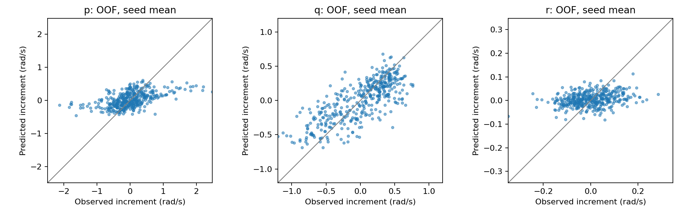

# 参考模型 v16：原始20ms角速度增量诊断

**导数限幅没有触发。p增量幅值偏小且相关性有限；q比p更可预测，但也有明显一步误差。训练内同样存在这些现象，暂不能归因为限幅、长递推或不可预测噪声。保留A1600研究基线。**

## 数据与口径

原407个非重叠父窗口、5个原训练飞行、5折×3个冻结v8 hold模型。每折仅在其4个训练飞行上计算fit，在排除于模型及归一化的第5个飞行上计算OOF。未重训、重新筛选或改变数据划分；未评价739个开发验证窗口，sealed/reserved未访问。OOF已经多次研究，不能称盲测。
本轮是原始窗口起点到20ms后一个点的增量：Δω=ω(t+20ms)−ω(t)。预测和真值共用同一个已观测初值，所以增量误差恰等于首次角速度预测误差。未来实测量只用于评价，不是模型输入。这里的相关性是跨窗口的一步增量相关性，不是1秒波形相关性或控制因果效应。
先对每模型/飞行计算指标；fit中重复出现的源飞行先平均其四个模型，再等权平均飞行和种子。比值/收益也是逐飞行计算后平均，不能由表中两个总体均值相除精确复原。标准差幅值比、相关性、分位数和逐飞行统计均保存在CSV中。

## 首个20ms结果

| cohort | axis | rmse | truth_rms | pred_rms | std_ratio | correlation | sign_agreement | hold_gain |
| --- | --- | --- | --- | --- | --- | --- | --- | --- |
| fit | p | 0.510107 | 0.607238 | 0.232904 | 0.397248 | 0.592949 | 0.711775 | 0.168743 |
| fit | q | 0.253165 | 0.417755 | 0.308722 | 0.737133 | 0.793977 | 0.847012 | 0.39198 |
| fit | r | 0.0805032 | 0.0867637 | 0.030194 | 0.349257 | 0.392944 | 0.480602 | 0.0695175 |
| oof | p | 0.523357 | 0.607238 | 0.230016 | 0.39321 | 0.555312 | 0.68023 | 0.143501 |
| oof | q | 0.280395 | 0.417755 | 0.30482 | 0.72945 | 0.739228 | 0.812143 | 0.325638 |
| oof | r | 0.0845269 | 0.0867637 | 0.0301773 | 0.34943 | 0.28765 | 0.438373 | 0.0216919 |

RMSE、RMS单位rad/s；std_ratio为预测增量标准差/真值标准差，hold_gain为相对保持当前角速度（零增量）的RMSE改善比例。方向一致率只在|真实增量|>0.01rad/s时计算，|预测增量|≤0.01也计为未预测正确；其他指标保留全部窗口，未删除弱响应。这个0.01是报告死区，并非传感器噪声阈值。
OOF p/q增量标准差约为真值39.3%/72.9%，相关系数0.555/0.739，方向一致率68.0%/81.2%。fit也只有39.7%/73.7%、相关0.593/0.794；不能只解释为留出分布变化。p/q仍较保持值改善14.4%/32.6%，说明已有局部可预测信息。r改善仅2.2%，且一个飞行退化，作为对照保留。
幅值偏小不自动支持放大输出：带不确定性的平方误差预测可以出现向条件均值收缩，相关性不足时放大也会放大错误。此次未拟合输出校准，未把事后真值尺度当成可部署增益。

图中每个窗口只出现一次，预测取3种子均值；表中按单个模型先算指标，因此图与表不采用同一集成口径。

## 限幅是否造成瓶颈

| axis | first_saturation | rollout_saturation | truth_exceeds_limit | clamp_oracle_rmse | exceed_error_share |
| --- | --- | --- | --- | --- | --- |
| p | 0 | 0 | 0.003125 | 0.00214906 | 0.0477047 |
| q | 0 | 0 | 0 | 0 | 0 |
| r | 0 | 0 | 0 | 0 | 0 |

模型头先限幅±6，再乘20rad/s²，dt=0.02s，故每步角速度增量界为±2.4rad/s。所有15模型、fit/OOF、全部50步均无角速度头限幅。首步raw head最大绝对值p/q/r约1.634/1.964/0.399，远未达到6。完整递推各轴峰值见verification.json。
只有1/407个独立窗口的真实Δp超过2.4rad/s，q/r没有。表中超限比例按飞行等权，约0.3125%，不是简单的1/407。允许逐点使用真值、仅受这个增量界约束时的理论最小RMSE，p仅0.00215rad/s，远小于实际0.523；这是不可部署的约束诊断下界，不是剩余误差的噪声下界。没有放宽限幅的证据。

## 高频历史与误差

只对起点前26点角速度去均值、加Hann窗，计算单边谱>8Hz的能量RMS与占比。频率栅格约1.923Hz，Nyquist25Hz；该指标受短窗泄漏和已有缓存重采样影响，不能视为原始IMU谱或噪声测量。每轴按当前折4个fit飞行等权三分位定界，再应用OOF，所有窗口保留。

| axis | stratum | rmse | truth_rms | std_ratio | correlation | hold_gain |
| --- | --- | --- | --- | --- | --- | --- |
| p | high | 0.574515 | 0.632879 | 0.332479 | 0.534265 | 0.0839056 |
| p | low | 0.456535 | 0.569214 | 0.405098 | 0.643101 | 0.197695 |
| p | mid | 0.540996 | 0.620148 | 0.420295 | 0.424375 | 0.1189 |
| q | high | 0.282088 | 0.468349 | 0.701173 | 0.817218 | 0.396427 |
| q | low | 0.262574 | 0.356567 | 0.818991 | 0.684949 | 0.250711 |
| q | mid | 0.294471 | 0.411198 | 0.724108 | 0.690342 | 0.2776 |
| r | high | 0.0930064 | 0.0978898 | 0.274066 | 0.36914 | 0.0522436 |
| r | low | 0.0748622 | 0.0737624 | 0.412552 | 0.20938 | -0.0216529 |
| r | mid | 0.0866759 | 0.0900199 | 0.343642 | 0.320074 | 0.0380884 |

p高频RMS高层一步误差0.575、低层0.457rad/s；但绝对误差与历史高频强度的逐飞行Spearman均值仅0.162，5飞行均正，幅度不强。q相应均值仅0.026且跨飞行正负不一致，未支持“高频越大就是主要误差来源”。这里是描述性关联，没有分离工况、信号幅值、采样和真实运动，不能按高频强度删样本或宣称不可预测噪声。
部分p分层在单飞行/模型内仅1个样本，相关性无法定义，CSV保留空值；汇总相关性仅平均可定义组，不对小层作稳定性结论。coverage.csv记录各层样本数和未定义相关数。全体指标每飞行至少64窗口，不受该小层问题影响。

| axis | log_id | hf_error_spearman | correlation | hold_gain |
| --- | --- | --- | --- | --- |
| p | 2026.9.6/log_17_2026-9-6-18-34-06.ulg | 0.145215 | 0.508 | 0.120792 |
| p | 2026.9.6/log_18_2026-9-6-18-46-20.ulg | 0.282523 | 0.508906 | 0.10116 |
| p | 2026.9.6/log_19_2026-9-6-18-52-30.ulg | 0.0199691 | 0.551048 | 0.132789 |
| p | 2026.9.6/log_20_2026-9-6-18-58-10.ulg | 0.222344 | 0.585869 | 0.149652 |
| p | 2026.9.6/log_28_2026-9-6-07-01-38.ulg | 0.141923 | 0.622738 | 0.213115 |
| q | 2026.9.6/log_17_2026-9-6-18-34-06.ulg | -0.0763597 | 0.80297 | 0.390716 |
| q | 2026.9.6/log_18_2026-9-6-18-46-20.ulg | -0.0188293 | 0.661517 | 0.24456 |
| q | 2026.9.6/log_19_2026-9-6-18-52-30.ulg | 0.102987 | 0.756446 | 0.340935 |
| q | 2026.9.6/log_20_2026-9-6-18-58-10.ulg | 0.12091 | 0.708855 | 0.292474 |
| q | 2026.9.6/log_28_2026-9-6-07-01-38.ulg | 0.00255947 | 0.766351 | 0.359506 |
| r | 2026.9.6/log_17_2026-9-6-18-34-06.ulg | 0.0949839 | 0.317521 | 0.0492373 |
| r | 2026.9.6/log_18_2026-9-6-18-46-20.ulg | 0.266379 | 0.336482 | 0.0447464 |
| r | 2026.9.6/log_19_2026-9-6-18-52-30.ulg | -0.0776895 | 0.396038 | 0.0763371 |
| r | 2026.9.6/log_20_2026-9-6-18-58-10.ulg | 0.110287 | 0.254076 | 0.0346474 |
| r | 2026.9.6/log_28_2026-9-6-07-01-38.ulg | 0.337858 | 0.134134 | -0.0965089 |

## 原有扑频层

| stratum | rmse | truth_rms | std_ratio | correlation | hold_gain |
| --- | --- | --- | --- | --- | --- |
| high | 0.272011 | 0.472985 | 0.685829 | 0.836575 | 0.423485 |
| low | 0.275019 | 0.33434 | 0.877909 | 0.591885 | 0.144966 |
| mid | 0.296495 | 0.424104 | 0.713845 | 0.716494 | 0.292434 |

沿用v12 q历史扑频层：低/高层20ms绝对误差相近（0.275/0.272），但真值增量RMS为0.334/0.473，相关性0.592/0.837，相对保持值改善14.5%/42.3%。说明低频层相对预测困难仍在；不能简单说低频层每个时刻绝对误差都更大，也不能由关联推出频率因果机制。

## 验证与下一步

4项针对性测试通过；30组完整冻结预测重放、首步及50步head→增量重构、30组独立单步推理、原始标签/历史频谱/fit分层阈值复算、407个OOF唯一性、v15首次20ms误差逐飞行逐种子复现和源哈希核验通过。原始数据、权重、模型限幅均未修改。
下一步应冻结“相同输入和同折模型，专门优化20ms单步目标”的对照，保留原1秒训练模型与保持值基线。先看训练内和OOF一步误差能否同时改善，再评价相同1秒完整递推与其他状态是否退化，用来区分长时域训练目标的取舍与当前历史/表示的局限。预算、初始化、样本及归一化固定，不根据查询结果调参。
这是一项新的诊断对照，尚未执行。即便一步改善，也不等于1秒模型或控制作用验收通过；若训练内改善而OOF无收益，应报告泛化差距，不能继续把训练收益当控制能力。本轮不修改限幅、不按响应强弱删除窗口，不能据此认定必须补飞。
