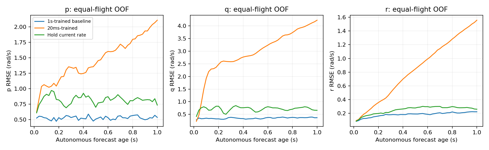

# 参考模型 v17：单步训练目标对照

**15组训练已完成。训练内单步p/q大幅改善，但OOF联合指标退化5.04%；其中q改善20.44%，p退化18.70%。完整1秒递推显著退化，所有30项长期保护检查均失败，不晋升新模型，保留A1600。**

## 固定与改动

保持原407个非重叠窗口、5个原训练飞行、5外层折×3种子、同折归一化、GRU64/40070参数、单位和导数限幅。每组从与v8 hold完全一致的初始参数开始，并复用同一1600×32抽样索引；AdamW学习率3e-4、weight_decay1e-4、梯度裁剪1不变，固定最后checkpoint。
唯一实验因素是训练时域：沿用归一化角速度＋速度＋0.2姿态损失，只评价原起点20ms后的一个目标；保留完整H26历史，解码器只运行1步。未把其他49步改作教师强制样本、未增加起点、未删除弱响应窗口。评价时仍原样自主递推50步，未来只给计划参考。
“同预算”指相同更新次数和窗口抽样次数，并非同FLOPs、目标点数或梯度传播长度。不同状态的形式权重相同，但只观察20ms会改变实际优化取舍。baseline为同折v8的1秒训练模型，single为本轮20ms训练模型，persistence只保持当前观测。
训练内fit与OOF分开；OOF查询飞行不参与该折模型和归一化，但这些飞行已多次用于研究，不是未开封测试。未评价739个开发验证窗口，未访问sealed/reserved，未启动控制优化。

## 单步及整段预测结果

每飞行先求RMSE，重复fit模型先按源飞行平均，再等权平均飞行和种子。prefix=1.0s表示完整50点波形RMSE，而非仅终点。角速度rad/s、速度分量RMSE m/s；下表姿态单位deg。

| cohort | arm | horizon_s | p | q | r | velocity | attitude_deg |
| --- | --- | --- | --- | --- | --- | --- | --- |
| fit | baseline | 0.02 | 0.510107 | 0.253165 | 0.0805032 | 0.0909146 | 0.417617 |
| fit | baseline | 1 | 0.483998 | 0.255902 | 0.130317 | 0.3227 | 3.28621 |
| fit | persistence | 0.02 | 0.607238 | 0.417755 | 0.0867637 | 0.135253 | 0.890159 |
| fit | persistence | 1 | 0.824195 | 0.721406 | 0.256721 | 0.828293 | 10.7589 |
| fit | single | 0.02 | 0.089937 | 0.0762715 | 0.0682323 | 0.0946533 | 0.446763 |
| fit | single | 1 | 1.53253 | 3.09729 | 0.91728 | 2.59586 | 54.1559 |
| oof | baseline | 0.02 | 0.523357 | 0.280395 | 0.0845269 | 0.0943264 | 0.422053 |
| oof | baseline | 1 | 0.531633 | 0.352311 | 0.188063 | 0.413012 | 5.9102 |
| oof | persistence | 0.02 | 0.607238 | 0.417755 | 0.0867637 | 0.135253 | 0.890159 |
| oof | persistence | 1 | 0.824195 | 0.721406 | 0.256721 | 0.828293 | 10.7589 |
| oof | single | 0.02 | 0.621226 | 0.223072 | 0.0952102 | 0.107803 | 0.48726 |
| oof | single | 1 | 1.52078 | 3.11376 | 0.955146 | 2.57695 | 53.8975 |

首20ms的p/q联合指标（两轴RMSE等权）训练内改善78.22%，OOF却退化5.04%，3个种子都退化，仅2/5飞行改善，未通过冻结的至少5%改善、3种子同正、至少4飞行同正门槛。
OOF p：0.52336→0.62123rad/s（退化18.70%）；q：0.28040→0.22307（改善20.44%）；r：0.08453→0.09521。训练内p/q：0.51011/0.25316→0.08994/0.07627。p的训练与留出差距扩大，表明更强局部拟合并未转成跨飞行收益；这不能证明剩余误差不可预测。
q在5/5飞行、3/3种子均改善，是后续实验线索；没有据此把预定p/q联合失败改判成功。逐飞行/种子收益：

| group | identity | p | q | r |
| --- | --- | --- | --- | --- |
| log_id | 2026.9.6/log_17_2026-9-6-18-34-06.ulg | -0.259203 | 0.182432 | -0.147281 |
| log_id | 2026.9.6/log_18_2026-9-6-18-46-20.ulg | -0.0479857 | 0.257311 | -0.113585 |
| log_id | 2026.9.6/log_19_2026-9-6-18-52-30.ulg | -0.151642 | 0.218804 | -0.110336 |
| log_id | 2026.9.6/log_20_2026-9-6-18-58-10.ulg | 0.0195243 | 0.237892 | -0.0901058 |
| log_id | 2026.9.6/log_28_2026-9-6-07-01-38.ulg | -0.736333 | 0.123524 | -0.177684 |
| seed | 17 | -0.187423 | 0.175156 | -0.110514 |
| seed | 23 | -0.195584 | 0.211903 | -0.125965 |
| seed | 42 | -0.17802 | 0.224899 | -0.142795 |

## 幅值恢复并不等于预测正确

| cohort | arm | axis | std_ratio | correlation | sign_agreement |
| --- | --- | --- | --- | --- | --- |
| fit | baseline | p | 0.397248 | 0.592949 | 0.711775 |
| fit | baseline | q | 0.737133 | 0.793977 | 0.847012 |
| fit | baseline | r | 0.349257 | 0.392944 | 0.480602 |
| fit | single | p | 0.983412 | 0.988531 | 0.936116 |
| fit | single | q | 0.974687 | 0.982935 | 0.957607 |
| fit | single | r | 0.501043 | 0.624359 | 0.636326 |
| oof | baseline | p | 0.39321 | 0.555312 | 0.68023 |
| oof | baseline | q | 0.72945 | 0.739228 | 0.812143 |
| oof | baseline | r | 0.34943 | 0.28765 | 0.438373 |
| oof | single | p | 1.04649 | 0.501556 | 0.635504 |
| oof | single | q | 0.936193 | 0.855026 | 0.867905 |
| oof | single | r | 0.522755 | 0.10896 | 0.431806 |

训练内p/q预测增量标准差恢复到真值98.3%/97.5%，相关性0.989/0.983。OOF p幅值比从0.393到1.046，但相关性从0.555降至0.502，方向一致率从68.0%降至63.6%；这直接说明“幅值变大”不是足够的成功标准。OOF q幅值比0.729→0.936、相关0.739→0.855、方向一致率81.2%→86.8%，这条局部改善更完整。
方向统计沿用|真实增量|>0.01rad/s，近零预测计为未预测正确；其他指标保留全部窗口。相关性是跨窗口20ms增量相关性，不是控制因果作用认证。

## 自主递推保护失败

OOF完整1秒p/q/r RMSE由0.532/0.352/0.188升至1.521/3.114/0.955rad/s；速度0.413→2.577m/s，姿态0.103→0.941rad（约5.91→53.90deg）。不仅训练外差，fit的1秒结果也显著退化。虽然所有输出仍有限，不能把“能跑完50步”当成稳定或可信。
3种子×2时域（0.5/1s）×5状态指标的30项保护检查全部未满足不超过5%退化要求；0.5s端点绝对阈值也失败。该单步目标没有训练解码器在多步预测状态分布上保持准确，结果支持存在明显的时域取舍，但不能仅据此锁定唯一架构原因。

本轮OOF各模型整个50步角速度头仍未触发限幅；训练内少量p首步触界（单模型最高0.323%），对应原来可见的极端增量。完整统计保存在saturation.csv。没有通过放宽限幅改善递推的依据。

## 验证与交付

3项针对性测试通过；15模型初始化/抽样逐项配对，归一化按模型float32表示精确复核，初始化及训练后首步截断/完整前缀损失梯度一致。30组checkpoint完整重放、15模型未来参考前缀因果检查、v16首20ms角速度指标复现、训练完成哈希与全部有限性检查通过。
归一化审计最初将float32模型缓冲直接与float64原统计按固定绝对容差比较，出现4.45e-7舍入差；已改成精确比较原统计的float32转换，数据与归一化没有修改。姿态评价统一先归一化四元数，再用符号不变弦长角距离，避免20ms尺度的float32范数误差；两组使用同一口径，不更改训练损失。
模型：fold*/seed*/final.pt；配对样本：sample_draws.npz；完整预测：fit_predictions.npz/oof_predictions.npz；协议、决策、每飞行/种子收益与绝对阈值检查均保留。此处保存的是失败的研究候选，不能用于替换控制模型。

## 下一步

更有依据的下一项单因素实验是：保留原完整1秒损失，只添加首20ms的q辅助损失，冻结一个系数并继续同折配对，检验能否保留q局部收益且不损伤p和长递推。不要把所有轴继续改成纯单步训练，也不要直接把当前q预测拼接进基线而跳过递推与姿态积分检查。
这一建议来自已经查看过的OOF，后续仍属开发研究，必须重新冻结协议、共同评价原始窗口并保持长期保护和绝对验收；不能把事后单轴成功宣称为整个控制模型通过。p目前更需要定位跨飞行泛化，而不是只追求训练误差下降。新辅助损失实验尚未执行，现有证据也没有证明必须补飞。
