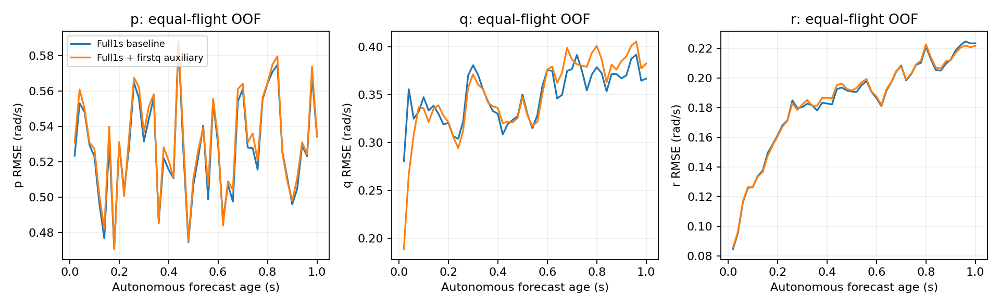

# 参考模型 v18：完整递推损失＋首步q辅助损失

**15组候选与1组零权重复现全部完成。首20ms q的OOF改善为32.64%；状态保护未通过，参考敏感性保护未通过，绝对预测阈值未通过。本轮未晋升控制模型。**

## 冻结实验

仍使用407个原训练父窗口、5外层飞行折×种子17/23/42。保持H26、50Hz、K50、40070参数、同折归一化、初始参数、1600×32抽样索引、AdamW3e-4/weight_decay1e-4/梯度裁剪1和最终checkpoint规则。模型与推理路径、导数限幅均未变，没有新窗口、筛样本或未来测量输入。
损失固定为 L = L原完整50步 + (1/3)·mean_batch[((q预测首步−q真实首步)/q_scale)²]。没有缩短完整递推或归一化总损失。额外项系数等于原损失中整段平均q项系数；逐点q平方误差系数从首步1/150变成51/150，其余49步仍为1/150，总名义q权重加倍。并非只给首步乘一个轻微权重，也不是已知最优系数；本轮不搜索其他系数。
从v17的q线索预先选定单轴主指标，不再使用v17的p/q联合指标；这次切换写入训练前协议。其他轴仍受保护，共享网络可能改变全部输出。0权重复现fold0/seed17的最终参数必须与v8基线一致；实际最大差见verification.json。
数据/模型查询边界不变：fit为训练内，OOF飞行排除于其模型与归一化，但已被多轮研究查看，不是盲测。未评价739个开发验证窗口，未访问sealed/reserved；未启动控制优化或实飞。

## 首步与完整1秒误差

先按飞行/模型计算RMSE，再等权平均源飞行与种子，fit重复模型先按源飞行平均。prefix=1s为完整50点误差而非终点；角速度rad/s，速度分量m/s，表中姿态deg。

| cohort | arm | horizon_s | p | q | r | velocity | attitude_deg |
| --- | --- | --- | --- | --- | --- | --- | --- |
| fit | aux | 0.02 | 0.515576 | 0.0783165 | 0.0807757 | 0.0906915 | 0.421238 |
| fit | aux | 1 | 0.487571 | 0.243299 | 0.134851 | 0.330713 | 3.44073 |
| fit | baseline | 0.02 | 0.510107 | 0.253165 | 0.0805032 | 0.0909146 | 0.417617 |
| fit | baseline | 1 | 0.483998 | 0.255902 | 0.130317 | 0.3227 | 3.28621 |
| oof | aux | 0.02 | 0.530822 | 0.188868 | 0.0856215 | 0.0936271 | 0.428497 |
| oof | aux | 1 | 0.535059 | 0.354378 | 0.18855 | 0.42065 | 6.06609 |
| oof | baseline | 0.02 | 0.523357 | 0.280395 | 0.0845269 | 0.0943264 | 0.422053 |
| oof | baseline | 1 | 0.531633 | 0.352311 | 0.188063 | 0.413012 | 5.9102 |

首20ms q：fit改善69.07%，OOF改善32.64%；OOF有5/5飞行、3/3种子改善。预设主门槛为至少5%、全部种子同正、至少4飞行同正；结果为通过。

| group | identity | p | q | r | velocity | attitude |
| --- | --- | --- | --- | --- | --- | --- |
| log_id | 2026.9.6/log_17_2026-9-6-18-34-06.ulg | -0.00770316 | 0.309681 | -0.049874 | 0.0141693 | -0.000621347 |
| log_id | 2026.9.6/log_18_2026-9-6-18-46-20.ulg | -0.0142924 | 0.338478 | -0.00965788 | 0.0150681 | -0.0293448 |
| log_id | 2026.9.6/log_19_2026-9-6-18-52-30.ulg | -0.0295896 | 0.392536 | -0.0159606 | 0.0227636 | -0.0379795 |
| log_id | 2026.9.6/log_20_2026-9-6-18-58-10.ulg | -0.026135 | 0.414861 | -0.00314724 | 0.00983432 | 0.00575854 |
| log_id | 2026.9.6/log_28_2026-9-6-07-01-38.ulg | 0.0176213 | 0.172789 | 0.0107602 | -0.0281145 | -0.0289103 |
| seed | 17 | -0.0150723 | 0.32425 | -0.0126776 | -0.00228672 | -0.0228982 |
| seed | 23 | -0.0110236 | 0.325985 | -0.014459 | 0.0136118 | -0.0132976 |
| seed | 42 | -0.0166921 | 0.328935 | -0.0116972 | 0.0105562 | -0.00970895 |

数值为相对原基线改善比例，负值表示退化；按种子/飞行分别报告，不能只挑改善的窗口。

| cohort | arm | axis | std_ratio | correlation | sign_agreement |
| --- | --- | --- | --- | --- | --- |
| fit | aux | p | 0.39358 | 0.571982 | 0.68976 |
| fit | aux | q | 0.970717 | 0.982145 | 0.957692 |
| fit | aux | r | 0.33816 | 0.375953 | 0.461716 |
| fit | baseline | p | 0.397248 | 0.592949 | 0.711775 |
| fit | baseline | q | 0.737133 | 0.793977 | 0.847012 |
| fit | baseline | r | 0.349257 | 0.392944 | 0.480602 |
| oof | aux | p | 0.390194 | 0.525064 | 0.672821 |
| oof | aux | q | 0.944017 | 0.892627 | 0.896109 |
| oof | aux | r | 0.332208 | 0.24737 | 0.416115 |
| oof | baseline | p | 0.39321 | 0.555312 | 0.68023 |
| oof | baseline | q | 0.72945 | 0.739228 | 0.812143 |
| oof | baseline | r | 0.34943 | 0.28765 | 0.438373 |

增量幅值比与相关性为跨窗口20ms统计，方向统计沿用真实增量绝对值>0.01rad/s，近零预测计为未预测正确。它们不是执行器舵效或真实参考反事实的验证。

## 长期与其他状态保护

冻结保护共42项：3种子×5状态×0.5/1秒完整前缀共30项，另有首20ms的p/r/速度/姿态共12项，每项允许最多5%退化。全部输出有限；有限性只是数值检查，不是控制稳定性。
保护失败2/42项，详情如下：

| seed | kind | horizon_s | metric | baseline | aux | gain |
| --- | --- | --- | --- | --- | --- | --- |
| 23 | prefix | 0.5 | attitude | 0.0686279 | 0.0726873 | -0.0591507 |
| 23 | prefix | 1 | attitude | 0.102531 | 0.108608 | -0.0592627 |

0.5s端点绝对阈值仍为每种子p/q/r≤0.15rad/s、速度≤0.5m/s、姿态≤3deg；结果保存在absolute_checks.csv。所有原预测和训练曲线保留，没有通过选择中间checkpoint或修改门槛获得结果。

## 参考输入敏感性保护

比较相同OOF起点下的日志计划参考与将5个参考通道保持首值的预测。q整段1秒参考收益定义为1−实际参考预测RMSE/保持参考预测RMSE，effect为两组预测差的RMS。按飞行等权，要求每种子收益下降不超过0.02、effect相对原模型比例在[0.9,1.1]。

| seed | utility_change | effect_ratio | passes |
| --- | --- | --- | --- |
| 17 | -0.0195684 | 1.0425 | True |
| 23 | 0.00171187 | 1.14347 | False |
| 42 | 0.00199741 | 1.22502 | False |

这只约束模型对已记录参考的敏感性和预测收益，不是真实飞行反事实证据；即使比例接近旧模型，也不能证明控制正确。

## 验证与交付

6项针对性测试通过，覆盖零辅助项恢复旧损失/梯度、首q直接梯度系数51及其余输出直接梯度不变、后续目标仍进入完整损失、稳定四元数角距离。16组完成检查、零权重全程训练复现、15组初始化/抽样/归一化配对、30组完整checkpoint重放、15组保持参考重载、参考前缀因果性、v17基线全部指标与源哈希核验完成。
训练前冻结的评价脚本在静态复核时发现候选CSV列名沿用single而检查读取aux；保留原脚本，evaluation_amendment.json记录只改列名的更正脚本及哈希。修复发生于读取本轮结果前，未改指标、权重、门槛、数据或训练。
候选在fold*/seed*/final.pt；零权重复现在fold0/identity；原始抽样、完整预测、参考保持预测、逐飞行/种子指标、协议与判定均随交付清单保存。

## 结论与下一步

本轮证明了一个有限但可重复的结果：在保留完整递推损失的条件下，加强首步q监督能提高原始起点附近的预测。OOF q首20ms误差0.280395→0.188868rad/s，改善32.64%，5/5飞行、3/3种子均正；训练内改善69.07%。增量相关性0.739→0.893，幅值比0.729→0.944，方向一致率81.2%→89.6%。这些指标共同改善，不是只有幅值变大。

但收益尚未延伸到需要的完整时域：40ms的q端点误差0.3557→0.2669（约25.0%改善），60ms为0.3250→0.3085（约5.1%），100ms为0.3474→0.3359（约3.3%），200ms已基本无收益。完整1秒q波形误差0.35231→0.35438，略退化0.59%。首20ms本来就是新损失显著加强的位置，不能把该端点的进步称为整个1秒模型的改善。

相较v17的纯单步训练，这次避免了数量级明显的递推退化；但冻结保护仍有2/42项失败：种子23的姿态完整前缀误差在0.5/1秒退化5.92%/5.93%，超出5%界限。其余40项状态保护通过，包括首步p/r/速度/姿态。不能把小幅超界解释成自动获准，也没有选择表现较好的种子单独晋升。

参考保持对照显示，q对计划参考变化的输出差幅度相对基线分别为1.042、1.143、1.225倍；种子23/42超出预设[0.9,1.1]区间。参考预测收益下降限值三个种子均通过，但幅度保护并非真实飞机的舵效范围；它只是本轮防止模型敏感性漂移的研究约束。幅度增长本身不能证明真实控制作用增强，也不能直接断言真实响应变错。

0.5秒绝对预测验收仍未通过，p的完整1秒误差也基本未改善（0.53163→0.53506rad/s）。因此保留A1600作为研究基线，v18仅保留为局部q改善的研究候选，不进入控制优化，不进行全407重训或开发验证扩展。

下一步更适合先用这15组冻结模型定位两个具体问题：q收益为何在40–100ms快速减弱，以及种子23姿态和两个种子参考敏感性的退化发生在哪些飞行、预测年龄和参考变化区间。对相同完整窗口做配对的逐时刻误差、均值/幅值/波形分解及角速度到姿态的积分审计，不依结果筛掉困难窗口，也不立即再搜索辅助权重。若局部改善只是对周期运动的短时延续，不能将它当作控制作用更可信的证据；p的主要瓶颈也应继续单独定位。该后续诊断尚未执行。

