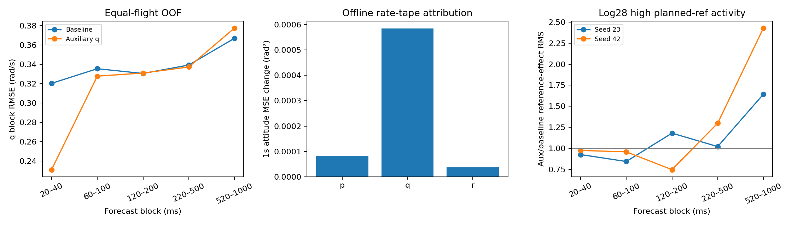

# 参考模型 v19：局部收益、姿态与参考敏感性定位

**q首步收益被后半秒新增误差抵消；姿态保护失败主要定位到seed23的log_18，参考敏感性增长主要定位到log_28的高参考变化层。独立积分与模型输出一致，未发现积分实现错误。此次仅诊断，不改变v18未晋升的决定。**

## 范围与方法

原407个非重叠父窗口、5外层飞行折、3种子，冻结v8 hold与v18辅助损失模型；fit和OOF均保留。固定时间段20–40、60–100、120–200、220–500、520–1000ms，另报完整1秒。没有重训、调权重、增加起点或按误差删除窗口，未评价开发验证、未访问sealed/reserved。OOF已多次研究，不称盲测。
先对每窗口做精确MSE分解，再在每飞行/模型平均，fit重复模型按源飞行平均后等权汇总。归因在MSE空间保持可加性；报告的RMSE仍先逐飞行求根再平均，所以MSE贡献比例不是RMSE下降比例。短到2点的时间块可以作代数分解，但不能据此识别频率或物理时延。

## q收益为何没有保留到1秒

| block | baseline_rmse | aux_rmse | gain | weighted_mse_delta | total_mse | bias_mse | amplitude_mse | shape_mse |
| --- | --- | --- | --- | --- | --- | --- | --- | --- |
| 20_40ms | 0.320377 | 0.231257 | 0.278174 | -0.00193185 | -0.0482963 | -0.0462294 | -0.00174839 | -0.000318523 |
| 60_100ms | 0.335498 | 0.327819 | 0.0228889 | -0.000324113 | -0.00540188 | 0.0039952 | -0.00502709 | -0.00436999 |
| 120_200ms | 0.330593 | 0.331002 | -0.00123911 | 8.54336e-05 | 0.000854336 | 0.00512979 | -0.00315752 | -0.00111793 |
| 220_500ms | 0.339268 | 0.337294 | 0.00581739 | -0.000408732 | -0.00136244 | 0.000762118 | -0.000142177 | -0.00198238 |
| 520_1000ms | 0.366897 | 0.377454 | -0.0287744 | 0.00467151 | 0.00934302 | 0.00560186 | -0.000843678 | 0.00458483 |
| full1s | 0.352311 | 0.354378 | -0.00586797 | 0.00209225 | 0.00209225 | 0.00193346 | -5.22888e-05 | 0.000211076 |

表中total_mse/bias_mse/amplitude_mse/shape_mse为“辅助模型−基线”的变化，负值是改善；weighted_mse_delta按该时间块在50个目标点中的占比加权。20–40ms块RMSE 0.3204→0.2313，早期2点的MSE改善对全时域贡献约−0.00193(rad/s)²；520–1000ms的25点反而贡献约+0.00467，足以抵消前段收益。
完整1秒新增MSE约0.00209，其中窗口均值偏差项增加约0.00193（约92%净增量）；这描述的是新增误差，不是原有总误差的92%。原有总体误差仍主要包含波形项。后半秒同时出现均值偏差和波形项增加，不能只按预测幅值放大或把它称为统一时延。
偏差项是各窗口内的平均误差平方，不代表全数据有一个可以统一减去的常量；不同窗口会正负抵消。完整逐飞行和逐窗口分解保存在q_decomposition_per_flight.csv及q_decomposition_per_window.csv。

## 姿态积分与误差来源

独立numpy float64中点积分从相同观测初值出发，重建全部60组模型/队列的姿态；与保存四元数的最大角距离为1.91e-06rad。因此没有发现姿态更新实现或索引不一致足以解释这次退化。用未来记录角速度积分的1秒姿态一致性RMSE约0.0212rad，仍有采样/估计链差异；它是使用未来真值的离线一致性检查，不能当成部署预测或不可约误差下界。
将基线/辅助模型的预测角速度序列做全部8种p/q/r组合后重新积分，按Shapley平均分配非线性相互作用；再对前5点（20–100ms）和后45点做4种组合。仅替换已生成序列，不反馈到GRU，不构成可运行混合模型或网络因果机制识别。每次分配之和严格等于辅助与基线的姿态MSE差。

| log_id | baseline_rmse | aux_rmse | delta_mse | p | q | r | rmse_gain |
| --- | --- | --- | --- | --- | --- | --- | --- |
| 2026.9.6/log_17_2026-9-6-18-34-06.ulg | 0.0944271 | 0.0950393 | 0.000115991 | 9.43812e-05 | -0.000216418 | 0.000238027 | -0.00648328 |
| 2026.9.6/log_18_2026-9-6-18-46-20.ulg | 0.112701 | 0.141278 | 0.00725794 | 0.00104846 | 0.00608629 | 0.000123187 | -0.253563 |
| 2026.9.6/log_19_2026-9-6-18-52-30.ulg | 0.0779349 | 0.0762838 | -0.000254627 | 8.17029e-06 | -4.17541e-05 | -0.000221043 | 0.0211853 |
| 2026.9.6/log_20_2026-9-6-18-58-10.ulg | 0.0833201 | 0.083376 | 9.31114e-06 | 0.000173363 | 1.39633e-05 | -0.000178015 | -0.000670389 |
| 2026.9.6/log_28_2026-9-6-07-01-38.ulg | 0.144274 | 0.147061 | 0.000812124 | 0.000521065 | 5.13822e-05 | 0.000239676 | -0.0193216 |

seed23的log_18完整1秒姿态RMSE 0.1127→0.1413rad（退化25.36%），贡献该种子5飞行净姿态MSE增量约91.4%。在这个飞行内，q序列归因约83.9%，后45个端点归因约86.2%。轴与时间是两种分别完备的分配，百分比不能相加。这说明后续q预测与该保护失败密切相关，不能仅归咎于修正了首20ms。
全种子等权的1秒姿态新增MSE约0.000706rad²，q序列贡献约0.000585；后45个端点贡献约0.000589。各飞行也可能出现负贡献抵消，完整表保留所有种子，未只看seed23。

## 参考敏感性增长集中在哪里

仍比较原计划参考与所有5通道保持第一个计划值的预测。按每折训练归一化，把完整计划参考的相邻变化RMS分为低/中/高层，阈值只由该折4个fit飞行的等权三分位确定，OOF不参与定界。该分层使用已知完整计划，不使用未来运动结果；是离线描述，不能冒充只知道当前信息的在线可信度判据。

| seed | log_id | effect_ratio | baseline_effect | aux_effect | delta_effect_mse | utility_change |
| --- | --- | --- | --- | --- | --- | --- |
| 23 | 2026.9.6/log_17_2026-9-6-18-34-06.ulg | 1.06043 | 0.159765 | 0.169419 | 0.00317801 | 0.00345064 |
| 23 | 2026.9.6/log_18_2026-9-6-18-46-20.ulg | 1.01967 | 0.157193 | 0.160284 | 0.000981539 | 0.00210366 |
| 23 | 2026.9.6/log_19_2026-9-6-18-52-30.ulg | 1.09794 | 0.234275 | 0.257219 | 0.0112771 | -0.0118176 |
| 23 | 2026.9.6/log_20_2026-9-6-18-58-10.ulg | 1.02429 | 0.154604 | 0.15836 | 0.00117548 | 0.00510202 |
| 23 | 2026.9.6/log_28_2026-9-6-07-01-38.ulg | 1.37819 | 0.263374 | 0.362981 | 0.062389 | 0.0097206 |
| 42 | 2026.9.6/log_17_2026-9-6-18-34-06.ulg | 1.05815 | 0.166042 | 0.175696 | 0.00329945 | 0.00300659 |
| 42 | 2026.9.6/log_18_2026-9-6-18-46-20.ulg | 1.01183 | 0.15809 | 0.159961 | 0.000594925 | -0.0192929 |
| 42 | 2026.9.6/log_19_2026-9-6-18-52-30.ulg | 1.04029 | 0.246881 | 0.256828 | 0.0050102 | 0.0144255 |
| 42 | 2026.9.6/log_20_2026-9-6-18-58-10.ulg | 1.02166 | 0.158057 | 0.161481 | 0.00109395 | 0.0161363 |
| 42 | 2026.9.6/log_28_2026-9-6-07-01-38.ulg | 1.78908 | 0.246719 | 0.441399 | 0.133963 | -0.00428843 |

log_28在seed23/42的参考输出差RMS分别增至基线1.378/1.789倍；对应五飞行等权的差异能量净增量约79.0%/93.1%来自这个飞行。这里的能量分配是平方RMS空间，不是原参考保护中平均RMS比例的百分比分解。
log_28共81窗口，高参考变化层28个、中层31个、低层22个，未丢弃任一层。主要放大在高层和后半秒：520–1000ms高层差异RMS比为seed23的1.643和seed42的2.429；中低层的变化较小，部分抵消。全数据分层每飞行/模型最小16窗口，计数见reference_coverage.csv。

| seed | block | windows | baseline_effect | aux_effect | effect_ratio | utility_change |
| --- | --- | --- | --- | --- | --- | --- |
| 23 | 120_200ms | 28 | 0.0392922 | 0.0463586 | 1.17984 | 0.0105968 |
| 23 | 20_40ms | 28 | 0.00676568 | 0.0062612 | 0.925435 | -0.000394998 |
| 23 | 220_500ms | 28 | 0.147739 | 0.150764 | 1.02047 | 0.039693 |
| 23 | 520_1000ms | 28 | 0.459704 | 0.755382 | 1.64319 | 0.00110732 |
| 23 | 60_100ms | 28 | 0.034852 | 0.0293841 | 0.843111 | -0.0074304 |
| 23 | full1s | 28 | 0.335323 | 0.540729 | 1.61256 | 0.0207718 |
| 42 | 120_200ms | 28 | 0.0939056 | 0.0700653 | 0.746124 | -0.00912699 |
| 42 | 20_40ms | 28 | 0.0102185 | 0.00995656 | 0.974366 | 0.00227911 |
| 42 | 220_500ms | 28 | 0.188649 | 0.244928 | 1.29833 | -0.0966202 |
| 42 | 520_1000ms | 28 | 0.396509 | 0.963163 | 2.42911 | 0.0260863 |
| 42 | 60_100ms | 28 | 0.0484958 | 0.0464697 | 0.958221 | -0.00955445 |
| 42 | full1s | 28 | 0.300521 | 0.694595 | 2.3113 | 0.0258345 |

高层包含多种参考通道变化；本轮没有区分是哪一通道触发，也没有证明真实飞机需要更强或更弱的控制作用。对同一真值评价保持参考是模型诊断，日志里没有对应的真实反事实飞行。尤其首20ms两条预测的参考输入相同，首步精度改善不能直接证明未来参考变化的控制响应更真实。

## 可追溯片段与验证

review_windows.csv保留seed23/log_18的全部78个窗口，以及seed23/42/log_28的全部81个窗口和所有参考层，包含window_id、array_index、origin_index、原始起止timestamp_us、模式和配对指标。时间戳沿用PX4日志时钟，不转换成文件开头的相对秒数。该表只是事后复核索引，没有生成新的训练选择或删除集合；全部407窗口仍在原逐窗口表中。
5项测试覆盖积分方向/初值/符号、含相互作用的精确分配、时间替换与输入活动度。60组独立姿态重建、15组v18参考保持预测复现、原参考指标与原姿态逐飞行指标复现、407个OOF唯一性、时间块MSE加权恒等式、Shapley可加性、后段替换不改变前100ms及fit分层阈值复算均通过。

## 下一步

继续保留A1600，v18仍是局部q改善候选。下一项应先把log_28高参考变化窗口的参考保持对照拆到滚转、俯仰、推力等单独通道，并核对它们在该折训练飞行中的支持范围；同时检查log_18的持续q偏差与参考/历史条件是否有关。所有窗口共同评价，局部对照只用于定位，不把这些飞行作为应当删除的异常。
这样才能判断后续应约束长时均值、参考敏感性，还是处理输入支持与泛化。现在直接降低辅助权重、拼接预测或删掉这两个飞行，都不能算完成控制模型验收。该通道拆解尚未执行，本轮也没有证明必须补飞。
