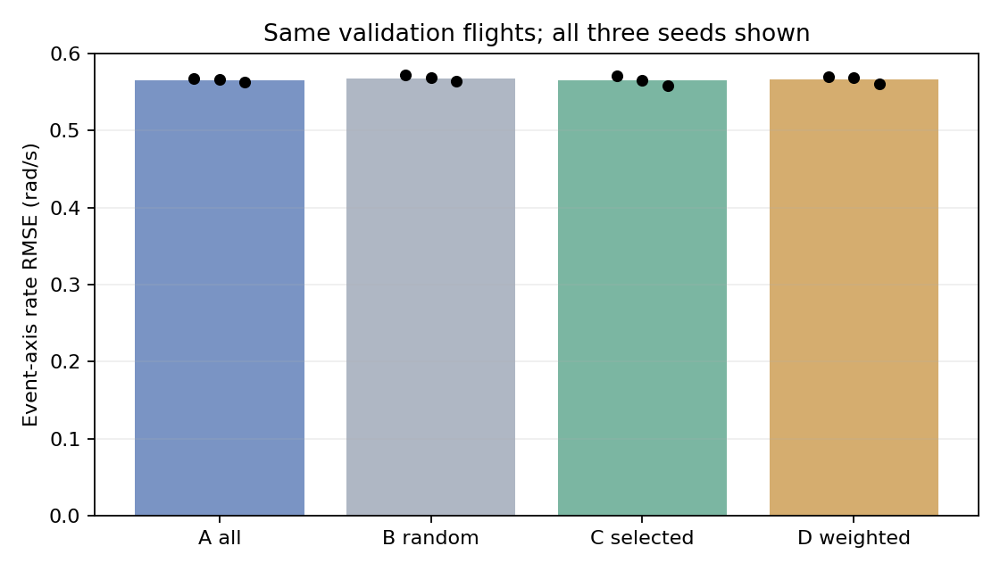

# 控制导向非重叠数据与四组训练 v2

执行日期：2026-09-27；分支 `reference-dynamics-data-v1`。12/12 次固定预算训练完成。G1 结论以 [评价汇总](evaluation/summary.json) 为准；未取得控制设计晋升资格。sealed/reserved 未打开。

## 数据与窗口

- 同记录固件/控制配置的 14 个飞行、66 个连续片段，共 **2208.32 秒（36.81 分钟）**；兼有 Mission 和 Stabilized。该组 Mission 的记录目标类型是 loiter，不能称直线航段。
- 连续片段均值 33.46 秒，P05/P25/P50/P75/P95 为 2.62/7.27/26.82/45.12/82.97 秒；最长 150.12 秒。按 10 秒管理块切分，保留尾段，共 254 块。原连续片段和跨块事件关系仍保留。
- 从输入变化事件出发，按时间顺序安放，再以固定网格填充背景，得到 **1146 个完整支撑区间互不重叠的 H26/K50 样本**。每个支撑区间从 t0−0.52 秒到 t0＋1 秒，共 1.52 秒；包括 77 个 20ms 采样点。所有样本逐一从源缓存重提取并核对成功。
- 窗口支撑跨度累计 1741.92 秒（29.03 分钟）；按采样格计覆盖 1764.84 秒，未使用采样格 444.80 秒。两种口径相差每窗一个 20ms 端点，不能混算覆盖率。
- 同日志相邻原片段间隙中位数 1.08 秒，均值 1.23 秒，P95 1.89 秒；相邻最终窗口支撑间隙中位数 0.18 秒，P95 1.68 秒，最小 0.02 秒。**没有共享采样点不等于统计独立**，推断与置信区间均以飞行为聚类单位。
- [窗口清单](windows_v2.csv)、[连续片段](segments_v2.csv)、[管理块](blocks_v2.csv)、[详细审计](audit/summary.json)、[条件范围](audit/conditions.json)、[输入变化相关性](audit/input_increment_correlations.json)。

筛选不使用输出响应方向、响应强弱、预测误差或单个风估计值。Q3 首版仅标识记录舵面命令接近限幅（绝对值≥0.98），不代表已经识别全部扰动和困难工况。执行命令变化另作诊断，不用于按“是否听话”筛选。

## 划分与实际对照强度

描述性筛选保留汇总视图；正式训练沿用原有整飞行归属，没有依据结果重分配：5 个训练飞行（407 窗口），9 个开发验证飞行（739 窗口）。验证日志此前已被查看，不称新盲测。这次没有做共享 flight 的块级划分；训练比验证少是原同配置可用数据归属造成，不靠挪动已看过的验证片段平衡数量。

| 集合 | Q1 输入活动 | Q2 低活动 | Q3 近限幅 | 总数 |
|---|---:|---:|---:|---:|
| train | 395 | 7 | 5 | 407 |
| validation | 614 | 120 | 5 | 739 |

A/D 各 407 个训练窗口，B/C 各 395 个。B 与 C 有 **384 个共同窗口（97.2%）**；C 保留 A 的 97.1%。因此本次只检验这套既定阈值与权重的有限改变，**不能把结果泛化为所有数据筛选方法有效或无效**。没有根据训练结果提高阈值来制造更大的差别。

所有组先等概率抽 flight，组内 A/B/C 均匀抽窗口；D 在 flight 内按 Q1:Q2:Q3=3:1:1 抽样。B 匹配 C 的 flight/mode 数量。原始日志、v1 密集窗口和旧统计保留。

## 训练和模型边界

GRU64，5 维未来参考，14 维历史状态，4 维严格过去执行命令，当前模式上下文；预测 v、姿态、p/q/r。它建模参考端以下的 PX4 内环、分配、执行器与飞机整体。不能再在其前面重复串入同一 PX4 内环。

12 次训练为 A/B/C/D × seeds 17/23/42，每次 800 次更新、batch 32、AdamW lr 3e-4；共享 A-train 拟合的归一化和损失尺度；固定最终 checkpoint，不按验证集选 epoch 或最佳 seed。训练预算前有 20 次更新的 train-only 有限值/运行成本预检。正式训练循环累计约 9.63 分钟（不含评价与文件写入），CPU 单线程。各次训练窗口抽取次数中位数范围 62–64，逐窗口次数见 checkpoint 邻接 `exposure.csv`。

未来状态、实际执行命令、实测空速/频率/相位不作为预测输入；当前空速和扑频保持为代理上下文，未来相位据保持频率推进。未知物理相位零点、扑频变化以及未完整重建的控制器隐状态都是建模限制。September 记录的扑频比例保留 7.909090995788574，不套用 April ratio-8。

日志固件为 c9af571575af33d5403fbb479256848797c801e2；同记录参数组不能证明完整硬件与固件路径完全等价。原语义审计参考了归档实现，该固件实际源码路径等价性仍未单独证明。预测未来记录参考属于条件重放，不等于已验证任意新参考的反事实响应。

[训练协议](training/protocol.json)、[完成状态和 checkpoint hashes](training/status.json)。数据构建 manifest 中的 `formal_training_started=false` 是当时构建快照；后续训练状态以此 `training/status.json` 为准。`artifacts/control_windows_v2/<arm>_<seed>/final.pt` 为各固定最终模型。

## G1 共同真实验证集

主指标为 roll 活动时 p 与 pitch 活动时 q 的角速度误差：分别对 0.1/0.2/0.5 秒按 flight 等权算 RMSE，再对轴、时域及 seed 等权平均。所有模型使用相同窗口；不把未来实际舵面当已知输入。单位 rad/s，越低越好。

| 组 | seed 17 / 23 / 42 | 均值 |
|---|---|---:|
| A | 0.56718 / 0.56649 / 0.56257 | 0.56541 |
| B | 0.57162 / 0.56843 / 0.56383 | 0.56796 |
| C | 0.57092 / 0.56464 / 0.55859 | 0.56472 |
| D | 0.56926 / 0.56908 / 0.56046 | 0.56627 |

正数为改善，区间是对整个验证 flight 成对重采样 2000 次的 95% bootstrap 区间；3 个 seed 先平均，不能当成额外飞行。

| 比较 | 主指标改善 | 95% 区间 |
|---|---:|---|
| C 对 A | +0.12% | [-0.01%, +0.26%] |
| C 对 B | +0.57% | [+0.45%, +0.70%] |
| D 对 A | -0.15% | [-0.25%, -0.04%] |
| D 对 B | +0.30% | [+0.17%, +0.44%] |

C 的 G1 通过状态：**False**；D：**False**。验收同时要求相对 A/B ≥5% 改善、至少 2/3 paired seeds 同向、置信区间排除无改善，以及完整集退化≤3%、保持/困难层≤5%。详细逐项结论见 [summary](evaluation/summary.json)，而非只看最好的一个数字。

全部速度/姿态/p/q/r、Mission/Stabilized、保持/困难层、0.1/0.2/0.5/1 秒和逐 seed 指标见 [flight 等权表](evaluation/flight_equal_rmse.csv)；[逐 flight 表](evaluation/per_flight_rmse.csv) 与 [最差 flight 表](evaluation/worst_flight_rmse.csv) 保留失败分布。另有保持速度/角速度并积分姿态的 persistence 基线。困难验证只有 5 个窗口，其统计结论尤其薄弱。

## G2/G3 与结论范围

共有 87 个输入事件簇，只有 19 个完整保留前 1 秒/最后变化后 3 秒上下文，而且均来自 validation；train 完整事件簇为 0。频繁参考变化会把相邻事件并成很长的簇，碰到原质量/模式边界就被标为不完整。这个标记不使已经通过质量检查的短预测样本自动无效，也不能把截短的样本冒充完整恢复过程。

完整 validation 事件中，roll 负/正为 18/16 簇、5/5 flights；pitch 负/正为 14/15 簇、4/4 flights；thrust 负/正只有 4/3 簇。manual yaw 的全部验证事件也仅各符号 1 簇、1 flight；yaw_sp_move_rate 恒零。相关计数见 [全部事件覆盖](event_coverage.csv) 和 [完整事件覆盖](audit/complete_event_coverage.csv)。数量门槛不是因果可辨识的保证。

本轮保存了 [1 秒波形增量、峰值幅度与峰值时间差诊断](evaluation/one_second_waveform_diagnostics.csv)，它没有验证完整的恢复过程，峰值时间差也不是物理舵机时延。G2 **未验收通过**；不以该短窗诊断替代完整事件验收。G3 参考优化器研究未启动，不能声明模型已经适合真实控制器或 RL 使用。

这次已经完成既定窗口规则、冻结四组训练及共同留出预测比较。若继续研究，应先解释有限对照强度、模型欠拟合/泛化与输入证据各自的影响，再预注册新的独立实验；不能根据这次结果悄悄回改阈值、预算或测试范围。当前结果也不构成“所有旧日志都不能用”或“必需马上补飞”的结论。

验证：14 项窗口/边界/因果性/梯度/评价聚合测试通过；1146 样本与源缓存逐项核对；无共享支撑采样点；12 次训练和共同验证预测均有限。数据与代码 hashes 保留于各阶段 manifest。
