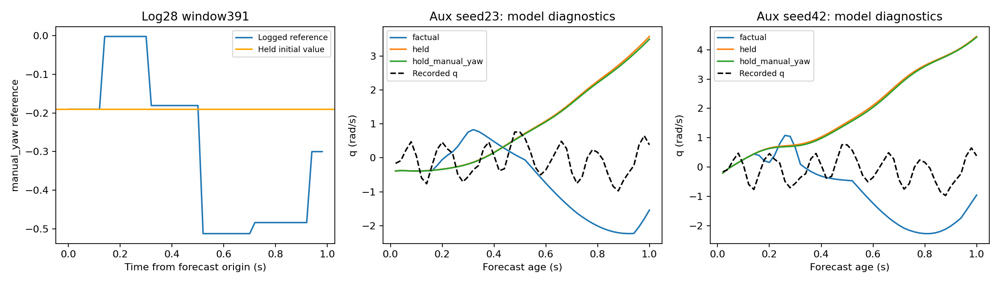

# 参考模型 v20：通道拆解、训练支持与持续q偏差

**log_28的参考敏感性增长主要来自manual_yaw，且几乎由单个窗口391驱动；该窗口原始参考和保持参考都缺少当前训练分布支持。log_18持续q偏差则未被同一覆盖问题或某个单独参考通道解释。模型与数据均未修改，仍未通过控制验收。**

## 固定范围与诊断含义

原407个非重叠父窗口、5外层飞行折×3种子、v8/v18配对冻结模型。原始参考、全部保持，以及每个通道“只允许它变化”/“只保持它”的12种设置均保留；相同参考张量复用预测。保持值是预测起点的首个计划值，历史状态/执行命令、模式等不改。未重训、筛除窗口、访问开发验证或sealed/reserved。
人工组合参考没有对应的真实飞行结果。与日志真值的误差只用于诊断，不能把某个保持方案误差较低当成物理反事实成立；未对各通道RMS直接相加作舵效归因。已保存单通道预测和的非加性残差，避免忽略耦合。yaw_rate参考在这些片段没有变化，因此其保持/单通道对照无差异不能证明真实偏航控制无效。

## log_28主要是哪一通道

| seed | mask | versus_held_rmse_baseline | versus_held_rmse_aux | versus_factual_rmse_aux |
| --- | --- | --- | --- | --- |
| 23 | factual | 0.335323 | 0.540729 | 0 |
| 23 | held | 0 | 0 | 0.540729 |
| 23 | hold_manual_yaw | 0.153638 | 0.146678 | 0.51574 |
| 23 | hold_pitch | 0.332783 | 0.537854 | 0.0625493 |
| 23 | hold_roll | 0.338946 | 0.536998 | 0.0579692 |
| 23 | hold_thrust | 0.315597 | 0.524765 | 0.124553 |
| 23 | hold_yaw_rate | 0.335323 | 0.540729 | 0 |
| 23 | only_manual_yaw | 0.313097 | 0.516692 | 0.14779 |
| 23 | only_pitch | 0.0620341 | 0.0639129 | 0.537788 |
| 23 | only_roll | 0.0629199 | 0.0570996 | 0.537506 |
| 23 | only_thrust | 0.134253 | 0.12316 | 0.522763 |
| 23 | only_yaw_rate | 0 | 0 | 0.540729 |
| 42 | factual | 0.300521 | 0.694595 | 0 |
| 42 | held | 0 | 0 | 0.694595 |
| 42 | hold_manual_yaw | 0.166191 | 0.166821 | 0.669105 |
| 42 | hold_pitch | 0.298977 | 0.69367 | 0.0655844 |
| 42 | hold_roll | 0.304112 | 0.689313 | 0.0550073 |
| 42 | hold_thrust | 0.274119 | 0.681409 | 0.155036 |
| 42 | hold_yaw_rate | 0.300521 | 0.694595 | 0 |
| 42 | only_manual_yaw | 0.269947 | 0.671644 | 0.168175 |
| 42 | only_pitch | 0.0617306 | 0.0670493 | 0.693523 |
| 42 | only_roll | 0.053965 | 0.0530648 | 0.693273 |
| 42 | only_thrust | 0.155968 | 0.155465 | 0.673701 |
| 42 | only_yaw_rate | 0 | 0 | 0.694595 |

表为原28个高参考活动窗口，单位rad/s。全部参考变化相对全部保持的q差异RMS，seed23为0.335→0.541，seed42为0.301→0.695。只允许manual_yaw变化已得到辅助模型0.517/0.672；只保持manual_yaw时降至0.147/0.167，接近基线的0.154/0.166。只固定pitch/roll/thrust均未消除主要增长。结论是模型的manual_yaw路径发生变化，不是真实手动偏航到俯仰气动作用已经被识别。

## 进一步集中到窗口391

| seed | window391_net_effect_energy_share | window391_aux_total_energy_share |
| --- | --- | --- |
| 17 | 0.993203 | 0.39028 |
| 23 | 1.00959 | 0.703748 |
| 42 | 1.01016 | 0.800301 |

窗口391占log_28参考差异能量净增量约99.3%/101.0%/101.0%（三个种子）；超过100%表示其余窗口合计略有抵消。它在seed23/42辅助模型的全飞行参考差异总能量中占70.4%/80.0%。这细化了v19的“28个高活动窗口”结论，不表示其余27个窗口都有同样问题，也不授权删除391。
该窗口为Stabilized(mode15)，原始日志支撑547.397212–548.917212s，预测起点547.917212s（PX4时钟，不是日志文件相对零点）。manual_yaw首值约−0.19048，未来最小约−0.51190。其训练折其他飞行的manual_yaw首值范围约[−0.00238,0.20120]；训练未来轨迹确有负值到−0.45238，不能说训练从未见过负指令，缺口在幅值、起点和条件组合。

保持参考会把起点−0.19048延续整秒，原始与人工保持方案均需检查支持。图中记录q只对应原始参考，不能用来验证保持方案的误差。

## 覆盖检查支持什么结论

使用20个计划参考摘要（每通道首值/范围/相邻变化RMS/净变化）、12个历史摘要。每折仅用4个训练飞行等权计算均值/标准差，计算标准化最近邻距离；阈值为训练窗口到其他训练飞行最近邻距离的等权95分位。参考、历史、联合三组分别报告，查询飞行不进入邻居库；训练边际min/max和1/99分位同时保留。

| mask | group | distance | threshold | outside |
| --- | --- | --- | --- | --- |
| factual | references | 5.23257 | 0.740248 | True |
| held | references | 4.1274 | 0.740248 | True |
| only_manual_yaw | references | 5.25772 | 0.740248 | True |
| hold_manual_yaw | references | 4.12576 | 0.740248 | True |
| factual | history | 0.502951 | 0.93693 | False |
| held | history | 0.502951 | 0.93693 | False |
| only_manual_yaw | history | 0.502951 | 0.93693 | False |
| hold_manual_yaw | history | 0.502951 | 0.93693 | False |
| factual | joint | 4.18893 | 1.00618 | True |
| held | joint | 3.3223 | 1.00618 | True |
| only_manual_yaw | joint | 4.20857 | 1.00618 | True |
| hold_manual_yaw | joint | 3.31328 | 1.00618 | True |

391的原参考距离5.233远大于经验阈值0.740，保持参考也为4.127；历史摘要距离0.503则未超阈值0.937。联合距离同样超界。因而不能把这个对照的增长直接称作已经证实的控制响应退化。原冻结保护检查仍失败，不事后剔除此窗口改判通过。
全飞行概况：

| log_id | group | windows | outside_fraction | median_distance | threshold |
| --- | --- | --- | --- | --- | --- |
| 2026.9.6/log_17_2026-9-6-18-34-06.ulg | history | 97 | 0.0618557 | 0.405562 | 1.07455 |
| 2026.9.6/log_17_2026-9-6-18-34-06.ulg | joint | 97 | 0.0824742 | 0.459166 | 0.958428 |
| 2026.9.6/log_17_2026-9-6-18-34-06.ulg | references | 97 | 0.0824742 | 0.278717 | 0.69112 |
| 2026.9.6/log_18_2026-9-6-18-46-20.ulg | history | 78 | 0 | 0.406856 | 1.1171 |
| 2026.9.6/log_18_2026-9-6-18-46-20.ulg | joint | 78 | 0 | 0.495604 | 1.08534 |
| 2026.9.6/log_18_2026-9-6-18-46-20.ulg | references | 78 | 0 | 0.31033 | 0.799988 |
| 2026.9.6/log_19_2026-9-6-18-52-30.ulg | history | 87 | 0 | 0.413471 | 1.06705 |
| 2026.9.6/log_19_2026-9-6-18-52-30.ulg | joint | 87 | 0 | 0.434899 | 1.08018 |
| 2026.9.6/log_19_2026-9-6-18-52-30.ulg | references | 87 | 0.0229885 | 0.259335 | 0.741007 |
| 2026.9.6/log_20_2026-9-6-18-58-10.ulg | history | 64 | 0.03125 | 0.407187 | 1.07105 |
| 2026.9.6/log_20_2026-9-6-18-58-10.ulg | joint | 64 | 0.03125 | 0.444804 | 1.001 |
| 2026.9.6/log_20_2026-9-6-18-58-10.ulg | references | 64 | 0.03125 | 0.270314 | 0.773857 |
| 2026.9.6/log_28_2026-9-6-07-01-38.ulg | history | 81 | 0.271605 | 0.688042 | 0.93693 |
| 2026.9.6/log_28_2026-9-6-07-01-38.ulg | joint | 81 | 0.148148 | 0.72046 | 1.00618 |
| 2026.9.6/log_28_2026-9-6-07-01-38.ulg | references | 81 | 0.0987654 | 0.364813 | 0.740248 |

log_28原参考/历史/联合分别8/81、22/81、12/81超经验阈值；高活动28窗分别8、10、10个。阈值只是选定摘要下的经验诊断，不是覆盖概率、可辨识性或物理安全范围。摘要会遗漏时序细节、模式和其他状态；未超界不能证明输入充分、模型准确或控制可用。人工组合支持也随所有mask保存，不假定单通道对照处于训练分布内。

## log_18偏差没有被同样原因解释

| mask | signed_bias_baseline | signed_bias_aux | bias_rmse_baseline | bias_rmse_aux | rmse_baseline | rmse_aux |
| --- | --- | --- | --- | --- | --- | --- |
| factual | 0.00391477 | -0.000670762 | 0.101314 | 0.137247 | 0.341936 | 0.350454 |
| held | 0.0140243 | 0.00593801 | 0.102749 | 0.131744 | 0.370187 | 0.380274 |
| hold_manual_yaw | 0.00369883 | -0.000703809 | 0.100699 | 0.13744 | 0.341881 | 0.350613 |
| hold_pitch | 0.0042427 | -0.000583442 | 0.101514 | 0.136845 | 0.343548 | 0.350789 |
| hold_roll | 0.0118045 | 0.00548702 | 0.100836 | 0.136084 | 0.345805 | 0.350585 |
| hold_thrust | 0.00564665 | -0.000387092 | 0.10382 | 0.133375 | 0.365627 | 0.378318 |
| hold_yaw_rate | 0.00391477 | -0.000670762 | 0.101314 | 0.137247 | 0.341936 | 0.350454 |
| only_manual_yaw | 0.0141921 | 0.00596865 | 0.103412 | 0.131644 | 0.370342 | 0.380267 |
| only_pitch | 0.0133186 | 0.00563103 | 0.102749 | 0.13244 | 0.368716 | 0.380124 |
| only_roll | 0.00575568 | -0.000494449 | 0.10322 | 0.132885 | 0.3672 | 0.37892 |
| only_thrust | 0.0123186 | 0.00590997 | 0.100371 | 0.135771 | 0.347286 | 0.350738 |
| only_yaw_rate | 0.0140243 | 0.00593801 | 0.102749 | 0.131744 | 0.370187 | 0.380274 |

seed23的原始参考下，窗口平均q误差的RMS从0.1013升到0.1372rad/s，但全飞行带符号平均误差约0.00392→−0.00067，说明局部正负偏差抵消，不能统一减去一个常量。全部参考保持时偏差RMS仍为0.1027→0.1317，固定任一个通道也没有去除该差距；这些是对同一真实日志的模型诊断，不是保持参考的真实误差估计。
log_18的78个原窗口在三组距离筛查中均未超经验阈值。这并不证明覆盖充分，但当前证据不支持把它简单归为log_28式的输入外推。对预先声明的32个输入摘要与“辅助−基线的窗口偏差平方变化”做逐飞行Spearman，seed23最大绝对值仅0.266，其他种子不一致；全部相关及常量特征空值已保留。没有据此训练阈值分类器或选删困难窗口。

## 验证与下一步

3项针对性测试通过；60组模型/队列的所有mask首步一致性检查、15组候选独立重载、15组输入支持标定与距离复算、查询飞行排除于最近邻库、407个OOF唯一性及v19原参考敏感性复现通过。汇总阶段修复了pandas的mask列与同名方法冲突，用显式列索引重跑；原始模型推理、权重、分层和实验判据未改变。
review_windows.csv保留log_18和log_28全部相关窗口及所有通道对照；window391.json提供准确原日志位置。未生成新的删除集合。
下一步优先回查窗口391的原始manual_control_setpoint、飞行模式和执行命令时间链，确认manual_yaw的含义、采样/保持语义及实际执行变化。只有核实这条输入链，才决定为支持不足的通道增加适用域限制还是修改表示；不应直接把manual_yaw清零来制造通过。log_18应作为独立的持续偏差问题继续研究，不能认为解释391就已修复整体模型。该原日志复核尚未执行，保留A1600和原验收失败结论。
