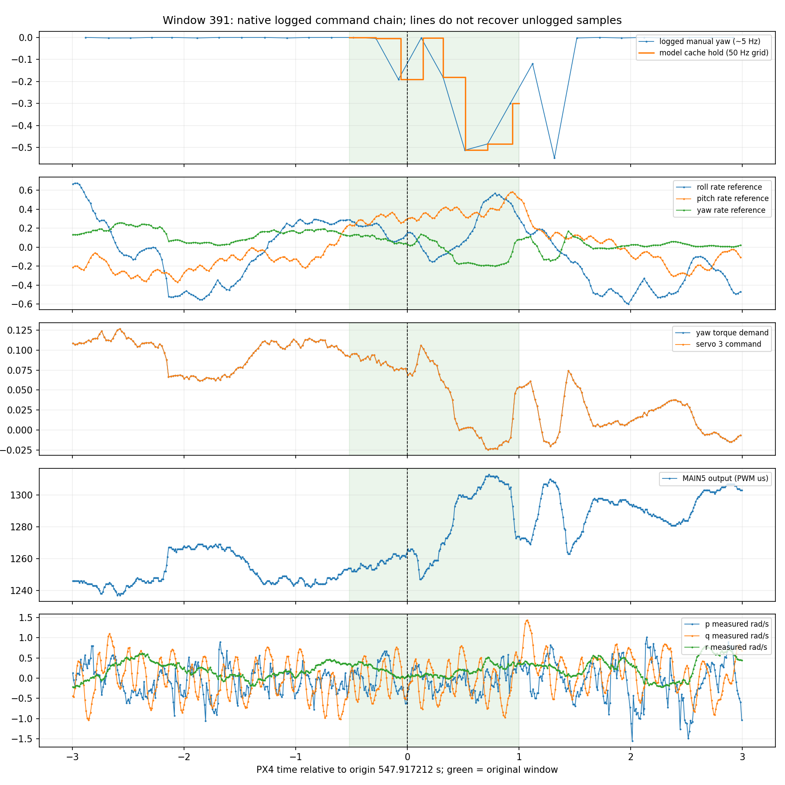

# v21：窗口391原始手动参考与执行链审计

结论：这次负向摇杆操纵是真实记录，已进入偏航角速度参考、控制需求和最终输出链；未发现缓存抄错、模式切换或记录中的分配饱和。**但5Hz的手动参考日志不能完整还原两次记录之间的输入，当前50Hz缓存只是因果保持。**这项限制与v20的训练支持不足同时存在，尚不能确定各自对模型失配的贡献。保留A1600，v18仍未通过原保护门槛，不删除391、不重训或晋升控制用途。

## 范围与可追溯性

- 原train窗口 `52364e098db4b9af_7_union0_block2_6924`，array_index391，log_28，H26/K50。原支撑547.397212–548.917212s，预测起点547.917212s，均为PX4时钟。
- 固定查看起点前后3s：544.917212–550.917212s；每个原生话题额外导出区间前最后一条消息供因果保持复核。统计表不把这条边界消息算作区间内发布。
- 源ULog SHA256 `73dd94d60553a00efb3e2d9009430686c08ee611f11eb4e3f8e3a427f26df842`；重新校验源manifest祖先链、train归属及cache哈希。沿用九月自定义数据合同，未使用四月canonical，也未加载开发验证、sealed或reserved。
- 日志声明固件 `c9af571575af33d5403fbb479256848797c801e2`，对应源码存在本地PX4仓库。按该commit导出源码及blob哈希，未使用当前分支版本代替。版本号本身不能独立认证实际二进制或排除构建时未提交修改。
- 本轮只审计这一窗口及固定上下文，不推论所有407窗口。未训练或加载模型，也不以新诊断修改既有评价标准。

[冻结协议](protocol.json) · [原始消息目录](raw/) · [时序和范围汇总](summary.json) · [逐网格记录](window_grid.csv) · [源码定位及哈希](source_provenance.json)

## 输入的实际语义

源码链为：

`RC第4通道 → 校准后的manual_control_setpoint.yaw → 附加偏航角速度参考 → 角速度控制器 → 偏航控制需求 → actuator_servos.control[2] → MAIN5输出`

1. `RC_MAP_YAW=4`，使用`input_rc.values[3]`，校准MIN/TRIM/MAX为1000/1420/1922，REV=+1。源码采用分段线性归一化；本路径未找到额外摇杆死区操作。selector直接复制所选输入，日志data_source=1、valid=1，均指向有效RC来源。
2. 非VTOL、Stabilized、manual/attitude/rates控制均开启时，姿态控制器把 `clip(manual_yaw × radians(30), ±radians(50))` 加到协调转弯产生的机体偏航角速度参考上。它不是直接舵角，也不是绝对航向参考。
3. `vehicle_attitude_setpoint.yaw_sp_move_rate` 在窗口内始终为0，但`vehicle_rates_setpoint.yaw`明显变化。前者为0不表示没有手动偏航输入；模型单独保留manual_yaw具有语义依据。
4. rate模块虽然先填manual/direct值，随后在rates_enabled路径中会用角速度控制结果覆盖扭矩；不能只读`vehicle_manual_poll()`的局部代码就认定Stabilized绕过角速度环。
5. 第三控制面的配置力矩列为(0,0,1)，PWM_MAIN_FUNC5=203、REV位4置1、MIN/MAX=800/1800。按线性输出映射，MAIN5约为`round(1300−500×servo3)`μs。日志没有MAIN中心参数，源码无有效center时走线性路径；PWM映射一致性见下文。

精确源码：[姿态控制器](source/FixedwingAttitudeControl.cpp#L333)、[角速度控制器](source/FixedwingRateControl.cpp#L273)、[RC映射](source/rc_update.cpp#L437)、[selector](source/ManualControlSelector.cpp#L44)、[舵面映射](source/FunctionServos.hpp)、[输出函数](source/output_functions.yaml)、[PWM转换](source/mixer_module.cpp#L535)、[MAIN驱动](source/px4io.cpp#L227)。

## 记录频率与缓存保持

固定6s上下文内，原生记录的发布间隔如下。它们是日志记录间隔，不能当成生产者或控制器执行周期。

| 话题 | 消息数 | 中位间隔 | 最大间隔 |
|---|---:|---:|---:|
| manual_control_setpoint | 30 | 200.938ms | 228.599ms |
| input_rc | 11 | 500.278ms | 502.981ms |
| vehicle_rates_setpoint | 300 | 19.959ms | 25.272ms |
| vehicle_torque_setpoint | 300 | 19.960ms | 22.491ms |
| actuator_servos | 300 | 19.961ms | 22.491ms |
| actuator_outputs | 600 | 9.981ms | 12.611ms |
| control_allocator_status | 30 | 199.597ms | 209.575ms |

日志profile=4097；对应源码默认manual/input_rc订阅间隔200/500ms，扑翼profile提高了其他链路话题记录频率，未单独提高这两个话题。`manual_control_input`、`rc_channels`未记录，不能用它们补全。

原支撑77个网格点全部重建成功，manual_yaw与cache最大差为0；选择消息时同时保证publication和sample不晚于查询时刻，没有未来插值。模型未来50个输入时刻中，手动消息年龄中位99.90ms、P95=183.38ms、最大201.12ms。年龄按合同取发布/采样年龄中较大者；它不是飞行器物理延迟。

原始RC提供了独立时间点，确认稀疏手动保持遗漏了变化：

| PX4时刻 | RC归一化yaw | 当时最近已记录manual_yaw | 两条消息采样相隔 |
|---|---:|---:|---:|
| 547.913203s | −0.211905 | −0.190476 | 75.661ms |
| 548.415708s | −0.509524 | −0.180952 | 178.583ms |
| 548.915869s | −0.002381 | −0.300000 | 77.590ms |

这些是不同采样时刻的差异，说明保持序列不能代表完整RC轨迹；**不能把差值认作同时刻的传感器矛盾，也不能把RC时刻直接当成控制器采用新指令的时刻。**RC自身只有约2Hz，不能据此生成可靠的50Hz真值输入。线性插值同样不能恢复未记录波形。

## 实际命令链是否变化

原1.52s支撑内：

- 偏航角速度参考范围−0.19849至+0.13631rad/s。
- 偏航控制需求及第三舵面命令范围−0.024381至+0.106135；固定6s上下文300组相同`timestamp_sample`配对，两者最大差为0。
- MAIN5输出范围1247–1313μs；其他舵面也变化，因此不能把全部机体响应单独归于偏航通道。
- 使用最近已记录servo值预测同期PWM，600点残差RMS=1.139μs，范围−8至+6μs，89.5%在±1μs内。输出记录比servo记录更密，残差包含异步记录和未记录中间命令的影响；不是机械舵机精度或延迟测量。
- 记录的模式始终15，manual/attitude/rates使能，非VTOL；未发现failsafe、RC丢失、姿态reset_counter变化或窗口附近ULog dropout。全日志两条dropout位于409.44s，远离该窗口；这不排除所有未被日志检测的质量问题。
- 8条窗口内分配状态均报告torque_setpoint_achieved，偏航未分配需求为0，相关4个执行器饱和标志为0；只能描述这些记录时刻，不能排除记录间的短时异常。
- 偏航PID积分项在窗口内为+0.05535至+0.08672；负手动参考与正控制输出可以同时存在。控制器还包含协调转弯项、反馈、缩放和历史积分，不能用两者瞬时符号判断接线或舵效。

图中原生消息连线仅辅助阅读，不用于补点；绿色为原窗口，0为预测起点。输出话题记录的是软件命令，不是示波器测得的物理PWM或实际舵角。

## 对模型结论与下一步的影响

这次审计排除了“manual_yaw只是无意义字段”及“缓存值抄错”两种解释，确认实际执行命令变化。它也确认了输入可恢复性的限制：日志输入在该快速操纵段不能作为精确50Hz参考真值。

v20发现的训练支持不足仍成立；原计划参考与人工保持输入都缺少经验支持。本次没有证明稀疏采样独自造成v18敏感性增大，更没有证明391应删除。log_18的持续q偏差仍是另一个未解决问题。

下一步应在原407训练窗口上做**手动输入可恢复性与覆盖范围审计**：保留全部窗口，逐窗报告manual消息年龄、独立更新数、RC补充证据、manual活动幅值和模式，汇总到飞行与已有工况层。标明哪些片段能支持缓慢参考响应、哪些只能支持高频执行命令条件下的响应研究，再冻结训练对照；不能依据模型误差删片段，也不能将未知输入补成零。

若之后尝试`vehicle_rates_setpoint`作为输入，模型对象必须改成“角速度环＋飞机”；该信号包含姿态反馈，不能将未来日志rate参考作为原“姿态参考→闭环飞机”模型的可用外生计划输入。同样，改用执行命令是另一种模型合同，仍要处理闭环输入相关性。当前尚未更换输入定义。

## 验证与实现修正

完成3项针对性测试（RC非对称标定、PWM反向与舍入、publication/sample双时间因果性），原日志/缓存/祖先manifest哈希、77点缓存重建、300组精确采样配对及产物校验。完整脚本可重跑且会检查已冻结协议一致。

首次审计脚本误将“消息可用时间的年龄”当作cache年龄，触发约43μs的断言差异；按既有v14/数据合同改为两种年龄的最大值后通过。未更改源数据、时间戳、阈值或模型，修正记于`implementation_amendment.json`。
