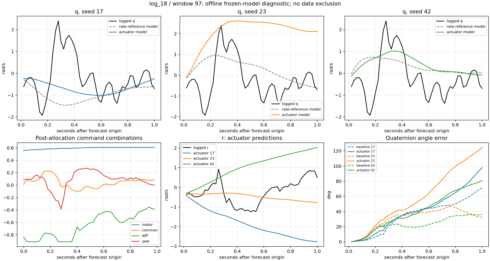

# v31：执行命令模型退化诊断

**诊断完成；未重训、改输入时间、删窗或晋升模型。保留A1600。**原407窗、v23/v30各15模型和所有评价标签冻结。当前证据把问题定位到跨飞行条件下的均值偏差与后段误差积累，尚不能确定唯一根因。

## 主要发现

1. log_18的q退化不是整架次普遍严重超出输入覆盖。78窗中，过去命令弱支持5窗、未来命令4窗、过去状态和联合特征各1窗。该共同状态异常窗是97，也带有v28的分配受限记录。阈值只由各折4个fit飞行定义，不使用误差。
2. 窗口97对log_18的候选减基线q MSE增量贡献64.50%。这是有符号MSE贡献，不是“解释了多少RMSE”的因果比例。其seed23 q MSE从1.066626升至6.283879，后半秒从0.611317升至8.615458；seed17/42该窗q反而改善。seed17/42的r在该窗明显恶化，提示种子相关的不同轴偏差增长，不能只归因于俯仰。
3. 其余77窗q仍从0.327621升至0.343331，退化4.80%。Mission和Stabilized两层都退化。因此，排除这个困难片段既不能消除问题，也会缩小有效工况；本轮保留全部窗口。
4. log_18新增q MSE为0.029224，其中均值偏差项贡献68.08%；前/后半秒新增MSE为0.007722/0.050726，退化主要集中后半秒。训练内log_18 q略改善而OOF退化，支持进一步查泛化/递推误差，不证明过拟合是唯一原因。
5. 固定40点真值支持、±100ms的q中心化波形移位诊断中，log_18两模型在fit和OOF的最优移位均为0。此有限诊断不支持直接补一个统一时延；它既不能排除时变延迟，也不能测量真实执行器延迟。

## 跨飞行与支持范围

q完整1秒RMSE，先飞行内开方再等权平均种子，单位rad/s：

| 飞行 | v23参考模型 | v30执行命令模型 | 改善 |
|---|---:|---:|---:|
| log_17 | 0.345986 | 0.341722 | +1.23% |
| log_18 | 0.351404 | 0.388998 | -10.70% |
| log_19 | 0.345311 | 0.337856 | +2.16% |
| log_20 | 0.330676 | 0.328983 | +0.51% |
| log_28 | 0.395426 | 0.394692 | +0.19% |

各飞行弱支持窗口数（总数分别97/78/87/64/81）：

| 飞行 | 过去命令 | 未来命令 | 过去状态 | 过去联合 |
|---|---:|---:|---:|---:|
| log_17 | 4 | 3 | 4 | 5 |
| log_18 | 5 | 4 | 1 | 1 |
| log_19 | 1 | 1 | 1 | 1 |
| log_20 | 1 | 3 | 2 | 2 |
| log_28 | 7 | 7 | 24 | 21 |

支持特征采用均值、标准差、末值、步差RMS。命令为motor、servo共模/差模、yaw，组合不等于实测力矩；状态为过去速度、角速度、重力方向、扑频、空速及有效标记。各fit飞行等权标准化，最近邻校准排除整个同飞行，95分位阈值只用fit。未来命令支持是离线条件输入覆盖，不能用于在线信任判定。汇总特征不覆盖全部时序关系，标为覆盖内不代表物理可辨识。

log_28弱状态支持较多但q整体略改善，因此弱支持本身不是退化的充分解释。log_18舵面共/差模大部分位于fit逐通道范围内；联合/状态分布比单通道上下限更有信息，但仍是描述性关联。

## log_18分层

沿用既有fit-only扑频分位点与模式；窗口数量和误差均按种子平均，未按结果重定义分箱：

| 条件/层 | 窗口 | v23 q RMSE | v30 q RMSE |
|---|---:|---:|---:|
| allocator_flag/limited | 1 | 1.158239 | 1.540592 |
| allocator_flag/unflagged | 77 | 0.327621 | 0.343331 |
| frequency_mean/high | 30 | 0.304822 | 0.310192 |
| frequency_mean/low | 21 | 0.468149 | 0.536016 |
| frequency_mean/mid | 27 | 0.287372 | 0.320925 |
| mode/15 | 55 | 0.369272 | 0.408029 |
| mode/3 | 23 | 0.304035 | 0.337435 |
| support_past_joint/covered | 77 | 0.327621 | 0.343331 |
| support_past_joint/weak | 1 | 1.158239 | 1.540592 |

各分层贡献见[log18_stratum_contributions.csv](log18_stratum_contributions.csv)。同一条件下贡献能重组成完整飞行的MSE差；不同条件交叉重叠，不能相加。低扑频层包含窗口97，不能据此把扑频定为根因。分配受限消息较低速，也不能等同于该窗全程舵面饱和。

窗口97为原log时间364.685188–366.205188秒，预测起点365.205188秒；Stabilized，仍保留在数据中。此窗历史扑频约2.976–3.468Hz，未来servo0达到归一化1，servo1最低约−0.982。没有实测舵角/气动力，不能从命令直接认定物理舵效。

矢量版本：[window97_diagnostic.svg](window97_diagnostic.svg)。绘图用已有记录与冻结预测，不是模拟的新干预轨迹。

## 姿态退化：不能只看q

用保存的预测角速度重新执行同一中点四元数积分，全部fit/OOF轨迹与保存姿态逐值相同；未发现这条回放路径的实现不一致。随后只替换积分使用的某一轴为未来真值，其他轴保持原预测，得到下表。此为使用未来标签的离线运动学oracle，不重跑GRU、不形成可部署模型，轴间效应不可加。

1秒姿态端点RMSE（rad，飞行/种子等权）：

| 离线替换 | v23 | v30 |
|---|---:|---:|
| 原预测 | 0.146886 | 0.168137 |
| 替换p | 0.129568 | 0.150548 |
| 替换q | 0.131138 | 0.146144 |
| 替换r | 0.101340 | 0.112590 |
| 替换全部三轴 | 0.027412 | 0.027412 |

替换r带来的端点下降比单独替换p/q更大，说明偏航角速度的持续误差也值得优先追查。仅替换q不能消除姿态差异。全三轴真值积分仍约0.027412rad误差，表明50Hz角速度积分与日志姿态之间也有离散化/估计器/时间等未分离差异；这不是不可约噪声下界，不能把它全算作模型误差或测量延迟。

## 验证与下一步

6项测试通过；全部5折支持距离用独立逐样本最近邻复算，原扑频分层核验，误差分解恒等式与分层加权重组通过；v30的p/q/r和姿态主指标复现，15组模型全部fit/OOF四元数从保存角速度精确重建。父产物与代码哈希通过；未访问开发验证、sealed或reserved。

下一步建议冻结模型，记录全部407个OOF窗口每一步q/r预测导数、隐藏状态与输出限幅，重点展示97而不只筛它；使用明确标为离线oracle的真实状态输入对照，区分局部状态条件误差和自由递推误差传播，再决定是否需要新的训练对照。本轮尚未执行该进一步诊断，不据此调整时延、删除困难窗或部署控制器。

入口：[冻结协议](protocol.json)、[结论](decision.json)、[验证](verification.json)。完整明细包括[rate_errors.csv](rate_errors.csv)、[error_timecourse.csv](error_timecourse.csv)、[attitude_oracles.csv](attitude_oracles.csv)、[lag_curves.csv](lag_curves.csv)、[support_per_window.csv](support_per_window.csv)。五飞行已经多轮开发使用，结论不是独立测试认证。
