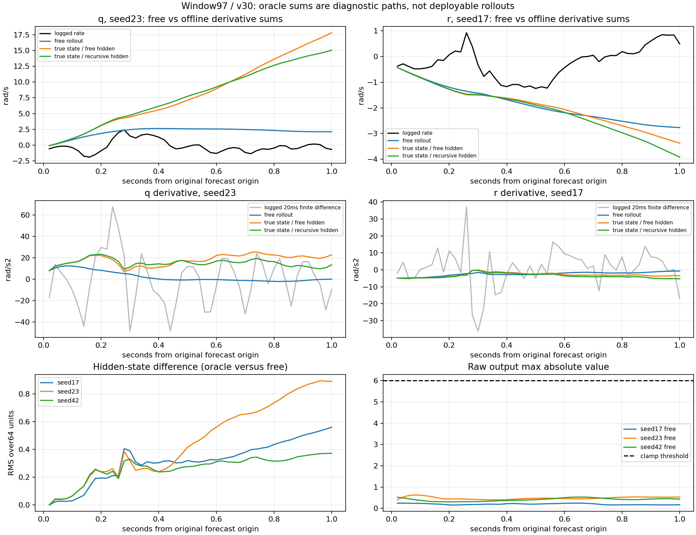

# v32：逐步导数、隐藏状态及递推路径诊断

**全部407窗、v23/v30共30个OOF模型诊断完成。没有重训、改检查点、改输入时间或删窗；保留A1600，不晋升控制模型。**本轮未发现输出限幅瓶颈，但也不支持“只有自由状态漂移，纠正状态就能恢复正确持续响应”的简单解释。

## 对照边界

三条路径共享原26点历史、未来参考/命令、模式及原来的固定扑频、相位推进和空速代理：

- 原自由递推：状态和隐藏状态均由模型推进，与原检查点预测逐值一致。
- 真实状态＋自由隐藏：每一步用上一时刻记录的速度/姿态/角速度，保留该步自由路径的更新前隐藏状态，分支只预测一步，随后丢弃分支隐藏更新。
- 真实状态＋独立隐藏：使用相同上一时刻真实状态，但沿这条路径连续更新自己的隐藏状态。

所有路径首步完全相同。第k步的oracle只使用第k−1步标签作为状态输入，不提前读取第k步目标。尽管如此，这两条路径仍在原预测起点之后持续接收真实观测，**属于离线诊断，不是原起点可实现的1秒预测**。它们也没有使用未来真实相位、扑频或空速。

## 没有触发输出限幅

全部模型、窗口、50步和三条路径中，raw head超过±6的分量共 **0** 个；最大绝对值为 **2.577292**。因此这批退化不能归因于输出被该clamp截断，不据此放宽限幅。

部分隐藏单元接近±1，但这只是隐藏数值接近边界，不是直接测得GRU门饱和，也不是根因证明。原始隐藏64维、归一化递推输入21维、限幅前6维输出和限幅后导数均已保存，避免只凭隐藏范数下结论。

## 局部误差和持续偏差必须分开

每步重置真实状态后的20ms角速度误差（全50次局部预测聚合，飞行/种子等权，rad/s）：

| 模型 | 离线路径 | q局部RMSE | r局部RMSE |
|---|---|---:|---:|
| v23 | 真实状态＋自由路径隐藏状态 | 0.269118 | 0.087475 |
| v23 | 真实状态＋独立递推隐藏状态 | 0.260870 | 0.087734 |
| v30 | 真实状态＋自由路径隐藏状态 | 0.270155 | 0.087336 |
| v30 | 真实状态＋独立递推隐藏状态 | 0.263339 | 0.087642 |

同一批点的“保持上一真实角速度”基线q/r为0.399512/0.091502。例如v30独立隐藏路径q局部误差0.263339，确实低于保持基线；但不能与自由递推1秒的0.358450直接比较并宣称长时性能改善，因为可用观测不同。

为检查局部增量是否存在持续同向偏差，另外从原初始角速度累加各路径预测角加速度×dt，**不在求和时重置角速度**。oracle导数仍是在真实状态路径上算出的，此累积不是重新运行的自洽动力学轨迹，更不是可部署预测。

| 模型 | 导数来源路径 | q累计曲线RMSE | r累计曲线RMSE |
|---|---|---:|---:|
| v23 | 原自由递推 | 0.353761 | 0.180909 |
| v23 | 真实状态＋自由路径隐藏状态 | 1.211011 | 0.244858 |
| v23 | 真实状态＋独立递推隐藏状态 | 1.516031 | 0.360095 |
| v30 | 原自由递推 | 0.358450 | 0.189780 |
| v30 | 真实状态＋自由路径隐藏状态 | 1.176541 | 0.283165 |
| v30 | 真实状态＋独立递推隐藏状态 | 1.573652 | 0.380346 |

v30真实状态＋独立隐藏的q累计误差升至1.573652，v23也有同类现象（1.516031）。即使局部误差较小，符号相关的增量误差仍可持续积累；当前结果不支持把退化全部归结为积分器数值误差或单纯的自由状态漂移。

这里的“真值导数”是相邻20ms日志角速度的有限差分，即区间平均变化率，含测量/滤波/采样影响，不是独立测得的瞬时物理角加速度。真实状态、原训练隐藏状态与固定相位/频率代理的组合也改变了输入分布，**不能据此证明真实状态路径就是训练一致的裸机向量场，或将偏差唯一归因于损失、隐藏状态或某个物理机制**。

## 窗口97的异常怎样形成

v30 seed23的自由路径首步预测dq/dt约8.022rad/s²，0.1秒约12.337rad/s²；q随后维持明显正偏差。沿真实状态路径计算时，该偏差没有自动消失。1秒平均导数误差与累计端点绝对误差如下（前者rad/s²，后者rad/s）：

| seed/轴 | 导数路径 | 平均导数误差 | 累计端点绝对误差 |
|---|---|---:|---:|
| 23/q | 原自由递推 | +2.812425 | 2.812425 |
| 23/q | 真实状态＋自由路径隐藏状态 | +18.534404 | 18.534403 |
| 23/q | 真实状态＋独立递推隐藏状态 | +15.764369 | 15.764368 |
| 17/r | 原自由递推 | -3.265256 | 3.265256 |
| 17/r | 真实状态＋自由路径隐藏状态 | -3.871064 | 3.871064 |
| 17/r | 真实状态＋独立递推隐藏状态 | -4.414004 | 4.414004 |
| 42/r | 原自由递推 | +1.538629 | 1.538629 |
| 42/r | 真实状态＋自由路径隐藏状态 | +2.643033 | 2.643033 |
| 42/r | 真实状态＋独立递推隐藏状态 | +2.661269 | 2.661269 |

同一步比较自由路径与“真实状态＋自由隐藏”可看到物理状态输入对输出的影响；后两条oracle的差异则发生在相同物理输入、不同隐藏历史下。但这是模型内部、路径相关的比较，不是独立因果分解。隐藏差异增长可以是状态偏差的后果，不能仅凭同时增长认定隐藏状态失稳。

图中的oracle累计曲线只用于显示偏差累积；虚线限幅阈值没有被触及。[SVG版本](window97_trace.svg)。完整407窗及log_18其余77窗均保留，分别见[汇总](summary_rmse.csv)、[逐飞行](by_flight_rmse.csv)、[其余77窗](log18_remaining77_rmse.csv)，没有按图示结果筛除数据。

## 检查及下一步

3项针对性测试通过，覆盖完整自由路径复现、以模型轨迹作真值时三路径逐值一致、未来标签扰动不能改变自由路径或此前oracle结果，以及真实clamp/积分记录。对30个实际检查点，另用未修改模型的forward hooks逐值核验hidden/rawhead/recurrent input，自由输出与原文件逐值一致；每种子每组407窗唯一，首步三路径一致，积分恒等式及原v30角速度主指标复现。原检查点与父产物/源码哈希未变。无开发验证、sealed或reserved访问。

下一步建议先准备一个**完整H26观测历史重新编码的滚动单步对照**，明确相位/扑频/空速与时间合同，检验当前真实状态路径是否主要受隐藏状态和上下文分布不一致影响。若局部增量偏差仍存在，再冻结“局部增量监督＋原完整递推监督”的训练对照；不能因本轮oracle变好就直接调权重。旧v18只强化原起点首步q，且未通过保护门槛，不等同于这个尚未准备的对照，也不能作为其成功依据。

本轮没有执行该下一阶段或启动任何新训练。当前数据仍不足以认证因果控制作用，五飞行OOF也已反复用于开发。

入口：[协议](protocol.json)、[结论](decision.json)、[验证](verification.json)、[逐窗口指标](per_window.csv)、[逐步q/r明细](per_step.csv.gz)。全部原始内部轨迹在fold*/{baseline,actuator}/seed*/trace.npz。
