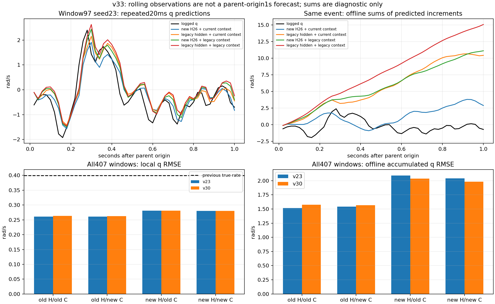

# v33：完整H26历史重新编码的滚动单步对照

**完成30个冻结模型、原407窗内全部20350个滚动起点的诊断；未重训、删窗或晋升模型，保留A1600。**完整历史重编码减轻了窗口97的部分异常，但没有消除整体局部增量的持续偏差。不能把这一步当作控制可用模型已经得到。

## 观测和时间边界

沿用5个原train飞行、5折×3种子、原归一化与v23/v30检查点。每个父窗的原起点+k（k=0..49）建立26点历史，只预测其后20ms。历史状态/参考/当前命令为新起点−25..0，原滞后执行历史为−26..−1；预测输入为新起点当前命令，标签为+1。全部观测都位于原77点支持内，逐起点通过原valid/reset/时间间隔/模式检查。

从已哈希固定的9月缓存读取实际记录的相位、扑频和空速；相位仅相对各个新起点重设零，未推断物理零位，也未换成4月ratio8。单步解码器使用该起点最新已知扑频/空速，相对相位从0起步。角速度参考由v23已审计的源消息保持点重建，执行命令与v28网格逐值一致；不重新插值或拟合时延。

这些输入在每个**新的滚动时刻**可因果获得，但包含原父窗起点之后逐渐获得的观测，所以结果不是原起点自主预测1秒。50个滚动历史高度重叠，只是407个原父窗内的诊断观测，不计为20350个独立训练窗口，没有新划分。

## 交叉对照

主路径“滚动H26＋当前上下文”直接调用原模型的单步forward，重新编码完整观测历史。另三组仅作离线对照：交换新编码隐藏与v32真实状态递推隐藏，同时交换当前解码上下文与v32原起点固定相位推进/扑频/空速。物理状态和同刻控制保持一致，除了原代码四元数归一化的极小舍入差异。

新隐藏包含整段历史状态、历史命令和历史上下文的变化，不能把该因素叫作纯记忆作用；交叉组合也可能超出训练分布，不能直接部署。旧隐藏＋旧上下文逐步复现v32，提供两轮诊断之间的核对桥梁。

## 同一批观测下的结果

下表均先飞行内汇总平方误差并开方，再等权平均飞行和种子，单位rad/s。局部列是反复观测下的20ms预测；累计列是从父窗初始角速度累加各路径预测导数×dt，仅用于显示有符号增量误差，**不是自洽动力学轨迹或可部署1秒预测**。

| 模型 | 路径 | q局部RMSE | r局部RMSE | q离线累计RMSE | r离线累计RMSE |
|---|---|---:|---:|---:|---:|
| v23 | 旧隐藏＋旧上下文（v32） | 0.260870 | 0.087734 | 1.516031 | 0.360095 |
| v23 | 旧隐藏＋当前上下文 | 0.260907 | 0.087853 | 1.540921 | 0.368230 |
| v23 | 滚动H26＋旧上下文 | 0.281344 | 0.088391 | 2.090152 | 0.503992 |
| v23 | 滚动H26＋当前上下文 | 0.280320 | 0.088481 | 2.038857 | 0.512643 |
| v30 | 旧隐藏＋旧上下文（v32） | 0.263339 | 0.087642 | 1.573652 | 0.380346 |
| v30 | 旧隐藏＋当前上下文 | 0.262930 | 0.087772 | 1.565059 | 0.376828 |
| v30 | 滚动H26＋旧上下文 | 0.280774 | 0.088827 | 2.034143 | 0.542308 |
| v30 | 滚动H26＋当前上下文 | 0.280187 | 0.088834 | 1.979966 | 0.534147 |

同一批点保持上一真实角速度的q/r RMSE为0.399512/0.091502。主路径v30分别改善29.87%/2.92%；但v23与v30的局部q分别0.280320/0.280187，非常接近，执行命令输入并未在这项检查中带来明显额外收益。

v30主路径q离线累计误差1.979966，高于v32旧路径1.573652；问题没有被完整历史重编码普遍解决。跨窗等权平均q导数偏差仅-0.055261rad/s²，但各窗正负抵消，累计端点RMSE仍为3.173258rad/s。不能据总体平均接近0就认为局部无偏，也不能直接加一个全局常数修正。

仅更新当前解码上下文时，全局指标变化相对较小；改变历史编码后，累计误差仍明显。因此，上一轮的总体结论不能仅归因于固定扑频/空速或沿用了旧隐藏。不过这仍不排除相位质量、采样差异、局部状态支持或训练目标的影响。

## 窗口97：局部改善与总体问题并存

窗口97/seed23的q诊断如下。平均导数误差单位rad/s²，最后一列为1秒离线累计端点绝对误差rad/s：

| 路径 | 平均导数误差 | 20ms局部RMSE | 累计端点绝对误差 |
|---|---:|---:|---:|
| 旧隐藏＋旧上下文（v32） | +15.764369 | 0.548858 | 15.764368 |
| 旧隐藏＋当前上下文 | +11.129476 | 0.507341 | 11.129476 |
| 滚动H26＋旧上下文 | +11.816415 | 0.485936 | 11.816415 |
| 滚动H26＋当前上下文 | +3.596759 | 0.445463 | 3.596759 |

完整滚动路径将此例平均导数偏差从+15.764369降到+3.596759，说明隐藏/上下文组合确实放大了上一轮这个例子的异常，不能把原oracle数值当作固有舵效错误。但改善不等于消除，其他窗口的偏差也仍在；全部窗口保留在汇总中。

[矢量图](rolling_comparison.svg)。图中的累计曲线和底部累计柱状图均为诊断，不是新预测器效果。

## 核验与下一步

3项测试通过：滚动时序/相位重设/边界、未来记录不能进入此前输入、隐藏与上下文相同则交叉路径相同。407个原起点输入逐值复现，20350个标签逐值等于原数据；全部30模型的新主路径与原生forward一致，旧路径逐步复现v32的rawhead/导数/角速度，指标一致。每种子每组407窗唯一，检查点/父产物/代码哈希未变。所有分支输出限幅触发0次。未读取开发验证、sealed或reserved。

下一步建议进入**联合监督训练对照的准备**：保持原完整1秒自由递推损失，增加来自fit飞行滚动H26观测历史的局部增量监督；先冻结系数、父窗采样、局部起点抽样和计算量口径，不扫描权重、不删困难窗。相同初始化与训练预算下，仍以完整1秒q、其他状态保护和绝对精度作为验收，不能以局部预测更好替代控制能力。旧v18的原起点首步q辅助损失不等同于此方案，也未证明该思路必然有效。

本轮没有准备最终训练系数或启动新训练；结果只是支持检验“局部增量与长递推目标是否兼容”这一假设，不是唯一根因证明。五飞行OOF已被多轮开发使用，后续仍需独立响应与闭环证据。

入口：[冻结协议](protocol.json)、[数据血缘](lineage.csv)、[数据合同](dataset_manifest.json)、[结论](decision.json)、[验证](verification.json)、[逐窗口](per_window.csv)、[逐飞行](by_flight_rmse.csv)。滚动输入位于rolling_inputs.npz；各模型内部结果位于fold*/{baseline,actuator}/seed*/trace.npz。
