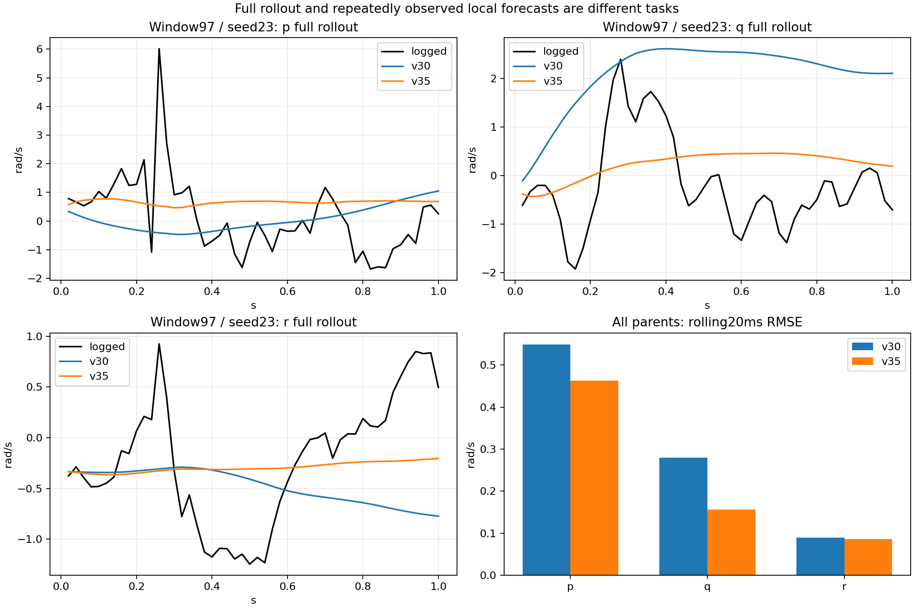

# v35：局部增量与完整递推联合监督训练

**完成1次零权重完整复现及15组候选训练、完整评价和独立重放。条件预测描述门槛通过，保留A1600；未晋升为控制可用模型。**

## 完整预测验收

相对相同执行命令输入边界的v30，完整1秒q波形RMSE改善10.0394%，3个种子均改善=True，5/5飞行改善；保护18/18，原活动窗口绝对精度3/12。主门槛要求≥5%、3种子均正、至少4飞行正，且全部保护通过；绝对门槛单独报告。训练内完整1秒q改善3.3137%。

统计先在各飞行内平均平方误差并开方，再对飞行和种子等权；单位p/q/r为rad/s、速度m/s、姿态rad。五个OOF飞行已反复用于开发，不是未开封最终测试。

| 量 | v30 | v35 | 改善 |
|---|---:|---:|---:|
| p | 0.517375 | 0.506011 | +2.20% |
| q | 0.358450 | 0.322464 | +10.04% |
| r | 0.189780 | 0.177980 | +6.22% |
| velocity | 0.413200 | 0.416586 | -0.82% |
| attitude | 0.110127 | 0.101145 | +8.16% |

| seed | q基线 | q候选 | 改善 |
|---|---:|---:|---:|
| 17 | 0.356865 | 0.320813 | +10.10% |
| 23 | 0.363521 | 0.318971 | +12.26% |
| 42 | 0.354964 | 0.327608 | +7.71% |

| fold | q基线 | q候选 | 改善 |
|---|---:|---:|---:|
| 0 | 0.341722 | 0.306645 | +10.26% |
| 1 | 0.388998 | 0.309110 | +20.54% |
| 2 | 0.337856 | 0.327564 | +3.05% |
| 3 | 0.328983 | 0.312605 | +4.98% |
| 4 | 0.394692 | 0.356395 | +9.70% |

保护失败项：

无保护项失败。

全部20ms/0.1/0.5/1秒波形与端点指标见[comparison.csv](comparison.csv)，完整[保护项](protection_gate.csv)与[绝对精度](absolute_active_gate.csv)保留全部原活动标记：0.5秒p/q≤0.15rad/s、姿态≤3度、速度≤0.5m/s。没有按响应强弱删窗。

## 局部监督是否学到了对应任务

所有407父窗各50个滚动H26起点，使用该时刻真实观测历史、当前相位/扑频/空速，只预测下一20ms；与v33同点v30结果比较。20350个相关观测不算新增独立窗口。

| 轴 | v30局部RMSE | v35局部RMSE | v30离线累计RMSE | v35离线累计RMSE |
|---|---:|---:|---:|---:|
| p | 0.549346 | 0.462708 | 2.093120 | 2.743141 |
| q | 0.280187 | 0.155803 | 1.979966 | 1.087267 |
| r | 0.088834 | 0.085874 | 0.534147 | 0.348079 |

局部每一步都重新获得真实历史，不能当作父窗起点1秒自主预测；累计列是从父窗初始角速度累加这些局部预测导数×dt，只诊断持续增量偏差，不是自洽动力学轨迹。跨窗平均偏差可正负抵消，完整[累计端点/上一真实角速度保持](rolling_summary.csv)、[有符号偏差](rolling_derivative_bias.csv)和逐飞行结果均保留，不把局部收益替代主门槛。

## 预先指定的困难窗口97

log_18窗口97全部保留；后续局部导数误差是20ms区间差分误差，非实测瞬时角加速度。最后两列单位rad/s²。

| seed | v30完整q RMSE | v35完整q RMSE | v30滚动q导数偏差 | v35滚动q导数偏差 |
|---|---:|---:|---:|---:|
| 17 | 1.117713 | 1.510009 | +4.700365 | -0.242973 |
| 23 | 2.506767 | 1.059779 | +3.596759 | -2.410472 |
| 42 | 0.997296 | 0.964720 | -0.737485 | -0.705796 |

个例变化不代表总体结论；[窗口97完整指标](window97_full_metrics.csv)与[滚动指标](rolling_window97.csv)保留所有种子。

## 固定训练合同与实际预算

沿用v34冻结方案：407个不重叠父窗、Stabilized274/Mission133、总支持618.64秒，5折×seed17/23/42，GRU64/40070参数、H26/K50、原fit-only归一化。原完整50步损失不变，增加系数1.0的局部三轴归一化增量误差均值；共同真实初值抵消，直接算端点差，不除dt、不拟合新scale。新增率项会改变角速度与速度/姿态的相对权重，不能称原损失权重全部不变。

完全复用1600×32父窗抽样和可训练初值；每次父窗出现配一个独立预生成的局部位置，按每父窗打乱50点循环，全部15计划覆盖每父窗所有50点。局部监督仅取当前折fit飞行。AdamW3e−4/wd1e−4，联合loss反传后总梯度clip1；固定最后1600步，无早停、挑检查点或权重搜索。

先完成fold0/seed17系数0的1600步训练，参数/buffer与v30逐值一致后才运行15候选；零权重记录的weight=0是实际值，继承计划local_weight=1是候选计划值。16次正式执行全部完成。单候选实测164.3–209.0秒；零权重复现129.0秒。耗时包括训练后的保存/预测而不含初始校验加载；6路并发，不把进程耗时之和当总墙钟时间。

优化更新和父窗曝光相同，计算量不同：每样本循环位置76→103（+35.53%），每组3891200→5273600。该计数不是FLOPs或实测加速比。

四路输入仍是分配后motor0/servo0/servo1/servo2命令，不是实测执行器运动；旧滞后执行历史不变。继承9月机械相位/频率合同，频率比7.909090995788574，物理相位零位未确认；未改用4月ratio8数据或先验。所有数据/父模型路径及哈希由[v34冻结协议](../control_windows_v34/protocol.json)和[数据合同](../control_windows_v34/dataset_manifest.json)解析。

## 命令保持与控制边界

| 轴 | 原命令误差 | 保持命令误差 | 两预测之差RMS |
|---|---:|---:|---:|
| p | 0.506011 | 0.519428 | 0.119737 |
| q | 0.322464 | 0.376150 | 0.196037 |
| r | 0.177980 | 0.189765 | 0.067168 |

保持命令没有对应真实反事实标签；这只是对原日志真值的诊断差异，不是恒定输入下的精度。未来日志命令含反馈信息，预测改善不能独立证明因果舵效。当前没有新控制器闭环重放或实飞验证，不宣布控制可用。

## 验证与下一步

7项针对性测试通过。完整零权重训练精确复现；15模型全部fit/OOF/命令保持共45组预测逐值重放，归一化buffer、初始化、前缀因果性和每种子407唯一OOF通过。独立实现复算全部OOF时域指标及主/保护/绝对门槛一致。滚动原起点与完整预测首步相同、导数逐值重建原生单步输出，v30滚动指标复现v33；滚动head限幅计数0（两组总计）。父产物和冻结代码哈希通过，未读取开发验证、sealed或reserved。

冻结候选，按已记录操纵的输入支持分层审计响应方向、时延、幅值、持续作用与耦合；再决定是否值得准备同一控制链闭环重放。 下一阶段尚未执行，所有窗口和失败结果保留。

交付：[评价](evaluation.json)、[独立重放](verification.json)、[滚动核验](rolling_verification.json)、[训练状态](launch/status.json)、[训练方案](../control_windows_v34/report_zh.md)。15个候选检查点位于fold0–4/joint_increment/seed17、23、42/final.pt，不能直接替换参考输入模型。
