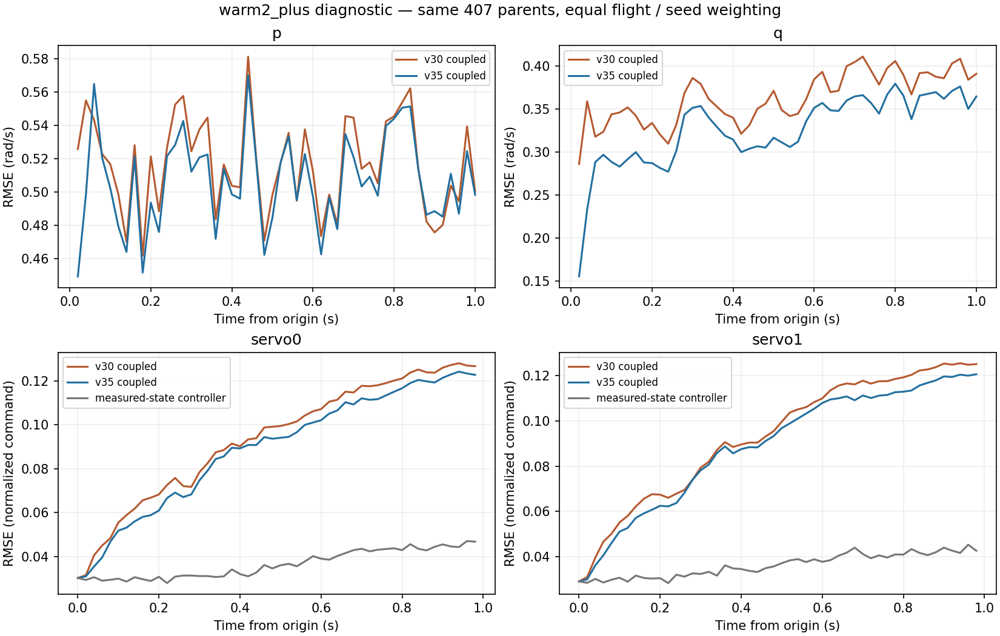

# c9af＋GRU受限闭环重放 v40

已完成30个冻结v30/v35 OOF模型、全部407个原train父窗、4种预先冻结初始化/时钟/反馈假设的**9768条闭环轨迹**，另完成1628条匹配调度的真实状态驱动控制器对照。所有轨迹有限，未删窗、重训或额外限制模型动作。**v35相对收益在本轮近似闭环中保持，但绝对精度和动作复现仍不足，不能认定控制可用。**

## 怎样闭环

数据仍为5个原train飞行的274 Stabilized＋133 Mission父窗，每窗H26初始化、K50预测1秒。模型参数和归一化保持原样，五折OOF已反复用于开发，不能称作独立测试。没有读取开发验证/sealed/reserved。

控制器起点前用原始日志的因果2秒历史预热；整个预热严格早于起点。保留warm2_plus、warm2_minus、warm2_20ms、warm2_delayed_feedback，分别覆盖HPF全正/全负、20ms替代时钟和上一合成分配残差反馈。两个符号探针并非全部初态不确定性边界，四分支均报告，不选最低误差配方。

从起点以后，姿态/角速度由GRU状态提供，c9af控制器产生力矩和分配命令，再由命令驱动GRU前进一步。模型闭环没有未来实测状态或未来日志执行命令入口；日志姿态参考、油门、manual yaw只作为条件带。Mission导航/TECS未模拟，这些条件也不是外生随机激励。

400Hz控制器与50Hz模型采用明确的分段保持近似：模型状态在20ms内保持，rate环每2.5ms更新、姿态环每10ms更新；模型只消费区间起点生成的命令，全部中间命令另存。20ms分支两个环均每20ms更新。由此产生了50Hz飞机输入保持，**不是还原了原生高频执行波形**。v35主要分支中，内部高频请求与模型所用命令的servo0/1 RMS差约0.00938/0.00968，不能视为零；20ms分支该差为0是定义导致的，不是其更真实。

控制器空速采用起点有效CAS（无效/过期则源码trim回退），作为固定的新鲜合成观测；GRU沿用原生固定扑频/空速和phase推进。真实三轴D=0已核验，因此控制器角加速度输入0；未来模式/空中/rate/attitude标志仅审计窗口适用性，运行时固定起点模式且landed=false，无未来积分/增益/reset回灌。没有增加舵面/油门归零、安全退出或额外动作clamp。

匹配的真实状态对照使用同样初始控制器、20ms保持、参考带和固定CAS，只将状态换为实测值。它与v38原先按日志姿态发布更新、使用未来实测空速的对照不同，必须分别比较；本轮不将它的误差从模型误差中直接相减。

## 状态与动作结果

下表先飞行内求RMSE，再五飞行等权、三种子等权。p/q/r为rad/s，速度为m/s，姿态为rad。`logged_command_conditioned`是此前用未来日志执行命令的条件预测，仅作边界不同的对照。

| variant | stage | attitude | p | q | r | velocity |
| --- | --- | --- | --- | --- | --- | --- |
| logged_command_conditioned | 30 | 0.110127 | 0.517375 | 0.358450 | 0.189780 | 0.413200 |
| logged_command_conditioned | 35 | 0.101145 | 0.506011 | 0.322464 | 0.177980 | 0.416586 |
| warm2_20ms | 30 | 0.108682 | 0.520396 | 0.368093 | 0.197799 | 0.413116 |
| warm2_20ms | 35 | 0.098551 | 0.510320 | 0.332351 | 0.183808 | 0.416648 |
| warm2_delayed_feedback | 30 | 0.108285 | 0.520388 | 0.367081 | 0.197613 | 0.412885 |
| warm2_delayed_feedback | 35 | 0.098526 | 0.510293 | 0.331142 | 0.183915 | 0.416771 |
| warm2_minus | 30 | 0.108366 | 0.520393 | 0.367177 | 0.197735 | 0.412931 |
| warm2_minus | 35 | 0.098557 | 0.510307 | 0.331289 | 0.183943 | 0.416809 |
| warm2_plus | 30 | 0.108369 | 0.520398 | 0.367175 | 0.197711 | 0.412883 |
| warm2_plus | 35 | 0.098555 | 0.510303 | 0.331321 | 0.183921 | 0.416773 |

warm2_plus中，v35完整1秒q从v30的0.367175降至0.331321rad/s，改善9.7648%；但比它自身日志命令条件预测的0.322464稍差。p/r为0.510303/0.183921，速度0.416773，姿态0.098555。闭环与日志命令条件预测的差别包含控制器/调度近似和反馈变化，不能唯一归因于裸机模型。

生成命令对真实日志命令的RMSE如下。四列是归一化命令，不是舵角或推力。

| variant | stage | motor0 | servo0 | servo1 | servo2 |
| --- | --- | --- | --- | --- | --- |
| warm2_20ms | 30 | 0.001200 | 0.099849 | 0.096452 | 0.036459 |
| warm2_20ms | 35 | 0.001200 | 0.096177 | 0.092434 | 0.031688 |
| warm2_delayed_feedback | 30 | 0.001200 | 0.097654 | 0.098164 | 0.036239 |
| warm2_delayed_feedback | 35 | 0.001200 | 0.093275 | 0.093364 | 0.031949 |
| warm2_minus | 30 | 0.001200 | 0.097941 | 0.097457 | 0.036314 |
| warm2_minus | 35 | 0.001200 | 0.093206 | 0.093010 | 0.031933 |
| warm2_plus | 30 | 0.001200 | 0.098284 | 0.097732 | 0.036324 |
| warm2_plus | 35 | 0.001200 | 0.093766 | 0.093346 | 0.031954 |

匹配真实状态驱动控制器的命令RMSE：

| variant | motor0 | servo0 | servo1 | servo2 |
| --- | --- | --- | --- | --- |
| warm2_20ms | 0.001200 | 0.035846 | 0.034636 | 0.015117 |
| warm2_delayed_feedback | 0.001200 | 0.036367 | 0.036091 | 0.014754 |
| warm2_minus | 0.001200 | 0.036421 | 0.035866 | 0.014728 |
| warm2_plus | 0.001200 | 0.037297 | 0.036784 | 0.014754 |

v35 warm2_plus的servo0/1误差约0.09377/0.09335，而匹配真实状态对照约0.03730/0.03678。生成动作还有显著偏差；不能只用“状态RMSE变化不大”宣称闭环已忠实复现。motor0由已知条件油门驱动，它在两种模型/teacher之间相同，不证明电机模型有效。

所有四种假设的逐飞行配对轨迹差另存[sensitivity_summary.csv](sensitivity_summary.csv)；这些是有限的敏感性探针，不是误差置信区间。

## 冻结验收

沿用v29/v35主门槛：完整1秒q改善至少5%、三个种子均改善、至少4/5飞行改善；18项保护为每种子p/r完整1秒及速度/姿态0.5秒/1秒端点退化不超过5%。新增的动作保护在运行前冻结：每种子每个归一化命令RMSE相对v30退化不超过5%，共12项，仅是相对诊断。

| variant | q_improvement_percent | improving_flights | protections_passed | action_protections_passed | absolute_passed |
| --- | --- | --- | --- | --- | --- |
| warm2_plus | 9.764755 | 5 | 18 | 12 | 3 |
| warm2_minus | 9.773898 | 5 | 18 | 12 | 3 |
| warm2_20ms | 9.710083 | 5 | 18 | 12 | 3 |
| warm2_delayed_feedback | 9.790521 | 5 | 18 | 12 | 3 |

四种假设均5/5飞行改善，状态保护18/18、动作保护12/12。**绝对门槛均仍只有3/12通过，三个种子的速度通过，p/q和姿态均失败。**下面是warm2_plus的v35三个种子平均值，正式门槛仍逐种子判定：

| metric | rmse | limit |
| --- | --- | --- |
| attitude | 0.097788 | 0.052360 |
| p | 0.486238 | 0.150000 |
| q | 0.315800 | 0.150000 |
| velocity | 0.405144 | 0.500000 |

因此，相对收益可保留为研究证据，不能把原先要求放宽为“闭环有限”或仅比较平均误差。保留A1600及v35研究候选，不晋升模型，不设计或部署新控制器。

## 饱和与覆盖

仅用各折四个fit飞行的命令与历史状态建立逐通道min/max范围。在线标记使用当时生成命令和当前生成状态，没有用未来真值选择窗口。下表为v35百分比，先飞行/种子等权；fraction是时刻比例，any是出现过该事件的模型窗口比例。

| variant | stage | command_outside_fraction | state_outside_fraction | surface_clip_fraction | any_command_outside | any_state_outside | any_surface_clip |
| --- | --- | --- | --- | --- | --- | --- | --- |
| warm2_20ms | 35 | 0.816806 | 1.848026 | 0.492346 | 3.108448 | 4.569490 | 1.038271 |
| warm2_delayed_feedback | 35 | 0.773454 | 1.780657 | 0.280604 | 2.764806 | 4.396594 | 0.623752 |
| warm2_minus | 35 | 0.774829 | 1.783014 | 0.300251 | 2.764806 | 4.396594 | 0.692481 |
| warm2_plus | 35 | 0.776203 | 1.787846 | 0.303516 | 2.764806 | 4.396594 | 0.692481 |

warm2_plus约0.776%的时刻命令超出fit逐通道范围，约1.788%的时刻状态至少一列超范围；原生分配表面限幅约0.304%的控制微步出现。所有这些轨迹仍保留。逐通道范围内不保证联合输入/状态有支持，也不是可靠置信度；范围外不等同真实飞行危险判据。

完整计数见[support_window_counts.csv](support_window_counts.csv)，逐飞行、模式、种子和窗口指标全部保存。9768条是重复模型/假设运行，不是9768个独立真实操纵事件。

## 核验与限制

3项耦合测试通过：区间起点命令与中间命令区分、参考输入前缀因果性、重复独立会话一致，以及不支持时钟/D项的拒绝。全部162800个参考条件点从原ULog独立重建，publication和sample均满足因果边界；全部模型同一假设的第一步命令一致。另独立重算273504个窗口指标、488400个当前状态支持标记和全部命令支持，确认实际模型输入恰为区间起点命令。详见[verification.json](verification.json)、[independent_verification.json](independent_verification.json)。

首次准备阶段被严格JSON拒绝NumPy布尔标志，尚未运行模型耦合；未完成产物及当时源码保留于`control_windows_v40_preparation_serialization`。修复仅将NumPy标量无损转换为JSON原生标量，未改波形、数据或门槛，重新冻结后完成本轮。旧v29/v30/v35/v38/v39产物及检查点哈希均保持。

下一步先冻结本轮模型，定位角速度/姿态误差与控制器内部历史分别怎样变成动作偏差：在相同控制器状态下对照模型状态与实测状态，再分离积分/压缩历史差异，按时间、飞行和原支持分层。需要用到未来真值的替换明确标为离线oracle，不作为可部署补偿。具体合同见[next_execution_plan.json](next_execution_plan.json)；本轮未实施该后续诊断，也未据此认定必须补飞。
