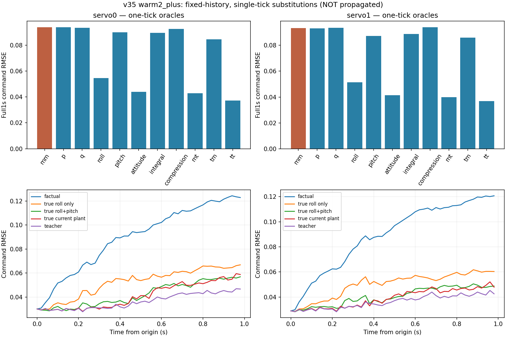

# 状态误差怎样变成控制命令偏差：v41

已完成v40全部407父窗、30个冻结模型来源、4种假设的控制器历史重建和14类当前时刻对照。**主要线索是滚转/俯仰姿态误差，而不是当前p/q角速度误差或单独的积分/压缩历史。**这支持下一轮优先准备姿态监督对照；仍没有证明唯一物理/训练根因，也没有取得可部署的真值补偿。

## 先验证没有改变原来的重放

9768条模型状态轨迹、1628条teacher轨迹的原动作、力矩、角速度参考、全部控制微步和分配限幅均逐值复现。记录488400份模型控制器更新前33维状态，teacher状态另存；全部407窗保留，包括Mission、Stabilized和超出原支持范围的时刻。

本轮不运行新GRU轨迹、不训练、不改权重/归一化/控制器参数。仅读取同一批原train数据及冻结预测，没有开发验证/sealed/reserved访问。v40的400Hz/50Hz保持、固定CAS等近似全部保留；teacher隐藏状态是重放的近似状态，不是实机真实隐藏状态。

## 对照如何定义

每个20ms区间起点，在姿态环更新前复制控制器状态，仅做一次对应2.5ms或20ms控制计算。对照输出随后丢弃，原两条控制器历史继续沿各自原状态推进所有微步；**任何真值替换都不回写后续积分、压缩器或飞机轨迹**。

| 分支 | 控制器内部历史 | 当前姿态/角速度 |
| --- | --- | --- |
| mm | 原模型重放 | 原模型状态，复现v40动作 |
| mt | 原模型重放 | 全部换为实测值 |
| tm | teacher重放 | 保留模型状态 |
| tt | teacher重放 | 实测值，复现v40 teacher |
| p/q/r | 原模型重放 | 仅该角速度轴换真值 |
| roll/pitch | 原模型重放 | 仅该欧拉角换真值 |
| rates/attitude | 原模型重放 | 全部角速度/滚转俯仰角换真值 |
| integral | 仅积分换为teacher | 保留模型状态 |
| compression | 压缩器内部及缓存增益、HPF、能量、上一effort换为teacher | 保留模型状态 |
| yaw_memory | 姿态环的旧yaw率记忆等换为teacher | 保留模型状态 |

姿态替换直接发生在控制器实际使用的roll/pitch量上，不构造并注入新的GRU四元数。压缩器先用缓存增益输出、再更新，因此当前单步中真正直接改变命令的是缓存增益；HPF/energy替换的后续效应没有传播。相同固定CAS使两条历史的空速滤波逐值相同，已核验。

## 命令误差结果

以下是v35 warm2_plus完整1秒命令RMSE：先每飞行求RMSE，再五飞行/三种子等权。命令为归一化motor0/servo0/servo1/servo2，不是舵角或气动力。全部14分支与v30、其余假设均保留在结果表中。

对真实日志命令：

| branch | motor0 | servo0 | servo1 | servo2 |
| --- | --- | --- | --- | --- |
| mm | 0.001200 | 0.093766 | 0.093346 | 0.031954 |
| mt | 0.001200 | 0.042778 | 0.039875 | 0.018506 |
| tm | 0.001200 | 0.084514 | 0.085890 | 0.027437 |
| tt | 0.001200 | 0.037297 | 0.036784 | 0.014754 |
| p | 0.001200 | 0.093851 | 0.093036 | 0.031954 |
| q | 0.001200 | 0.093381 | 0.093556 | 0.031954 |
| r | 0.001200 | 0.093766 | 0.093346 | 0.026347 |
| roll | 0.001200 | 0.054511 | 0.051319 | 0.031168 |
| pitch | 0.001200 | 0.089945 | 0.087349 | 0.029667 |
| rates | 0.001200 | 0.093381 | 0.093213 | 0.026347 |
| attitude | 0.001200 | 0.043870 | 0.041518 | 0.027470 |
| integral | 0.001200 | 0.089431 | 0.088706 | 0.028149 |
| compression | 0.001200 | 0.092461 | 0.094020 | 0.030785 |
| yaw_memory | 0.001200 | 0.090219 | 0.090187 | 0.031954 |

对匹配teacher命令（是近似控制器对照，不是实机真值）：

| branch | motor0 | servo0 | servo1 | servo2 |
| --- | --- | --- | --- | --- |
| mm | 0.000000 | 0.087199 | 0.086376 | 0.030199 |
| mt | 0.000000 | 0.014921 | 0.014501 | 0.010110 |
| tm | 0.000000 | 0.077606 | 0.078383 | 0.025843 |
| tt | 0.000000 | 0.000000 | 0.000000 | 0.000000 |
| p | 0.000000 | 0.086168 | 0.084908 | 0.030199 |
| q | 0.000000 | 0.085470 | 0.087098 | 0.030199 |
| r | 0.000000 | 0.087199 | 0.086376 | 0.023859 |
| roll | 0.000000 | 0.040582 | 0.036108 | 0.028295 |
| pitch | 0.000000 | 0.082853 | 0.080511 | 0.026881 |
| rates | 0.000000 | 0.084369 | 0.085620 | 0.023859 |
| attitude | 0.000000 | 0.023972 | 0.021963 | 0.023782 |
| integral | 0.000000 | 0.081520 | 0.080504 | 0.026279 |
| compression | 0.000000 | 0.087019 | 0.087857 | 0.029359 |
| yaw_memory | 0.000000 | 0.083369 | 0.082880 | 0.030199 |

几个直接结论：

- 原servo0/1误差0.093766/0.093346。只替换roll降为0.054511/0.051319；替换roll＋pitch降为0.043870/0.041518。保留模型控制器历史但全部换为实测姿态/角速度（mt）为0.042778/0.039875，接近但不等于teacher的0.037297/0.036784。
- 只替换当前p或q，升降副翼误差几乎不降，个别通道反而增大；因此不能把角速度RMSE大直接等同于它对当前动作偏差的贡献最大。这不意味着p/q预测不重要：它们的过去误差仍可能经运动学积分造成当前姿态误差。
- 只替换全部内部历史（tm）仍有0.084514/0.085890；单独积分、压缩、yaw记忆的改善也弱于姿态替换。隐藏历史有影响，不能解释为全部都来自初态或压缩器。
- 方向舵与当前r的关系更明显：仅r替换将servo2误差0.031954降为0.026347；仅姿态替换为0.027470。不同轴不能合并成单一结论。

## 四种假设、模式和支持分层

下表是servo0/1 RMSE的算术平均，只便于比较两舵面，不是合并平方后开根。每种假设的15组为5飞行×3种子；roll/attitude替换在各组均改善，但这些相关对照不能当作15次独立实飞。

| variant | groups | roll_positive_groups | attitude_positive_groups | mm | mt | tm | tt | p | q | roll | pitch | attitude | integral | compression |
| --- | --- | --- | --- | --- | --- | --- | --- | --- | --- | --- | --- | --- | --- | --- |
| warm2_20ms | 15 | 15 | 15 | 0.094305 | 0.040773 | 0.085455 | 0.035241 | 0.094300 | 0.094117 | 0.053267 | 0.089301 | 0.042274 | 0.090125 | 0.093615 |
| warm2_delayed_feedback | 15 | 15 | 15 | 0.093320 | 0.040229 | 0.085764 | 0.036229 | 0.093192 | 0.093161 | 0.051754 | 0.088352 | 0.041638 | 0.089294 | 0.092881 |
| warm2_minus | 15 | 15 | 15 | 0.093108 | 0.040518 | 0.084809 | 0.036144 | 0.092985 | 0.093025 | 0.052203 | 0.088200 | 0.041896 | 0.088618 | 0.092887 |
| warm2_plus | 15 | 15 | 15 | 0.093556 | 0.041327 | 0.085202 | 0.037040 | 0.093444 | 0.093468 | 0.052915 | 0.088647 | 0.042694 | 0.089068 | 0.093240 |

v35主要分支按原模式与v40当时的支持标记分层，仍比较真实日志命令：

| family | layer | mm | roll | attitude | mt | tm | tt |
| --- | --- | --- | --- | --- | --- | --- | --- |
| mode | 3 | 0.081030 | 0.038448 | 0.033773 | 0.033961 | 0.074702 | 0.032348 |
| mode | 15 | 0.098394 | 0.058705 | 0.046443 | 0.044426 | 0.089135 | 0.038358 |
| support | 0 | 0.091644 | 0.049948 | 0.039942 | 0.038867 | 0.083225 | 0.034763 |
| support | 1 | 0.209564 | 0.192263 | 0.147120 | 0.126424 | 0.193868 | 0.106362 |
| support | 2 | 0.162585 | 0.133878 | 0.121802 | 0.118601 | 0.133707 | 0.097724 |
| support | 3 | 0.244077 | 0.198988 | 0.211443 | 0.202526 | 0.243082 | 0.180767 |

mode3为Mission、15为Stabilized。support0为当前状态和命令均在原fit逐通道min/max内，1为仅状态超范围，2为仅命令超范围，3为两者均超范围。分层标记始终来自原v40轨迹，不随oracle替换重新筛窗；按该层有数据的飞行/种子等权，点数另存[strata_per_flight.csv](strata_per_flight.csv)。范围内也存在明显动作误差，不能只归因于少量超范围时刻。边际范围不证明联合支持。

## 分解与交互

定义D=mm−tt、P=mm−mt、H=mt−tt，逐点严格满足D=P＋H。P是在模型内部历史下的当前状态效应，H是在实测当前状态下的内部历史效应；反过来的路径也保留，交互项为mm−mt−tm＋tt。全部1953600个动作标量恒等式核验通过。

为描述平方差如何分配，另报告E[P·D]/E[D²]、E[H·D]/E[D²]，先对各飞行/种子矩等权再求比，符号可以为负。这些是**指定分解路径下的有符号统计份额，不是独立因果百分比**。主要分支两升降副翼的当前状态项约88.44%/88.61%，内部历史约11.56%/11.39%；反向路径得到的当前状态项约87.94%/89.94%。完整四假设及yaw结果、交互项保留，不把各单轴替换效果相加。

## 为什么当前姿态会如此影响动作

在这批c9af实际参数下，滚转/俯仰姿态时间常数均约0.4s，rate环滚转P约0.04而参考前馈FF约0.8，俯仰P约0.06、FF约0.5。源码输出在限幅前包含：

`gain × [scale² × (P × (rate_sp − rate) + integral) + scale × FF × rate_sp] + trim`

姿态误差先改变rate参考，再同时经过P项和较强的参考前馈；当前角速度误差主要直接进入P项。这是现有配置下姿态偏差能显著影响命令的一条源码解释，与本轮替换结果一致，不构成调小FF/PID的建议。这里仍未区分姿态偏差究竟由持续角速度偏差、周期相位、运动学/标签不一致还是其他学习问题造成。

## 核验与决定

3项测试通过：克隆隔离和交叉分解恒等式、单次调用与完整区间起点动作一致、33维状态恢复及HPF对当前/下一tick的区别。独立重新计算全部3282048个窗口误差量，并从保存状态调用c9af原API复查每条轨迹固定0/0.48/0.98s的全部14分支，共410256次，命令与限幅逐值一致。v40原动作指标、原支持分层重组、父产物和源码哈希保持。

本轮没有降低原v40绝对门槛，也没有改善任何真实可部署预测：原p/q/姿态门槛仍失败，模型未晋升。下一步优先准备**针对滚转/俯仰姿态持续误差的受控训练对照**，先核对运动学一致性与现有损失量级，再用fit-only依据冻结单项姿态监督权重，保持网络、数据、初始化、抽样、预算和评价不变；先复现零权重基线。不先调控制器、不新增观测通道，也不因oracle有效而宣称训练一定有效。

具体准备任务见[next_execution_plan.json](next_execution_plan.json)，本轮未启动该新训练，未判断必须补飞。
