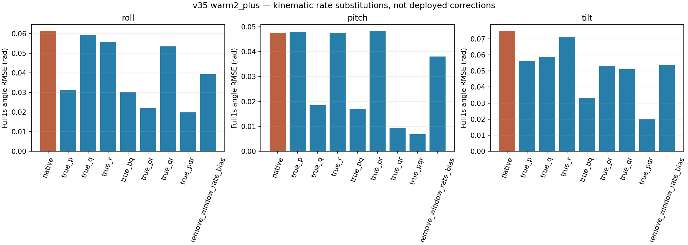

# 姿态持续误差监督准备 v42

**运动学核验、fit-only梯度审计、单项新增损失及五折权重、15组训练合同已完成；1600步零权重控制逐值复现v35。**正式候选训练尚未启动，没有新的模型精度或控制可用性结论。

## 姿态误差与角速度历史

v40全部9768条模型轨迹的四元数，都由保存的角速度通过原生中点积分逐值复现。随后沿相同初态，分别替换整段p/q/r及其组合，或去掉预测角速度误差的窗口均值，再仅重做运动学积分；不重跑神经模型或控制器。这些使用未来实测量的结果只作离线诊断，不能部署或当作真实反事实。

v35 warm2_plus完整1秒误差，先飞行内RMSE再五飞行/三种子等权，单位rad：

| oracle | roll | pitch | tilt |
| --- | --- | --- | --- |
| native | 0.061488 | 0.047390 | 0.075065 |
| true_p | 0.031284 | 0.047790 | 0.056365 |
| true_q | 0.059303 | 0.018541 | 0.058716 |
| true_r | 0.055867 | 0.047531 | 0.071211 |
| true_pq | 0.030274 | 0.017094 | 0.033345 |
| true_pr | 0.022078 | 0.048401 | 0.052988 |
| true_qr | 0.053518 | 0.009393 | 0.051114 |
| true_pqr | 0.019850 | 0.006820 | 0.020128 |
| remove_window_rate_bias | 0.039361 | 0.037978 | 0.053415 |

原roll误差0.061488，用整段实测p替换后为0.031284；原pitch0.047390，用整段实测q替换后为0.018541。**过去角速度误差会通过积分形成当前姿态偏差**，因此v41“仅当前p/q替换对当前动作帮助小”并不意味着角速度学习不重要。

全部实测p/q/r积分后tilt误差0.020128，约为原0.075065的26.81%，5/5飞行下降，通过预先冻结的“总体≤原来一半、至少4/5飞行下降”准备检查。仍有日志角速度与姿态标签的不一致，不能说动力学积分没有任何测量/时间/离散化残差，也不能把0.020128当不可约物理噪声下界。去窗口均值偏差只能将tilt降到0.053415，未解释全部误差。



完整4假设、v30/v35、5飞行3种子、9种角速度带均保存，未按好坏筛窗。该准备检查不是新的独立测试；仍只使用原5个train飞行407父窗，开发验证/sealed/reserved保持未访问。

## 新增什么损失

保留v35原完整50步损失（角速度＋速度＋0.2全姿态）和局部角速度增量项，额外加入：

`L_new = L_v35 + lambda_fold * mean_batch,time(||g(q_pred) − g(q_true)||²) / 0.1²`

其中`g(q)=R_nb(q).T·[0,0,1]`为机体系单位重力方向，先归一化四元数。向量三个坐标求和、batch/time求平均；该项不受全局航向和四元数符号影响，无欧拉角±π跳变或pitch90°奇异性。小误差下近似`(d_pitch² + cos²(pitch)*d_roll²)/0.1²`，不是任意姿态下roll/pitch完全等权；原全姿态项保留，航向监督没有删除。

0.1rad尺度沿用原姿态损失口径，没有重拟合数据归一化。只新增一项损失，不加输入、网络层或控制器。40070参数、H26/K50、固定扑频/相位/空速代理不变。

## 权重如何冻结

在任何本轮审计/校准运行前写入[protocol.json](protocol.json)：每折使用三个种子各自原1600×32采样计划的前4个fit batch及对应局部offset，在原始初始化上获取12对参数梯度范数。

`lambda_fold = clip(0.5 * median(||grad L_v35|| / ||grad L_tilt||), 0.01, 10)`

每折三个种子共享该系数。校准仅用该折4个fit飞行，OOF父窗不参与；不根据OOF效果搜索系数。另在既有v35最终检查点的同一批fit数据上做梯度审计，**这些结果不参与定权或再次调整**。

| fold | weight | unclipped_weight | clipped | gradient_pairs |
| --- | --- | --- | --- | --- |
| 0 | 0.139041 | 0.139041 | False | 12 |
| 1 | 0.140483 | 0.140483 | False | 12 |
| 2 | 0.139675 | 0.139675 | False | 12 |
| 3 | 0.139680 | 0.139680 | False | 12 |
| 4 | 0.137846 | 0.137846 | False | 12 |

五折均未触及预设上下限。这里只是在初始化附近控制新增梯度的相对规模，不保证所有batch或训练后期一直是0.5倍，也不等同于最优权重。

60组初始化与60组最终fit审计的中位数：

| stage | v35_loss | tilt_loss | old_weighted_attitude_loss | v35_grad_norm | tilt_grad_norm | old_attitude_grad_norm | cosine | weighted_tilt_grad_ratio |
| --- | --- | --- | --- | --- | --- | --- | --- | --- |
| fresh | 6.628382 | 17.736474 | 4.001833 | 88.427555 | 316.171936 | 66.175446 | 0.956254 | 0.500000 |
| v35_final_fit_only | 0.684320 | 0.274378 | 0.075051 | 2.375606 | 3.896242 | 1.205847 | 0.628259 | 0.238335 |

初始化新增加权梯度/旧联合梯度范数中位数约0.5，在v35最终fit审计约0.238；两者的梯度方向相关性也改变。因此本轮没有“旧损失完全忽略姿态”的结论：旧的全姿态项本来已提供显著梯度，本实验改变的是对倾斜持续误差的相对关注。完整值与校准父窗索引/offset均保留。

## 训练准备与零控制

15组各3步临时更新预检通过：旧v35路径和新lambda=0路径的参数及AdamW状态逐值相同；正权重候选梯度/更新有限且确实改变参数，归一化buffer保持。临时135次optimizer调用不保存候选检查点。

之后实际完成fold0/seed17的**完整1600步零倾斜权重复现**，全部最终参数和buffer与冻结v35完全相同，实测耗时327.5秒。复现文件保留在[zero_control/final.pt](zero_control/final.pt)；metadata不同，不要求整个checkpoint文件字节相同。它是基线复现实验，不是新候选性能结果。

正式候选固定5折×seed17/23/42，每组从原初值训练1600更新，不是从v35微调。完整父窗与局部offset抽样、batch32＋local32、AdamW lr3e−4/weight_decay1e−4、总梯度裁剪1保持；原407父窗全部留存。没有新增循环分支，但新增四元数投影及反向传播仍有额外计算，不能称完全等计算量。

## 验收规则

新实验目标是完整1秒tilt误差相对v35改善≥5%、三个种子均改善、至少4/5飞行改善。原18项保护保持，另加每种子q完整1秒和roll/pitch完整1秒各≤5%退化，共27项保护。原“q改善≥5%”条件单独报告，tilt成功不冒充q门槛通过。

原活动窗0.5秒绝对门槛保持：p/q≤0.15rad/s、全姿态≤3°、速度≤0.5m/s，共12项。tilt指标不替代全姿态绝对门槛。

随后在完全相同的4种v40耦合假设下，用生成动作评价状态与控制命令：两升降副翼RMSE算术平均改善≥5%，三个seed均改善、至少4/5飞行改善；每个seed每个4通道动作RMSE退化不超过5%，并保持状态保护和绝对门槛。所有窗口、支持范围与饱和统计都报告，不只评价“容易”的片段。任何这些数值通过都不自动证明新控制器实飞可用。

## 核验与执行入口

测试覆盖重力方向的符号/航向不变性、角度量纲、极端pitch处有限梯度、lambda=0与v35梯度一致、正权重确有效果及校准规则。既有局部增量测试同时通过：

```text
.........                                                                [100%]
9 passed in 3.44s
```

独立用直接重力公式重新计算60组fit梯度和五折权重，核验fit/query隔离、全部运动学汇总及1600步复现参数。所有父产物/检查点/源码哈希保持；见[independent_verification.json](independent_verification.json)。

候选训练已经具备固定输入、系数、脚本和验收合同，启动命令如下；本轮未执行：

```bash
OPENBLAS_NUM_THREADS=1 OMP_NUM_THREADS=1 /home/zn/anaconda3/envs/flap-train-gpu/bin/python scripts/run_attitude_training_v42.py
```

输出到`control_windows_v43`，先产生15组候选，再按冻结规则做条件预测和4假设闭环评价。[training_plan.json](training_plan.json)和[next_execution_plan.json](next_execution_plan.json)给出可执行计划。保留A1600和v35研究基线，不调控制器、不补飞、不宣称损失设计已改善真实控制。
