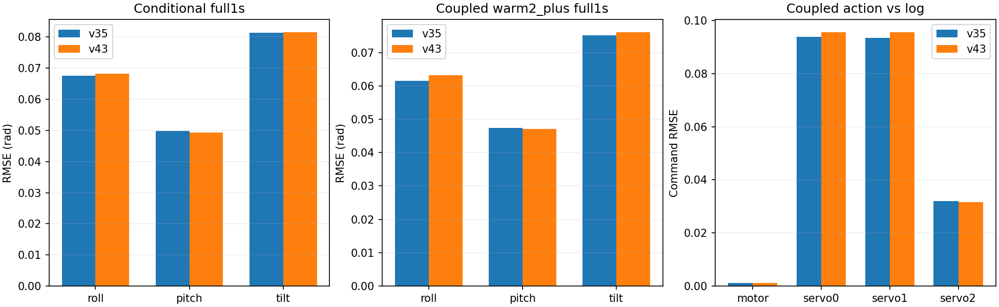

# 倾斜姿态监督训练与闭环评价 v43

**15组×1600步训练、全部407父窗条件预测、4种受限闭环重放及独立核验已完成。**

条件预测倾斜误差目标通过：False；含27项状态保护：False。四种闭环的全部相对门槛通过：False；全部绝对门槛通过：False。本轮不晋升控制模型，保留A1600与v35研究基线。

## 实验合同

严格执行v42预先冻结方案：原v35完整递推＋局部增量损失保留，新增单位重力方向平方差/0.1²。五折系数分别为0.139041, 0.140483, 0.139675, 0.139680, 0.137846，按fit初始梯度确定，未在本轮调权。H26/K50、40070参数、初始参数、父窗与local offset采样、归一化、AdamW和1600更新预算保持；从原初值训练，不是微调v35。

上一轮fold0/seed17完整1600步零权重复现已逐值通过，本轮复用证据。15个正权重候选均完成。数据是原5个训练飞行407父窗的留一飞行OOF，已经多轮用于开发，**不是未开封的独立测试**；开发验证、sealed test、reserved未访问。原数据为专门登记的9月日志命令数据，沿用v29时间/相位/扑频合同，不混入canonical旧数据或DeLaurier先验。

## 条件预测

给定未来日志分配命令的完整1秒波形RMSE，先飞行内RMSE，再五飞行、三seed等权；角度rad、角速度rad/s、速度m/s：

| metric | baseline | candidate | improvement_percent |
| --- | --- | --- | --- |
| attitude | 0.101145 | 0.101650 | -0.499003 |
| p | 0.506011 | 0.511517 | -1.088156 |
| pitch | 0.049787 | 0.049288 | 1.002237 |
| q | 0.322464 | 0.335169 | -3.940107 |
| r | 0.177980 | 0.180925 | -1.655011 |
| roll | 0.067504 | 0.068222 | -1.063399 |
| tilt | 0.081392 | 0.081560 | -0.206832 |
| velocity | 0.416586 | 0.425305 | -2.092815 |

倾斜改善-0.207%，改善seed 0/3、飞行1/5；原q条件另计，改善-3.940%，通过False。27项状态保护通过27/27。新增tilt通过不等于q条件或全姿态绝对门槛通过。

活动窗0.5秒端点，三seed均值仅供阅读，实际逐seed验收通过3/12：

| metric | rmse | limit |
| --- | --- | --- |
| attitude | 0.101363 | 0.052360 |
| p | 0.492440 | 0.150000 |
| q | 0.315468 | 0.150000 |
| velocity | 0.413162 | 0.500000 |

fit完整1秒波形结果（每模型内各fit飞行等权，再模型等权；与OOF来源/用途不同）：

| metric | baseline | candidate | improvement_percent |
| --- | --- | --- | --- |
| attitude | 0.061844 | 0.059805 | 3.297065 |
| p | 0.466985 | 0.472666 | -1.216390 |
| pitch | 0.033221 | 0.032267 | 2.872411 |
| q | 0.247277 | 0.265414 | -7.334597 |
| r | 0.130637 | 0.133785 | -2.410050 |
| roll | 0.043359 | 0.039565 | 8.750188 |
| tilt | 0.052973 | 0.049579 | 6.407120 |
| velocity | 0.345513 | 0.354738 | -2.669869 |

## 同一控制器的生成动作重放

复用v40逐值核验的因果2秒控制器预热、参考带、固定起点CAS及原生分配，使用候选状态生成未来动作，GRU不读取未来实测状态或日志执行命令。模型20ms推进，控制器2.5ms/姿态10ms和20ms替代调度保持；模型消费区间起点动作，内部微步单独记录。参考来自日志条件，Mission不包含完整导航/TECS复现；固定空速/扑频及50Hz输入保持仍是近似。

四种假设均保留全部407窗×3seed，共4884条新模型轨迹，另复用4884条冻结v35轨迹及1628条匹配teacher。没有删困难片段、增加动作clamp或调整控制参数。两升降副翼指标是servo0与servo1各自RMSE的算术平均，不与电机/方向舵混合。

| variant | tilt_improvement_percent | surface_improvement_percent | surface_seeds | surface_flights | state_protections | action_protections | absolute | coupled_relative_gate |
| --- | --- | --- | --- | --- | --- | --- | --- | --- |
| warm2_plus | -1.405991 | -2.143479 | 0 | 0 | 27/27 | 12/12 | 3/12 | False |
| warm2_minus | -1.429292 | -2.196495 | 0 | 0 | 27/27 | 12/12 | 3/12 | False |
| warm2_20ms | -1.379928 | -1.977463 | 0 | 0 | 27/27 | 12/12 | 3/12 | False |
| warm2_delayed_feedback | -1.442222 | -2.154993 | 0 | 0 | 27/27 | 12/12 | 3/12 | False |

warm2_plus完整1秒状态误差：

| metric | baseline | candidate | improvement_percent |
| --- | --- | --- | --- |
| attitude | 0.098555 | 0.099272 | -0.727245 |
| p | 0.510303 | 0.515761 | -1.069630 |
| pitch | 0.047390 | 0.047072 | 0.672441 |
| q | 0.331321 | 0.343993 | -3.824741 |
| r | 0.183921 | 0.184839 | -0.499372 |
| roll | 0.061488 | 0.063187 | -2.763542 |
| tilt | 0.075065 | 0.076120 | -1.405991 |
| velocity | 0.416773 | 0.425863 | -2.181062 |

warm2_plus分配命令对实测日志RMSE（axis0电机、1/2升降副翼、3方向舵）：

| axis | baseline | candidate | improvement_percent |
| --- | --- | --- | --- |
| 0 | 0.001200 | 0.001200 | 0.000000 |
| 1 | 0.093766 | 0.095513 | -1.863099 |
| 2 | 0.093346 | 0.095609 | -2.425122 |
| 3 | 0.031954 | 0.031517 | 1.367972 |

warm2_plus活动窗0.5秒端点：

| metric | rmse | limit |
| --- | --- | --- |
| attitude | 0.098181 | 0.052360 |
| p | 0.496413 | 0.150000 |
| q | 0.331394 | 0.150000 |
| velocity | 0.410923 | 0.500000 |

命令/状态越出fit逐通道范围和原生分配限幅的比例：

| variant | arm | command_outside_fraction | state_outside_fraction | surface_clip_fraction |
| --- | --- | --- | --- | --- |
| warm2_20ms | baseline | 0.008168 | 0.018480 | 0.004923 |
| warm2_20ms | candidate | 0.008271 | 0.017879 | 0.005111 |
| warm2_delayed_feedback | baseline | 0.007735 | 0.017807 | 0.002806 |
| warm2_delayed_feedback | candidate | 0.007855 | 0.017770 | 0.003441 |
| warm2_minus | baseline | 0.007748 | 0.017830 | 0.003003 |
| warm2_minus | candidate | 0.007866 | 0.017816 | 0.003551 |
| warm2_plus | baseline | 0.007762 | 0.017878 | 0.003035 |
| warm2_plus | candidate | 0.007838 | 0.017816 | 0.003582 |

范围仅为fit边际min/max，不是联合支持或校准置信度。完整mode分层、每飞行/seed结果、匹配teacher命令误差与内部微步差异均已保存；这些指标不用于事后删除窗口。

## 验证与结论边界

10项针对性测试通过，包括原v42损失、耦合接口及本轮评价。全部15检查点的fit和OOF预测逐值重放；原始初始化、buffer、采样哈希、参数数目及前缀因果性通过。独立公式复算条件预测78144个窗口指标，闭环312576个状态指标和78144个动作指标，核验488400个当前状态支持点；所有相对/绝对门槛独立复算一致。父产物及源码哈希不变。

见[条件预测核验](conditional/verification.json)、[闭环核验](coupled/verification.json)、[完整保护失败清单](protection_failures.csv)。`control_ready=false`；即使某些相对门槛通过，也不替代独立控制响应证据和真实闭环验证。

下一步仅提出[残余误差定位计划](next_execution_plan.json)：冻结本轮结果，比较fit/OOF及条件/生成动作之间的误差变化，先确定剩余问题再选择一个新假设。本轮没有追加权重搜索、控制器调参或实飞。
