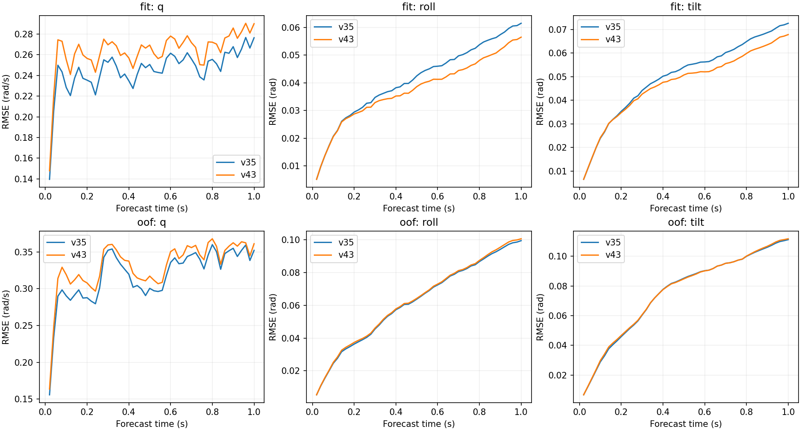

# v43残余误差诊断 v44

**新增倾斜监督的fit姿态收益，伴随短时角速度波形代价；该姿态收益没有推广到OOF，主要丢失在滚转积分路径。**这是一组冻结结果的定位结论，不是已确认的唯一优化/物理根因。

本轮未训练、未修改权重或控制器、未筛掉窗口。固定v35/v43各15模型，比较全部407原train父窗、原5折3seed条件预测，以及4种v40耦合假设。共10989对轨迹，其中fit同一窗口有4个不同模型视角，不能当作新增独立数据；OOF仍为反复用于开发的5个飞行。

## 1. q退化主要来自波形，不是窗口平均偏差

逐窗口做精确分解`MSE = mean(error)² + mean((error−mean(error))²)`。先每个源飞行平均、再模型fold/seed等权；以下是MSE，单位rad²/s²，不与平均RMSE混用：

| cohort | arm | mse | bias_squared | centered_mse |
| --- | --- | --- | --- | --- |
| fit | baseline | 0.061895 | 0.002027 | 0.059868 |
| fit | candidate | 0.071392 | 0.001913 | 0.069479 |
| oof | baseline | 0.104422 | 0.004862 | 0.099560 |
| oof | candidate | 0.112710 | 0.004769 | 0.107942 |

candidate减baseline：

| cohort | mse | bias_squared | centered_mse | centered_share_percent |
| --- | --- | --- | --- | --- |
| fit | 0.009497 | -0.000114 | 0.009611 | 101.200849 |
| oof | 0.008289 | -0.000093 | 0.008382 | 101.118823 |

fit和OOF的q窗口均值偏差平方都略降，但去均值波形误差增加，解释了超过100%的净MSE增加，其余由均值项改善抵消。**去均值不是高通或频谱分解**，其中仍包含低频形状、斜率、相位或幅值差异；不能据此直接断言是扑频/相位故障。

即使全局有符号偏差接近零，不同窗口的正负误差也会抵消，因此采用逐窗口偏差平方。first25/last25也分别保存，q在前、后半秒的波形项均增加。

## 2. 退化已经出现在第一个20ms

q在第1步端点的飞行平衡RMSE（rad/s）：

| cohort | baseline | candidate | increase_percent |
| --- | --- | --- | --- |
| fit | 0.139654 | 0.147946 | 5.937137 |
| oof | 0.155741 | 0.163615 | 5.055659 |

首步fit和OOF均变差，说明不能把全部退化解释成1秒滚动后状态漂移或仅未知飞行的泛化问题。fit的倾斜收益主要在更长的积分过程中显现，但短时q代价已经存在。

完整1秒波形RMSE复现v43：

| cohort | metric | baseline | candidate | improvement_percent |
| --- | --- | --- | --- | --- |
| fit | attitude | 0.061844 | 0.059805 | 3.297065 |
| fit | p | 0.466985 | 0.472666 | -1.216390 |
| fit | pitch | 0.033221 | 0.032267 | 2.872411 |
| fit | q | 0.247277 | 0.265414 | -7.334597 |
| fit | r | 0.130637 | 0.133785 | -2.410050 |
| fit | roll | 0.043359 | 0.039565 | 8.750188 |
| fit | tilt | 0.052973 | 0.049579 | 6.407120 |
| fit | velocity | 0.345513 | 0.354738 | -2.669869 |
| oof | attitude | 0.101145 | 0.101650 | -0.499003 |
| oof | p | 0.506011 | 0.511517 | -1.088156 |
| oof | pitch | 0.049787 | 0.049288 | 1.002237 |
| oof | q | 0.322464 | 0.335169 | -3.940107 |
| oof | r | 0.177980 | 0.180925 | -1.655011 |
| oof | roll | 0.067504 | 0.068222 | -1.063399 |
| oof | tilt | 0.081392 | 0.081560 | -0.206832 |
| oof | velocity | 0.416586 | 0.425305 | -2.092815 |

## 3. 哪条角速度路径形成姿态变化

固定初始四元数/角速度与dt，将p/q/r各自选为v35或v43的保存轨迹，穷举8种组合，只重新积分运动学。两端原生四元数共21978条逐值复现。用所有6种替换顺序平均的Shapley分配，将三个轴的贡献相加还原candidate−baseline姿态MSE。

负数表示降低误差，单位rad²：

| cohort | variant | metric | delta_mse | p | q | r |
| --- | --- | --- | --- | --- | --- | --- |
| fit | conditional | roll | -0.000349 | -0.000231 | -0.000006 | -0.000111 |
| fit | conditional | tilt | -0.000382 | -0.000209 | -0.000065 | -0.000109 |
| oof | conditional | roll | 0.000073 | 0.000103 | 0.000006 | -0.000035 |
| oof | conditional | tilt | 0.000012 | 0.000099 | -0.000070 | -0.000017 |
| oof | warm2_plus | roll | 0.000199 | 0.000224 | -0.000006 | -0.000019 |
| oof | warm2_plus | tilt | 0.000151 | 0.000199 | -0.000041 | -0.000008 |

fit的roll/tilt受益主要沿p路径、其次r路径；到OOF时p路径贡献转为增加误差，抵消了q及部分r路径的收益；warm2_plus中p路径的负面贡献更大。**这是固定初态与保存角速度带下的对称运动学分账**：混合轨迹不一定符合任何可实现的飞机/GRU/控制器，也没有重新传播神经隐藏状态和反馈动作。不能把这些数值称为独立因果舵效或损失优化的因果百分比。

未来实测角速度窗口均值去偏差的oracle：

| cohort | arm | native_rmse | debiased_rmse | true_rate_rmse |
| --- | --- | --- | --- | --- |
| fit | baseline | 0.052973 | 0.042309 | 0.020128 |
| fit | candidate | 0.049579 | 0.042005 | 0.020128 |
| oof | baseline | 0.081392 | 0.052414 | 0.020128 |
| oof | candidate | 0.081560 | 0.052546 | 0.020128 |

两模型都去掉各自未来均值偏差后，fit倾斜差距明显收窄，说明原fit收益与持续偏差有关，但不是完整解释。去偏差改变整个非线性积分路径，不能将RMSE差简单相减当作独立贡献。全实测角速度积分的约0.020128rad残差不是不可约物理噪声下界，oracle也不可在线部署。

## 4. 不是单一坏飞行或单一模式

源飞行映射和窗口数量：

| source_fold | log_id | windows | mode3 | mode15 |
| --- | --- | --- | --- | --- |
| 0 | 2026.9.6/log_17_2026-9-6-18-34-06.ulg | 97 | 29 | 68 |
| 1 | 2026.9.6/log_18_2026-9-6-18-46-20.ulg | 78 | 23 | 55 |
| 2 | 2026.9.6/log_19_2026-9-6-18-52-30.ulg | 87 | 40 | 47 |
| 3 | 2026.9.6/log_20_2026-9-6-18-58-10.ulg | 64 | 18 | 46 |
| 4 | 2026.9.6/log_28_2026-9-6-07-01-38.ulg | 81 | 23 | 58 |

模式3为Mission、15为Stabilized，统计沿用日志标签。两模式的覆盖/数量并不相同，分层结果不等于均衡采样下的独立模式效应：

| cohort | mode | metric | baseline | candidate | improvement_percent |
| --- | --- | --- | --- | --- | --- |
| fit | 15 | q | 0.261208 | 0.280098 | -7.231665 |
| fit | 15 | roll | 0.043680 | 0.039920 | 8.608969 |
| fit | 15 | tilt | 0.054180 | 0.050920 | 6.017974 |
| fit | 3 | q | 0.214145 | 0.230183 | -7.489556 |
| fit | 3 | roll | 0.041400 | 0.037820 | 8.648091 |
| fit | 3 | tilt | 0.048892 | 0.045392 | 7.157978 |
| oof | 15 | q | 0.342476 | 0.354955 | -3.643740 |
| oof | 15 | roll | 0.067358 | 0.067893 | -0.793226 |
| oof | 15 | tilt | 0.083785 | 0.083760 | 0.030218 |
| oof | 3 | q | 0.273839 | 0.287349 | -4.933455 |
| oof | 3 | roll | 0.065119 | 0.066394 | -1.957794 |
| oof | 3 | tilt | 0.072659 | 0.073576 | -1.261833 |

全部源飞行逐项结果：

| cohort | source_fold | metric | baseline | candidate | improvement_percent |
| --- | --- | --- | --- | --- | --- |
| fit | 0 | q | 0.256002 | 0.272183 | -6.320973 |
| fit | 0 | roll | 0.040514 | 0.038014 | 6.171349 |
| fit | 0 | tilt | 0.050502 | 0.048359 | 4.243761 |
| fit | 1 | q | 0.231668 | 0.256543 | -10.737585 |
| fit | 1 | roll | 0.041109 | 0.038112 | 7.290162 |
| fit | 1 | tilt | 0.048754 | 0.046078 | 5.487724 |
| fit | 2 | q | 0.230355 | 0.241743 | -4.943610 |
| fit | 2 | roll | 0.040091 | 0.037184 | 7.251001 |
| fit | 2 | tilt | 0.047910 | 0.045196 | 5.664533 |
| fit | 3 | q | 0.223245 | 0.240138 | -7.567063 |
| fit | 3 | roll | 0.034531 | 0.032098 | 7.044454 |
| fit | 3 | tilt | 0.046594 | 0.044696 | 4.072987 |
| fit | 4 | q | 0.295115 | 0.316460 | -7.232961 |
| fit | 4 | roll | 0.060550 | 0.052417 | 13.432268 |
| fit | 4 | tilt | 0.071104 | 0.063564 | 10.603947 |
| oof | 0 | q | 0.306645 | 0.315835 | -2.996741 |
| oof | 0 | roll | 0.057509 | 0.059669 | -3.755168 |
| oof | 0 | tilt | 0.073533 | 0.073651 | -0.160826 |
| oof | 1 | q | 0.309110 | 0.331634 | -7.286487 |
| oof | 1 | roll | 0.065126 | 0.066515 | -2.133325 |
| oof | 1 | tilt | 0.078193 | 0.079247 | -1.347821 |
| oof | 2 | q | 0.327564 | 0.335518 | -2.428476 |
| oof | 2 | roll | 0.059836 | 0.059757 | 0.133410 |
| oof | 2 | tilt | 0.068202 | 0.068258 | -0.082625 |
| oof | 3 | q | 0.312605 | 0.326464 | -4.433513 |
| oof | 3 | roll | 0.054473 | 0.055289 | -1.499115 |
| oof | 3 | tilt | 0.074533 | 0.075166 | -0.850082 |
| oof | 4 | q | 0.356395 | 0.366396 | -2.805953 |
| oof | 4 | roll | 0.100577 | 0.099881 | 0.692496 |
| oof | 4 | tilt | 0.112499 | 0.111479 | 0.907011 |

fit倾斜在5/5源飞行均改善，q在5/5 fit和5/5 OOF源飞行均退化，两模式也都有q代价。不支持通过删除某个不听话片段/模式来处理这次整体取舍。所有窗口及较困难条件继续保留。

## 5. 闭环如何改变退化

相同OOF窗口、相同初始历史下，先分别计算v43−v35的MSE变化，再计算“闭环变化−日志命令条件变化”：

| variant | period | metric | delta_mse | conditional_delta | additional_coupled_delta |
| --- | --- | --- | --- | --- | --- |
| warm2_plus | full | q | 0.008456 | 0.008289 | 0.000167 |
| warm2_plus | full | roll | 0.000199 | 0.000073 | 0.000126 |
| warm2_plus | full | tilt | 0.000151 | 0.000012 | 0.000139 |

warm2_plus的roll/tilt退化比条件预测更大；q额外退化相对较小，大部分q代价在日志命令条件下已经出现。这一差分涉及整个生成动作/状态路径变化，不能独立归因给控制器本身，更不能据此降低PID或前馈。

warm2_plus两升降副翼命令误差的均值/波形分解（归一化命令平方）：

| arm | axis | mse | bias_squared | centered_mse |
| --- | --- | --- | --- | --- |
| baseline | 1 | 0.009130 | 0.005590 | 0.003540 |
| baseline | 2 | 0.008907 | 0.005674 | 0.003233 |
| candidate | 1 | 0.009419 | 0.005834 | 0.003585 |
| candidate | 2 | 0.009296 | 0.005876 | 0.003420 |

其他3种假设、全部时间曲线和模式/飞行分层同时保存，不以主分支结果替代敏感性检查。

## 验证和下一步

3项针对性测试通过。独立用6种全排列重算所有轴分配，复算791208个角速度分解标量和324000个时间曲线单元；完整1秒fit/OOF及四假设指标逐项复现v43，所有407个OOF父窗保持，父产物和源码哈希不变。

下一步只选择一个待检验假设：**新增姿态梯度可能与短时去均值角速度波形拟合存在竞争。**在固定v35/v43最终检查点上，使用v42原定fit-only批次，比较倾斜、原联合损失、p/q/r均值与去均值波形项的梯度范数、点积和余弦；不做参数更新、OOF选批次或权重搜索。局部负点积只能表明当时的梯度竞争，不能证明完整训练历史的唯一根因。详见[下一执行合同](next_execution_plan.json)。

保留A1600与v35研究基线。原相对/绝对门槛不变，v43仍未通过、`control_ready=false`；本轮诊断没有产生新的可用控制模型。
