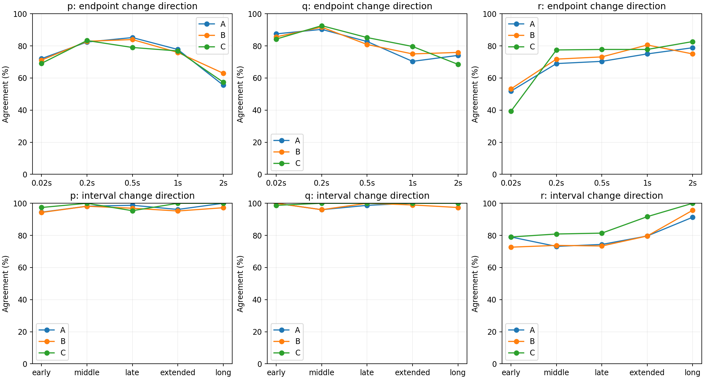

# 冻结 PA-HBD 与 1s GRU-Control：共同验证范围比较

本次结果：当前 PA-HBD A/B 没有超过冻结的 1s GRU-Control。200ms、500ms、1s、2s 的位置、速度、姿态、角速度 RMSE 均更高；分别看种子17和29，结论也一致。角速度变化同向性存在局部优势，但未显示整体优势。这里比较已训练预测器，不把差异归因于单独某个结构。

本次只执行冻结模型推理和分析，未训练、未恢复正式队列、未访问封存 test。正式训练保持暂停。分析工作树为 `perf/pahbd-compile-v4`，代码 SHA `dba2b61`；本目录保存执行脚本与结果。

## 比较对象与共同数据

- A：完整 PA-HBD；B：仅关闭显式相位相关控制增益。各用种子17、29独立选出的 best。A17为9120步，B17/A29/B29为10944步；均已完成10944步正式训练。
- C：既有 `velocity_rate_gru64_horizon_training_v1/train_1000ms/GRU-Control/seed_{17,29}/best.pt`，没有重训。原模型为float32、原TF32设置，A/B为float64；2s属于C训练时域之外的外推。
- 数据为冻结 `velocity_rate_multistep_v1` validation。取原PA-HBD固定验证成员与C支持范围的交集：27个main_50hz航次、108个窗口，四个名义时域各27个。没有将C不支持的12个sparse_10hz航次纳入比较。
- 三个模型使用完全相同的评分时刻、观测目标和观测角速度增量起点。评分采用原生VLP状态时刻及其原有配对传感器标签；角速度目标距该时间栅格约±5ms。没有插值或向未来滚动注入观测。A/B这些查询点本已存在，没有改变积分调度。
- 同一预测起点用于定义增量，但模型内部初始化机制保留：PA-HBD历史Belief与GRU原有状态/隐状态初始化不互相替换。位置坐标原点做等价平移。
- 本表与此前39航次、原生gyro时刻的A/B表口径不同，不应直接混合比较。

## 物理误差

向量误差为三轴欧氏范数，姿态为SO(3)测地角。先在航次内对窗口平方误差平均，再等权航次、等权种子，最后开方。每个预测端点使用所有足够长的窗口：200ms/500ms/1s/2s分别108/81/54/27个，各覆盖27航次；不是每个端点都用108个窗口。

| 时域 | RMSE | A | B | C：1s GRU |
| --- | --- | --- | --- | --- |
| 0.2s | 位置 (m) | 0.0972 | 0.0944 | 0.0431 |
| 0.2s | 速度 (m/s) | 0.3101 | 0.3028 | 0.2261 |
| 0.2s | 姿态 (deg) | 2.9425 | 3.0690 | 2.7305 |
| 0.2s | 角速度 (rad/s) | 0.6106 | 0.6085 | 0.5339 |
| 0.5s | 位置 (m) | 0.2225 | 0.2161 | 0.1211 |
| 0.5s | 速度 (m/s) | 0.5210 | 0.5055 | 0.3430 |
| 0.5s | 姿态 (deg) | 5.8458 | 6.0986 | 4.8924 |
| 0.5s | 角速度 (rad/s) | 0.5927 | 0.5944 | 0.5052 |
| 1s | 位置 (m) | 0.5560 | 0.5501 | 0.3371 |
| 1s | 速度 (m/s) | 1.0020 | 1.0311 | 0.7216 |
| 1s | 姿态 (deg) | 10.6495 | 11.3667 | 7.9130 |
| 1s | 角速度 (rad/s) | 0.6756 | 0.6602 | 0.5849 |
| 2s | 位置 (m) | 2.0788 | 2.1405 | 1.4468 |
| 2s | 速度 (m/s) | 2.2584 | 2.4146 | 1.8242 |
| 2s | 姿态 (deg) | 21.5166 | 23.6470 | 16.4815 |
| 2s | 角速度 (rad/s) | 0.8719 | 0.8627 | 0.8259 |

1s时，A相对C的位置/速度/姿态/角速度误差分别高64.9%/38.9%/34.6%/15.5%；B分别高63.2%/42.9%/43.6%/12.9%。两个种子各自的16项比较中，A、B均为16项更高。20ms辅助端点上A/B角速度RMSE较低（0.559/0.552 vs 0.604rad/s），但未延续到200ms及以后。

## 角速度变化同向性

p/q/r分别为机体系滚转/俯仰/偏航角速度。增量相对同一最新因果观测角速度，不以各模型不同的Belief作为比较起点。

**终点增量符号**：观测增量绝对值>0.01rad/s才纳入；预测增量须同号且绝对值>0.01rad/s。先等权航次，再等权种子。下面列出正确率，覆盖数为每个种子的观测合格窗口数，三模型一致。

| 终点 | 轴 | A | B | C | 合格/候选窗口 |
| --- | --- | --- | --- | --- | --- |
| 0.2s | p | 82.4% | 82.9% | 83.3% | 108/108 |
| 0.2s | q | 90.3% | 91.7% | 92.6% | 107/108 |
| 0.2s | r | 69.0% | 71.8% | 77.5% | 106/108 |
| 0.5s | p | 85.2% | 84.0% | 79.0% | 81/81 |
| 0.5s | q | 82.7% | 80.9% | 85.2% | 80/81 |
| 0.5s | r | 70.4% | 73.1% | 77.8% | 77/81 |
| 1s | p | 77.8% | 75.9% | 76.9% | 54/54 |
| 1s | q | 70.4% | 75.0% | 79.6% | 53/54 |
| 1s | r | 75.0% | 80.6% | 77.8% | 50/54 |
| 2s | p | 55.6% | 63.0% | 57.4% | 27/27 |
| 2s | q | 74.1% | 75.9% | 68.5% | 27/27 |
| 2s | r | 78.8% | 75.0% | 82.7% | 26/27 |

**区间平均增量符号**：原生dt加权平均，保留此前报告的TRAIN冻结阈值p=0.159964、q=0.207299、r=0.060343rad/s；仅筛选观测增量，预测只要求同号。它们是历史阈值，不是当前数据重新拟合的分位数或测量噪声界限。

| 区间 | 轴 | A | B | C | 合格/候选窗口 | 合格航次 |
| --- | --- | --- | --- | --- | --- | --- |
| 0–0.1s | p | 94.4% | 94.3% | 97.4% | 87/108 | 27 |
| 0–0.1s | q | 100.0% | 100.0% | 98.7% | 85/108 | 26 |
| 0–0.1s | r | 79.0% | 72.7% | 79.0% | 62/108 | 25 |
| 0.1–0.3s | p | 98.1% | 98.1% | 100.0% | 63/81 | 27 |
| 0.1–0.3s | q | 96.0% | 96.0% | 100.0% | 51/81 | 25 |
| 0.1–0.3s | r | 73.1% | 73.8% | 80.9% | 58/81 | 27 |
| 0.3–0.5s | p | 98.8% | 96.9% | 95.4% | 70/81 | 27 |
| 0.3–0.5s | q | 98.7% | 100.0% | 100.0% | 58/81 | 26 |
| 0.3–0.5s | r | 74.4% | 73.4% | 81.4% | 67/81 | 26 |
| 0.5–1s | p | 96.2% | 95.2% | 100.0% | 40/54 | 26 |
| 0.5–1s | q | 100.0% | 99.0% | 100.0% | 41/54 | 24 |
| 0.5–1s | r | 79.6% | 79.6% | 91.7% | 45/54 | 27 |
| 1–2s | p | 100.0% | 97.2% | 100.0% | 18/27 | 18 |
| 1–2s | q | 100.0% | 97.4% | 100.0% | 19/27 | 19 |
| 1–2s | r | 91.3% | 95.7% | 100.0% | 23/27 | 23 |

A/B的局部优势包括500ms终点滚转同向率、2s终点俯仰同向率；不能概括成每个指标都落后。反过来，高区间同向率不代表波形准确：1–2s区间滚转的时间相关系数A/B/C约0.117/0.246/0.371，偏航约0.161/0.004/0.372。此时区间符号正确率却接近100%，说明区间平均正负掩盖了时间变化误差。完整幅值比、相关系数和各航次结果见CSV。

## 执行检查与解释边界

- 27个200ms窗口的GRU输入与原归档打包逐项相同；长时域归档另核对107/108个起点的全部7项输入一致，余下1个起点无可用2s归档成员，按原规则打包。所有比较只使用validation。
- 四个PA-HBD模型的旧gyro查询输出均与上一轮推理逐值相同（最大差0）；全部A/B/C同向性观测筛选成员一致。
- GRU新共同队列的float32/TF32批量数值与历史归档有小幅差别。648个物理指标比较，最大差为位置0.000798m、速度0.000448m/s、姿态0.003421deg、角速度0.000214rad/s；初始1e-4容差并非全部通过，不能称逐位复现。恢复seed17原始批次后，抽查24个指标全部精确复现，支持差异来自批量数值路径；这些差别远小于模型间误差差距。
- A/B训练覆盖114航次、四时域逐窗口Adam；C训练94航次、1s时域、批量AdamW。模型结构、相位输入、初始化、训练预算和best选择目标不同，因此这是当前可用完整预测器的比较，不是公平隔离某一个设计因素的消融。
- 这是固定验证子集上的开发结果，仅两个种子，尚无封存test结论或显著性检验。真实记录控制序列的条件预测及同向性不能证明反事实控制因果效果或闭环MPC有效性。

## 文件

`preparation.json`记录冻结checkpoint路径和数据来源，`comparison_checks.json`记录评分口径，`direction_protocol.json`记录同向性协议。`error_summary.csv`、`error_per_seed.csv`、`error_per_flight.csv`保存物理误差；`direction_summary.csv`及相应逐种子/航次/窗口CSV保存同向性、幅值、相关性。

推理脚本为`prepare.py`、`infer.py`、`infer_gru_archived_batch.py`；聚合脚本为`analyze.py`和`direction_analyze.py`；`check_archived_batch.py`保存原批次复现检查。各模型目录的`verification.json`记录实际checkpoint和执行设置。已有输出应保留，重跑应另建目录。
