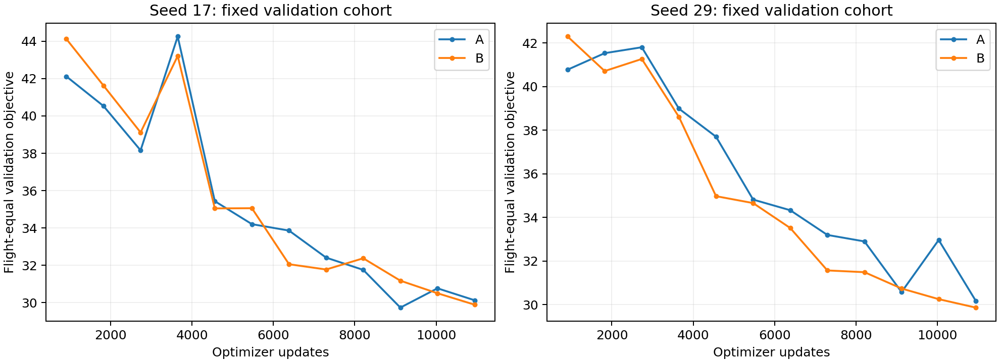
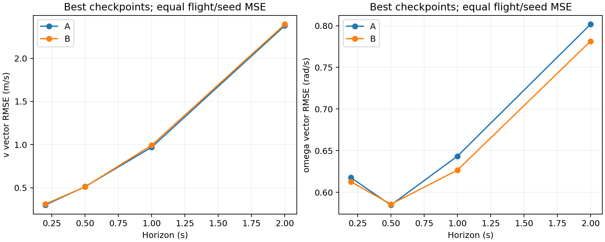
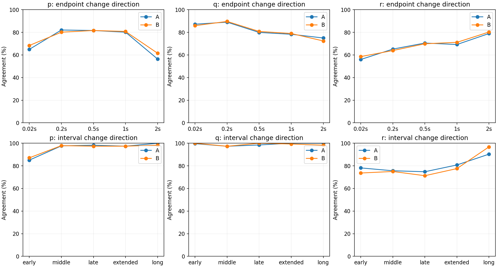
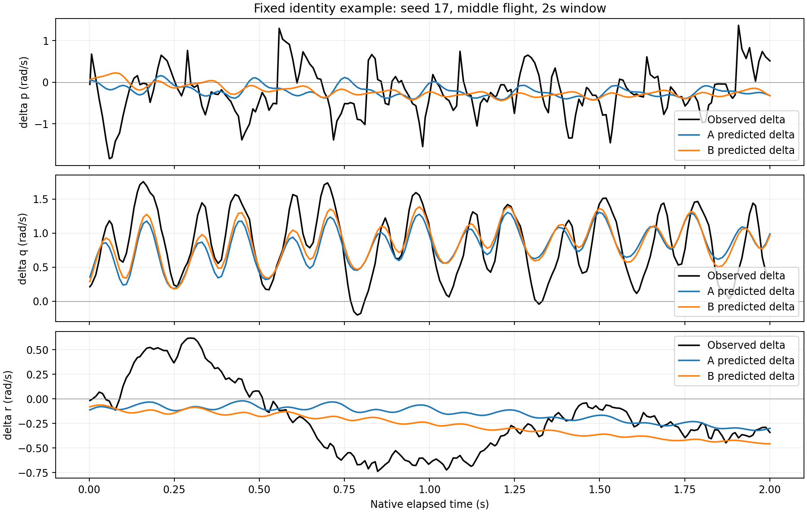

# PA-HBD 两个完整配对种子的验证核查

结论：训练使固定验证目标相对912步首次验证下降约26%～32%，但完整A相对B还没有稳定的总目标优势。A在位置、姿态上改善，长时域角速度更差，速度收益随种子变化。不能据此宣称已优于GRU或已验证控制有效性。

## 已安全暂停

原队列：`/home/zn/pahbd-runs/ab-compiled-dual-20261103-1812`，状态paused，种子17/29四项完成10944步并退出0；种子43两项退出75。训练PID均已退出。
- A_seed43：6741步，`/home/zn/pahbd-runs/ab-compiled-dual-20261103-1812/A_seed43/pause_00006741.pt`，已实际加载模型与19组Adam状态，sampler.draws和保存步数一致。
- B_seed43：4851步，`/home/zn/pahbd-runs/ab-compiled-dual-20261103-1812/B_seed43/pause_00004851.pt`，已实际加载模型与19组Adam状态，sampler.draws和保存步数一致。

## 方法与公平性

第一轮核查复用了训练时已执行并保存的固定验证结果；随后为补充角速度同向性，对四个best模型在同一156个验证窗口重新推理。封存test未读取。独立按原预定validation score选择每个模型的best；同时报告固定终点10944步以检查结论是否依赖best选择。核对了实际checkpoint与记录的step/score、原配置、manifest身份、相位合同、四模型156个固定验证窗口一致（39航次×四时域）；同种子A/B的模型配置只在mode不同。沿恢复链读取训练抽样记录，确认两个种子各自A/B的全部10944个window_id顺序逐步完全相同。种子43未完成，不混入完整预算比较。

验证总目标按原训练代码，包含来源噪声缩放的状态误差、方差校准项与跨翼拍项；先按航次×时域平均，再航次等权。原生RMSE在原生观测中选择名义时域±30ms内最近的有效观测，先航次内平均平方向量范数，再航次等权开根号；因此不是每轴RMSE。跨种子汇总也在MSE层面对两个种子等权。长窗口会贡献其覆盖的多个查询时域，沿用已有指标定义，未重采样时间栅格。

除2s姿态外，各原生指标支持39航次；2s姿态仅31航次有符合既定mask和时间容差的观测，A/B成员完全相同，不填补缺失。

## 总目标（越低越好）

| 模型 | 首次912步 | Best步数 | Best分数 | 10944步分数 | 相对首次验证改善 |
|---|---:|---:|---:|---:|---:|
| A_seed17 | 42.1158 | 9120 | 29.7354 | 30.1291 | 29.40% |
| B_seed17 | 44.1202 | 10944 | 29.8925 | 29.8925 | 32.25% |
| A_seed29 | 40.7717 | 10944 | 30.1759 | 30.1759 | 25.99% |
| B_seed29 | 42.2928 | 10944 | 29.8671 | 29.8671 | 29.38% |

这里的首次验证已经经过912次更新，不是未训练基线。

- 种子17：A相对B改善+0.525%；A在18/39航次的总分更好。固定10944步时A相对B改善-0.792%。
- 种子29：A相对B改善-1.034%；A在17/39航次的总分更好。固定10944步时A相对B改善-1.034%。

两个best总分均值A=29.9556、B=29.8798，A高0.254%。固定终点两个种子也均是B略优。仅两个种子，未做显著性或总体泛化结论；当前证据不支持显式周期控制增益提高总体预定指标。

## Best模型原生误差

| 分量 | 时域(s) | 航次 | A RMSE | B RMSE | A改善（正值更好） |
|---|---:|---:|---:|---:|---:|
| 位置(m) | 0.2 | 39 | 0.1001 | 0.1266 | +20.90% |
| 位置(m) | 0.5 | 39 | 0.2162 | 0.2413 | +10.39% |
| 位置(m) | 1 | 39 | 0.5359 | 0.5531 | +3.10% |
| 位置(m) | 2 | 39 | 2.0730 | 2.1192 | +2.18% |
| 速度(m/s) | 0.2 | 39 | 0.2991 | 0.3101 | +3.53% |
| 速度(m/s) | 0.5 | 39 | 0.5131 | 0.5108 | -0.47% |
| 速度(m/s) | 1 | 39 | 0.9701 | 0.9938 | +2.39% |
| 速度(m/s) | 2 | 39 | 2.3794 | 2.3947 | +0.64% |
| 姿态(rad) | 0.2 | 39 | 0.0541 | 0.0583 | +7.22% |
| 姿态(rad) | 0.5 | 39 | 0.1003 | 0.1075 | +6.69% |
| 姿态(rad) | 1 | 39 | 0.1778 | 0.1918 | +7.29% |
| 姿态(rad) | 2 | 31 | 0.3570 | 0.3912 | +8.72% |
| 角速度(rad/s) | 0.2 | 39 | 0.6176 | 0.6127 | -0.80% |
| 角速度(rad/s) | 0.5 | 39 | 0.5846 | 0.5856 | +0.17% |
| 角速度(rad/s) | 1 | 39 | 0.6434 | 0.6265 | -2.68% |
| 角速度(rad/s) | 2 | 39 | 0.8017 | 0.7815 | -2.59% |

A的位置和姿态在两个种子、四个时域均有改善。合并后200ms位置改善20.90%，500ms改善10.39%；姿态改善约6.69%～8.72%。速度在1s/2s的方向随种子反转；角速度1s/2s在两个种子均比B差，合并约差2.68%/2.59%。因此不能将部分分量改善写成整个动力学模型或控制性能全面改进。2s时A速度向量RMSE约2.38m/s、角速度约0.80rad/s，尚需结合实际任务容许误差判断用途。

## 读取修复与解释边界

运行代码2066d5c在runtime元数据中直接存储torch.__version__（TorchVersion子类），导致默认weights_only安全加载拒绝新checkpoint。此次仅在load_checkpoint中允许已知PyTorch TorchVersion元数据类型，仍保留weights_only=True；将未来入口版本号改为普通str。没有重写历史checkpoint、修改权重或Adam。新增回归测试覆盖该类型及模型/Adam逐位恢复，1项通过；实际四个best、四个最终及两个暂停checkpoint的恢复读取均通过。

本次只有固定validation上的预测观测一致性核查；同一验证集参与了best选择，结果不是独立test评估。没有重评GRU/LSTM，没有开展控制交换、因果控制效果或闭环验证。Hall=0、AS5600正向、0相位后上扑和20ms发布保护的原研究假设保持原合同。保留种子43保存点，正式训练保持暂停。

复现：使用原Python环境执行本目录analyze.py，读取保存的checkpoint与progress文件；需要本次TorchVersion兼容修复。逐种子/逐航次数据见models.csv、paired_scores.csv、native_metrics.csv、paired_flights.csv、horizon_loss.csv及summary.json。

## 角速度同向性补充：两种旧口径

对A/B×seed17/29四个best模型，各自重新推理完整156个固定validation窗口，共624次自主窗口预测；没有优化器更新。四次复算总分与保存值最大差7.11e-15，全部原生RMSE达到1e-8容差。模型初始belief由因果历史生成，未来角速度只用于评分。原生预测/实测时间序列保存于direction-*/window_*.npz。

预测与实测共用决策时刻前最近且已发布的有效实测角速度作为ω0；其年龄满足原数据合同。Δω_pred=ω_pred(t)−ω0、Δω_true=ω_true(t)−ω0。这包含模型belief相对实测起点的误差，没有用未来观测重新定中心。A/B及两种子的窗口、原生观测时间、真值和起点均核对一致。

### 口径1：端点增量

沿用旧v16定义：|Δω_true|>0.01rad/s才进入方向分母；预测须同号且|Δω_pred|>0.01，预测过弱不算正确。0.01是报告死区，不是已标定噪声阈值。本次按现有原生目标，在名义20ms、200ms、500ms、1s、2s±30ms内取最近点；没有新建统一栅格或修改积分时刻，因此不是强行把旧20ms规则套成精确20ms观测。全体窗口仍参与幅值、RMSE和相关性。

同向率：先航次内按符合真值门槛的窗口平均，再对有支持的航次等权，最后两个种子等权。相关性在端点是跨origins、航次等权的增量相关，不是时序波形相关。幅值比沿用旧报告的macro预测RMS变化/真实RMS变化。下表样本数是每个模型的独立窗口数，未将两个种子重复算作新增数据。

| 时域 | 轴 | A同向率% | B同向率% | 有效窗口/航次 | A/B幅值比 | A/B增量相关 |
|---|---|---:|---:|---:|---:|---:|
| 0.02s | p | 64.96 | 68.38 | 154/39 | 0.900/0.896 | 0.607/0.644 |
| 0.02s | q | 87.18 | 85.90 | 154/39 | 1.045/1.082 | 0.878/0.883 |
| 0.02s | r | 55.98 | 58.55 | 139/39 | 1.202/1.147 | 0.331/0.331 |
| 0.2s | p | 82.05 | 80.13 | 156/39 | 0.771/0.767 | 0.765/0.779 |
| 0.2s | q | 89.00 | 89.64 | 153/39 | 0.832/0.837 | 0.901/0.893 |
| 0.2s | r | 65.17 | 63.89 | 150/39 | 0.688/0.698 | 0.432/0.416 |
| 0.5s | p | 81.62 | 81.62 | 117/39 | 0.852/0.837 | 0.785/0.790 |
| 0.5s | q | 79.91 | 80.77 | 114/39 | 0.823/0.828 | 0.861/0.849 |
| 0.5s | r | 70.51 | 69.87 | 110/39 | 0.673/0.714 | 0.596/0.598 |
| 1s | p | 80.13 | 80.77 | 78/39 | 0.687/0.711 | 0.783/0.819 |
| 1s | q | 78.29 | 78.95 | 75/38 | 0.924/0.944 | 0.838/0.832 |
| 1s | r | 69.23 | 71.15 | 73/39 | 0.938/1.054 | 0.558/0.519 |
| 2s | p | 56.41 | 61.54 | 39/39 | 0.788/0.800 | 0.671/0.723 |
| 2s | q | 75.00 | 72.37 | 38/38 | 0.904/0.934 | 0.688/0.703 |
| 2s | r | 78.95 | 80.26 | 38/38 | 0.971/1.100 | 0.627/0.620 |

### 口径2：区间平均变化

沿用旧model_flight_response_diagnostic_v1的“先按真实dt平均Δω，再判断同号”定义。区间采用0–0.1s、0.1–0.3s、0.3–0.5s、0.5–1s，并扩展到1–2s；使用原生观测实际dt，区间边界处对时间权重裁切，没有插值生成目标。只用覆盖该区间（允许原生末点距名义端点≤30ms）的窗口，保留实际覆盖时长。

弱变化门槛沿用历史TRAIN的固定q25值：p=0.159964、q=0.207299、r=0.060343rad/s，所有区间不变。它们不是当前9–10月train重新估计的q25，也不是噪声标定；本轮没有在validation上重拟合或搜索门槛。与旧报告一致，只要求预测区间均值同号，不对预测均值另加幅值门槛，所以必须同时看幅值比。历史数据和模型不同，不能直接把本表百分比与旧报告96%等数值排名。

区间相关性是各窗口内按实际dt加权、去均值后的波形相关，先航次等权，再种子等权；与上面的端点跨origins相关性不同。方向列仅强变化子集，幅值与相关列仍覆盖全部合格窗口，两者分母不同。

| 区间 | 轴 | A同向率% | B同向率% | 有效窗口/航次 | A/B幅值比 | A/B波形相关 |
|---|---|---:|---:|---:|---:|---:|
| 0–0.1s | p | 85.04 | 87.07 | 122/39 | 0.783/0.802 | 0.266/0.261 |
| 0–0.1s | q | 99.57 | 100.00 | 120/39 | 0.957/0.987 | 0.884/0.892 |
| 0–0.1s | r | 78.15 | 73.65 | 81/37 | 0.874/0.803 | 0.231/0.310 |
| 0.1–0.3s | p | 97.65 | 97.86 | 97/39 | 0.784/0.770 | 0.262/0.347 |
| 0.1–0.3s | q | 97.30 | 97.30 | 74/37 | 0.846/0.859 | 0.835/0.836 |
| 0.1–0.3s | r | 75.64 | 75.00 | 80/39 | 0.689/0.702 | 0.276/0.298 |
| 0.3–0.5s | p | 98.25 | 97.37 | 91/38 | 0.762/0.784 | 0.239/0.310 |
| 0.3–0.5s | q | 98.46 | 100.00 | 87/38 | 0.871/0.890 | 0.800/0.801 |
| 0.3–0.5s | r | 74.78 | 71.27 | 97/38 | 0.639/0.658 | 0.298/0.269 |
| 0.5–1s | p | 97.37 | 97.37 | 60/38 | 0.702/0.719 | 0.169/0.299 |
| 0.5–1s | q | 100.00 | 99.29 | 57/35 | 0.842/0.859 | 0.663/0.658 |
| 0.5–1s | r | 80.77 | 77.56 | 63/39 | 0.750/0.818 | 0.152/0.139 |
| 1–2s | p | 100.00 | 98.28 | 29/29 | 0.662/0.676 | 0.106/0.276 |
| 1–2s | q | 100.00 | 98.28 | 29/29 | 0.785/0.814 | 0.380/0.386 |
| 1–2s | r | 90.32 | 96.77 | 31/31 | 0.892/1.007 | 0.199/0.116 |

### 结果解读

1. 两种方向口径均未支持完整A相对B的稳定全面改进。2s端点p：A56.41%、B61.54%，两个种子都是A较差；q：A75.00%、B72.37%；r：A78.95%、B80.26%。这不是一个整体一致改善的模式。
2. 区间平均方向可以很高，同时动态细节很差。1–2s强变化p子集为29窗口/29航次，A100%、B98.28%；但全部39窗口/39航次的p波形相关仅0.106/0.276，幅值比0.662/0.676。不能把方向分母中被排除的弱变化忘掉，也不能用100%掩盖波形和幅值问题。
3. q的短期区间波形相关较高（0–0.1s约0.884/0.892，0.3–0.5s约0.800/0.801），延长到1–2s降至0.380/0.386，且幅值比0.785/0.814。
4. r在0.3–0.5s、0.5–1s区间A平均同向率较高，但1–2s退化到90.32%，B为96.77%，两个种子都支持这一长区间退化。
5. 所有结论是原记录控制条件下的运动响应一致性；相对起点的净变化仍混合惯性、其他控制和扰动，不能直接等同真实舵效方向正确率，也没有证明闭环MPC有效。

下面例图事先按窗口身份选取：seed17、2s组按flight_id排序的中位航次，不按误差挑选。只用来说明波形形态，不能替代上面的全部航次统计。

完整分母、逐种子和逐航次结果：direction_windows.csv、direction_per_flight.csv、direction_per_seed.csv、direction_summary.csv。方向死区边界自检通过，A/B原生时间/真值/起点及方向有效窗口分母逐项相同。
