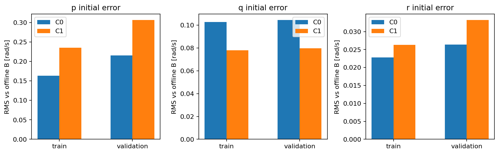
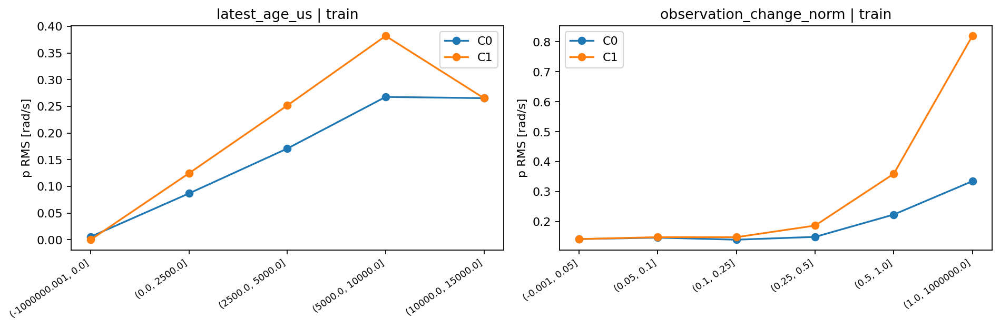
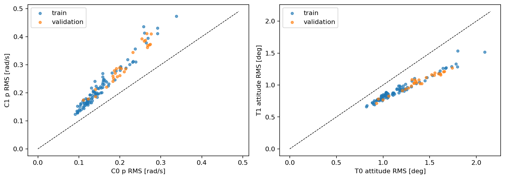

# 因果状态与动力学监督目标的一致性研究

**结论：情况C，不建议直接开展C0/T0与当前C1/T1的6epoch动力学训练。** 两个已发布角速度样本的线性外推虽然因果可实现，却使关键p轴初值误差在全部94个训练航次、27个验证航次上增大。T1的姿态积分一致性确实改善，但这是更换初值和未来角速度标签的联合结果，不能据此判定C1状态估计更准确。停止此固定短时外推方案，不缩短门限搜索更好的结果，不另加滤波参数。

本轮实际训练次数 **0**，没有实例化GRU、加载checkpoint、GPU推理、Loss修改或test读取。基准 `3ee850af770631f6be3d5a9326987aa443307394`，分支 `exp/causal-state-target-contract-v1`；独立worktree，新增文件限于本实验目录。

## 固定表示与因果规则

使用历史 `velocity_rate_multistep_v1/main_50hz`，复用上一轮来源记录和原H1000身份；train107,920窗口/94航次、validation36,332窗口/27航次全部处理。不重算113对Oracle，不重新匹配，不解析原ULog。

C0保持原角速度。C1以位置/EKF名义测量时间t0为估计时刻，以该行state_publication为决策截止t_dec，从已发布且三轴有限、测量时间有效的原生观测取最近两点。同一三轴规则：括住t0则线性插值，否则外推距离同时不超过15ms和该两点的一个实际间隔；非正间隔、超过20ms、观测不足或无效则回退C0。若两点都晚于t0但已发布，代码支持同限幅后向外推；实际起点没有这种情况。没有读取离线B来选择输入观测或改变规则。

历史每行均使用**该行自己的**t_dec，不能使用最终决策时已经看到的后来观测补历史。全144,252窗口检查了历史末端与initial的C1角速度逐值一致；其他历史状态、控制、相位和原dt不变。863,457个唯一使用的历史行保存了来源索引、测量/发布时刻、估计值与回退原因。C1按原特征精度转float32；数值积分诊断使用float64。

## Q1：能否得到更合理的统一时间初始状态？

因果可用性能够满足，但当前线性外推的关键轴准确性不能满足。相对于离线B(t0)的窗口等权RMS如下（rad/s），回退窗口全部保留：

| split | windows | flights | C0_p_rms | C1_p_rms | C0_q_rms | C1_q_rms | C0_r_rms | C1_r_rms |
| --- | --- | --- | --- | --- | --- | --- | --- | --- |
| train | 107920 | 94 | 0.1633 | 0.2351 | 0.1028 | 0.0779 | 0.0228 | 0.0263 |
| validation | 36332 | 27 | 0.2155 | 0.3065 | 0.1045 | 0.0797 | 0.0264 | 0.0332 |

p在train **0.1633→0.2351**（约+44.0%），validation **0.2155→0.3065**（约+42.2%）；r也恶化，q改善约24%。航次等权p结果分别0.1611→0.2314、0.2147→0.3057，同样结论；**没有一个航次的p RMS改善**，不是少数异常窗口独占结果。

起点覆盖：

| split | reason | windows | flights | fraction |
| --- | --- | --- | --- | --- |
| train | extrapolation_limit | 4369 | 94 | 0.0405 |
| train | forward_extrapolation | 72302 | 94 | 0.6700 |
| train | interpolation | 31249 | 94 | 0.2896 |
| validation | extrapolation_limit | 1706 | 27 | 0.0470 |
| validation | forward_extrapolation | 24083 | 27 | 0.6629 |
| validation | interpolation | 10543 | 27 | 0.2902 |

C1规则准入率train95.95%、validation95.30%，回退4.05%/4.70%；全部121航次都有准入窗口，但准入不等于准确。约三分之二起点需要前向外推，约29%可以插值。已有双侧观测的插值与离线B使用同一测量数据，因此接近零的误差是参考构造一致，**不是独立物理真值验证**。

前向外推子集p RMS：train0.1864→0.2783，validation0.2443→0.3624。即使最新观测年龄只在0–2.5ms，p也从0.0867→0.1245、0.1127→0.1596。两观测三轴变化范数>1 rad/s的训练窗口，p RMS从0.3348→0.8193。结果与局部斜率外推在快速变化观测下不稳定相符，但没有证明具体滤波器或翼拍是物理根因。

历史完整性：

| split | history_all_C1_fraction | history_fallback_fraction |
| --- | --- | --- |
| train | 0.3905 | 0.0386 |
| validation | 0.3377 | 0.0413 |

约39.05%/33.77%的完整500ms历史无需回退，其余历史按预定规则混合C1和C0。历史行回退比例按窗口出现次数计为3.86%/4.13%，唯一历史行统计另存；重叠窗口不作为独立飞行实验。

## Q2：姿态积分的一致性是否保持？

T0使用原因果13维initial、原A未来速度和角速度；T1只将历史/initial角速度改C1、未来角速度改同一状态网格上的原生B。两者初始姿态、初始速度、位置及未来目标速度完全相同，不用truth_initial姿态或离线B起点作初始化。

直接调用原 `velocity_rate_gru.py::integrate`：位置采用速度梯形积分，姿态右乘 `Exp(0.5*(w_k+w_{k+1})*dt)` 并单位化四元数。每窗口从原因果姿态连续积分，不回灌未来姿态；积分结果与原注册A姿态作SO(3)测地角比较。未来速度/角速度是**离线指定的真实目标**，这不是模型推理，也不是自主预测能力实验。

原生B仍遵守20ms缺口和原注册support_start/end；遇到第一处缺失即停止积分评分，不补零、不外推、不跳过缺口后重新开始。T0和T1采用完全相同的连续支持前缀；另外单独报告完整H1000窗口。

| split | subset | windows | T0_attitude_rms_deg | T1_attitude_rms_deg | T0_endpoint_rms_deg | T1_endpoint_rms_deg | position_rms_m |
| --- | --- | --- | --- | --- | --- | --- | --- |
| train | common_prefix | 107920 | 1.1872 | 0.9313 | 1.5117 | 1.1131 | 0.2141 |
| train | complete_H1000 | 80533 | 1.1718 | 0.9486 | 1.4879 | 1.1330 | 0.2215 |
| validation | common_prefix | 36332 | 1.3990 | 1.0595 | 1.8153 | 1.3024 | 0.2030 |
| validation | complete_H1000 | 26009 | 1.3932 | 1.0933 | 1.8062 | 1.3452 | 0.2123 |

共同前缀姿态路径RMS：train **1.1872°→0.9313°**，validation **1.3990°→1.0595°**。完整支持窗口仍改善：train1.1718°→0.9486°，validation1.3932°→1.0933°。每个航次的联合T1姿态路径RMS均较低，没有观察到新的整体积分冲突，但不保证每个窗口改善。

位置结果两合同逐值相同（共同前缀RMS约0.2141/0.2030m），因为速度、初值和积分时间未变。姿态比较的记录本身是有时间/滤波语义的估计状态，不是无噪声真值。

完整B未来目标支持为 **80,533/107,920（74.62%）** 和 **26,009/36,332（71.59%）**；其余保留部分连续支持，不作为完整1000ms训练样本宣称。覆盖及支持数量继承上一轮注册边界，没有扩张原数据范围。

## 初值与目标的偏差及固定病例

相对B起点的误差已经显示C1在p/r恶化，因此不能说T1普遍减少了初始状态与监督目标的时间一致性误差。初值到第一个标签的三轴跳变量均值仅小幅下降：train0.5793→0.5653，validation0.6652→0.6561 rad/s。该跳变量含真实运动变化和目标替换，不是纯时间误差，不能替代初值参考误差。

只查看train:124和train:336的原固定两端，未重算控制响应Oracle：

| pair_uid | window_id | C0_error | C1_error | reason | T0_attitude_path_rms | T1_attitude_path_rms |
| --- | --- | --- | --- | --- | --- | --- |
| train:124 | 95b2e74ad704fbe261d081ad317f01a9bba5c99b3c2f32b64e3a5e57602164a8:1:1264:h500000:f500000 | -1.0231 | -0.8211 | forward_extrapolation | 0.0320 | 0.0247 |
| train:124 | 3746db93c8eb02d5b94167d21d11701b5caaeffdd909b7f61a4c70b7519129d0:1:1821:h500000:f500000 | 0.3917 | 0.3433 | forward_extrapolation | 0.0572 | 0.0230 |
| train:336 | bb1f0984727ec1aa0d2a8eb18164d581e4b1fb387ace936abdf485b258ae125e:1:1605:h500000:f500000 | -0.0032 | -0.1100 | forward_extrapolation | 0.0105 | 0.0085 |
| train:336 | 132368b0811cbfe0949bd7b8fd033aee173d390f671341368d591b5d3377e880:1:1222:h500000:f500000 | 0.1733 | 0.1733 | extrapolation_limit | 0.0122 | 0.0101 |

上表姿态路径RMS单位rad，来自相同起点对应H1000窗口，不是旧500ms匹配响应评分。train:124两端p误差有所缩小但仍大（−1.0231→−0.8211、+0.3917→+0.3433）；train:336一端由−0.0032变为−0.1100，另一端因外推界限回退不变。不能用124的局部改善忽略全航次退化。

## Q3：是否将原A标签改成B？

B标签在T1联合运动学对照中更兼容记录姿态，值得保留为时间一致的**候选监督定义**；但本轮同时改变初值和未来标签，没有单独识别标签替换的贡献，也没有训练验证。当前不应把生产训练合同直接切到C1/T1，保留C0/T0作为已有基准。B是滤波后原生角速度的离线时间参考，不是零延迟绝对物理真值。

本结果说明“姿态积分更接近记录”与“瞬时初始角速度更准确”可以不同。仅改变角速度而保留其他异步状态也不构成完全统一的6DoF状态估计器。

## Q4：下一步能否直接训练？

**不建议直接进行当前C0/T0与C1/T1的6epoch对照，选择情况C。** 关键p轴在train和validation全部航次都变差，未通过“足够多航次稳定改善初值”的前提。停止两点短时外推，不继续调15ms门限、扫时移或增加复杂滤波参数。下一步优先明确潜在运动状态与异步、滤波传感器观测的区别及各自时间合同；在此之前不把B起点作为已知因果状态、不直接替换训练目标。本轮不自动开展这个后续研究或任何训练。

## 复现与检查

原数据manifest、Parquet及缓存身份哈希复用上一轮receipt并核对实际读取文件；没有重复大规模原日志或Oracle审计。来源路径和环境见results/receipt.json及execution_record.json。针对性测试覆盖发布截止、未来观测污染不敏感、插值/双向短外推、15ms/单间隔双限制、20ms缺口、无效数据回退、历史/initial一致、原积分器恒定角速度解析解、缺失目标停止积分以及train/validation隔离。

本轮9项测试通过，未修改原模型、Loss、checkpoint或AGENTS.md。复现入口见 [README](README.md)。
