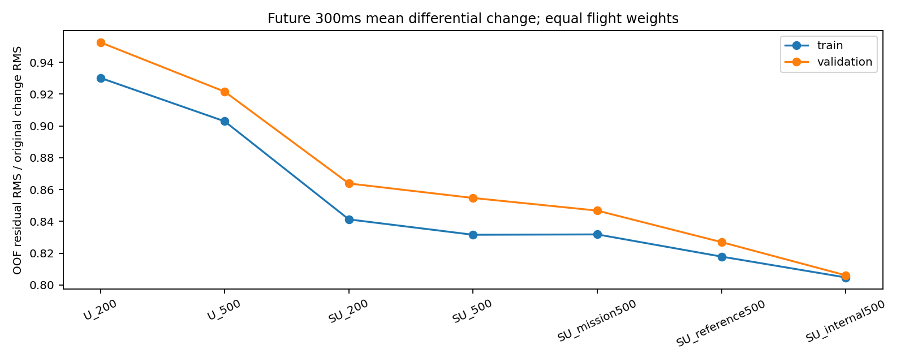
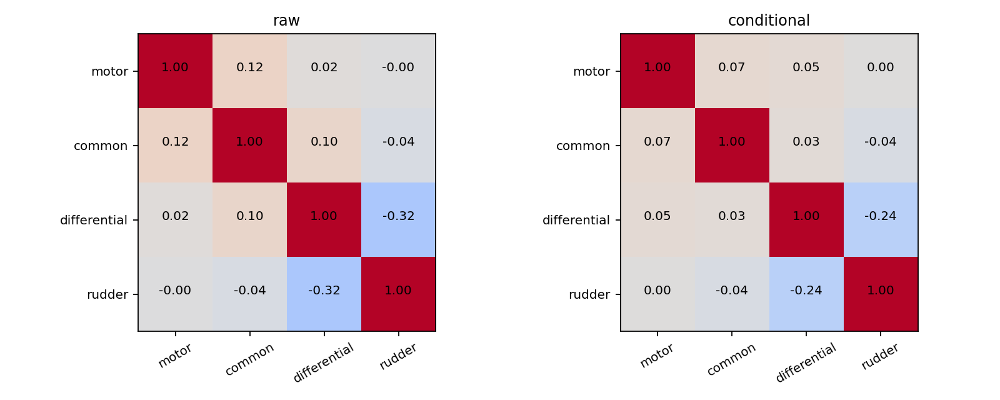
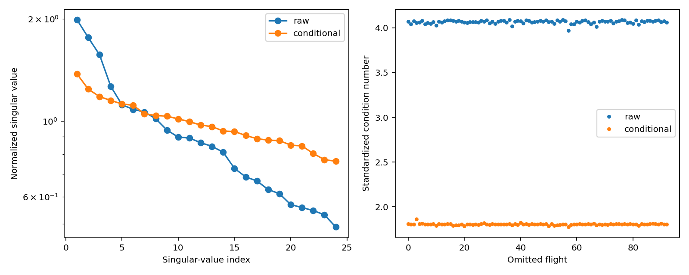
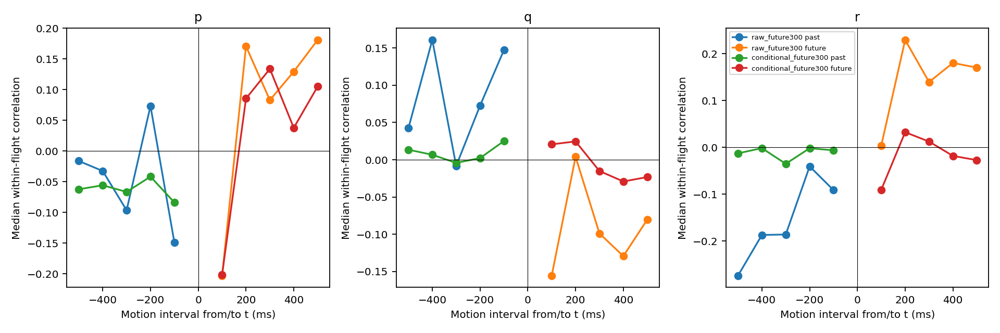
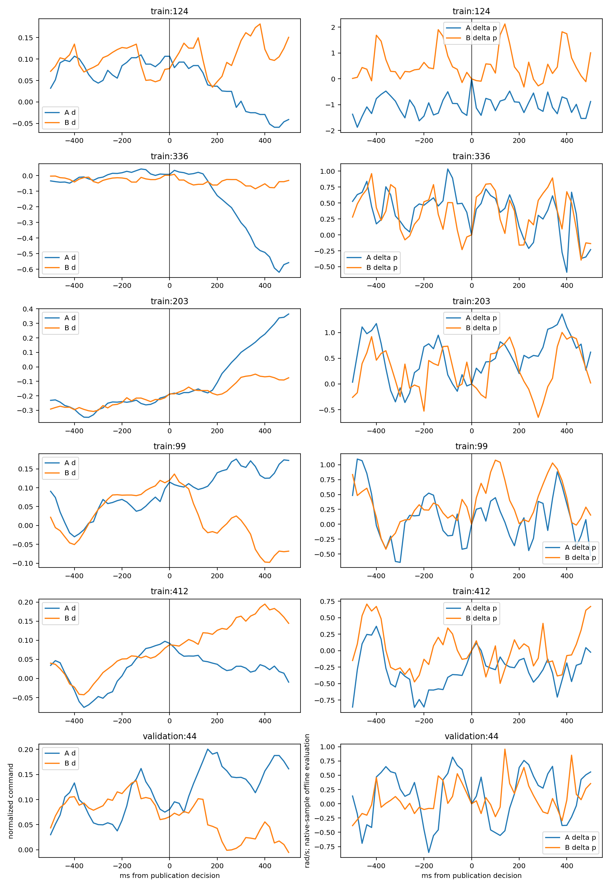
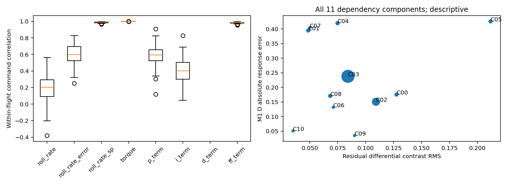

# 有限实飞数据的闭环控制信息量诊断

本轮建议优先路线 **B：研究有条件的训练目标或样本加权的可行性，保留闭环状态、参考与控制耦合，不能把观察性响应差当成因果监督。** 本轮不实施这些训练改动。

证据既不支持“剩余控制变化几乎为零”，也不支持“这些变化已是独立激励”。可用差动变化分布在很多航次上，指定低阶矩阵无明显秩亏；但控制强烈依赖反馈派生设定值，任务切换也受实际到点状态触发。模型失败与信息不足、耦合或配置的关系只有有限探索性证据，尚不能唯一归因。没有证据支持直接进入路线A的物理控制增益辨识，也不应按路线C断言所有局部控制信息都不足。

## 1. 实际范围与复用资产

基准 `321822d83f7a1f381ecc50ba0a4c23e5aa9fa4cf`，分支 `exp/closed-loop-control-informativity-v1`。使用独立worktree，所有新增代码与产物仅在本目录。读取历史 `velocity_rate_multistep_v1/main_50hz` 的八份train/validation Parquet，manifest SHA256 `8afb8623bf7174e4da5b2044f644331b8b251433fed3576f6dcdab470935bcb5`；八文件及共享划分逐项核验哈希。封存test的轨迹、标签、Parquet、ULog均未打开；仅共享元数据用于隔离检查。

复用原控制可辨识性审计、scope冻结工况／事件／匹配、rollout时钟与输入合同、swap结果、正式三折留出结果、时间合同与Stage4报告。没有新GRU训练／推理、Loss、模型、IV动力学或MPC。仅拟合小型控制命令描述回归，全部CPU。

| 范围 | train | validation |
|---|---:|---:|
| main_50hz数据／原日志实际核验 | 94航次／94文件 | 27航次／27文件 |
| AUTO_stable候选航次 | 93 | 22 |
| 全部注册候选起点 | 56,080 | 14,269 |
| 完整历史＋未来支持不重叠起点 | 6,838 | 1,763 |
| 合格起点未来控制支持并集 | 7,302.471s | 1,883.985s |
| 不重叠起点中差动占优变化 | 1,015 | 237 |
| 不重叠起点中四路未来小变化 | 769 | 179 |

覆盖是原固定约100ms注册起点及其未来支持并集，不等于连续时间上每一瞬间都满足AUTO_stable，也不按未来运动筛选。先在完整候选中去重再计事件，所以1,015不同于旧scope在“差动事件子集内另行去重”的2,937；二者不是删样或数据变少。训练覆盖15日期、13固件、29配置；前5航次占差动300ms变化平方和10.48%、控制支持时长7.45%，并非少数航次独占。验证仅3日期，前5航次变化平方和占34.85%，更集中。

## 2. Q1：控制变化从哪里来

所查13类topic在全部121条日志中均存在。AUTO_stable起点的角速度设定、姿态设定、横纵向设定、rate terms/status、torque/thrust，航次平均≤50ms新鲜覆盖均为100%。任务triplet的训练航次起点年龄中位数约10.59s，≤50ms约0.28%；它是按事件长期保持的航点，不能将此判为参考缺失。global-position约110ms、allocator状态约99ms年龄中位数，日志频率低于控制内环。字段有限性与所有25/50/100/200ms覆盖另表保留。

逐航次在不重叠AUTO起点统计，**当前差动**与当前已发布信号的相关中位数：

| 信号 | train航次相关中位数 |
|---|---:|
| roll torque命令 | 约1.000 |
| roll rate设定 | 0.989 |
| FF项 | 0.984 |
| roll rate误差 | 0.599 |
| P项 | 0.593 |
| I项 | 0.401 |
| 实际p | 0.202 |

这些关系支持既有软件链解释；不是相互独立的贡献分解。D项在这批roll记录没有可用于相关分析的变化（相关数为0／NaN，未伪填零）。FF系数、参考、P/I及空速缩放存在共变，不能从0.984相关就宣称98.4%的控制“来自外部参考”。设定值本身由姿态／路径反馈生成。

新增源码核对确认：MissionBase在到点完成条件成立后才推进航点，MissionBlock的完成条件使用实际飞行状态。因而**预先给定的航点坐标**与**活动参考改变时刻**必须区分。训练不重叠起点仅191个（2.79%，76航次）在之前500ms观察到航点改变。另按原生参考的20ms显示网格识别329个有前后100ms支持的改变（83航次）：差动平均绝对变化由改变前0.040增至改变后0.140；p在改变前后100ms均已有较大变化，约0.580／0.537rad/s。参考改变有关联，但不是状态未动时的随机控制脉冲。

详细软件路径、14固件的126项精确源码来源、文献版本及假设对照见 [methods_and_chain_zh.md](methods_and_chain_zh.md)。未认证实飞binary、绝对机械相位、执行器实际舵角或滤波群延迟。

## 3. Q2：给定历史与参考之后剩多少变化

目标明确为 `mean(d[t,t+H))−d(t)`，精确积分原生四路ZOH；不是“未来d的水平”，也不是匹配A−B的完整命令差。以下均为train跨ULog五折预测、完整支持不重叠样本、航次等权。均值／尺度／缺失处理／配置编码只在拟合折计算。

| 条件变量（历史500ms，除注明） | 300ms剩余RMS | 剩余／原变化RMS | 验证剩余／原RMS |
|---|---:|---:|---:|
| 仅历史命令200ms | 0.05288 | 0.930 | 0.952 |
| 仅历史命令500ms | 0.05133 | 0.903 | 0.922 |
| 命令＋状态200ms | 0.04782 | 0.841 | 0.864 |
| 命令＋状态500ms | 0.04727 | 0.832 | 0.855 |
| 再加任务相对几何／年龄／改变 | 0.04728 | 0.832 | 0.847 |
| 再加姿态、角速度、横纵向参考 | 0.04649 | 0.818 | 0.827 |
| 再加已发布内部P/I/D/FF和积分状态 | 0.04575 | 0.805 | 0.806 |

原300ms差动变化RMS为0.05685，验证0.05276。主变量组“状态＋历史控制＋参考”的剩余均方比为66.89%，即简单描述模型相对零变化基线减少约33.11%均方误差；**不能解读为33.11%反馈因果贡献或66.89%独立激励**。过去状态显著增加命令可解释性；任务几何单独在train没有改善，加入下游参考仅在54/93航次降低剩余RMS，非普遍收益。

主变量组100／300／500ms剩余RMS为0.02567／0.04649／0.06165，对应比值0.769／0.818／0.788。预定岭系数0.001、0.01、0.1的300ms比值0.828／0.818／0.824，没有按结果选择新参数。控制方向门限0.02下，300ms原变化近零34.28%，剩余变化仍超过0.02的航次加权比例56.86%。辅助命令预测方向约80.09%，这是命令描述能力，**不是运动响应方向准确率**。

## 4. Q3：哪些局部范围信息支持相对更好

下表是固定物理幅值分箱后的补充描述，不用于重新选择旧匹配对。分箱在主回归后、查看分箱结果前定义，未据运动误差挑选边界，详见README。

| 300ms平均差动偏离幅值 | 不重叠起点／航次 | 剩余RMS | 含义 |
|---|---:|---:|---|
| ≤0.02 | 2,381／92 | 0.02758 | 回归误差大于原小变化尺度；残差不能冒充已发现新激励 |
| 0.02–0.05 | 2,457／93 | 0.03103 | 有变化但尺度较小，匹配／反馈背景不能忽略 |
| 0.05–0.10 | 1,575／93 | 0.04876 | 多航次重复、幅度适中，适合将来有条件的探索性分析 |
| >0.10 | 425／92 | 0.12823 | 大变化存在，但更强不等于更外生、更容易预测 |

历史速度6–8m/s有3,332个不重叠起点、93航次；≤6和8–12m/s分别1,473／80与2,033／92。按旧0.1命令阈值，未来持续超阈值100–250ms有1,465起点，250–500ms有735；均有广泛航次覆盖。暂可把**6–8m/s、0.05–0.10平均差动偏离、100–250ms持续变化**作为下一轮协议讨论的支持区域，不能称为本轮验证的最优控制激励或直接据此重选监督真值。

原生差动4s Welch谱中，0.25–<2.5Hz占约85.27%，2.5–5.5Hz约3.40%；最低非零频点0.25Hz最大，不声称分辨了更低频的峰。命令多为较慢反馈变化，p瞬时运动却含翼拍及异步测量影响；500ms只有约两周期。条件残差另在10Hz上分析100ms平均命令，不把低采样率残差谱当原生执行器高频谱。

四路坐标相关矩阵、原单位与标准化矩阵均保存。指定6阶、24列滞后矩阵的标准化条件数为原变化4.066、条件剩余1.805，1%相对奇异值门限下均24/24；熵有效秩17.34／22.92。逐航次删除范围分别3.971–4.091／1.776–1.862，不由一条航次决定。原命令单位条件数15.54／8.51；1阶最弱条件方向几乎为motor（系数绝对值0.9997）。**标准化会隐藏弱通道的绝对幅值，残差中的噪声／模型失配也会制造满秩。** 不据满秩判定四路真实气动力可独立学习。

## 5. 控制前后运动与负对照

以同一个未来300ms差动平均偏离，与 `[t−H,t]` 已完成运动及 `[t,t+H]` 后续运动分别关联。负时间轴表示过去区间，**不把过去增量额外取负号**。以下为93个训练航次各自相关系数的中位数，H=300ms：

| 控制描述量 | 与已发生Δp | 与随后Δp |
|---|---:|---:|
| 原差动变化 | −0.096 | +0.083 |
| 条件剩余变化 | −0.066 | +0.134 |

原变化的过去相关在76/93航次为负；剩余变化的过去相关仍在67/93航次为负。未来命令可以和过去运动关联，表明闭环状态驱动／共同原因不能忽略。条件化后未来正关联增加，但过去关联未消失；不能由相关峰推断真实时延或控制因果符号。

另有1,015个“原控制资格合格＋完整支持不重叠”差动事件，按未来500ms平均差动符号定向后，前／后300ms平均p变化为−0.058／−0.047rad/s。这个均值与上表相关回答不同问题、事件子集也不同；没有通过事后正向运动筛掉反例。p/q/r、100–500ms、各航次／日期／配置以及全部事件曲线均保留。

## 6. Q4：参考与工具变量是否可用

真实参考已记录，且任务切换后控制变化明显，**参考缺失并非当前主要障碍**。但以下条件尚不满足：

- 角速度／姿态／外环设定值含状态反馈，与创新独立未经证实；不能因高相关就作IV。
- 航点坐标有任务源，但活动航点切换依赖到点状态；相对几何还直接使用实际位置，不能作为纯外部输入。
- 航点改变同时影响横纵向控制、其他控制轴和后续状态；在“单一差动→p”模型中的排除限制未建立。
- 没有确认独立注入序列、执行器实测及噪声结构；不同配置下同一软件反馈关系的物理等价性未认证。

因此本轮没有准入有效IV，也没有拟合IV/CL-DeePC控制模型。可以保留任务坐标／任务切换为**待论证的上游参考来源**，当前不能称为合格工具变量。Colin的结构矩阵条件依赖指定LTI模型类和控制器；Dinkla的一致性还需要有效IV／创新正交等条件；Matt使用设计扫频和独立机动验证。这里的局部Gram和相关性均不能替代这些假设。

## 7. Q5：固定48对及失败归因

全部原113个主／背景匹配身份保留。训练主48对、航次互斥17对、同固件38、同配置11、严格2对及各背景分别报告，不合并算独立证据。原11个共享航次依赖分量逐一保存，Fold0大分量仍含25对。`pair_dependence_summary.csv` 提供逐对、航次等权、依赖分量等权描述。

48主对两段“相对各自起点命令的300ms变化差”RMS为0.09985，辅助交叉拟合后剩余差RMS为0.09672，只有7/48的剩余差绝对值<0.02。17互斥对为0.09283→0.07981；11同配置对0.07182→0.07203；严格2对0.04455→0.04883。这不是同一历史下的控制剩余对照，不能据剩余差大就认证可辨识性；回归失配同样可能增大剩余。

| 固定病例 | 300ms控制偏离差 | 条件剩余差 | 历史角速度匹配RMS | 信息解释 |
|---|---:|---:|---:|---|
| train:124 | −0.0752 | −0.0917 | 0.686 | 剩余不小；A起点native p与因果p相差约1.092rad/s，B约−0.426，且配置不同。不能只归因为控制不够强。 |
| train:336 | −0.0394 | −0.0660 | 0.464 | 同配置仍有未解释变化；辅助模型解释项与实际偏离差异号。新结构放大反向响应不能靠“没有激励”一句话解释。 |
| train:203 | +0.0563 | +0.0708 | 0.699 | 配置不同、历史不接近严格匹配，存在条件错配；不能确定是物理控制符号错误。 |
| train:99 | +0.0922 | +0.0669 | 0.495 | 方向改善但幅度仍弱；有剩余控制变化，并非零输入支持。 |
| train:412 | −0.0729 | −0.0711 | 0.433 | 同配置，三模型能重现部分响应，剩余量级与失败例并无简单分界。 |
| validation:44 | +0.0774 | +0.0513 | 0.495 | 单一已暴露病例；仅展示，不调整规则。 |

表中控制差**先减各自起点命令**，不同于旧匹配表完整未来命令A−B；完整差与当前控制见固定曲线／旧索引。历史率匹配量为三轴向量RMS，不是p测量噪声。

原冻结B真值的主组／小控制差背景RMS为0.549／0.367rad/s；D为0.374／0.214。两段均安静背景B/D为0.434／0.265，仍相当明显。背景混合不同历史、反馈、扰动、相位及测量误差，**不是传感器噪声或控制误差下界**；主组更大也不证明差值都是控制作用。

探索性逐对相关没有出现“剩余越小，模型越失败”的清晰模式。D绝对误差与剩余控制差绝对值的逐种子Spearman均值：M0约0.155、M1约0.265、M2约0.280，反而是弱正关联；历史率不匹配约0.272／0.224／0.238。数值只作描述，未控制共同状态、未给显著性，不是找到因果根因；大响应本就可能带来大绝对误差。所有分量、种子与正反例保留，不能把48对或种子当独立干预。

## 8. 结论、验证与下一步边界

1. **Q1：**软件链明确，下游角速度设定与差动高度相关，反馈误差及积分等也关联；任务参考改变较少且切换受状态触发。不能将四类来源作唯一、可加的因果百分比分解。
2. **Q2：**主300ms条件剩余RMS仍为原变化的81.8%，验证82.7%；有未解释变化，但不是已识别独立激励。低复杂度描述模型能力有限，未证明最优条件剩余。
3. **Q3：**中等幅值、约100–250ms持续变化和常见6–8m/s前飞有多航次支持。低阶矩阵无明显退化，motor绝对弱方向及小变化尺度限制仍存在。支持局部条件性观察分析，不能认证任意控制作用。
4. **Q4：**参考覆盖良好，有可追溯来源和相关性，但独立性、排除限制、创新模型条件不足，没有准入有效IV。
5. **Q5：**失败与反馈、历史不匹配、配置和异步状态均有合理关联证据，但没有单一解释，也没有证据证明“控制信息太少”是唯一瓶颈。

优先路线B，同时暂停无依据地堆叠网络复杂度。下一轮若获授权，可先制定条件性样本权重／目标的评价协议，要求保留状态历史、参考类型、背景尺度及航次依赖；不要直接把残差当外生控制标签。如果将来获得更可信参考／噪声假设，再考虑路线A的低阶模型；当前不开展它。路线C的合理部分是限制物理效能／反事实声明，而不是宣布一切闭环辨识都不可能。

13项自动测试通过。独立实现用增广最小二乘重建4个辅助拟合，最大预测差1.08e−14；432条汇总RMS最大差1.12e−16；Gram-SVD最大差1.56e−15；400窗口×3时域共1,200次原生ZOH积分及历史命令全部一致；负对照相关最大差1.12e−16。原文件哈希、全部日志身份、完整支持去重、ULog分组与train-only拟合均检查。

保留了实施中两类数值复核问题：独立ZOH复核最初在float32先作坐标运算，而原统计先转float64，改为一致精度后精确相等；合成秩亏测试最初比较近零奇异值与Gram特征值平方根，后者有平方根放大的舍入误差，改为比较平方值并独立检查秩。仅修正复核实现／断言，没有调整分析数据、方法参数或主要结果。另保留初次固定100ms滞后索引的失败日志及修正说明。

全部代码、配置、来源、日志和输出路径见 [README.md](README.md)。大型可重建特征／全窗口运动数组留在本地并登记哈希，固定匹配窗口数组、完整逐窗命令交叉拟合预测、逐航次统计与图表随分支提交。没有修改旧实验或AGENTS.md。本轮到此停止。
