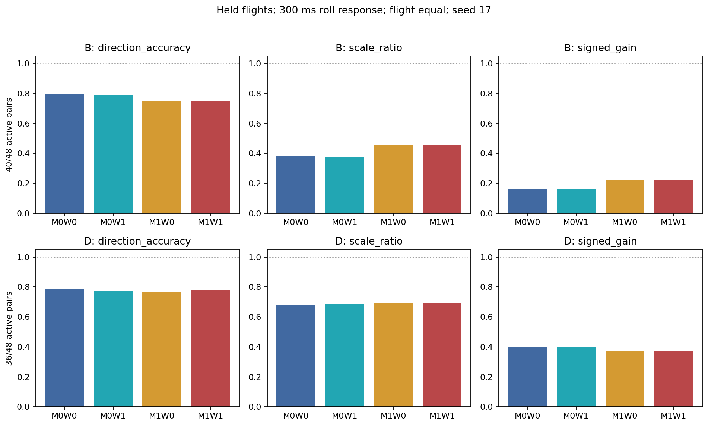
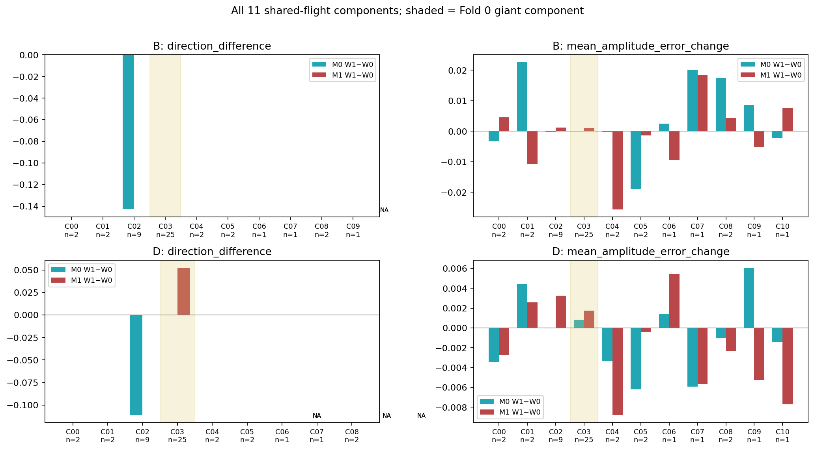

# 控制变化加权 W1：三折、单种子、6 epoch 动力学试训练

**结论：停止推进当前固定 W1 到 24 epoch 多种子比较。** 本轮未看到滚转响应方向和幅度跨多个依赖分量的一致改善。M0 的 B/D 方向各损失一对；M1 的 B 不变、D 只改善一对，且发生于 Fold0 的大分量，预测幅度接近零。普通速度轨迹稍好不能替代控制响应证据。该结论限于本权重、模型、6轮预算和重复使用的开发数据，不证明所有控制条件加权均无价值；本轮不追加 W2。

## 执行与公平性

基准 `exp/control-conditioned-training-weights-v1` / `73c03c73237aa0d6e6c7608827263a94f696f793`；新分支 `exp/control-conditioned-training-pilot-v1`。独立 worktree，旧数据、模型、权重和报告未修改。

已完成 **12/12 次从头训练、72个 epoch、6,384 次更新**，无提前停止、无恢复或重跑选优。每折四组合 M0W0/M0W1/M1W0/M1W1，seed17；Fold0/1/2 每次更新516/564/516（每轮86/94/86）。所有 best 均为 epoch6，同时保存 last、优化器、scheduler和RNG状态。M0参数37,590，M1参数36,534；结构直接导入冻结实现。第一轮六个 W0 运行的训练/验证损失与原相同折、种子的24轮实验第一轮逐值相同；这只是相同初始学习率下的回归检查，不是不同训练预算的性能比较。

每折87,239/95,627/87,750拟合窗口，原500ms历史、1000ms自主预测、六维速度/角速度更新和13维积分状态、V0及 `exact_zoh_merge_us_v1` 不变。AdamW lr0.001、weight_decay0.0001、batch1024、clip5、cosine T_max6。模型和batch顺序均有哈希；同折同结构W0/W1初始参数哈希完全相等，四组合每epoch顺序一致。

折内 mean/scale/output_scale/loss_scales 复用原独立核验的拟合侧结果，逐个核对cache、拟合索引、函数和normalization哈希。没有使用全训练归一化、留出航次或validation估计尺度。权重以 `registered_index/window_id/flight_id` 对齐，27个随机真实batch经独立身份检查；实际batch同一索引同时取输入、target、mask、weight。原float64权重逐值保留，原四分量Loss和网络仍为float32，W1仅标量加权归约为float64；全1时直接退化为原Loss。

四组合best仅由原27个validation航次等权的**未加权 W0 四项轨迹Loss**选择，最小改善1e−4。不同折尺度不同，不把折间归一化validation loss平均当作物理性能。各次训练配置、epoch LR、梯度、所有batch权重均值/和/ESS均已保存。W1实际batch ESS比最小为 93.99%；M1控制分支所有batch梯度非零且有限。

GPU0有其他任务，因此仅用GPU1，没有终止其他进程或缩减预算。训练加每轮验证的墙钟合计 640.95 秒（非纯kernel计时；不含缓存解压、后续评价和报告），峰值PyTorch allocated约1.69GiB。使用规定 `flap-train-gpu`，没有安装依赖。

## 留出范围与评价定义

48主对涉及46个留出航次、11个共享航次分量，每个组合每对只由所属fold best评价一次。另按冻结协议评价两端同时留出的背景；共105个train匹配对可评价（48主对+57其他/背景，队列标签可重叠），5个跨折背景不补配。`validation:44`只作为三个fold模型的已暴露补充病例保存，不计入排名。完整普通轨迹评价覆盖 **53,144个留出H1000窗口、46航次、四组合212,576行**。

主时刻300ms，FRD p；B沿用原生角速度物理时钟参考，D沿用270ms中心平均，A原始参考保留。两段各自相对起点增量之差为真实/预测事实差；不把匹配差当因果标签。阈值 `|D_real|>0.1 rad/s`，B有效40/48（近零8，16.67%），D有效36/48（近零12，25%）。预测方向零判据仍为原 `1e−8`；本次有效真值中没有预测恰零弃判，但许多预测小于0.1，另表完整保存。100/200/400ms和各对共同端点保留，精确500ms、D边界无支持处保持缺失，未外推或填零。

所有组合的A/B/D真值与支持掩码和旧表逐值一致。交换只替换四路未来控制，receiver历史、initial、dt完全相同，未来相位仍由历史因果外推。折内控制边缘范围支持直接复用同一拟合窗口/相同输入的已核验表；这不是联合状态-控制支持或真实反事实保证，不按支持或模型误差删样本。

## 主结果：方向与幅度

以下为航次等权描述，seed17；RMS比和增益为观察性响应差的统计量，不是物理控制效能。

| 参考 | 组合 | 方向有效对 | 航次等权同向率 | 预测/真实 RMS | 有符号增益 | MAE rad/s |
|---|---|---|---|---|---|---|
| B | M0W0 | 40/48 | 79.70% | 0.3808 | 0.1627 | 0.4372 |
| B | M0W1 | 40/48 | 78.66% | 0.3777 | 0.1642 | 0.4356 |
| B | M1W0 | 40/48 | 75.09% | 0.4559 | 0.2189 | 0.3835 |
| B | M1W1 | 40/48 | 75.09% | 0.4541 | 0.2249 | 0.3807 |
| D | M0W0 | 36/48 | 78.75% | 0.6829 | 0.4007 | 0.2726 |
| D | M0W1 | 36/48 | 77.45% | 0.6855 | 0.4008 | 0.2736 |
| D | M1W0 | 36/48 | 76.39% | 0.6916 | 0.3707 | 0.2538 |
| D | M1W1 | 36/48 | 77.82% | 0.6925 | 0.3728 | 0.2542 |

严格在同一结构内做 W1−W0 比较：

| 结构 | 参考 | 错→对 | 对→错 | 逐对 Δpp | 航次等权 Δpp | 分量等权 Δpp |
|---|---|---|---|---|---|---|
| M0 | B | 0 | 1 | -2.50 | -1.04 | -1.16 |
| M0 | D | 0 | 1 | -2.78 | -1.30 | -1.77 |
| M1 | B | 0 | 0 | +0.00 | +0.00 | +0.00 |
| M1 | D | 1 | 0 | +2.78 | +1.43 | +0.64 |

M0的B RMS比0.3808→0.3777，D0.6829→0.6855；M1的B0.4559→0.4541，D0.6916→0.6925。幅度低估基本保持。M0的B MAE略降但方向下降，M1的D方向增加但MAE略升，说明不能只按普通误差或单一指标判优。

阈值敏感性也未改变这一判断：0.05/0.2下B有效44/35对、D有效42/28对。M0的B同向率75.46→74.50% /79.24→78.06%，D67.09→66.02% /83.46→81.78%；M1的B保持75.99%/78.27%，D68.99→70.17% /80.41→82.25%。没有根据这些结果改变阈值。

## 分量、折与匹配质量

方向得失均来自负向真实响应：M0在Fold1/C02的 `train:363` 失去B/D方向，B预测−0.00519→+0.02022（真实−0.30642），D−0.00328→+0.00172（真实−0.46408）。M1唯一得分提升为Fold0/C03的 `train:788`，D+0.00300→−0.00473，真实−0.36812；W1幅度仅约真实的1.29%，属于接近零附近的符号跨越，不能当作充分重现控制响应。

Fold0包含25对但仅一个分量。去掉Fold0后，M1没有任何p方向新增收益；M0的损失保留。全11分量完整列出（得/失为方向计数，NA表示无有效方向对）：

| 分量 | Fold | 对数 | B/D 有效对 | M0 B 得/失 | M0 D 得/失 | M1 B 得/失 | M1 D 得/失 |
|---|---|---|---|---|---|---|---|
| C00 | 2 | 2 | 2/1 | 0/0 | 0/0 | 0/0 | 0/0 |
| C01 | 2 | 2 | 2/1 | 0/0 | 0/0 | 0/0 | 0/0 |
| C02 | 1 | 9 | 7/9 | 0/1 | 0/1 | 0/0 | 0/0 |
| C03 | 0 | 25 | 20/19 | 0/0 | 0/0 | 0/0 | 1/0 |
| C04 | 2 | 2 | 2/2 | 0/0 | 0/0 | 0/0 | 0/0 |
| C05 | 2 | 2 | 2/1 | 0/0 | 0/0 | 0/0 | 0/0 |
| C06 | 1 | 1 | 1/1 | 0/0 | 0/0 | 0/0 | 0/0 |
| C07 | 1 | 1 | 1/0 | 0/0 | NA | 0/0 | NA |
| C08 | 2 | 2 | 2/2 | 0/0 | 0/0 | 0/0 | 0/0 |
| C09 | 2 | 1 | 1/0 | 0/0 | NA | 0/0 | NA |
| C10 | 1 | 1 | 0/0 | NA | NA | NA | NA |

按分量分别看幅度绝对误差，M0的B有6/11改善、D有7/11改善，M1的B5/11、D7/11改善；变化小且不与跨分量方向收益一致。不能把多数微小幅度变化或25对大分量当作独立重复干预，也不构造显著性或置信区间。

冻结子集保留如下（航次等权；子集重叠，不相加）：

| 队列 | 参考 | 可评价对 | 方向有效对 | M0 W0→W1 | M1 W0→W1 |
|---|---|---|---|---|---|
| flight_disjoint | B | 17 | 16 | 68.75% → 62.50% | 68.75% → 68.75% |
| flight_disjoint | D | 17 | 10 | 70.00% → 60.00% | 70.00% → 70.00% |
| same_firmware_controller | B | 11 | 9 | 58.14% → 53.49% | 58.14% → 58.14% |
| same_firmware_controller | D | 11 | 7 | 80.00% → 73.33% | 80.00% → 80.00% |
| small_pair | B | 27 | 19 | 52.72% → 52.72% | 65.11% → 76.13% |
| small_pair | D | 27 | 22 | 89.86% → 89.86% | 89.86% → 89.86% |
| strict | B | 2 | 1 | 100.00% → 100.00% | 100.00% → 100.00% |
| strict | D | 2 | 1 | 100.00% → 100.00% | 100.00% → 100.00% |

同固件38对、其他安静背景及配置/日期/逐航次细表也全部保存在 `factual_summary.csv`、`per_group_300.csv`；严格匹配仅2对，无足够独立证据支撑模型胜负。

## 正负响应与固定病例

幅度偏差定义为 `|pred|−|real|`，负值表示偏小，但不代表方向正确。

| 结构 | 参考 | 真实符号 | 有效对 | 幅度偏差 W0→W1（rad/s） | 同向率 W0→W1 |
|---|---|---|---|---|---|
| M0 | B | positive | 19 | -0.3755 → -0.3787 | 79.33% → 79.33% |
| M0 | B | negative | 21 | -0.3729 → -0.3771 | 80.03% → 78.07% |
| M0 | D | positive | 14 | -0.1610 → -0.1607 | 89.94% → 89.94% |
| M0 | D | negative | 22 | -0.1528 → -0.1496 | 72.14% → 70.07% |
| M1 | B | positive | 19 | -0.2745 → -0.2745 | 81.07% → 81.07% |
| M1 | B | negative | 21 | -0.3485 → -0.3497 | 69.85% → 69.85% |
| M1 | D | positive | 14 | -0.1417 → -0.1423 | 87.42% → 87.42% |
| M1 | D | negative | 22 | -0.1560 → -0.1558 | 69.86% → 72.14% |

未出现正负方向同步改善。M0负向B/D方向下降；M1负向D增加一对，正向方向不变。M0 D有4对原已反向的预测绝对幅度进一步增加，M1 B有2对、D有3对，不能用RMS稍变大解释为更好的控制学习。

五个病例按预先固定编号完整展示，历史的“成功/失败”称谓不替代本轮实际结果：

| 固定病例 | D 记录响应 rad/s | M0 W0→W1 | M1 W0→W1 |
|---|---|---|---|
| train:124 | -1.3228 | -0.2294 → -0.2292 | -0.1564 → -0.1538 |
| train:336 | -0.1747 | +0.2409 → +0.2528 | +0.5231 → +0.5211 |
| train:203 | +0.5310 | +0.2294 → +0.2333 | +0.0132 → +0.0170 |
| train:99 | -0.2802 | +0.0930 → +0.0931 | +0.0095 → +0.0002 |
| train:412 | -0.2379 | -0.1731 → -0.1757 | -0.1777 → -0.1703 |

- `train:124`：D仍严重低估，M1 B还保持反向（+0.0565→+0.0507，真实−1.0131），问题未解决。
- `train:336`：M0 D反向幅度0.2409→0.2528进一步放大；M1 D仍约+0.52对真实−0.1747，M1 B反向幅度也增加。
- `train:203`：本轮D两结构均同向；M0稍增幅，M1仍接近零。不能套用旧24轮实验的方向标签。
- `train:99`：D两结构仍反向，M1 W1接近零但未变为正确符号，不能称为成功。
- `train:412`：M0 D幅度稍接近记录，M1则稍远；并非一致结构收益。

完整B/D曲线和C/H见 `figures/case_train_*.png`；额外方向得失病例363/788的全时刻数据保留在事实曲线表，所有48对的散点和失败标记均保存，没有删除不利例。

## q/r 与普通轨迹误差

| 轴 | 参考 | 有效对 | M0 同向率 | M0 RMS比 | M1 同向率 | M1 RMS比 |
|---|---|---|---|---|---|---|
| q | B | 44 | 81.74% → 78.88% | 0.6429 → 0.6354 | 76.57% → 80.15% | 0.6531 → 0.6584 |
| q | D | 36 | 96.27% → 97.75% | 0.9494 → 0.9444 | 96.27% → 96.27% | 0.9392 → 0.9426 |
| r | B | 37 | 87.63% → 87.63% | 0.6767 → 0.6803 | 85.32% → 83.70% | 0.6994 → 0.6998 |
| r | D | 37 | 84.23% → 84.23% | 0.6780 → 0.6800 | 81.70% → 83.96% | 0.7075 → 0.7060 |

耦合轴效果混合：M0 q-B方向下降，q-D上升；M1 q-B上升而r-B下降。普通事实轨迹未见整体明显恶化，速度误差有约0.3–0.8%的改善，但局部方向和p轨迹没有随之统一改善。

| 物理量：每窗 RMS 后航次等权 | M0 W0→W1 | M1 W0→W1 |
|---|---|---|
| position_m_path_rms | 0.19449 → 0.19471 (+0.11%) | 0.18428 → 0.18434 (+0.03%) |
| velocity_mps_path_rms | 0.54551 → 0.54121 (-0.79%) | 0.51187 → 0.51020 (-0.33%) |
| attitude_rad_path_rms | 0.09299 → 0.09292 (-0.08%) | 0.08662 → 0.08670 (+0.10%) |
| rate_radps_path_rms | 0.63322 → 0.63137 (-0.29%) | 0.61373 → 0.61466 (+0.15%) |
| p_path_rms | 0.39859 → 0.39925 (+0.17%) | 0.38070 → 0.38131 (+0.16%) |
| q_path_rms | 0.44712 → 0.44387 (-0.73%) | 0.43930 → 0.43998 (+0.15%) |
| r_path_rms | 0.17488 → 0.17484 (-0.02%) | 0.16648 → 0.16669 (+0.12%) |

物理单位为m、m/s、rad、rad/s；各窗口先对有效原生步求RMS，再按航次等权，未把不同fold的归一化Loss混成同尺度物理误差。

## 内部控制敏感性

300ms、主队列、航次等权：M0的C RMS **0.10550→0.10653 rad/s**、H **0.21434→0.21413**；M1的C **0.16090→0.15811**、H **0.22619→0.22627**。W1没有系统性提高未来控制贡献，也没有明显削弱历史依赖。

CA/CB在双方绝对响应都超过0.1时同向率均100%，但M0仅10/48对、M1仅17/48对满足该条件，不能推广到全队列。全部CA/CB/C/H、交互量与逐窗口四组合预测已保存。C/H是模型内部差异分解，没有真实交换轨迹，未计算所谓反事实准确率；C变大也不作为成功标准。

## 验证、产物与停止判断

前置9项测试通过，最终 **14 passed**。完整预算、每epoch batch哈希、同结构初始化、权重逐值/身份、fold-fit归一化、未加权验证选best、ZOH冗余分段不变、批量/单样本推理、未来target/phase污染不影响预测均通过。输入按原八字段白名单送入模型，自主递推，无future target回灌。

独立核验5,184个事实主时刻行，插值/中心平均最大差 2.50e-16；2,016条事实汇总最大差 6.66e-16；1,008条内部汇总通过，C+H闭合误差 2.22e-16。独立SciPy检查768条预先等距选取的留出轨迹，物理误差最大差 2.32e-07。另独立核验1,152条同结构方向得失/配对汇总和正负幅度表。检查范围明确：全量汇总和身份核验，轨迹数值复算为抽查而非全部双实现。test始终未读取。

Q1：W1没有改善M0的主要方向指标，幅度变化很小，反向例仍在。

Q2：对M1效果不同但不足：B方向不变、D只在一个大分量的一例接近零预测中跨过符号边界，幅度低估未解决。

Q3：没有跨多个依赖分量的一致方向收益；唯一M1收益由Fold0/C03贡献。

Q4：正负方向未同步改善，M0出现新反向预测，已有反向病例部分被放大。

Q5：普通轨迹总体接近，部分速度指标改善；q/r局部方向互有得失，不能据此认定控制响应改善。

Q6：**不建议直接推进当前W1到24epoch多种子正式比较，按预先原则停止该方案。** 单种子短预算不足以断言所有加权方法无效，但当前证据没有满足“跨多个分量的方向与幅度积极迹象”。下一步先重新审视可辨识的数据条件与监督信息，而不是继续扩大这个固定权重实验；本轮不实施新Loss、W2、网络修改或MPC。

三折与匹配规则多次参与研究设计，只是重复使用开发数据的探索性证据，不是新的独立盲测。validation用于checkpoint选择，不能当完全独立测试；观察性记录响应不等于真实因果控制效应。

全部产物位于 `experiments/control_conditioned_training_pilot_v1/`。入口 `README.md`；配置 `config.json`；12组best/last及优化器记录在 `folds/`；原生预测、逐对/逐折/逐时刻/逐分量统计、来源SHA256和独立核验在 `results/`；PNG在 `figures/`；完整文件SHA256见 `archive_manifest.json`。
