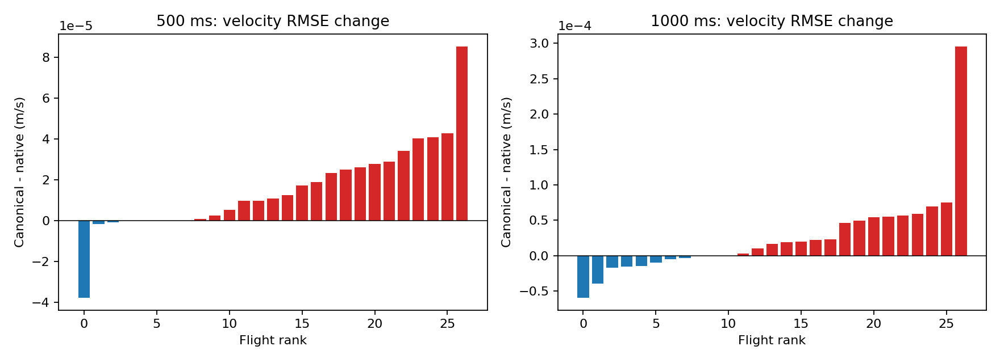
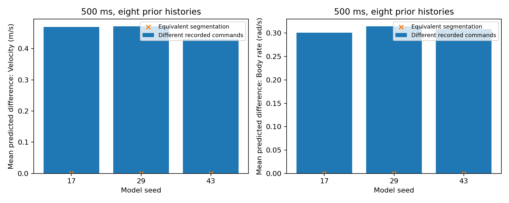

# 控制事件统一规范化：冻结模型验收与接入

**验收通过，已接入统一规则 `exact_zoh_merge_us_v1`。无需为本次修复立即重训，也未改变网络结构或权重。** 同一个记录控制函数经过同一规范化后，二分、四分、随机拆分都得到完全相同的输入及预测；原生验证轨迹精度基本保持。

基于 `653b60d`，独立分支 `fix/control-event-canonicalization-v1`。原工作区、原始数据、旧缓存、历史结果与六个既有模型权重保持不变。本次没有测试集读取、优化器更新、MPC 或完整控制响应评价重跑。

## 1. 规则及验收条件

每个原生状态区间内，将控制表示为 `[四路命令, 持续时间]`。四路值全部精确相同的相邻段合并，持续时间按整数微秒相加；忽略无效 padding、删除零时长条目，保留全部真实控制变化及其时刻。不跨状态区间、窗口或航次合并，不改原生 dt，不平均控制值。模型入口核对各段时长之和等于区间 dt。

例如 `[U,5ms][U,7ms][V,8ms]` 与 `[U,12ms][V,8ms]` 都成为后者。等价控制是否被上游人为拆分，已不影响有效输入。规则只比较输入存储精度下完全相同的四路值，不把近似相等当作相等。0.05 微秒检查容差仅接收 float32 时间存储误差。

`acceptance.json` 在本轮运行前记录条件：同批次/设备下等价表示的输入与预测逐元素相同；所有种子、两时域、四指标的航次等权 RMSE 增幅，全体不超过 0.1%，受影响子集不超过 1%。这是参考前一轮已知结果设定的工程回归容差，不是新的独立统计检验或能力认证。

## 2. 实际运行范围

- 冻结 1 s GRU-Control：种子 17、29、43。
- main_50hz validation：36,332 窗口、27 航次；沿用相同原生窗口和 500 ms/1 s 端点，未按模型误差筛选。
- 每个窗口实际推理原生、规范化、二分后规范化、四分后规范化、随机七段后规范化五种表示。
- 先用旧网络加外部规范化做 preflight，再用正式默认入口做 integrated；每阶段五种主条件共 544,980 条完整窗口递推，两阶段都实际执行。integrated 还对每个窗口另跑旧网络加外部规范化参考；重复推理及诊断病例另计。
- 复查前一轮 8 个异常历史窗口 / 6 航次，覆盖原生、二分、四分、原实验冗余细分、额外固定节点、padding 及实际控制交换；不依据本轮结果挑例。

## 3. 分段不变性结果

全部 36,332 窗口 × 3 种子的二分、四分及随机拆分，规范化后的控制张量和有效长度相同。全部自主递推状态张量的最大绝对差为 **0**；相同输入重复推理差为 **0**。正式入口与冻结旧网络加外部规范化也逐元素相同。preflight 和 integrated 的全部归档端点预测经独立比较完全一致。

原有 8 个诊断窗口全部通过。SO(3) 误差公式在两个相同浮点四元数上可能产生约 1e-15 度舍入残差；判据使用预测张量本身的逐元素相等，不把这类计算残差误当成不同预测。

## 4. 真实轨迹精度

下表为每航次先平均误差平方，再对航次和种子等权开方；正 change_pct 表示误差增加。位置 m、速度 m/s、姿态度、角速度 rad/s。逐窗口、逐航次、逐种子及窗口等权结果均归档。

| horizon_ms | metric | native_rmse | canonical_rmse | change_pct |
| --- | --- | --- | --- | --- |
| 500 | position_m | 0.204556 | 0.204555 | -0.000620 |
| 500 | velocity_m_s | 0.367857 | 0.367873 | 0.004201 |
| 500 | attitude_deg | 4.848366 | 4.848422 | 0.001160 |
| 500 | rate_rad_s | 0.585042 | 0.585044 | 0.000272 |
| 1000 | position_m | 0.469211 | 0.469206 | -0.001216 |
| 1000 | velocity_m_s | 0.657109 | 0.657136 | 0.004075 |
| 1000 | attitude_deg | 7.727768 | 7.727855 | 0.001131 |
| 1000 | rate_rad_s | 0.625198 | 0.625202 | 0.000582 |

总体速度误差约增加 0.004%，其它总体指标变化更小；没有明显精度收益，也没有实质退化。规范化主要带来等价表示的一致性。全体各种子/指标最大增幅 0.007099%，通过 0.1% 工程容差。

自然同值冗余涉及 88 个唯一验证状态区间，在重叠窗口中出现 728 次。1 s 影响 708 窗口 / 24 航次；500 ms 影响 362 窗口 / 24 航次。受影响子集单独按航次等权：

| horizon_ms | metric | windows | flights | change_pct |
| --- | --- | --- | --- | --- |
| 500 | position_m | 362 | 24 | -0.017378 |
| 500 | velocity_m_s | 362 | 24 | 0.413882 |
| 500 | attitude_deg | 362 | 24 | 0.219659 |
| 500 | rate_rad_s | 362 | 24 | -0.061231 |
| 1000 | position_m | 708 | 24 | 0.011766 |
| 1000 | velocity_m_s | 708 | 24 | 0.206148 |
| 1000 | attitude_deg | 708 | 24 | 0.101345 |
| 1000 | rate_rad_s | 708 | 24 | -0.007545 |

受影响子集全部种子/指标最大增幅 0.739207%，通过 1% 工程容差。窗口高度重叠，不把 708 个窗口视为 708 次独立飞行干预；不声称这些微小差异统计显著。

三个种子的速度结果：

| horizon_ms | seed | native_rmse | canonical_rmse | change_pct |
| --- | --- | --- | --- | --- |
| 500 | 17 | 0.363698 | 0.363723 | 0.007099 |
| 500 | 29 | 0.366459 | 0.366471 | 0.003084 |
| 500 | 43 | 0.373347 | 0.373357 | 0.002527 |
| 1000 | 17 | 0.653607 | 0.653642 | 0.005335 |
| 1000 | 29 | 0.650827 | 0.650848 | 0.003322 |
| 1000 | 43 | 0.666783 | 0.666807 | 0.003582 |

## 5. 是否误删了真正的控制响应

在上述八个历史窗口，实际交换匹配片段的命令后，规范化模型仍产生以下预测差异均值（8 窗口和 3 种子等权，第 25/50 个原生步，约 500 ms/1 s）：

| horizon_ms | position_m | velocity_m_s | attitude_deg | rate_rad_s |
| --- | --- | --- | --- | --- |
| 500 | 0.053580 | 0.457229 | 1.839135 | 0.307907 |
| 1000 | 0.265997 | 0.851713 | 4.198808 | 0.557507 |

例如 500 ms 速度响应约 0.457 m/s、角速度约 0.308 rad/s，说明规范化消除了冗余分段而没有强制抹平真实控制差异。**这只是模型敏感性检查，没有未执行控制的真实标签，不证明响应方向或幅度准确。** 本次未重跑完整实验 A/B，也未重新宣称因果控制能力。

## 6. 接入位置与兼容性

1. `src/system_identification/models/control_events.py` 是唯一规范化实现，NumPy 数据准备与 Torch 推理共用。
2. `scripts/prepare_velocity_rate_learning.py::interval_events` 默认使用它，新打包结果记录策略 ID。注册数据集原始记录保持不变。
3. `VelocityRateGRU.forward` 在 event GRU 前默认规范化，因此旧缓存、临时构造或控制交换产生的序列也受保护；已经规范化的输入再次处理不变。
4. 新训练 checkpoint 的配置和普通评估契约记录 `control_event_policy`。NoControl 仍不读取控制；历史 500 ms 状态/控制输入、主网络、相位外推和积分均不变。
5. 旧权重严格加载成功，参数仍为 37,590。`legacy_raw_v0` 仅作为显式历史重现选项；默认不会因 checkpoint 较旧而绕过规范化。完整历史结果重现应切回对应提交，不覆盖旧输出。

规则文档：[control_event_encoding.md](../../docs/control_event_encoding.md)。本次修复已由完整冻结验证支持，因此暂不重训；未来新训练统一采用该规则。

## 7. 验证、资源和归档

- 定向测试 **28 passed, 4 skipped**，见 `tests.log`：模型默认入口/旧模式、参数兼容、精确值与近似值、全函数等价、真实变化时刻、padding、零时长、错误输入、因果前缀、相位掩码、NoControl 隔离、梯度及积分。四个原有就地缓存测试因新 worktree 未复制缓存而跳过，以下共享缓存独立核验覆盖实际数据。
- NumPy/SciPy 对每阶段 **1,743,936 个标量指标**全量独立复算；最大差 **2.13e-14**。另复算所有航次等权汇总。
- 728 个真实合并区间逐边界验证整个控制函数相同；从 train/validation 各 12 个实际窗口的原生记录重新打包，共 1,200 个状态区间，与缓存规范化结果完全一致。
- 检查注册 manifest、授权 train/validation 原生控制及状态文件、训练/验证缓存、冻结权重哈希；验证集所有窗口航次归属、时间边界和 EXCLUDE 区间，训练/验证航次不交叉。
- 32 个训练窗口做 GPU 前向/反向：Control 与 NoControl 梯度有限，全部权重不变，优化器更新次数为 0。
- GPU：NVIDIA GeForce RTX 4090；正式接入阶段约 77.6 s，峰值分配显存 151.9 MiB。GPU 与其它任务共享，该时间仅作运行记录。

`results/preflight/` 与 `results/integrated/` 保存 manifest、逐窗口误差、端点预测、逐航次/种子表和病例结果；`results/verification.json` 保存独立复核。代码及全部新结果由 `archive.py` 记录 SHA256。复现方法见 [README.md](README.md)。

**结论边界：支持采用统一输入规范化来修复同值分段依赖；不意味着日志丢失信息已恢复，不意味着对近似控制扰动具备正确响应，也不意味着反事实控制预测已被证明。**
