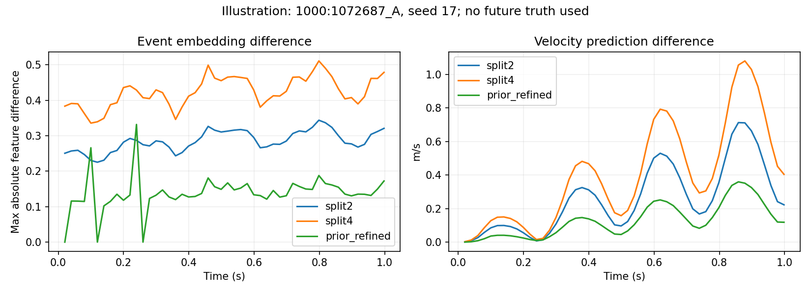
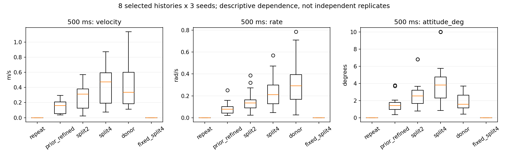

# 控制事件分段不变性检查

**复现，且不可忽略。原因已定位到逐事件 GRU 编码对冗余事件数量和时长分配的敏感性，未发现相位泄漏、状态复用或重复推理随机性。** 本轮仅诊断，不修改正式模型、权重、训练或推理代码。

基于 `8455e9f785f559ea455e18d1760058bfc0ff20f9`，独立分支 `exp/control-event-invariance-check`。实际使用 RTX 4090、指定 flap-train-gpu Python，GRU-Control 1 s 模型种子 17/29/43。本轮执行约 49.4 s，无重训或测试集读取。

## 样本与边界

从上一轮 main_50hz validation–validation signal 队列取 **4 对、8 个不同历史窗口、6 个航次**，各预测 50 个原生状态步。包括两个上一轮展示案例、其余样本中冗余分段速度差异最大的匹配对、其余样本历史匹配 score 居中的匹配对；双向历史都检查。选择有意覆盖已知异常，不是随机总体抽样，不能把异常发生率外推至全部飞行。完整 ID 见 `results/selected_pairs.csv`、`windows.csv`。不读取未来运动真值，也不按本轮结果筛选。

复用上一轮已归档输入，先校验其 NPZ/元数据/分析文件 SHA256、模型源码和六模型来源清单中的三个 Control 权重哈希。只对选定验证历史进行推理；源 NPZ 含未使用的训练行，没有测试行。本轮不重新加载原始数据集和 QgcLogs；数据版本、原注册清单哈希、帧/相位契约和模型哈希保存在 `manifest.json`，来源是上一轮校验过的归档。

## 等价控制是如何验证的

A 为原生分段常值命令。B 分别为每个保持段二分、四分，以及上一轮插入供体事件时刻但维持本方控制值的 `prior_refined`。另检查相邻同值合并、仅加 padding、真实记录命令交换。四路控制值及真正变化的生效时刻保持不变；时间步长、历史、初态、掩码全部保持不变。

采用整数微秒还原事件区间，在 A/B **所有边界的并集**上逐个半开恒值区间 `[a,b)` 核对四路值完全相同，且总时长一致。这证明整个预测区间的分段常值函数相等，不只是几个采样点相等。50 Hz 各区间首值相同，时长加权控制均值最大数值差不超过 0。

这里有一项物理前提：重复发布同值命令没有执行器重置、重新触发或超时恢复含义。模型接口只包含四路数值及持续时间，没有这些协议状态；本轮未独立核验具体固件到执行器的完整协议，因此**只在该前提下称物理等价**，不能据此断言真实硬件对所有重复消息都无响应。

## 逐层定位

实际模型没有把未来控制简化成一个 `[batch,50,4]` 张量，而是读取 `events[batch,50,E,5]`（四路命令及该段持续时间）和 `event_length`。因此“50 Hz 控制值相同”不等于真正送入模型的事件张量相同。

1. 历史输入、历史 GRU 最后有效隐状态、初始运动状态、原生 dt 和状态时间网格逐元素相同。
2. 冗余分段使 `events` 的有效条目、持续时间分配及 `event_length` 改变。单独增加无效 padding 不增加有效事件长度。
3. 每个状态步的事件 GRU 从默认零状态编码该区间，取第 `event_length-1` 个输出；二分/四分增加有效递归次数。它不是持续时间积分器，并不满足 `G(G(h,u,d/2),u,d/2)=G(h,u,d)`。持续时间被输入网络，并不能自动保证这一等价性。
4. 二分/四分在**第 1 个状态步**就改变事件嵌入和主 GRU 更新后的隐状态，速度、角速度、位置及姿态也从第 1 步产生可测差异；更新前的主隐状态和状态特征直到第 2 步才因预测反馈而不同。上一轮冗余事件复现首次变化在第 1 或第 2 步，取决于插入事件位置。
5. 主状态 GRU 的更新次数始终是 50。未来频率保持、相位外推、相位有效掩码及 dt 在所有对照中逐元素相同；没有未来扑翼测量或真实运动回灌。

对应正式源码位置：`src/system_identification/models/velocity_rate_gru.py:97` 调用事件 GRU，`:99` 按有效事件长度选择嵌入，`:104` 因果计算相位，`:107` 更新主状态隐变量。上述正式源码哈希与基线一致。

每个窗口整个 1 s 的平均更新次数如下。有效更新与含 padding 的计算位置分开统计，后者增加本身不解释结果：

| variant | valid_event_updates | event_gru_padded_updates | state_updates |
| --- | --- | --- | --- |
| 原生改为规范网格 | 251.0000 | 312.5000 | 50.0000 |
| 规范网格 A/B | 251.0000 | 312.5000 | 50.0000 |
| 原生相邻同值合并 | 100.0000 | 100.0000 | 50.0000 |
| native | 100.0000 | 100.0000 | 50.0000 |
| 仅增加 padding | 100.0000 | 400.0000 | 50.0000 |
| prior_common | 150.2500 | 193.7500 | 50.0000 |
| 上一轮冗余事件 | 149.2500 | 193.7500 | 50.0000 |
| 每段二分 | 200.0000 | 200.0000 | 50.0000 |
| 每段四分 | 400.0000 | 400.0000 | 50.0000 |

同一输入重复推理的所有状态指标最大差为 **0**；仅增 padding 的最大差为 **0**。两个输入完全相同的规范网格对照输出也相同。带 hook 与不带 hook 的实际推理输出逐元素一致；原生、上一轮冗余事件、共同事件网格和实际命令交换均复现上一轮保存的预测（浮点容差 2e-5）。没有证据支持随机性或隐藏状态错误复用作为原因。

## 500 ms 主要量化结果

下表为 8 窗口 × 3 种子的描述性均值及最大值；每个窗口等权，每种子等权，不把 24 次预测视为独立飞行。velocity 为 m/s，rate 为 rad/s，attitude_deg 为 SO(3) 测地角度数。每个窗口仍使用原生实际 dt，在最接近 500 ms 的真实预测步比较。

| 表示变化 | 指标 | 平均差异 | 最大差异 | 相对命令交换均值 % | 受影响窗口 |
| --- | --- | --- | --- | --- | --- |
| 交换实际记录命令 | attitude_deg | 1.8391 | 3.6892 | 100.0000 | 8 |
| 交换实际记录命令 | rate | 0.3079 | 0.7858 | 100.0000 | 8 |
| 交换实际记录命令 | velocity | 0.4572 | 1.1357 | 100.0000 | 8 |
| 上一轮冗余事件 | attitude_deg | 1.4720 | 3.7818 | 80.0362 | 8 |
| 上一轮冗余事件 | rate | 0.0803 | 0.2515 | 26.0851 | 8 |
| 上一轮冗余事件 | velocity | 0.1498 | 0.2948 | 32.7714 | 8 |
| 每段二分 | attitude_deg | 2.6874 | 6.8182 | 146.1222 | 8 |
| 每段二分 | rate | 0.1416 | 0.3871 | 45.9815 | 8 |
| 每段二分 | velocity | 0.2656 | 0.5701 | 58.0932 | 8 |
| 每段四分 | attitude_deg | 3.8700 | 10.0409 | 210.4255 | 8 |
| 每段四分 | rate | 0.2248 | 0.5700 | 73.0030 | 8 |
| 每段四分 | velocity | 0.4123 | 0.8724 | 90.1767 | 8 |

“相对命令交换均值”是同一批历史、种子下等价分段差异均值除以真实记录命令交换的**模型响应**均值。它不是实际飞行控制效应，也不是误差贡献比例，不能用来线性扣除。`summary.csv` 另给逐窗口比值中位数/最大值及规范网格命令交换作为分母的结果，避免仅展示个别案例。

每段四分时，速度差异均值约为命令交换响应的 **90.2%**，角速度约 **73.0%**，姿态约 **210.4%**。即便采用上一轮较温和的冗余事件方案，也达到约 **32.8%、26.1%、80.0%**。全部 8 个窗口、三个种子都超过数值差异判据（位置/速度/角速度 1e-5，姿态 1e-4°），显然不是重复推理误差。

三个种子分别的四分结果：

| seed | metric | mean_difference | max_difference | affected_windows |
| --- | --- | --- | --- | --- |
| 17 | attitude_deg | 5.7468 | 10.0409 | 8 |
| 29 | attitude_deg | 2.1906 | 4.3034 | 8 |
| 43 | attitude_deg | 3.6726 | 5.7714 | 8 |
| 17 | rate | 0.2278 | 0.4002 | 8 |
| 29 | rate | 0.1851 | 0.5700 | 8 |
| 43 | rate | 0.2614 | 0.4712 | 8 |
| 17 | velocity | 0.5025 | 0.8724 | 8 |
| 29 | velocity | 0.3291 | 0.5751 | 8 |
| 43 | velocity | 0.4053 | 0.7388 | 8 |

1 s 补充结果以及位移差异：

| 表示变化 | 指标 | 平均差异 | 最大差异 | 相对命令交换均值 % | 受影响窗口 |
| --- | --- | --- | --- | --- | --- |
| 交换实际记录命令 | attitude_deg | 4.1988 | 7.0433 | 100.0000 | 8 |
| 交换实际记录命令 | position | 0.2660 | 0.5679 | 100.0000 | 8 |
| 交换实际记录命令 | rate | 0.5575 | 1.3537 | 100.0000 | 8 |
| 交换实际记录命令 | velocity | 0.8517 | 1.6930 | 100.0000 | 8 |
| 上一轮冗余事件 | attitude_deg | 2.8040 | 6.6228 | 66.7801 | 8 |
| 上一轮冗余事件 | position | 0.1467 | 0.2846 | 55.1601 | 8 |
| 上一轮冗余事件 | rate | 0.1744 | 0.4882 | 31.2870 | 8 |
| 上一轮冗余事件 | velocity | 0.3249 | 0.6025 | 38.1432 | 8 |
| 每段四分 | attitude_deg | 7.1151 | 17.3619 | 169.4554 | 8 |
| 每段四分 | position | 0.4068 | 0.8400 | 152.9394 | 8 |
| 每段四分 | rate | 0.4011 | 0.8985 | 71.9523 | 8 |
| 每段四分 | velocity | 0.8865 | 1.7863 | 104.0853 | 8 |

`metrics.csv` 还记录每个时域内的峰值，避免只看端点漏掉瞬时差异。这些值是同一模型的两种输入表示之差，不是对真实未来运动的预测误差。

## 固定统一时间网格对照

保留原生 50 Hz 状态 dt。在每个状态区间内，先合并冗余同值事件，再加入固定 5 ms 节点；**保留全部真实控制跳变时刻**。只保留整齐 20 ms/5 ms 采样而删除区间内真实变化会改变控制函数，本次没有这样做。这里的规范网格是固定规则的节点加真实断点，不宣称真实事件时刻都在等间隔网格上。

对原生 A 和四分 B 应用相同规则后，实际送入网络的全部张量逐元素相同，三个种子输出差异为 **0**。所以，在统一等价表示下，本轮未复现“完全相同输入却输出不同”的模型数值问题。

但是，规范网格的输出**不等于旧原生表示的输出**：

| 表示变化 | 指标 | 平均差异 | 最大差异 | 相对命令交换均值 % | 受影响窗口 |
| --- | --- | --- | --- | --- | --- |
| 规范网格命令交换 | attitude_deg | 2.3610 | 4.4656 | 128.3760 | 8 |
| 规范网格命令交换 | rate | 0.3647 | 0.9198 | 118.4445 | 8 |
| 规范网格命令交换 | velocity | 0.4638 | 1.1962 | 101.4391 | 8 |
| 原生改为规范网格 | attitude_deg | 3.0962 | 8.1470 | 168.3530 | 8 |
| 原生改为规范网格 | rate | 0.1793 | 0.4799 | 58.2440 | 8 |
| 原生改为规范网格 | velocity | 0.3326 | 0.6923 | 72.7406 | 8 |
| 规范网格 A/B | attitude_deg | 0.0000 | 0.0000 | 0.0000 | 0 |
| 规范网格 A/B | rate | 0.0000 | 0.0000 | 0.0000 | 0 |
| 规范网格 A/B | velocity | 0.0000 | 0.0000 | 0.0000 | 0 |

这只是定位实验，不是已验证的生产修复。模型训练时见过的事件分布与新规则不同，不能直接替换上线并把零差异解释成物理准确性。

## 对上一轮解释的影响与最小建议

- **需要收紧控制敏感性解释。** 原生控制交换会同时改变控制值与事件表示；本轮证实表示效应的量级足以干扰响应幅度判断。上一轮统一共同事件网格后仍有响应，说明控制值敏感性不是完全虚构，但不能把原生交换的全部差异解释成物理控制作用。
- 上一轮事实轨迹/运动差异评价仍是其原生输入下的观测结果，本轮没有复算或推翻这些统计；但它们不能外推到任意事件分段，也不证明反事实准确性。本轮小样本不能精确估计原报告总体受影响比例。
- **有必要修复表示不变性，再做控制响应验证。** 最小候选方案是在每个状态区间内合并相邻完全同值事件，保留真实命令跳变与精确持续时间，形成唯一表示。原生样本恰无可合并的同值邻段，所以本轮 merged 与 native 一致；这不保证整个训练/部署数据都如此。
- 若统一规范化会改变大量原生输入，需在训练、验证和部署中一致处理，并评估是否需要重训；不能仅靠此检查承诺无需重训。长期方案可考虑具有时间组合一致性的控制编码，或加入等价分段训练约束，均涉及后续模型研究。本轮未实施任何正式修复或重训。

## 复现与验证

`check.py` 调用上一轮的 `predict` 和原 `VelocityRateGRU.forward`，hook 仅记录张量。`test_check.py` 的 7 项定向测试覆盖全区间等价性、保留真实断点、来源/划分/冻结哈希、重复推理与 padding、因果相位/初始隐状态、逐层首次分歧及全部 2304 项指标的独立向量/四元数复算。测试结果见 `tests.log`。

全部输入变体、逐步预测、事件嵌入、主隐状态、相位和状态特征保存在 `results/traces.npz`，完整哈希归档见 `archive_manifest.json`；运行方式见 [README.md](README.md)。本地提交，不推送。
