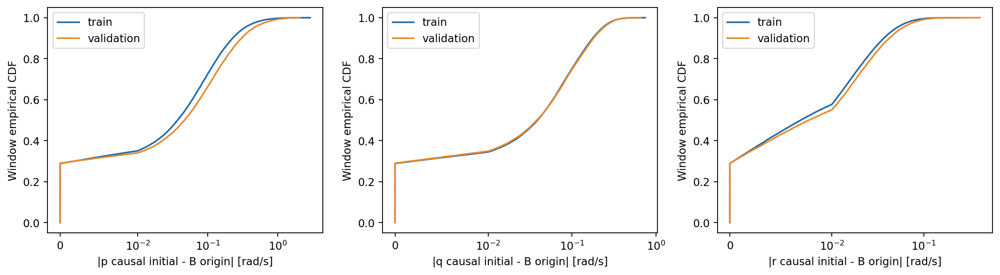
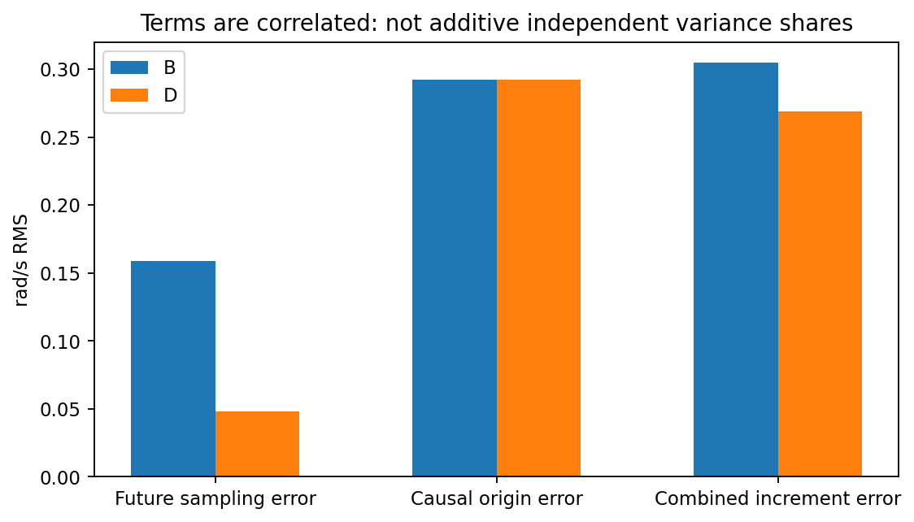
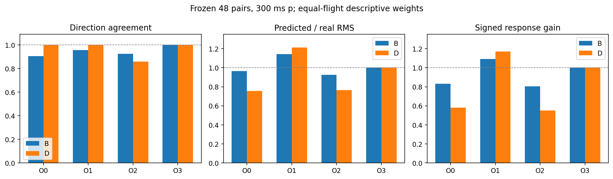
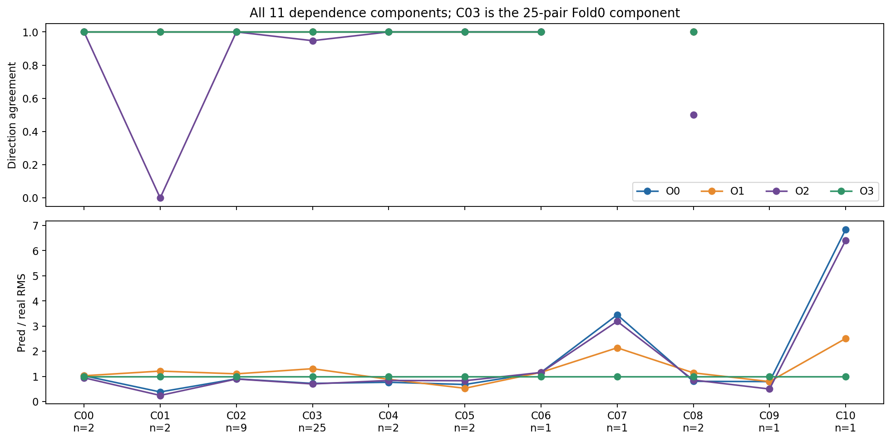
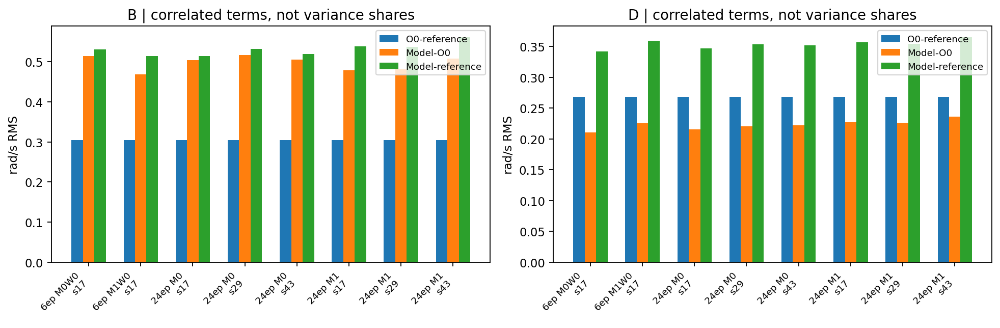

# 动力学训练目标与控制响应评价的一致性审计

**结论：优先路线 B，暂不直接新增单航次增量 Loss。** 因果初值与离线B起点之间存在可重复的差异，慢变响应中的标签基准误差主要表现为起点锚定；新增增量监督在当前状态合同下会要求一个带起点偏差的绝对角速度目标，与原目标及姿态积分约束发生冲突。同时，标签问题不能解释全部模型错误：完美原标签Oracle在D的36个有效主对上全部同向，而实际模型仍有额外反向预测。应先明确目标与初始状态的表示一致性，不能预设增加Loss一定有效，也不能将模型问题全归咎于标签。

## 范围与执行

基准 `exp/control-conditioned-training-pilot-v1` / `d8181c294bb4f5af628822ff21d6b6d1ed005c2b`；新分支 `exp/control-target-alignment-v1`，独立worktree。实际训练次数 **0**；CPU离线分析，无checkpoint加载、GPU推理、参数优化或test读取。所有旧模型、数据、报告及AGENTS.md未修改。

明确复现 `velocity_rate_multistep_v1/main_50hz`，manifest SHA256 `8afb8623bf7174e4da5b2044f644331b8b251433fed3576f6dcdab470935bcb5`。全量处理train **107,920窗口/94航次**、validation **36,332窗口/27航次**，不是抽样估计；原始ULog未重新解析。

固定局部评价包含225窗口（train52航次、validation6航次）、113个主/背景对；主分析严格保持train48对/46航次/11依赖分量、航次互斥17对及validation唯一主病例。全部225个窗口均与源sample、initial、truth_initial和未来标签逐值核验；221个还能按flight/start/origin/measurement/decision五字段精确对应H1000注册身份，另4个H1000键缺失，但原H500注册身份和源标签完整，未近邻补配或丢弃。

原生角速度和样本Parquet、缓存、既有预测数组及评价代码均有来源SHA256。6epoch M0W0/M1W0 seed17和24epoch M0/M1 seeds17/29/43只读归档，预算分别报告，不混合排名。重复使用开发数据，不是新的独立盲测。

## Q1：五种量与未来标签差异

完整调用路径、软件时钟与物理不确定性见 [时间合同](time_contract_zh.md)。initial按决策发布时的可用性取过去值；truth_initial和未来A标签按角速度measurement与位置状态时钟的最近邻取值；B按原生角速度measurement双侧线性插值；D对B作固定270ms中心平均，仍减瞬时B(t0)。所有量为FRD rad/s。

训练未来标签允许使用未来观测，这是正常监督，不是输入泄漏。train有33.03%、validation有31.87%的离线truth_initial在该决策后发布。模型初值仍全部在决策时可用。位置名义时刻与决策相差少量时间，因而initial源年龄也可能为负：train范围−4.991至12.476 ms、中位2.496 ms，不能将负值直接判为未来信息泄漏。

以下全量结果按窗口等权：future RMS是各窗口原生有效输出节点的A−B均方再平均；300ms列是将A曲线线性插值到统一300ms的差异，包含注册网格的插值作用，二者不可混称同一种采样误差。

| split | axis | windows | flights | origin_rms | future_rms | B300_future_rms | D300_future_rms | increment_rms |
| --- | --- | --- | --- | --- | --- | --- | --- | --- |
| train | p | 107920 | 94 | 0.1633 | 0.1021 | 0.1590 | 0.0392 | 0.1926 |
| train | q | 107920 | 94 | 0.1028 | 0.0635 | 0.0757 | 0.0165 | 0.1209 |
| train | r | 107920 | 94 | 0.0228 | 0.0142 | 0.0198 | 0.0047 | 0.0269 |
| validation | p | 36332 | 27 | 0.2155 | 0.1322 | 0.2196 | 0.0518 | 0.2527 |
| validation | q | 36332 | 27 | 0.1045 | 0.0646 | 0.0783 | 0.0168 | 0.1229 |
| validation | r | 36332 | 27 | 0.0264 | 0.0162 | 0.0255 | 0.0056 | 0.0310 |

训练p轴起点差异RMS **0.1633 rad/s**，有效注册未来节点差异 **0.1021**；统一300ms未来曲线差异 **0.1590**，270ms平均后未来差异降至 **0.0392**。validation对应起点 **0.2155**、注册未来节点 **0.1322**。q/r也有差异，但量级较小。逐航次等权结果及所有单航次分布已保存，未用validation选择规则。

所有H1000窗口起点、B300与D300均有离线双侧支持；但并非所有末端节点都有注册范围内的原生括号：

| 分区 | 窗口 | 航次 | 未来有效节点 | B支持节点 | B支持% | 全未来均支持窗口 | D支持中心节点 |
| --- | --- | --- | --- | --- | --- | --- | --- |
| train | 107920 | 94 | 5396006 | 5368619 | 99.4925 | 80533 | 3986541 |
| validation | 36332 | 27 | 1816602 | 1806279 | 99.4317 | 26009 | 1341843 |

未支持节点均标记缺失，原因为原生括号/间隔或注册支持边界不足，未从窗口外静默补入观测。D还受±135ms完整窗限制，支持时间自然缩短；本地500ms评价的100/400/500ms D通常没有支持。

## Q2：起点、未来取样及其相互作用

对同一窗口、同一输出时刻，`E_future=A(t)−B(t)`，`E_origin=initial−B(0)`。O0与B增量误差为 `E_future−E_origin`；匹配对按原A−B顺序再差分。D对同一未来曲线应用同一线性平均，保留瞬时起点。首个预测间隔的连接边界另列bridge；300ms桥接项低于浮点舍入量级。全量节点及逐对恒等式均通过独立验证。

主48对300ms、p轴、航次等权结果：

| method | pairs | future_rms | origin_rms | increment_rms | cross_moment | future_bias | origin_bias |
| --- | --- | --- | --- | --- | --- | --- | --- |
| B | 48 | 0.1585 | 0.2924 | 0.3046 | 0.0090 | -0.0494 | -0.0495 |
| D | 48 | 0.0483 | 0.2924 | 0.2686 | 0.0078 | -0.0023 | -0.0495 |

B未来项0.1585、起点项0.2924、合成误差0.3046 rad/s；D未来项仅0.0483，起点项仍0.2924，合成0.2686。两项有交叉矩，既可能抵消，也可能增强，**没有把RMS相加或声称独立贡献百分比**。

起点误差有个别大值：逐一去掉某航次时，主对起点RMS范围0.1435–0.3292；D的O0 RMSE范围0.1510–0.2991，说明train:124所涉航次等对总体幅度有较大影响。然而全量121航次的误差分布确认问题不只存在于这个病例。单航次移除结果仅为敏感性描述，没有改变主队列。

## Q3：完美原标签的表现

O0未来为原A标签、起点为因果initial；O1改用truth_initial；O2是B未来减因果initial；O3是B未来减B起点。O2在t0可非零，它是锚点差值诊断而非可运行的状态递推；O3使用连续原生B参考作自检。O0/O1没有重新积分13维状态，因此也不保证所有角速度与姿态监督同时可达。

**四种Oracle均使用未来真实观测，不可部署，也不是模型性能的理论上界。** 航次等权主结果如下；幅度偏差为 `|pred|−|real|`，不表示方向一定正确。

| Oracle | 参考 | 有效方向对 | 同向率% | RMS比 | 有符号增益 | RMSE rad/s | 正向幅度偏差 | 负向幅度偏差 |
| --- | --- | --- | --- | --- | --- | --- | --- | --- |
| O0 | B | 40 | 90.6133 | 0.9661 | 0.8314 | 0.3046 | -0.0404 | -0.0591 |
| O0 | D | 36 | 100.0000 | 0.7565 | 0.5806 | 0.2686 | -0.0633 | -0.1423 |
| O1 | B | 40 | 95.6195 | 1.1423 | 1.0927 | 0.2025 | -0.0070 | 0.1056 |
| O1 | D | 36 | 100.0000 | 1.2116 | 1.1688 | 0.1512 | 0.0471 | 0.0366 |
| O2 | B | 40 | 92.4906 | 0.9260 | 0.8040 | 0.2924 | 0.0092 | -0.1039 |
| O2 | D | 36 | 85.9740 | 0.7660 | 0.5498 | 0.2924 | -0.0619 | -0.1347 |
| O3 | B | 40 | 100.0000 | 1.0000 | 1.0000 | 0.0000 | 0.0000 | -0.0000 |
| O3 | D | 36 | 100.0000 | 1.0000 | 1.0000 | 0.0000 | -0.0000 | 0.0000 |

O0在B **37/40有效对同向，3对方向错误**，航次等权90.61%；D **36/36同向**，但RMS比0.7565、有符号增益0.5806，仍有明显幅度差异。D的36个方向有效对中，O0仍有 **4对预测绝对值≤0.1**，不能把100%同向率解释为完整响应重现。

O1改善起点一致性后D幅度比1.2116，仍不等于1；O2的B/D误差均0.2924，正是因果初值项，D甚至有3个方向错误。这说明“未来标签直接换B、仍保留因果初值”并不能自动消除问题。O3在B/D误差约1e−16，仅说明程序自洽，不能作为真实控制预测效果。

A口径完整保留：O1在A完全一致；O0在A同向率92.19%、RMS比0.8457，反映原离线起点与因果初值本就不同。主方向阈值0.1不变，0.05/0.2敏感性已保存；主B/D有效数40/36、近零真值8/12。O0在0.05门限下B/D同向率为86.74%/92.30%（有效44/42对），在0.2下为93.58%/100%（有效35/28对）；因此D的100%限于冻结0.1门限，不推广到所有接近零的真实响应。

辅助轴O0：q在B/D的有效方向44/36对，同向率100%/97.75%，幅度比1.0455/1.0519；r有效37/37对，同向率均100%，幅度比1.0305/1.0163。p的锚点与幅度问题更突出，不能把它当作三轴共同的固定比例误差。

全部11依赖分量如下，NA为该分量无方向有效对，不填零：

| group | pairs | B有效 | B同向率 | B幅度比 | D有效 | D同向率 | D幅度比 |
| --- | --- | --- | --- | --- | --- | --- | --- |
| C00 | 2 | 2 | 1.0000 | 1.3095 | 1 | 1.0000 | 1.0262 |
| C01 | 2 | 2 | 1.0000 | 0.9415 | 1 | 1.0000 | 0.3827 |
| C02 | 9 | 7 | 0.8571 | 0.8579 | 9 | 1.0000 | 0.9032 |
| C03 | 25 | 20 | 0.9500 | 0.8504 | 19 | 1.0000 | 0.7229 |
| C04 | 2 | 2 | 1.0000 | 1.0276 | 2 | 1.0000 | 0.7674 |
| C05 | 2 | 2 | 1.0000 | 0.8815 | 1 | 1.0000 | 0.6783 |
| C06 | 1 | 1 | 1.0000 | 1.3264 | 1 | 1.0000 | 1.1625 |
| C07 | 1 | 1 | 1.0000 | 0.6590 | 0 | NA | 3.4491 |
| C08 | 2 | 2 | 0.5000 | 1.0418 | 2 | 1.0000 | 0.8050 |
| C09 | 1 | 1 | 1.0000 | 1.3869 | 0 | NA | 0.7945 |
| C10 | 1 | 0 | NA | 0.9584 | 0 | NA | 6.8448 |

Fold0的25对只属于一个分量C03，不能视为25次独立实验。航次互斥、同固件/同配置、严格2对及冻结背景均保留在oracle_summary；子集重叠不相加。

## Q4：与实际模型及固定病例的关系

实际模型误差在同一参考上严格分解为 `模型−参考=(模型−O0)+(O0−参考)`，前项为相同初值下的未来标签拟合差，后项为标签/锚定差。两者有交叉项，不能独立相加解释总RMS，也不能将统计关联当作因果归因。逐单窗口相对于A的原始角速度误差另存，避免匹配对相减掩盖两条轨迹误差。

下表保持6epoch与24epoch分开，三个正式种子逐个保留：

| budget_epochs | model | seed | method | direction_accuracy | scale_ratio | label_error_rms | learning_error_rms | total_error_rms | oracle_correct_model_wrong |
| --- | --- | --- | --- | --- | --- | --- | --- | --- | --- |
| 6 | M0W0 | 17 | B | 0.7970 | 0.3808 | 0.3046 | 0.5138 | 0.5301 | 8 |
| 6 | M0W0 | 17 | D | 0.7875 | 0.6829 | 0.2686 | 0.2106 | 0.3417 | 6 |
| 6 | M1W0 | 17 | B | 0.7509 | 0.4559 | 0.3046 | 0.4680 | 0.5138 | 6 |
| 6 | M1W0 | 17 | D | 0.7639 | 0.6916 | 0.2686 | 0.2255 | 0.3597 | 7 |
| 24 | M0 | 17 | B | 0.8116 | 0.4543 | 0.3046 | 0.5039 | 0.5140 | 7 |
| 24 | M0 | 17 | D | 0.8249 | 0.6508 | 0.2686 | 0.2154 | 0.3473 | 5 |
| 24 | M0 | 29 | B | 0.7741 | 0.4849 | 0.3046 | 0.5169 | 0.5312 | 8 |
| 24 | M0 | 29 | D | 0.8249 | 0.6711 | 0.2686 | 0.2206 | 0.3535 | 5 |
| 24 | M0 | 43 | B | 0.8721 | 0.4659 | 0.3046 | 0.5050 | 0.5197 | 5 |
| 24 | M0 | 43 | D | 0.8249 | 0.6659 | 0.2686 | 0.2218 | 0.3521 | 5 |
| 24 | M1 | 17 | B | 0.7301 | 0.5760 | 0.3046 | 0.4785 | 0.5378 | 6 |
| 24 | M1 | 17 | D | 0.8262 | 0.6605 | 0.2686 | 0.2274 | 0.3572 | 5 |
| 24 | M1 | 29 | B | 0.7676 | 0.5805 | 0.3046 | 0.4807 | 0.5370 | 6 |
| 24 | M1 | 29 | D | 0.8457 | 0.6449 | 0.2686 | 0.2263 | 0.3547 | 4 |
| 24 | M1 | 43 | B | 0.7509 | 0.5848 | 0.3046 | 0.5079 | 0.5605 | 7 |
| 24 | M1 | 43 | D | 0.8119 | 0.6399 | 0.2686 | 0.2360 | 0.3648 | 6 |

即便D的O0全部同向，6epoch M0/M1仍分别有6/7个有效对预测错误；24epoch模型各种子仍有4–6个。这部分反向现象不能仅用“原标签相对B/D不同”解释。另一方面，O0在train:124等样本本就存在幅度压缩，因此不能把所有幅度不足都归为网络能力。

按46个航次汇总，6epoch M0/M1的D标签误差RMS与实际响应误差RMS相关约0.837/0.741；24epoch分别约0.803–0.828/0.728–0.737。幅度上存在明显描述性关联，但D标签误差与方向错误率的相关为−0.126至−0.064，并非一致正相关。B上的方向关联则随模型不同（M0接近零，M1约0.27–0.33）。这些航次还共享配对节点，既不是独立样本，也不是误差根因的因果认证。

八个预定病例的p轴300ms结果：

| pair_uid | method | real | O0 | O1 | O2 | O3 |
| --- | --- | --- | --- | --- | --- | --- |
| train:124 | B | -1.0131 | 0.3204 | -1.6312 | 0.4017 | -1.0131 |
| train:124 | D | -1.3228 | -0.0825 | -2.0341 | 0.0920 | -1.3228 |
| train:203 | B | 1.1050 | 1.0642 | 1.0642 | 1.1341 | 1.1050 |
| train:203 | D | 0.5310 | 0.5796 | 0.5796 | 0.5601 | 0.5310 |
| train:336 | B | -0.3864 | -0.2559 | -0.4726 | -0.2098 | -0.3864 |
| train:336 | D | -0.1747 | -0.0035 | -0.2202 | 0.0018 | -0.1747 |
| train:363 | B | -0.3064 | -0.0526 | -0.3970 | -0.0309 | -0.3064 |
| train:363 | D | -0.4641 | -0.2034 | -0.5479 | -0.1885 | -0.4641 |
| train:412 | B | -0.7160 | -0.3315 | -0.4517 | -0.6654 | -0.7160 |
| train:412 | D | -0.2379 | -0.1775 | -0.2977 | -0.1873 | -0.2379 |
| train:788 | B | -0.0955 | -0.0095 | -0.0095 | -0.0436 | -0.0955 |
| train:788 | D | -0.3681 | -0.3430 | -0.3430 | -0.3163 | -0.3681 |
| train:99 | B | -0.2974 | -0.1380 | -0.4501 | -0.1413 | -0.2974 |
| train:99 | D | -0.2802 | -0.1467 | -0.4589 | -0.1240 | -0.2802 |
| validation:44 | B | 0.3879 | 0.3266 | 0.3266 | 0.3646 | 0.3879 |
| validation:44 | D | 0.1100 | 0.0336 | 0.0336 | 0.0867 | 0.1100 |

- **train:124**：真实B−1.0131，O0却+0.3204；D真实−1.3228，O0仅−0.0825。两窗口因果锚点差导致强烈抵消，是不能忽略的标签合同问题。O1又给出D−2.0341，不能将换起点当成无代价的等价修正。
- **train:336**：O0的D−0.0035虽然同向但几乎为零；6epoch模型约+0.24/+0.52，仍存在额外反向拟合差。O2约+0.0018，显示起点附近的微小符号变化不能支持控制方向结论。
- **train:203**：O0在B/D均正确且有较充分幅度，标签错配不足以解释模型曾有的弱响应/错误。
- **train:99、train:363**：O0方向仍正确、幅度受压缩；实际模型的反向及W1方向损失不能全部由标签符号解释。
- **train:412**：O0在B偏小而D较接近，实际模型有部分正确响应，保留为对照。
- **train:788**：O0的D−0.3430接近真实−0.3681；此前模型在近零处跨过符号，主要不能用标签差异解释。
- **validation:44**：B O0+0.3266对真实+0.3879；D O0+0.0336对真实+0.1100。同向但慢变幅度偏小，仅作一个已暴露病例，不据此调参。

病例曲线全部保存为figures/case_*.png，包括Oracle及6epoch两个W0基准；24epoch逐种子相同病例数值在case_models_300及完整模型分解表中。按航次/依赖分量的关联、46航次移除结果均保留，属于探索性描述，没有显著性或可靠置信区间声明。

## Q5：候选单航次增量监督是否准入

候选目标 `pred(t)−initial = B(t)−B(0)` 等价于绝对角速度目标 `B(t)+initial−B(0)`，与原A目标的差为 `−E_increment`。因此当模型在原角速度目标上零误差时，候选Loss通常仍非零；CPU合成张量梯度也确认两者的最优点一般不相同。

全量单窗口在完美A未来节点上的候选均方Loss均值（rad²/s²，不加lambda、不拟合尺度）：

| split | variable | windows | flights | ideal_absolute_target_candidate_loss_mean | candidate_target_shift_rms |
| --- | --- | --- | --- | --- | --- |
| train | p | 107920 | 94 | 0.0371 | 0.1926 |
| train | q | 107920 | 94 | 0.0146 | 0.1209 |
| train | r | 107920 | 94 | 0.0007 | 0.0269 |
| validation | p | 36332 | 27 | 0.0639 | 0.2527 |
| validation | q | 36332 | 27 | 0.0151 | 0.1229 |
| validation | r | 36332 | 27 | 0.0010 | 0.0310 |

当前B300/D300离线支持覆盖全部H1000窗口，因此缺的不是监督数据数量，而是**与部署初值和绝对角速度/姿态积分一致的目标定义**。固定225窗口中只有65个能在原决策时刻拿到B起点的完整原生双侧括号；其余若将B(0)直接塞进initial，会改变因果输入合同。B的硬件/滤波延迟也尚未被完整标定。

将带初值偏置的绝对角速度推进原SO(3)积分器，可能与原姿态监督冲突；不能只因增量方向更好就修改瞬时状态。D还需未来135ms，作为离线监督可以成立，但可用时域缩短，且保留瞬时起点的偏差不会被平均掉。未来若准入，p/q/r尺度必须仅由每折拟合航次支持节点确定并统一用于各组，本轮未拟合任何新尺度或lambda。

**建议路线B：先研究目标、因果初值和积分状态表示的一致性，不建议直接开展此增量Loss的6epoch实验。** 不是建议用未来B初值修补模型，也不重复已做的相位时移。即使表示问题解决，O0与实际模型之间仍有明显差距，应保留学习/表达和闭环输入关系作为后续问题；本轮没有证明标签错配是唯一根因。

## 数值验证与限制

- 原A/B/D参考回归最大差 3.11e-15；6/24epoch归档预测及主要统计均复现，没有重跑模型。
- 独立SciPy插值与解析分段积分核验 19962 个Oracle点，最大差 5e-16；独立航次/连通分量归约核验 1620 行，最大差 3.55e-15。
- 363个确定性窗口覆盖全部121航次，独立复核全量数据计算最大差 2.26e-12；144,252行均方分解恒等式最大差 5.72e-15。
- 自动测试14项通过：时间轴、缺口、无外推、平均边界/合成周期、起点桥接、Oracle自洽、固定身份/方向分母、全量划分、因果可用性、源哈希、聚合、候选公式梯度及无训练边界。
- 审计发现末端的冻结共同控制支持可比单条标签时域更短；独立复核按原支持规则拒绝这些端点，没有为了Oracle补齐或扩大样本。
- B/D是带原生软件时间语义的离线参考，不是无噪声物理真值；Oracle没有反事实标签含义。没有新模型、Loss实现/调参、checkpoint修改、test读取或MPC。

复现及文件索引见 [README](README.md)。本轮在审计、报告和提交后停止。
