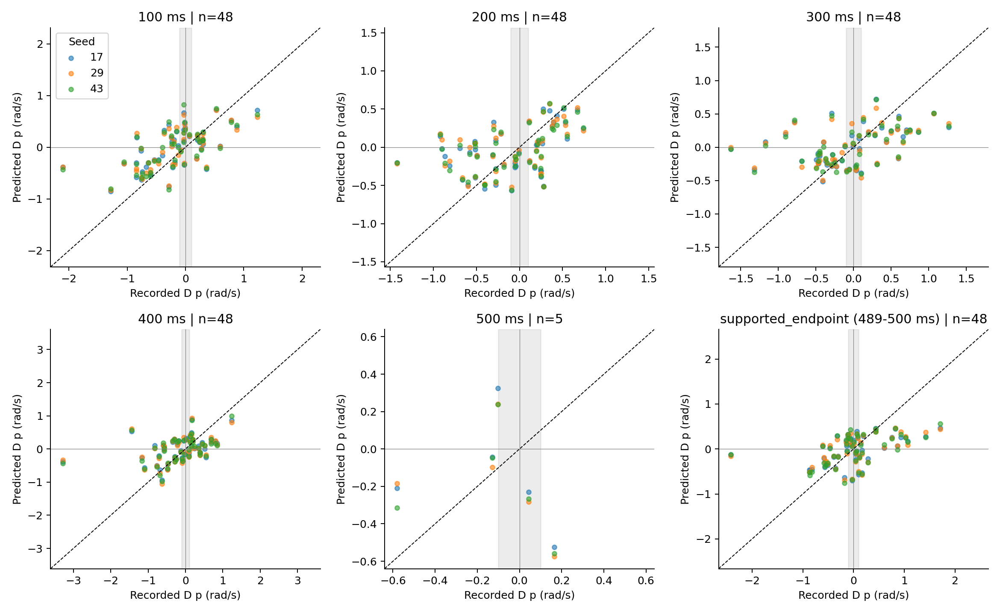
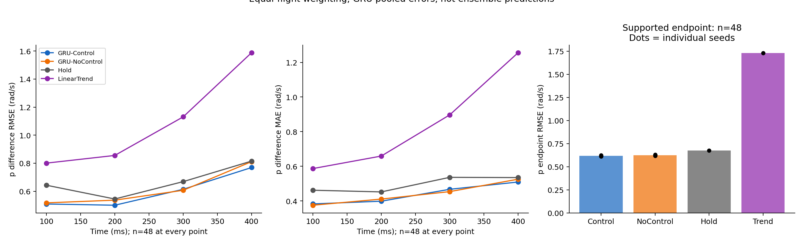
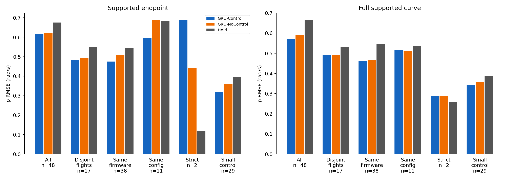
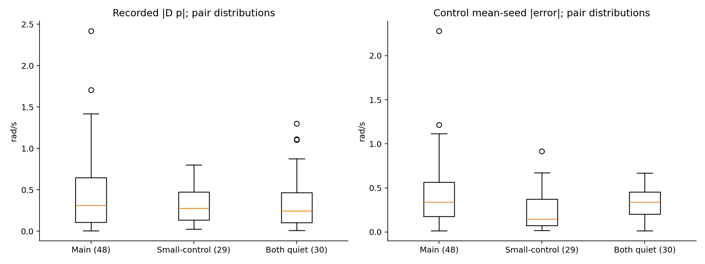
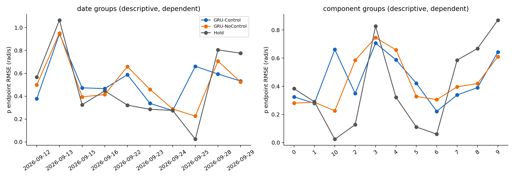
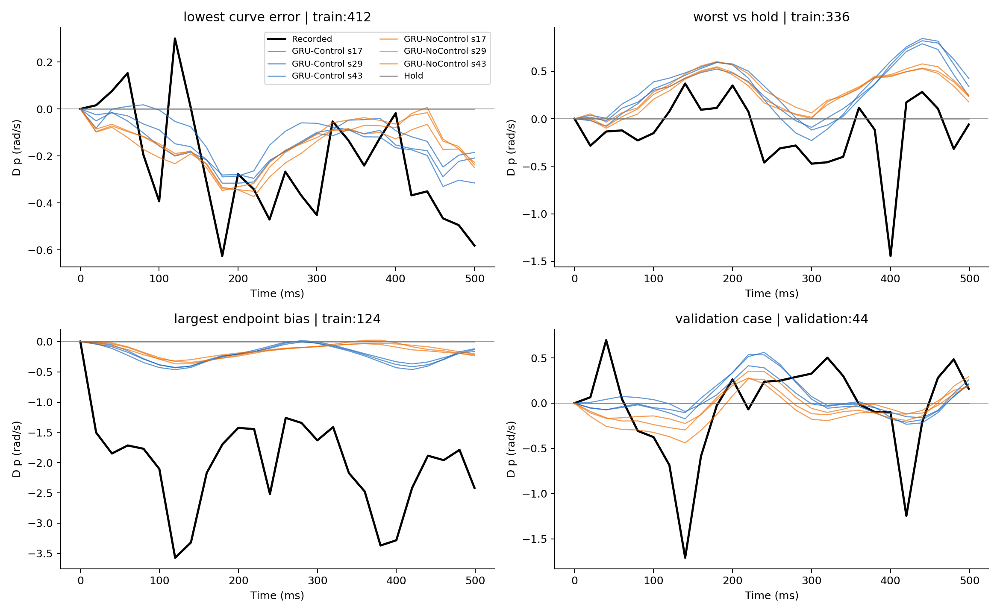
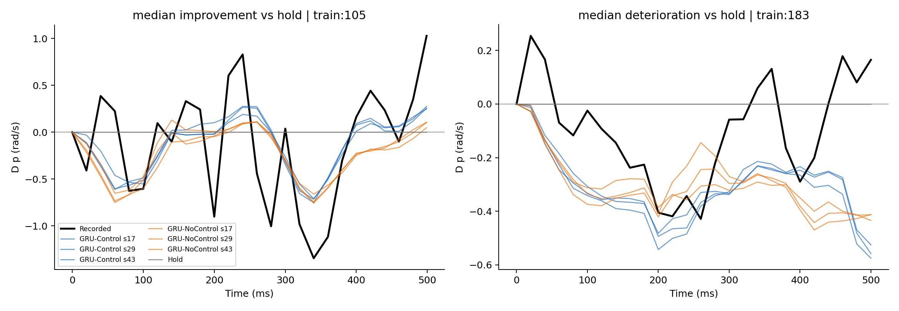
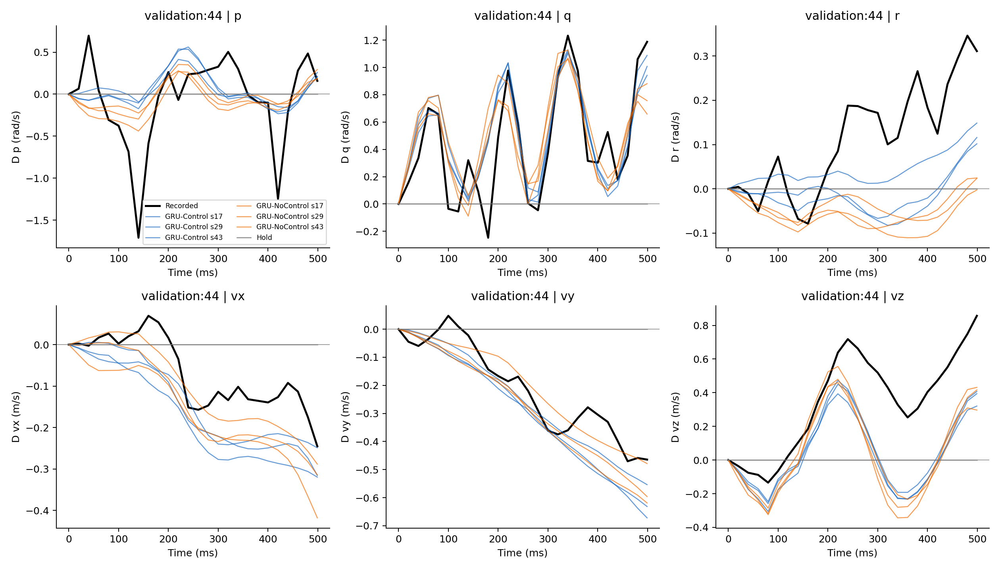
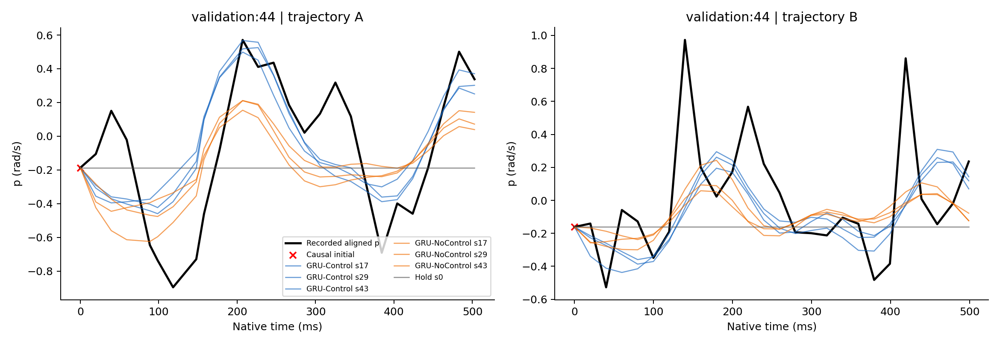

# 局部控制响应预测评价：路线 1 / 第二步

2026-10-23；基准 `4fecb63ad65b1314227d168ea5457676b46752d7`；分支 `exp/local-control-response-rollout-v1`。

**结论：冻结 GRU-Control 对这批已执行日志的滚转响应差具有有限的探索性预测价值，但尚未稳定重现响应方向、幅度和时序，也没有稳定胜过 GRU-NoControl。建议暂停向反事实换控准确性或 MPC 可靠性结论推进；后续若继续，应优先调查起点角速度对齐、幅度低估与峰值错位。** 本轮没有训练、调参、选择种子、重选片段或读取 test。

训练主队列 48 对全部完成；按航次等权、三种子误差汇总，实际共同端点的 p 响应差 RMSE 为 **0.617 rad/s**，保持基线为 **0.675**（下降 8.6%），NoControl 为 **0.623**（只下降 1.0%）。Control 的 MAE **0.463** 反而高于保持基线 **0.448**。全曲线 RMSE 为 **0.573 / 0.592 / 0.667**（Control / NoControl / Hold）。因此“有少量平均改善”不能替代逐例方向、幅度和依赖性检查。

## 1. 冻结对象、资产与实验条件

沿用第一步 `local_control_response_scope_v1` 的已保存索引及配置：AUTO_stable，即 AUTO_MISSION、过去 500 ms 地速 4–12 m/s、前向地速至少 3 m/s、滚转/俯仰绝对值不超过 25°、角速度范数 RMS 与起点范数不超过 1.2 rad/s、垂向速度绝对值不超过 2 m/s、扑翼频率 2.5–5.5 Hz，以及原完整性和近限幅条件。这里是扑翼振荡下的相对低动态前飞，不是空气动力学定常巡航。

主方向仍为软件命令差动 **d=(right-left)/2**；原控制链中正 d 对应左舵命令下降、右舵命令上升的滚转分配方向。它不是独立物理干预，仍可伴随其他控制、闭环调节和扰动。历史匹配阈值、持续时间、差动占优判据和 A/B 顺序完全复用，未根据真实响应或预测效果调整。

- 历史数据集 `velocity_rate_multistep_v1`、`main_50hz`；manifest SHA256 `8afb8623bf7174e4da5b2044f644331b8b251433fed3576f6dcdab470935bcb5`。本地 Stage5 恢复的 **8 份 train/validation Parquet** 与注册哈希一致；保留原航次/日期划分。读取未来标签仅用于评价，未送入模型。
- H1000 GRU-Control 与 GRU-NoControl，各 seeds **17、29、43**，共 6 个 checkpoint，逐文件核对原清单；Control 同时与第一步 `asset_receipt.json` 核对。所有权重及归一化固定，`eval`、`inference_mode`、禁止梯度。
- 复用既有 `control_response_eval_v1/evaluate.py` 的打包/推理接口和 `VelocityRateGRU`。保留 500 ms 历史、原状态/归一化/积分/相位外推定义，按真实未来控制和原生 dt 自主递推，采用 `exact_zoh_merge_us_v1`。历史打包器内原始事件一致性断言在导入实例中显式用 legacy 编码检查，进入推理前统一规范化；没有修改旧代码。
- NoControl 同时移除历史与未来控制，**不是纯未来控制消融**。Hold 保持起点速度/角速度；LinearTrend 在过去 200 ms 原生时间上对速度/角速度各分量作 OLS 斜率外推，锚定同一因果起点，使用原积分器，没有拟合未来或调斜率窗口。
- 使用 RTX 4090；正式批量推理约 8.61 s。未来 dt 属于已知日志的离线条件，尚未验证在线规划接口。
- 本地历史原始响应预测包及事件规范化全验证集 GPU 参考可用，已核对。Drive Stage3 复现 ZIP 的 metadata/fetch 调用返回工具不可用，未取到远端 CPU 重放数组；**不声称完成该远端 Stage3 的逐位复现**。这不影响本地已核验接口完成主实验。未运行可选交换控制诊断。

来源逐项 SHA256 在 [input_receipt.json](results/input_receipt.json)、[selection_manifest.json](results/selection_manifest.json) 和 [preflight.json](results/preflight.json)。未切换 canonical dataset，未引入新物理先验。

## 2. 评价定义、时间支持和统计口径

对每对分别预测 A、B；`D_real=(y_A(t)-y_A(0))-(y_B(t)-y_B(0))`，`D_pred` 同式替换为预测。主变量是 FRD 滚转角速度 p，同时完整保存 q/r 与 NED vx/vy/vz。

真实增量起点沿用旧评价的对齐 TARGET；预测增量起点是原模型可用的因果 initial。两者并不总相同，另报告因果起点锚定敏感性，见第 7 节。预测从自身递推，未来真实状态从不回灌。

在原 local-position 测量时钟上，将对齐标签和模型原生输出作**仅用于评价的分段线性插值**，统一到 0、20、…、500 ms，并额外保存双方共同支持端点。绝不外推。100/200/300/400 ms 均支持全部主对；精确 500 ms 训练只有 **5/48 对**、验证 **0/1 对**支持。完整主队列另报 `supported_endpoint=min(500ms,last_A,last_B)`：训练 **488.964–500 ms**，验证 **498.973 ms**。这不是把短端点改名为精确 500 ms。

方向只在 `|D_real|>0.1 rad/s` 时判定，近零单列；预测绝对值 ≤1e-8 为无方向，不能算正确。0.1 是本轮显式分析分辨门限，不是传感器噪声标定；0.05/0.2 的敏感性同时保存。Hold 总是零增量，所以方向正确率为零只表示弃判，不能把它解读为错误转向。

幅度报告有符号偏差、MAE、RMSE、预测/真实 RMS 比及过原点有符号增益。全曲线 RMSE 是共同支持时域内平方误差梯形积分除以时长再开方；峰值指 20 ms 评价网格上绝对响应最大处，不是精确物理时延。

每个种子先单列，再对误差而非预测轨迹汇总；不挑最好种子。主文用**航次等权**：先在每个航次相关对内平均误差，再在航次之间平均；同时提供逐对等权、共享航次图连通分量等权。峰值时差/相关系数的中位数为有效 pair-seed 行的描述统计，不作航次加权推断。无显著性检验或置信区间。

## 3. 队列与数据依赖

所有背景均来自原冻结索引；本次合并去重后推理 **225 个窗口、113 个不同匹配对**，每个均有 6 个 GRU 和 2 个简单基线结果。

| 训练队列 | 对数 | 航次数 | 共享航次连通分量 |
|---|---:|---:|---:|
| 主队列 | 48 | 46 | 11 |
| 主队列内航次互斥 | 17 | 34 | 17 |
| 主队列内同固件 | 38 | 39 | 13 |
| 主队列内同固件且同参数配置 | 11 | 16 | 8 |
| 主队列内严格历史匹配 | 2 | 4 | 2 |
| 小配对控制差异背景 small_pair | 29 | 26 | 9 |
| 双方未来控制变化小 both_future_quiet | 30 | 30 | 11 |
| 上述两背景条件交集 | 5 | 7 | 3 |
| 差动变化对安静片段 differential_vs_quiet | 16 | 24 | 10 |

训练主队列包含 96 个互不重叠完整支持窗口，来自 10 个日期；同一航次最多参与 8 对，最大依赖分量包含 **25/48 对**。验证主队列 1 对、2 航次；小配对差异背景 1 对，双方安静背景 1 对，分别展示，不能扩充成主验证样本。

这些子集相互重叠，不能相加当独立证据。第一步文字中的同配置 13 对采用“先按配置筛原始池、再贪心去重”的另一口径；本轮严格限于已冻结 48 对的交集，实际为 **11 对**，未重新构建 13 对。配置指已有参数集合指纹，不保证整个控制器状态或全程参数相同。

## 4. 主结果：平均改善有限，方向和幅度不稳定

下表为训练主队列共同支持端点，航次等权。误差单位 rad/s；方向只在 37 个非近零对上计算（近零 11 对，航次权重占 26.7%）。单轨迹列是 A/B 各自绝对 p 预测误差的 RMS，防止差分抵消掩盖误差。

| 模型 / 种子 | 响应差 RMSE | MAE | 有符号偏差 | 同向率 | 单轨迹 RMSE |
|---|---:|---:|---:|---:|---:|
| Control 17 | 0.615 | 0.457 | +0.030 | 64.2% | 0.339 |
| Control 29 | 0.611 | 0.462 | +0.030 | 64.2% | 0.343 |
| Control 43 | 0.625 | 0.470 | +0.027 | 59.7% | 0.345 |
| **Control 汇总** | **0.617** | **0.463** | **+0.029** | **62.7%** | **0.342** |
| NoControl 17 | 0.630 | 0.465 | +0.071 | 70.7% | 0.373 |
| NoControl 29 | 0.617 | 0.458 | +0.062 | 70.7% | 0.358 |
| NoControl 43 | 0.624 | 0.466 | +0.050 | 68.2% | 0.376 |
| **NoControl 汇总** | **0.623** | **0.463** | **+0.061** | **69.8%** | **0.369** |
| Hold | 0.675 | 0.448 | +0.047 | 0%（弃判） | 0.484 |
| LinearTrend | 1.730 | 1.373 | +0.027 | 31.1% | 1.605 |

Control 三种子都改善 Hold 的 RMSE，但没有改善 MAE；种子 43 的端点 RMSE 也未胜过相同种子的 NoControl。逐对看，Control 仅 **25/48 对**的种子平均平方误差低于 Hold，**24/48 对**低于 NoControl。历史线性趋势外推明显放大错误，说明这类振荡状态不能简单沿最近斜率持续外推 500 ms。

Control 预测响应 RMS **0.337**，真实为 **0.675**，整体幅度比例 **0.499**；有符号增益仅 **0.207**。非近零对的平均绝对幅度比为 0.946，但相对绝对误差为 1.313，不能据此前一数字声称幅值准确：小真实分母和错误方向会使此比例失真。偏差均值接近零也可能来自正负抵消。

| 时刻 | 有效对数 | Control RMSE / 同向率 | NoControl RMSE / 同向率 | Hold RMSE | Trend RMSE |
|---|---:|---:|---:|---:|---:|
| 100 ms | 48 | 0.510 / 72.2% | 0.518 / 68.8% | 0.643 | 0.801 |
| 200 ms | 48 | 0.501 / 65.0% | 0.537 / 60.5% | 0.545 | 0.855 |
| 300 ms | 48 | 0.614 / 79.5% | 0.607 / 81.2% | 0.669 | 1.130 |
| 400 ms | 48 | 0.769 / 73.5% | 0.812 / 75.3% | 0.815 | 1.588 |
| 精确 500 ms | **5** | 0.450 / 33.3% | 0.482 / 33.3% | **0.233** | 0.897 |
| 各对共同端点 | **48** | 0.617 / 62.7% | 0.623 / 69.8% | 0.675 | 1.730 |

不能将最后两行作同队列时间变化解释。方向近零门限 0.05/0.1/0.2 时，Control 同向率分别 **56.7% / 62.7% / 78.0%**，有效对数 **43/37/26**；NoControl 分别 **64.0% / 69.8% / 83.0%**。较大响应方向更易辨认，但 Control 的方向优势并未出现。

全曲线 Control RMSE 相对 Hold 下降 14.1%，相对 NoControl 下降 3.3%；真实/预测曲线 RMS 为 0.667/0.331。Control 曲线相关系数中位数 **0.529**，绝对峰值时差中位数 **0 ms**，但 P10/P90 为 **−240/+219 ms**，不能解释为没有提前/滞后。峰值可能符号错误或位于边界，500 ms 内峰值时间只是有限窗口描述。

## 5. 子集、跨航次和背景

| 队列 | n | 端点 RMSE：Control / NoControl / Hold | 全曲线 RMSE：Control / NoControl / Hold |
|---|---:|---:|---:|
| 全部主对 | 48 | 0.617 / 0.623 / 0.675 | 0.573 / 0.592 / 0.667 |
| 航次互斥 | 17 | 0.485 / 0.493 / 0.550 | 0.491 / 0.491 / 0.531 |
| 同固件 | 38 | 0.475 / 0.511 / 0.546 | 0.460 / 0.468 / 0.547 |
| 同固件、同配置 | 11 | 0.595 / 0.689 / 0.682 | 0.515 / 0.513 / 0.538 |
| 严格历史匹配 | 2 | **0.690 / 0.443 / 0.118** | **0.287 / 0.289 / 0.256** |
| 小配对控制差异背景 | 29 | 0.321 / 0.358 / 0.397 | 0.345 / 0.358 / 0.389 |
| 双方未来安静背景 | 30 | 0.398 / 0.422 / 0.479 | 0.316 / 0.323 / 0.433 |

严格对为 `train:183`、`train:746`。仅 2 对，不能用于稳定估计，但不能隐藏它们：Control 的端点响应过强，主结论在最好历史匹配子集上不成立。三种子方向判定在严格子集有效真实响应上均未正确；近零真实响应仍单列。

主队列逐对等权 / 航次等权 / 依赖分量等权的 Control RMSE 为 **0.578 / 0.617 / 0.476**；NoControl 为 **0.605 / 0.623 / 0.472**；Hold 为 **0.668 / 0.675 / 0.486**。依赖分量等权时，Control 相对 Hold 只改善约 2%，且略差于 NoControl。移除任一航次后重算，Control−Hold RMSE 差保持 **−0.075 至 −0.040**，但 Control−NoControl 在 **−0.024 至 +0.008** 间变化，优劣可以翻转。

日期分组也不一致：9/12 为 0.378 / 0.498 / 0.566，9/15 为 0.473 / 0.394 / 0.325，9/28 为 0.594 / 0.707 / 0.805（Control / NoControl / Hold）。跨日期对计入双方日期，日期组不能相加视为独立样本。按航次、日期、20 个参数指纹组及依赖分量的所有逐种子结果见 `per_group.csv`；同配置仍不消除风、相位、飞行状态及闭环任务差异。

主队列真实端点响应 RMS 为 0.675，小控制差异背景仍达 **0.397**，双方未来安静背景为 **0.479**；背景全曲线 RMS 也为 0.389/0.433。主队列整体尺度较大，但背景已经相当明显，不能把每对运动差归因于差动命令。背景队列的历史/扰动/测量差异及构成不相同，**不是纯传感器噪声，也不是控制因果误差下界**。额外冻结背景队列全部结果保存在 `endpoint_table.csv`、`curve_table.csv`。

## 6. 成功、失败与唯一验证病例

图 1 按运行前保存的展示规则选取：有非小响应者中 Control 曲线误差最小、相对 Hold 曲线退化最大、端点偏差最大，以及唯一验证对。**这些是展示极值，不代表整体典型水平。** 图 9 另给出改善/退化组内中位数实例，属于结果后的描述性展示，未改变任何队列或指标。完整逐对表保留所有反例。

- `train:412`，9/24 同固件同配置：Control 全曲线 RMSE 约 0.208，Hold 0.323；负向趋势部分复现，但仍漏掉真实 −0.626 rad/s 峰值和快速起伏，端点真实 −0.582，预测仅 −0.185 至 −0.315。即使最低误差例也不是完整成功。
- `train:336`，9/23 同固件同配置：Control 曲线 RMSE 约 0.590，Hold 0.390。真实在 400 ms 出现约 −1.445，模型在随后产生正峰，体现方向/相位错位；末端真实 −0.060 接近零，不拿它强判符号。
- `train:124`，9/13 跨固件和配置：端点真实 −2.419，Control 约 −0.119 至 −0.163；曲线峰值幅度严重低估。但该对起点对齐差也很大，不能把全部偏差解释成纯控制动力学错误（见下一节）。

唯一验证对 `validation:44` 来自 **2026-09-26** 两个航次，同固件、不同参数指纹、非严格匹配。固定 window_id 和 flight_id 见 `pairs.csv`，不能依据这个病例宣称稳健泛化。

在 **498.973 ms**，真实 Dp=+0.158557；Control seeds 17/29/43 分别预测 **+0.207715/+0.213387/+0.257875**，误差 **0.049/0.055/0.099**，都同向。但真实在 **140 ms** 有约 **−1.710** 的负峰，Control 未复现。全曲线 RMSE **0.506**，NoControl **0.479**，Hold **0.535**：好的末端并不等于好的完整响应。

验证端点 NoControl 响应差 RMSE 仅 0.081，但 A/B 单轨迹 RMSE **0.316**，明显高于 Control 的 **0.106**；例如 NoControl seed17 的 A/B 绝对误差为 −0.326/−0.359，两者抵消后响应差误差只剩 0.033。单轨迹误差和差分误差必须同时看。

## 7. 耦合响应与起点对齐限制

训练主队列端点响应差 RMSE（航次等权、种子汇总）：

| 分量 | Control | NoControl | Hold | LinearTrend |
|---|---:|---:|---:|---:|
| NED vx，m/s | 0.220 | 0.216 | 0.330 | 0.313 |
| NED vy，m/s | 0.246 | 0.261 | 0.380 | 0.414 |
| NED vz，m/s | 0.245 | 0.263 | 0.299 | 0.950 |
| FRD p，rad/s | 0.617 | 0.623 | 0.675 | 1.730 |
| FRD q，rad/s | 0.309 | 0.406 | 0.550 | 1.116 |
| FRD r，rad/s | 0.248 | 0.253 | 0.357 | 0.699 |

q 的 Control 优势大于 p，vx 则未胜过 NoControl；不能把这些联合响应解释为独立差动效能。六分量所有时刻、种子、单轨迹误差均保留。

在 96 个训练主窗口，真实对齐起点与因果输入 p 的差值 RMS 为 **0.188 rad/s**，绝对中位数 0、最大 **1.364**。起点因果角速度测量相对位置时钟的滞后中位数 **4.960 ms**、最大约 9.981 ms；目标角速度相对位置时钟偏移约 **±4.990 ms**。故当前“同一时间”的 p 标签继承原数据对齐近似，不是严格同步的独立物理真值。完整时间元数据见 `rate_clock_audit.csv`。

`train:124` 的 A/B 起点差分别 **+1.364/−0.587 rad/s**，两者相减约 1.952，显著放大增量差误差。若诊断性地把真实未来值也相对于因果输入起点取差，训练 Control / NoControl / Hold 的 RMSE 变为 **0.390 / 0.416 / 0.486**。该口径在 t=0 不一定为零，回答的是另一种锚定问题，**不能替换主响应增量定义、也不能据此挑出更好分数**。没有更改标签、修理数据或丢弃该对。

此外：500 ms 仅约两个扑翼周期，跨航次绝对相位零点未统一；地速不能替代空速，风和任务扰动未匹配；控制是闭环相关变化，四路命令未独立激励。训练对是已训练模型的探索数据，验证只有一个病例。这些均限制了可辨识性和跨航次结论。

## 8. 验证、可复现性与后续判断

- 原历史 8 个样本的八项打包输入逐项相同；六模型原始接口预测最大误差 <1e-6。
- 6 个已知规范化验证样本、三 Control 种子、500/1000 ms 参考预测最大差 **1.91e-6**，低于固定 2e-5 容差。该 1000 ms 仅用于旧接口回归检查，本轮评价仍为固定 500 ms。
- 相同控制波形 split2/split4 冗余分段的预测逐位相同；未来前缀一致；将未来状态、相位和标签整体污染后，八项输入仍完全一致。六 checkpoint 事后哈希仍一致。
- 8 项指标单元测试通过。独立括号插值实现复核 **1,136,352** 个标量，最大差 **5.42e-15**；独立按航次/图分量直接平均复核 **18,144** 行汇总，最大差 **8.88e-16**。
- 独立显式区间积分复核 **904** 行曲线指标和 **540** 行曲线汇总，最大差分别 **6.66e-16 / 3.33e-16**；复核主队列完整支持区间不重叠、航次互斥标记与 train/validation 航次隔离。
- 代码、依赖、命令、图表及结果哈希见 `README.md`、`execution_record.json`、`archive_manifest.json`；未安装或修改依赖。

**建议：本轮足以支持“平均改善有限、局部失败明确”的判断，不足以支持“已学会稳定的差动控制响应”。** 值得继续的首先是误差来源审查：在固定对上解释因果起点与对齐标签差异；区分扑翼振荡峰值错位和慢响应幅度误差；检查 25 对大依赖分量、跨固件及严格匹配反例。之后是否另立实验，应先明确更可靠的时序/相位评价合同和可获得的独立验证支持，再决定模型改进或反事实诊断。本轮停止于上述评价，没有自动开展下一阶段。
