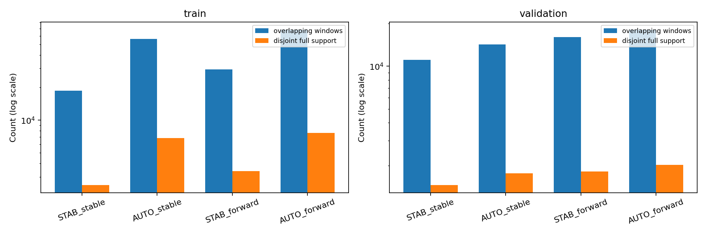
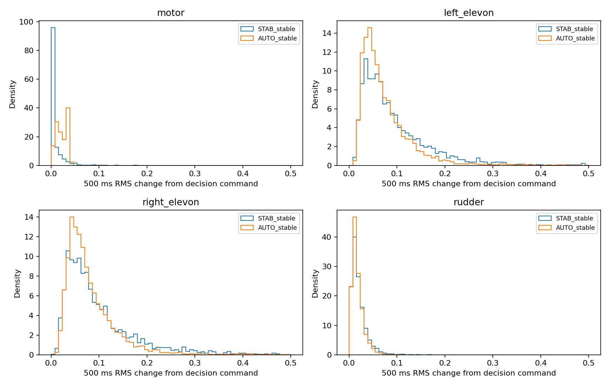
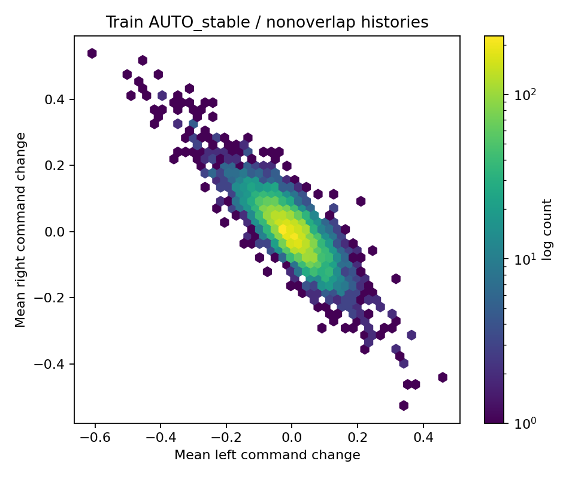
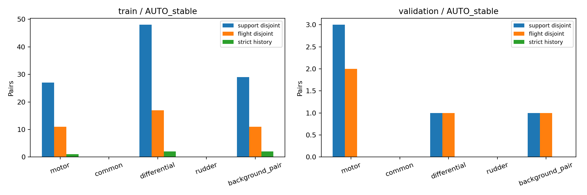
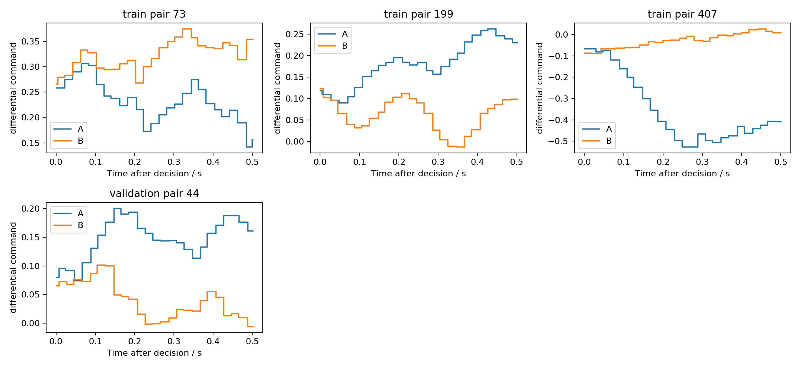

# 局部控制响应研究对象选择：路线 1 / 第一步

2026-10-23；基准 `91f772448b78fd8690df83b9f98177d1b897218e`；分支 `exp/local-control-response-scope-v1`。

**推荐 AUTO_MISSION 下低动态前飞，主要研究左右舵面差动命令方向；备选为同一工况的电机命令方向。推荐限于训练侧探索：主方案在验证侧仅有 1 个匹配对，尚不存在支持稳健验证的局部研究对象。** 本轮未运行网络、训练、换控或 MPC，也未读取 test 轨迹。

## 1. 实际复用的资产与数据边界

显式复用历史 `velocity_rate_multistep_v1`、`main_50hz`，注册表为 `configs/data/velocity_rate_dataset_registry.yaml`，manifest SHA256 为 `8afb8623bf7174e4da5b2044f644331b8b251433fed3576f6dcdab470935bcb5`。未切换 canonical dataset 或模型版本。

- 本地源目录 `/home/zn/flap-system-identification/dataset/velocity_rate_multistep_v1` 中的 samples、windows、native_actuator_motors、native_actuator_servos × train/validation 共 **8 份 Parquet** 均与登记 SHA256 相符；共享 flights/provenance/split/build_config 也核验哈希。8 文件正是 Stage5 恢复的数据内容，不需重建数据或下载原附件。
- 主采样组原有 **94/27 个 train/validation 航次**，分别来自 **15/3 个日期**；读取开发分区文件后明确排除 sparse_10hz。整航次、日期和 boot 身份无交叉；test 只在共享划分元数据中出现，没有打开其 Parquet 或原始日志。
- 复用 `control_identifiability_audit_v1/audit.py` 的历史质量、过去取值网格、SO(3) 匹配、原生命令 ZOH 和支持区间去重函数；复查原可辨识性、混合响应评价、事件规范化报告及模型实现契约。
- 已通过 Drive 读取 [Stage3](https://docs.google.com/document/d/17ZWk4olFMGX9lROwmpJZ0oxvodLXfOkT/edit)、[Stage4](https://docs.google.com/document/d/1K-hkx9jJgNEluCvzYWAYTGKXMi2uzoj9/edit)、[Stage5](https://docs.google.com/document/d/1DJrgqXfB6uGc3siKXsi99ACA9FoJMq4n/edit) 报告，保存文本快照及来源。Stage5 81,190,672-byte 复现 ZIP 已确认可见，本轮不依赖其中预测数组，未下载它，也未将其评分视为控制可辨识证书。
- H1000 GRU-Control seeds 17/29/43 的既有 checkpoint 字节哈希全部与规范化集成清单一致，**只验哈希，不加载模型或选择权重**。下一步保留 500 ms 历史和 `exact_zoh_merge_us_v1`。
- 额外读取这 121 个获准 main 航次的原始 ULog **文件头**，并核验全文件字节哈希，恢复 FW_/FLAP_/CA_/PWM_MAIN_/ASPD_/NPFG_/TECS_ 初始参数。没有解析原始运动流。训练/验证分别有 30/10 个该参数集合指纹；相同指纹不是整个控制器状态相同的证明。原 provenance 的 recorded parameter_changes 均为空；文件头本身不额外证明全程未改参。

数据来源和读取列白名单见 `results/{train,validation}/source_receipt.json`；模型及外部报告见 `results/description/asset_receipt.json`。

## 2. 固定工况与匹配规则

先分析训练集，固定选择后才执行 validation。训练探索中明确了嵌套工况的选择原则：同一模式/方向中，低动态范围若保留宽范围至少 80% 的不重叠对，就优先低动态范围；随后按训练不重叠对、航次互斥对和航次数排序，备选采用不同控制方向。此次主方案恰好保留全部 48 对，电机保留 27/28 对。此规则是在训练探索阶段形成的，不声称为查看训练数据前的预注册。过程记于 `training_design_record.json`；验证结果没有改变规则。

四个候选都要求过去 500 ms 内模式稳定、频率/模式可用、无 failsafe，使用登记有效连续片段；跨缺口和 EXCLUDE 的窗口不进入检索。历史 26 点按原生测量时间向过去取值，不插值、不跨段；这些值的发布时刻不晚于 decision。全原生历史检查模式/频率质量；下列运动范围在该 26 点表示上检查，不能解释为每个连续瞬时值都满足限制。

共同范围：地速 4–12 m/s、机体前向地速分量至少 3 m/s、扑翼频率 2.5–5.5 Hz；历史近命令限幅点比例不超过 5%。没有空速/风条件，因此称“前飞”，不证明定常空气动力学巡航。

| 候选 | 历史模式 | 最大绝对滚转/俯仰 | 历史角速度范数 RMS 及起点范数上限 | 最大绝对 NED 垂向速度 |
|---|---|---|---|---|
| STAB_stable | 15 / STAB | 25° / 25° | 1.2 rad/s | 2 m/s |
| AUTO_stable | 3 / AUTO_MISSION | 25° / 25° | 1.2 rad/s | 2 m/s |
| STAB_forward | 15 / STAB | 45° / 35° | 2 rad/s | 3 m/s |
| AUTO_forward | 3 / AUTO_MISSION | 45° / 35° | 2 rad/s | 3 m/s |

从原登记 500/500 ms 的 **110,175 / 36,852** 个窗口开始；历史质量和未来命令覆盖检查后为 **107,989 / 36,624** 个。未来完整性沿用登记掩码与时间支持合同，允许作离线可评价资格检查；不按未来运动值、误差、稳定与否选择工况。本轮不读取任何 `target_*` 列。未来命令从 publication/decision 起算精确 500,000 μs，整个 tape 的保持年龄不超过 160 ms；该检查不是实际执行器时延标定。

匹配只在同一 split、同一候选工况中跨原日志进行，硬件 UUID 相同、传动比差 ≤0.001。完整历史 RMS **及起点差**分别要求：NED 速度 ≤0.75 m/s、SO(3) 姿态 ≤15°、FRD 角速度 ≤0.75 rad/s、频率 ≤0.5 Hz、每路原始命令 ≤0.05。严格敏感性使用 0.5 m/s、10°、0.5 rad/s、0.3 Hz、0.03。不按 yaw 对齐或旋转轨迹。无近邻数量上限的必要条件半径检索之后精确检查全部门限。

相位仅描述日志原点相对相位及有效位；绝对相位零点未统一，未用于跨航次匹配。控制参数和固件相同仅作支持度分层，不在验证后改成新的主筛选。

## 3. 工况覆盖：数量很多，匹配很少

下表“互不重叠窗”要求完整历史—未来支持闭区间不交叠，以航次时间顺序贪心选择；“未来并集”是这些候选未来 500 ms 区间的时间并集，不能简单用窗口数×0.5 s 代替。

| 候选 | train 窗口 / 互不重叠窗 / 航次 | train 未来并集 s | validation 窗口 / 互不重叠窗 / 航次 | validation 未来并集 s |
|---|---:|---:|---:|---:|
| STAB_stable | 18,711 / 2,527 / 93 | 2,639.0 | 11,065 / 1,464 / 27 | 1,549.3 |
| AUTO_stable | 56,080 / 6,838 / 93 | 7,302.5 | 14,269 / 1,763 / 22 | 1,884.0 |
| STAB_forward | 29,346 / 3,400 / 93 | 3,628.5 | 16,010 / 1,822 / 27 | 1,943.5 |
| AUTO_forward | 68,406 / 7,653 / 93 | 8,213.3 | 18,063 / 2,024 / 22 | 2,157.1 |

四类工况重叠，不可求和。所有候选并集涉及训练 93/94 个航次和验证 27/27 个航次。训练候选有 13 个固件版本、验证 4 个；不能把跨版本重复当相同闭环实验。

AUTO_stable 训练历史地速 P10/P50/P90 为 **5.38/7.17/9.14 m/s**，起点俯仰 **9.90/14.45/18.84°**，角速度 RMS **0.527/0.697/0.908 rad/s**，频率 **3.38/3.79/4.16 Hz**。它是已有扑翼振荡下的相对低动态区域，并非角速度接近零。详细姿态、命令、频率、相位和状态年龄分布在 `history_distributions.csv`。

## 4. 实际存在的控制方向

原始命令为电机 (m\in[0,1])、左/右舵面 (L,R\in[-1,1])、方向舵 (y\in[-1,1])。定义固定软件命令坐标：

\[
c=(L+R)/2,\qquad d=(R-L)/2.
\]

在 Stage4 的理想未 clip 分配条件下，(L\approx0.5\tau_p-\tau_r/1.1\)，(R\approx0.5\tau_p+\tau_r/1.1\)，故 (2c\approx\tau_p\)、(1.1d\approx\tau_r\)。本轮 121 个文件头都确认左右 roll effectiveness 为 −0.55/+0.55、pitch 为 1/1，PWM 功能 201/202/101/203 对应上述输出通道。**正 d 是左命令降低、右命令升高的滚转分配方向；不保证真实滚转响应符号或大小。** 电机坐标是扑翼推力相关命令，不是测得转速、频率或推力。同向舵面和方向舵也只具有软件分配含义。本轮没有拟合 PCA 后赋予独立物理意义。

所有积分按原生 ZOH 的整数微秒边界精确计算；相同值重复分段不改变统计。单窗口变化为 (a(t)-a(0)\)，配对差异为 (a_A(t)-a_B(t)\)。方向门限按 ([m,c,d,y]) 为 **[0.05,0.10,0.10,0.05]**：RMS 达门限、至少连续同号超门限 100 ms、绝对有符号均值/RMS ≥0.6，且按门限缩放的四坐标能量中该方向占 ≥65%。这允许剩余联合控制变化，**不是隔离单通道激励**。配对额外要求该方向未来 RMS 差至少为历史 RMS 差和起点差较大者的两倍。

AUTO_stable 四路原始命令“相对起点的未来 500 ms RMS 变化”（全部重叠候选）：

| 通道 | train P50 / P90 / P99 | validation P50 / P90 / P99 |
|---|---|---|
| 电机 | 0.0218 / 0.0384 / 0.0398 | 0.0222 / 0.0384 / 0.0397 |
| 左舵面 | 0.0589 / 0.1344 / 0.2937 | 0.0591 / 0.1315 / 0.2932 |
| 右舵面 | 0.0662 / 0.1434 / 0.3022 | 0.0648 / 0.1398 / 0.3130 |
| 方向舵 | 0.0140 / 0.0320 / 0.0566 | 0.0139 / 0.0316 / 0.0577 |

差动占优单窗在 train/validation 有 **8,293/1,925** 个；先按方向筛选再去重为 **2,937/739** 个。正/负分别为 **1,410/1,527** 和 **368/371**；训练 93 个、验证 22 个航次都出现双向实例。电机占优单窗仅 **35/4** 个，去重 **15/2** 个；正/负 **10/5**、**2/0**。同向舵面和方向舵也出现单窗变化，但没有满足此规则的跨航次方向对照。

固定工况先去重后，训练 AUTO_stable 的左右**500 ms 平均命令变化**相关为 **−0.826**（STAB_stable 为 −0.843）；AUTO 左/右变化与方向舵分别为 **+0.290/−0.280**。因此差动确实常见，但仍有方向舵等伴随调节。完整四路矩阵见 `joint_delta_correlations.csv`；相关不是独立物理效能。

时间形状不是理想阶跃。固定工况先去重的独立描述子集中，训练差动占优窗的总变差 P50 为 **0.422**、RMS P50 **0.141**、同号超阈值最长持续时间 P10/P50/P90 **0.162/0.281/0.421 s**；命令通常持续调整并可局部回落。这里的 1,015 个形状样本与“先选方向再去重”的 2,937 个不是同一队列。保存了精确 100 ms 分箱积分和例子 ZOH，不把保持段当作物理执行器保持。

`direction_per_flight.csv` 保留逐航次正负、幅值和持续跨度，`control_state_relationship.csv` 按历史地速 4–6/6–8/8–12 m/s 与角速度 RMS ≤/>0.6 分层。模式、初态和控制变化不能视为独立：例如稳定 STAB 的电机占优原始窗口 139/142 为负方向，而稳定 AUTO 为 11/35；不能把两模式混合后当作对称电机激励。

## 5. 跨航次可比较性与数据依赖

表中为“原始对 / 支持区间不重叠对 / 所涉航次”。在各队列内按历史匹配分数确定性去重；各队列之间仍可共享窗口或航次。

| 工况与方向 | train | validation |
|---|---:|---:|
| STAB_stable，差动 | 16 / 4 / 6 | 0 / 0 / 0 |
| STAB_stable，电机 | 3 / 1 / 2 | 0 / 0 / 0 |
| AUTO_stable，差动（推荐） | **86 / 48 / 46** | **1 / 1 / 2** |
| AUTO_stable，电机（备选） | **61 / 27 / 27** | **3 / 3 / 5** |
| STAB_forward，差动 | 20 / 8 / 11 | 0 / 0 / 0 |
| STAB_forward，电机 | 4 / 2 / 4 | 0 / 0 / 0 |
| AUTO_forward，差动 | 87 / 48 / 46 | 2 / 2 / 3 |
| AUTO_forward，电机 | 62 / 28 / 28 | 3 / 3 / 5 |
| 任一工况，同向舵面/方向舵 | 0 / 0 / 0 | 0 / 0 / 0 |

AUTO_stable 差动训练 48 对来自 10 个日期，只有 **17 对航次互斥对、11 个共享航次连通分量**；原始 86 对有 14 次重复节点使用，去重后 96 个端点各用一次，但航次继续复用。严格历史匹配仅 **2 对**；同固件 **38 对**，同参数指纹 **13 对**，同固件且同参数也是 **13 对**，跨日期 **13 对**（这些分层各自去重，不能相加）。历史速度/角速度/姿态 RMS 差中位数为 **0.564 m/s、0.479 rad/s、6.48°**，不是几乎相同初态。

这 48 对的差动命令差 RMS 范围 **0.101–0.377**，P10/P50/P90 **0.107/0.136/0.295**；同号超阈值持续 **0.122–0.459 s**，P50 **0.258 s**。有可研究幅值和时长跨度，但不构成随机或独立干预。

主方案验证只有 **9 月 26 日同日两航次的一对**：差动差 RMS **0.120**，持续 **0.200 s**；速度/角速度/姿态 RMS 差 **0.424 m/s、0.495 rad/s、8.83°**。两航次固件相同，参数指纹不同；严格匹配、同参数匹配均为零。放宽为 AUTO_forward 也只有两对、一个航次依赖分量，没有据此切换方案。

电机备选训练 27 对只有 **11 对航次互斥对、8 个依赖分量**；同参数 5 对、严格 1 对。RMS 差范围 **0.050–0.108**、持续 **0.199–0.493 s**。验证 3 对仅 **2 对航次互斥对、2 个分量**，同参数/严格均为零；其中一段登记全窗口含模式切换，仅作混杂标记，未以未来模式剔除它。电机两方向覆盖弱，因此没有因验证 3>1 就反向改选主方案。

### 小变化背景必须区分

“各自小变化”要求每段相对自身起点的四坐标 RMS ≤[0.02,0.04,0.04,0.02]；“两段彼此相近”要求两段未来命令 RMS 差满足同一限值。后者不表示两段都恒定，也不是纯噪声基线。

| AUTO_stable 背景条件 | train 原始对 / 去重对 / 航次 | validation 原始对 / 去重对 / 航次 |
|---|---:|---:|
| 两段未来彼此相近 | 78 / 29 / 26 | 3 / 1 / 2 |
| 两段各自都是小变化 | 83 / 30 / 30 | 1 / 1 / 2 |
| 同时满足上述两项 | 8 / 5 / 7 | 0 / 0 / 0 |
| 差动对照中恰有一段小变化 | 24 / 16 / 24 | 0 / 0 / 0 |
| 电机对照中恰有一段小变化 | 22 / 14 / 18 | 1 / 1 / 2 |

各行先按该条件筛选、再独立去重，与主队列去重后再数小变化成员不同。主差动 48 对中恰有一段小变化的是 15 对；不能用 16 替代该子集计数。背景表和索引作为描述性补充，不参与已经冻结的主/备选排名。

## 6. 限制与下一阶段边界

主/备选已选端点没有历史 REVIEW 或未来近命令限幅；候选总体仍有 REVIEW 和少数近限幅窗口，原始标记未删除。近限幅只是命令距数值边界 ≤0.02，不是执行器饱和反馈。主方案全窗口无模式切换；状态年龄训练中位数约 0.517 ms，仍不能将 PX4 融合状态当独立物理真值。采样漏失、气动扰动、空速/风、执行器动态、控制器积分/自适应状态和任务参考未进入匹配。

**当前充分的是“训练侧值得做探索性评价”的支持，不是稳健验证、更不是严格因果辨识。** 同模式、同初始参数不能消除反馈选择；跨航次共享日期和配置也不独立。validation 已有 checkpoint 选择和多轮研究使用史，不能称新增盲测。方向相近不代表其他控制贡献为零，未观测的真实换控后果依然不存在。

下一阶段如另行授权，可直接使用固定索引，对主方案 48 个训练对、1 个验证对和独立列出的背景进行既有冻结 H1000 GRU-Control 的**记录控制条件下响应差异**评价，保留 seeds 17/29/43、原生 dt、完整历史、exact_zoh_merge_us_v1，不更改筛选、重新训练或选 checkpoint。先用少量固定窗做输入/事件一致性核验，再评价 100–500 ms 的 NED 速度与 FRD 角速度增量差，报告逐对、逐航次、航次互斥及同配置敏感性。训练结果用于探索，验证只作一个病例和完整失败/不足记录；不估计可靠置信区间或宣称因果响应已证实。若研究目标要求跨配置稳健的验证结论，应把当前支持不足作为停止条件，不靠事后放宽匹配、打开 test 或按验证结果改选方向。

## 7. 交付、验证与复现

- `config.json`、`results/frozen_selection.json`：固定条件、规则、代码/配置指纹和 train-only 排名。
- `results/{train,validation}/candidate_index.csv.gz`、`command_events.csv.gz`、`all_history_pairs.csv.gz`、`selected_pairs.csv`：所有候选身份、命令变化、历史匹配与固定选择。索引只在各 split 内有效，必须同时带 split。
- `results/description/selected_pair_index.csv`：便于下一阶段使用的原始 window_id、航次、decision 和完整支持边界；`background_index.csv` 给出补充背景队列。
- `coverage*.csv`、`command_distributions.csv`、`pair_support.csv`、逐航次/状态分层表、5 张 PNG，以及 `report_zh.md`。
- `analyze.py`、`describe.py`、`verify.py`、`test_scope.py`、执行日志、来源回执和归档哈希清单。

训练/验证主统计耗时约 **71.9/28.8 s**，未使用 GPU 或加载网络。20 项本轮及复用函数测试通过；另一个旧实验全产物测试因新 worktree 未链接旧 500/1000 ms 全候选档案及默认数据路径，在最初尝试中失败，之后明确 deselect，未修改旧实验或伪称全部旧测试通过。本轮产物由新的独立 verifier 验证：全部主表原始/去重/航次互斥数量和选中身份一致；原生电机/舵机分流直接重算 train/validation 各 24 对的 576 项均值、RMS、持续时间，最大差 **1.01×10⁻¹⁶**。所有验证均保持 test 封存。复现命令和本机/提交产物边界见 [README.md](README.md)。
