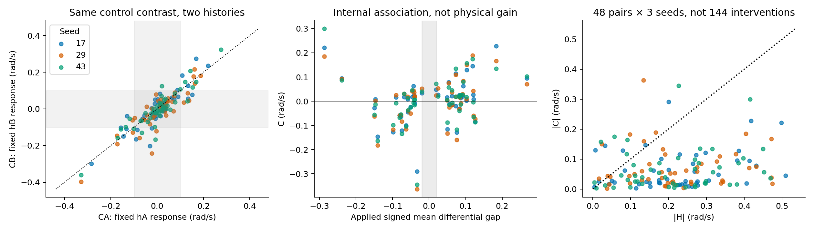
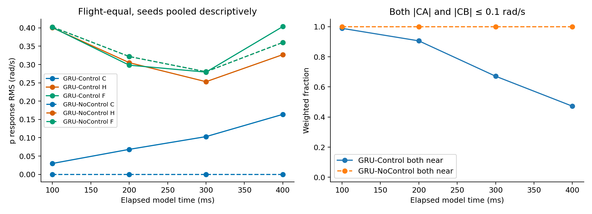
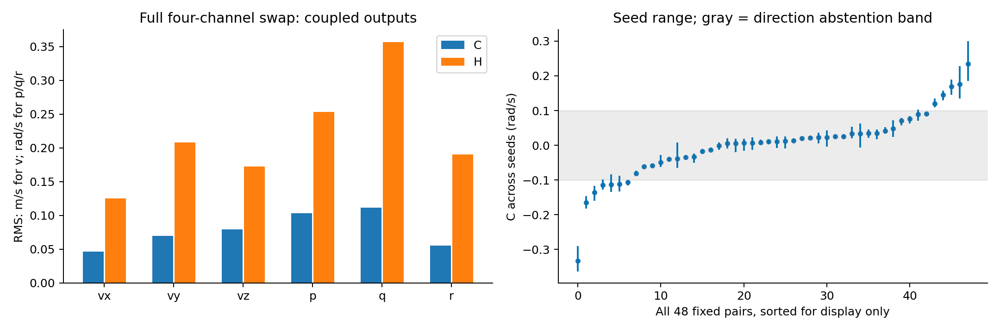
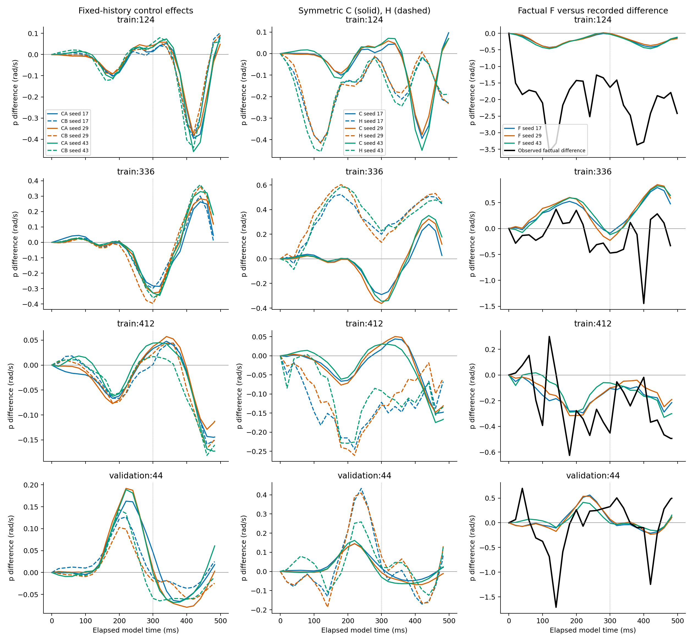
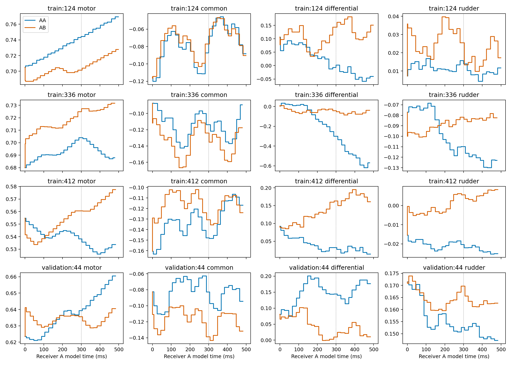
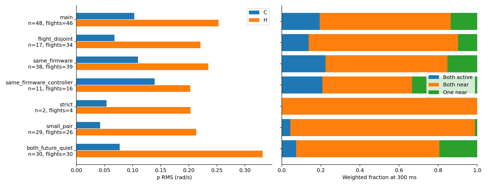

# 冻结 GRU：未来控制交换与内部响应敏感性

2026-10-26；基准 `9c9cb02098a29186922d9dcb061d3776f690605e`；分支 `exp/local-control-response-swap-sensitivity-v1`。

**主要结论：Control 确实使用未来控制，但在冻结 AUTO_stable 主队列的 300 ms 时刻，预测差异总体由历史侧信息主导。控制响应通常较小，少数片段却有明显、随时间换向的响应；不能概括为完全忽略控制，也不能据此认定真实控制效能不足。下一步应优先澄清状态／相位时间表示，再考虑有独立效能证据约束的显式控制模型；目前不宜直接用观察性匹配差训练控制响应 Loss。**

本轮所有 C、H、CA、CB 都是冻结模型内部的差异。只有事实组合差 F 可以和日志中的两段真实响应差比较；交换组合没有实测真值。没有计算真实反事实 RMSE、训练、调参、换模型、重新选对、控制单通道化、慢快分离重做或 MPC。

## 1. 实际运行范围与复现门禁

复用 `velocity_rate_multistep_v1/main_50hz`、AUTO_stable、差动 `(right-left)/2`、500 ms 历史及原 train/validation 划分。训练主对 48、航次互斥 17、同固件 38、同固件同配置 11、严格匹配 2；验证主对 1。全部背景队列保留。所有队列合并后是 **113 个不同匹配对、225 个窗口、452 个历史／控制组合**；队列间有重叠。

对 H1000 Control/NoControl 各 seeds 17、29、43 使用原六个 checkpoint 和归一化，`eval`、`inference_mode`、权重不更新。现有 RTX 4090 完成推理，不安装依赖。先核验旧 rollout 63 项、timing 62 项归档文件以及 checkpoint SHA256，再做六个模型 × 225 窗口的完整事实回放：与旧数组 **逐值一致，最大差为 0**。进入四组合批次后，AA/BB 的受支持前缀最大差为 **1.43e-6**，在预设 2e-5 容差内；差异来自批次浮点运算。三个 NoControl 的同历史交换输出全部逐值一致。

数据 manifest SHA256：`8afb8623bf7174e4da5b2044f644331b8b251433fed3576f6dcdab470935bcb5`。新增读取仅为原登记的 motor/servo native Parquet × train/validation，以及 samples_train/validation 的**历史输入、源时间戳与有效性字段白名单**，均验证 manifest 哈希；不读 test、测试日志或未来标签列。旧预测／真实数组仅用于回归与离线旁证。数据、代码、六份权重及归一化哈希见来源收据和归档。

## 2. 已确认的程序时间合同与物理不确定性

| 对象 | 冻结接口的实际含义与本轮处理 |
|---|---|
| 决策时刻 | 历史末条位置状态的发布时刻 `decision_us`，也是未来控制移植的时间锚点 |
| 模型时钟 t0 | 该位置状态的测量时刻，早于决策 420–1035 μs；保留此时钟与旧 300 ms 口径对应 |
| initial | 原因果历史末端 13 维状态，包含位置、NED 速度、四元数、FRD 角速度；各字段不一定同步测量 |
| initial 的 p/q/r | 决策时已发布的最近角速度。角速度测量相对位置 t0 的年龄为 0–9.981 ms，中位 4.931 ms；不是插值到 t0 的同步角速度 |
| truth_initial | 旧离线目标起点，可能是另一角速度样本；不用于模型初始化或交换 |
| 翼相位／频率 | 原历史最后可用编码器相位 sin/cos 与频率；相位取 atan2，频率固定。两者发布年龄中位 5.292 ms，**源时间戳相对位置 t0 年龄中位 14.733 ms，范围 9.437–19.480 ms** |
| 相位物理时间 | 编码器与频率的 measurement 时间字段均为 -1，真实物理测量时刻仍无法确认；源时间戳不应自动等同物理测量时刻 |
| 每一步 | 在步起点用 `phase0 + 2π f0 elapsed` 构造相位特征，使用该步规范化 ZOH 控制及 receiver 原生 dt；状态输出属于步终点 |
| 时间支持 | 不以真实未来状态或真实未来相位校正输入；未来 dt 来自既有日志，属于离线回放条件，不是在线规划接口验证 |

已有模型未将历史相位按源年龄推进到位置 t0，同时 initial 的角速度也异步。程序行为已确认，但这不等于已确认某个可直接修复的物理相位延迟。此处记录影响范围，不静默修复旧输入或模型。

每个 receiver 的四组合中，历史、mask、history_dt、initial、预测 dt、最后隐藏态，以及每步相位／频率／mask／dt 特征均检查一致；只替换未来四路事件。固定历史下的 C 因而不受“交换时把 donor 相位也带进来”的实现错误影响，但仍**条件于 receiver 本身尚不完全明确的物理相位**。

H 比较两个 receiver，除历史状态和历史命令外，还包含各自相位、频率、隐藏态、原生 dt 及微小决策时钟差异；不能称为纯状态历史因果贡献。NoControl 同时移除历史和未来控制，其 H 也不能当作 Control 的纯状态贡献。

详细时钟表：`results/state_phase_clock_audit.csv`、`time_contract.csv`、`step_contract.csv`。

## 3. 交换、支持范围与指标定义

对每对 A/B，构造 AA、AB、BA、BB。将 donor 事件按“receiver 决策−donor 决策”平移；保留 receiver 从位置 t0 到决策之间的原控制前缀。之后只使用 donor 决策后 500 ms 内原生发布事件，保持完整四路波形，不拉伸、不重新定相位、不补充最后命令来凑时间。

225 个窗口中有 62 个原完整预测的最后一步超过决策后 500 ms。因此完整旧事实回放单独用于门禁；新四组合只保留**终点不晚于决策+500 ms 的完整原生步**，同 receiver 的 own/swap 使用完全相同的 dt 前缀。对间共同端点取两 receiver 支持末端的较早者。主队列端点为 **473.021–499.048 ms**，中位 498.925 ms。100/200/300/400 ms 全部 48 对均支持；**精确 500 ms 全部缺失**，逐点表保留缺失行，不外推。端点统计不与旧 500 ms 附近端点假装完全同口径。

在相同“距各自位置 t0 的时间”上，以分段线性插值评价增量 `Yij=predictionij−initial_i`。这不是把不同航次绝对物理时刻强制相同。定义：

```
CA = YAA − YAB             CB = YBA − YBB
HA = YAA − YBA             HB = YAB − YBB
C = (CA + CB)/2            H = (HA + HB)/2
F = YAA − YBB = C + H      interaction = CA − CB = HA − HB
```

主方向判定要求 **|CA|、|CB| 都大于 0.1 rad/s**，其余分为双近零和仅一侧近零。0.05、0.2 是预设敏感性；近零不是数值零，更不是“控制没有作用”。辅助 q/r 同用 0.1 rad/s，速度用 0.1 m/s，仅作描述。

局部经验比值使用实际施加到 receiver `[t0,t]` 内控制差的时间平均：`gA=mean(dAA−dAB)`、`gB=mean(dBA−dBB)`、`g=(gA+gB)/2`。仅在相应 **|g|≥0.02** 时报告比值；有符号汇总增益为 `Σw Cg / Σw g²`，另外保存逐项量与平均比值。单位为 rad/s 每归一化差动命令单位。输入是执行器输出命令，不是舵角、转速或实际气动力测量。该比值压缩了随时间变化的四路联合波形，**不是静态、单通道或真实物理控制增益**；正负命令变化可在时间均值中抵消。

逐对等权、航次等权及共享航次依赖分量等权全部保存。航次等权为每航次先均分给其关联对，再对航次平均；分量等权为每分量内均分给其对。种子先分别报告，pooled 只是等权合并三个固定模型的描述性统计，不把种子当独立干预。

### 输入支持

用训练中 **56,080 个 AUTO_stable 候选、93 个航次**构建参考，不使用验证数据定义范围或规则。历史速度／角速率／频率、初始滚转俯仰及历史四路命令采用配置中的粗描述符容差；同硬件和传动比，排除 receiver 与 donor 航次。检查 donor 完整 500 ms 的四坐标时间均值相对于这些训练邻居的范围及最近归一化 L∞ 距离，阈值 1 仅作覆盖警告，不筛选结果。

全部 452 组合的实际有效命令在训练边际范围及归一化物理范围内，历史速度／角速度／频率也未超出训练边际范围；**边际未越界不代表联合或时间波形得到支持**。训练主对 AB/BA 都有跨航次粗邻居，最少分别 4/2 个参考航次；中位 15/14.5 个航次。仍有 **5/96 个交换组合**触发联合均值覆盖警告：AB 的 `train:79, train:746`，BA 的 `train:15, train:407, train:964`。事实 AA/BB 也有 6 个警告，说明这不是专门针对交换的理想支持保证。

验证主病例 44 的 AB/BA 有 9/8 个参考航次，未触发警告。其他验证背景存在 2 个未知支持和 2 个警告组合，全部保留。该检查只覆盖粗历史与四路未来均值，没有验证相位条件下的完整波形支持或可辨识性。`swap_support.csv` 保存全部标记；无任何按预测结果排除。

## 4. Q1：内部未来控制响应有多强？

下表为训练主队列 300 ms、p、航次等权，RMS 单位 rad/s。

| 模型／种子 | CA RMS | CB RMS | C RMS | H RMS | 有符号内部均值增益 |
|---|---:|---:|---:|---:|---:|
| Control 17 | 0.0925 | 0.1096 | 0.0985 | 0.2552 | 0.119 |
| Control 29 | 0.0977 | 0.1155 | 0.1035 | 0.2512 | 0.117 |
| Control 43 | 0.1022 | 0.1160 | 0.1071 | 0.2528 | 0.052 |
| Control pooled | **0.0975** | **0.1137** | **0.1031** | **0.2531** | **0.096** |
| NoControl pooled | 0 | 0 | 0 | 0.2802 | 0 |

NoControl 17/29/43 的 H RMS 分别为 0.2828/0.2784/0.2794，CA/CB/C 都严格为 0；符合接口预期。它不是未来控制专用消融的可交换替代。

主对在 300 ms 实际差动 RMS 的中位为 0.0935，范围 0.0297–0.3146；持续超过 0.1 且同号的最长片段中位 92.7 ms、范围 0–258.0 ms。同期 motor/common/rudder 差异 RMS 中位为 0.0193/0.0167/0.0192，四路均未删除。48 对的有符号差动均值范围 -0.2867–0.2672，46 对满足增益分母保护。

35/48 对在三个种子中均有 |C|≤0.1，涉及 **38 个航次、10 个日期、18 个控制配置**。这是“在这个时间点多数对的内部净响应较小”的证据，而不是对真实物理控制效能的估计。

| 时间 | C RMS | H RMS | CA−CB RMS | 双近零比例，航次等权 |
|---|---:|---:|---:|---:|
| 100 ms | 0.0298 | 0.4005 | 0.0175 | 98.9% |
| 200 ms | 0.0683 | 0.3051 | 0.0347 | 90.6% |
| 300 ms | 0.1031 | 0.2531 | 0.0489 | 67.1% |
| 400 ms | 0.1639 | 0.3270 | 0.0542 | 47.2% |
| 各对受支持端点 | 0.1622 | 0.2982 | 0.0630 | 52.6% |

响应随时域总体变大但不单调；部分曲线换向，不能从单个端点或一个均值增益描述完整动力学。主 300 ms 的 C RMS：q=0.1113、r=0.0551 rad/s；NED vx/vy/vz=0.0465/0.0696/0.0792 m/s。q 耦合与 p 同量级，不能将四路联合交换理解为纯滚转输入。





## 5. Q2：同一控制差异换历史后是否稳定？

300 ms 时，|CA|、|CB| 都超过 0.1 的 **25/144 个“对×种子”记录**同向，涉及 **10 个不同对**；三个种子各 8/8/9 条。航次等权双有效比例为 **19.4%**，双近零为 **67.1%**，仅一侧近零为 13.5%，总弃判 **80.6%**。所以不能把条件同向率 100% 当成全部 48 对的稳定方向证据。

| 方向阈值 | 双有效记录／144 | 涉及对数 | 条件同向率 | 双近零，航次等权 | 总弃判，航次等权 |
|---|---:|---:|---:|---:|---:|
| 0.05 | 48 | 19 | 100% | 44.3% | 67.0% |
| 0.10 | 25 | 10 | 100% | 67.1% | 80.6% |
| 0.20 | 5 | 3 | 100% | 90.5% | 94.6% |

双有效记录中的加权 |CB|/|CA| 为 1.123；CA−CB 的全队列 RMS 0.0489，约为 C RMS 的 47%。因此方向在大响应子集中较一致，但幅度依赖历史，不能当作统一固定效能系数。

跨种子 C 的数值符号一致有 38/48 对、混合符号 10 对；仅 **9 对**三个种子均超过 0.1。符号统计把 1e-8 以内作为数值零，与 0.1 的研究阈值区分。近零范围内的换号应视为不确定，不能过度解读成稳定反向控制。

按输入差动 RMS 分组，C RMS 从 <0.1 组的 0.0596，增至 0.1–0.2 组的 0.1185；>0.3 仅有 2 对，C RMS 0.1813，却给出负的汇总均值增益。按持续时间分组也不是单调关系。`covariate_summary.csv` 保存幅值、持续时间及历史匹配差异分组；不拟合独立物理导数，不依据这些结果重选阈值或样本。

## 6. Q3：历史还是未来控制主导？

300 ms 航次等权 C/H RMS 比为 **0.407**，`RMS(C)/(RMS(C)+RMS(H))=28.9%`。这是尺度比，**不是 28.9% 的方差解释率或因果贡献比例**；C/H 相关且可以抵消。124/144 条记录有 |H|>|C|，三个种子分别 41/48、41/48、42/48。

C、H 异号的航次等权比例为 32.7%；平均 `1−|F|/(|C|+|H|)` 为 16.6%。事实预测看起来较小时，可能包含内部控制与历史项抵消，而不是两者都小。

| 加权方式 | C RMS | H RMS | 有符号内部均值增益 |
|---|---:|---:|---:|
| 逐对 | 0.0947 | 0.2521 | 0.139 |
| 航次等权 | 0.1031 | 0.2531 | 0.096 |
| 依赖分量等权 | 0.1086 | 0.2499 | 0.032 |

历史占主导的尺度关系较稳，单一有符号增益明显依赖加权与少数数据。仅作事实旁证：原 A 口径 300 ms 的 F 方向同向率 Control 79.5%、NoControl 81.2%，RMSE 分别 0.614/0.607 rad/s。不是 swapped 准确率。本轮原始 C 与上轮 D 慢变响应不是同一个评价对象；旧 D 的 Control 82.5%/NoControl 84.6% 保留在原报告，不与原始 C 的符号当成因果真值直接相等。

## 7. Q4：跨航次、配置与失败病例

主队列 48 对涉及 46 个航次，但只有 **11 个共享航次依赖分量**，最大分量 25 对，同一航次最多关联 8 对。不能视为 48 个独立干预。

| 训练子集 | 对数／航次数 | C RMS | H RMS | 双有效记录数 | 双近零，航次等权 |
|---|---:|---:|---:|---:|---:|
| 全部主对 | 48 / 46 | 0.1031 | 0.2531 | 25 | 67.1% |
| 航次互斥 | 17 / 34 | 0.0679 | 0.2209 | 7 | 76.5% |
| 同固件 | 38 / 39 | 0.1097 | 0.2349 | 22 | 62.4% |
| 同固件同配置 | 11 / 16 | 0.1392 | 0.2025 | 5 | 45.8% |
| 严格历史匹配 | 2 / 4 | 0.0537 | 0.2029 | 0 | 100% |
| small_pair 背景 | 29 / 26 | 0.0422 | 0.2133 | 3 | 94.5% |
| both_future_quiet 背景 | 30 / 30 | 0.0770 | 0.3317 | 5 | 73.2% |

背景及交集、differential_vs_quiet 的完整逐种子结果均保留。背景反映不同历史、扰动、测量和配置的综合影响，不是传感器噪声，也不是控制因果误差下界。子集重叠，不相加。严格 2 对为 `train:183, train:746`，后者一个交换方向另有粗覆盖警告。

逐航次移除后 C RMS 为 0.0846–0.1097、H RMS 0.2421–0.2592，尺度比结论未反转；但有符号内部均值增益从 **0.0055 到 0.3719**，不宜当稳定参数。12 对在三个种子都呈负的 C/g，涉及 18 航次、7 日期、11 配置；各种子分别有 17/19/16 对负比值。这 12 对中有 9 对在三个种子中都处于 |C|≤0.1 的近零范围，只有 `train:15, train:199` 两对三个种子均超过 0.1；前者还触发一个交换组合的粗覆盖警告。它是分布广泛的内部符号关联，但四路混合、历史及波形均值压缩使其不等于错误的物理效能符号。逐航次／日期／配置／依赖分量表及全部病例标记见 `per_group.csv`、`all_case_diagnostics.csv`。

以下四例由任务预先指定，未按本轮效果挑选。数值为三个 Control 种子范围，单位 rad/s：

| 病例，300 ms | C | H | 原 A 真实差 | 解释 |
|---|---:|---:|---:|---|
| train:124 | +0.017 至 +0.045 | -0.075 至 -0.042 | -1.631 | 小控制项与历史项抵消，事实响应严重低估；不能靠交换项说明真实大响应来源 |
| train:336 | -0.363 至 -0.290 | +0.134 至 +0.227 | -0.473 | 本轮最大的内部 C 之一，明显抵消；原始 300 ms F 为负，但曲线稍后换向 |
| train:412 | +0.017 至 +0.031 | -0.130 至 -0.092 | -0.452 | 控制项较小，历史侧决定主要方向，事实幅度仍不足 |
| validation:44 | -0.030 至 +0.017 | +0.022 至 +0.078 | +0.327 | 三个种子 C 近零且换号，CA/CB 也在近零范围换号；只有一个病例，不支持稳健泛化结论 |

`train:336` 不与上一轮结论矛盾：保存的 D/270 ms 中心平均在 300 ms，seed17 的真实差为 -0.175、预测 +0.289，仍然反向；这里展示的原始瞬时 F 为 -0.090。不能用一个瞬时正确符号否定整段慢变反例，也不能在未重新分解慢变 C/H 的情况下把该反例全部归到某一项。本轮只引用保存的 D 结果，没有重新滤波。





每例另有 `case_*_four_cells.png`，显示三个种子、p/q/r 的 AA/AB/BA/BB 完整曲线。所有其他病例也都有逐点、逐种子数据与诊断标记，没有只保存成功案例。

## 8. Q5：下一步优先机制及停止判断

1. **先澄清并独立验证状态／相位时间表示。** 当前已排除 donor 相位误替换、ZOH 拉伸、模型输入泄漏及 checkpoint 错配；但源年龄未推进、角速度异步、物理编码器测量时刻未知仍在。`train:336` 的强控制项与时间换向说明“控制输入普遍没有被使用”不能作为统一解释。应先得到可信状态／相位时间合同，再判断哪些符号／幅度偏差仍需模型解释。
2. **其后更值得研究有物理约束的显式控制效能表示，而非立即增强控制响应 Loss。** 本轮显示历史主导、四路耦合、部分均值增益不稳定，结构化表示可能有助于区分慢变效能与相位调制；但还需要执行器映射、实际效能或更可靠独立激励证据，不能用当前 C/g 直接设物理参数。
3. **暂缓把匹配事实差当作控制响应监督。** 背景差异、配置差异和依赖仍强，48 对且只有 2 对严格匹配、1 对验证。强迫模型拟合观察性差异，可能把历史／扰动混杂当控制效应。内部响应小也没有真实交换响应作参照，不能确定应增大多少。

这支持继续做针对时序／相位合同的研究，不支持直接进入新 Loss 训练、结构化网络改造或 MPC。本轮在诊断与建议处停止。

## 9. 验证、来源缺口与复现

- 六个完整事实回放全部逐值通过；AA/BB 受支持前缀通过容差检查。
- 同 receiver 的全部非事件输入、最后隐藏态、每步相位特征不变；冗余事件细分不改变预测；向接口加入污染的未来真值／相位字段不改变预测，实际模型入参严格限于原八个张量。
- 独立实现从原生 motor/servo 通道检查 **28,439 个时间并集区间**，控制最大差 **0**，确认 receiver 前缀、donor 平移及 500 ms 边界，未拉伸或外推。另用单序列裁剪时长积分独立核对 gA/gB，最大差 1.63e-16。
- 独立括号插值与分解复核 **20,340 条有效逐点记录**，最大差 **3.65e-15**；恒等闭合最大差 **4.44e-16**。
- 独立图遍历与权重归约核对 **10,800 条汇总**，核心 RMS、方向和内部增益最大差 **1.87e-14**。
- **9 项单元测试通过**，覆盖合成 ZOH 平移、事件微秒时长、边界与无外推、冻结索引、输入相同、NoControl 不敏感、未来真值／相位排除及训练验证隔离。另检查 padding 的零时长事件不能作为实际控制范围证据。

必要输入均已恢复，无需替代模型。旧 scope 归档中 5 个未参与本轮的辅助文件当前缺失：`results/{train,validation}/all_eligible_metadata.csv.gz`，以及 `sources/stage3_report.txt`、`stage4_report.txt`、`stage5_report.txt`。已明确列入 `support_receipt.json`；冻结 candidate 索引、事件、匹配表、模型、原始数组、Stage3 推理代码及当前三份研究报告均可访问并复用。没有为这些缺口重建数据集、重训或伪称已核验缺失文件。

产物导航与命令见 [README.md](README.md)。本报告的图形、完整 CSV/JSON、NPZ、来源收据、独立复核和测试记录均位于本新实验目录，旧实验、模型、原数据与 AGENTS.md 不变。提交／远端状态以本目录所在 Git 提交及最终推送记录为准。
