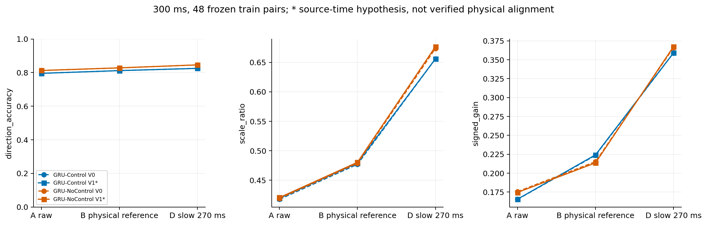
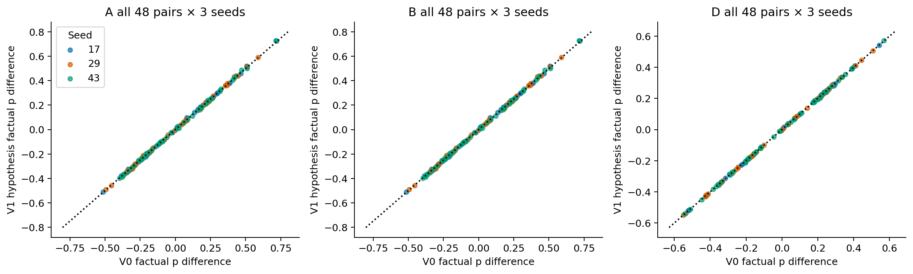
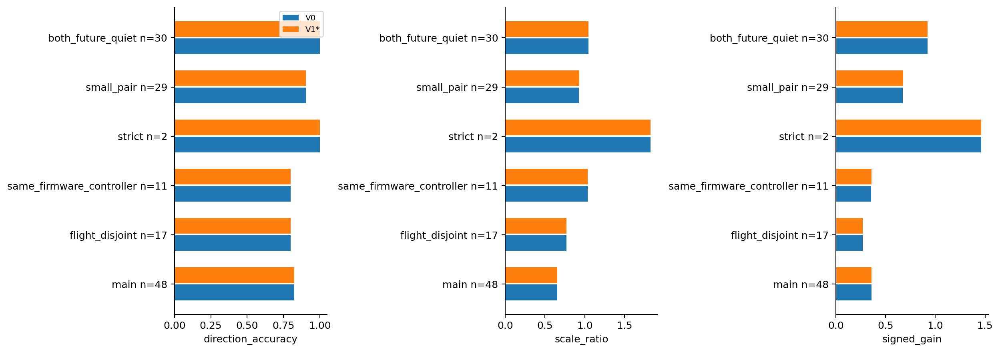
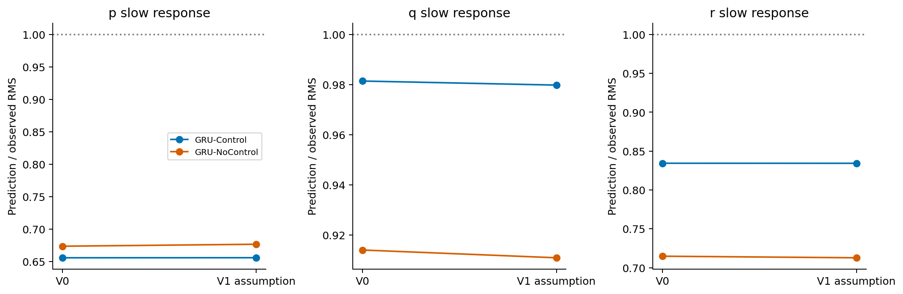
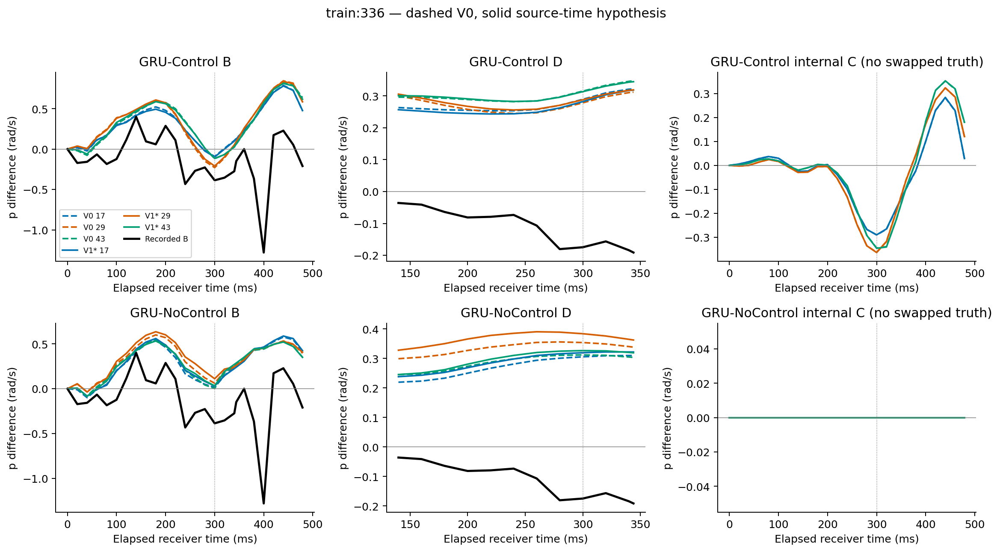
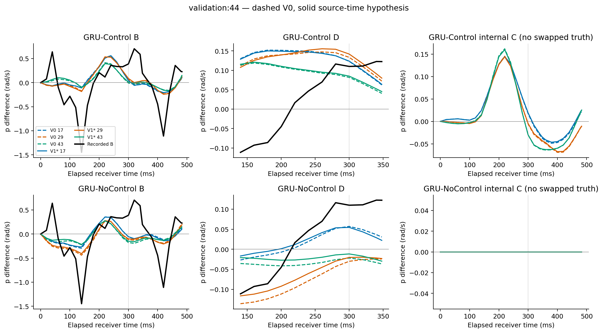
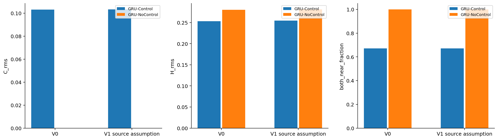

# 状态／相位时间合同与冻结 GRU 输入消融

基准 `ae8598a94555c908500856cc415cf2119c396078`；分支 `exp/local-control-response-time-contract-ablation-v1`；2026-10-26。

**结论：本轮没有得到可称为“已验证物理时间对齐”的修正。唯一执行的改变版是按编码器软件源时间传播相位的条件性诊断。它对主要方向和幅度指标影响很小，没有解决幅度低估、慢变方向错误或历史侧主导。建议结束这类源年龄／常量相位偏移扫描，下一步优先设计结构化控制效能模型的独立比较；现有证据不支持立即以“时间修正已改善”为依据重训。** 物理测量时间缺口仍需明确，但不能把继续试偏移当作验证它的方法。

本轮完成源码审查、准入、V0 回归、条件性 V1 冻结推理、全部固定队列比较及数值复核。V1 物理对齐和 V2 状态重建未准入。未训练、修改 checkpoint／归一化／网络、重选片段、读取 test、调 Loss 或实施 MPC。

## 1. 固定资产及实际运行范围

历史版本仍为 `velocity_rate_multistep_v1/main_50hz`，AUTO_stable、差动 `(right-left)/2`，500 ms 历史和名义 500 ms 未来。数据 manifest SHA256：`8afb8623bf7174e4da5b2044f644331b8b251433fed3576f6dcdab470935bcb5`。

复用 scope、rollout、timing_slowfast、swap_sensitivity 四轮的冻结索引、数据合同、原预测／真值数组、原生角速度诊断缓存、Stage3 推理接口和 `exact_zoh_merge_us_v1`。Stage4 文本从原 scope worktree 本地缓存恢复，未重新下载原始日志。六个 H1000 checkpoint 为 Control/NoControl × seeds 17、29、43，逐份验证 SHA256；归一化哈希均为 `03c15586b205d02232b75cf82292de2e66a3ffbc41c5c9391f2aaa22235e3189`。

训练主对 48、航次互斥 17、同固件 38、同固件同配置 11、严格匹配 2；验证主对 1。原背景与交集全部保留；合并为 **113 个不同匹配对、225 个窗口、452 个四组合**。V0 复用旧数组并进行六模型 GPU 回归；V1 只对实际改变的输入做六模型推理。每个版本都有相同 AA/AB/BA/BB、四路控制、dt、支持前缀及起点状态。

新增读取仅为登记的 samples_train/validation 历史字段白名单、native_vehicle_angular_velocity_train/validation 的时钟字段，以及 windows_train 的历史范围元数据。未来真值只来自前轮固定评价缓存，完全不进入模型。没有读取 test Parquet 或测试日志，也没有重新重建数据集。

## 2. Q1：哪些时间关系得到证实？

详细调用链和逐行证据见 [time_contract_zh.md](time_contract_zh.md)、`results/source_evidence.csv`。冻结窗口对应 **11 个固件标识、16 个关键文件 × 11 = 176 份精确提交来源**；各路径在这些提交中的内容哈希相同。来源包括本地 PX4 Git 对象、已登记源码缓存和精确 commit HTTPS；快照及 SHA256 均保存。没有改动 PX4 工作树。

| 已确认关系 | 对输入修正的意义 |
|---|---|
| AS5600 RAW_ANGLE I²C 读取成功后才取 `hrt_absolute_time()`；encoder/frequency 的 timestamp 使用这个 now | 这是软件读数返回锚点，不能直接认定为硬件物理采样时间 |
| 转速差分经 alpha=0.2 低通，再按绝对转速／FLAP_RATIO 得到频率 | 可用频率不是无延迟瞬时机械角速度，本轮不反演滤波或调整 ratio |
| Hall GPIO 中断记录时间，WingPhase 用编码器插值并在 Hall 重置零点；消息 timestamp 回填 encoder 时间 | logged wing_phase 发布时间不能从该字段直接恢复 |
| 历史数据集不用 logged wing_phase 作历史输入，而从全日志首条 encoder count 定义相对相位 | 保持历史 log-local 零点；不偷偷切换 Hall 机械相位或新版 canonical 数据集 |
| 构建器把下一条 encoder/frequency 源 timestamp 作为本条 availability 的保守上界 | **前轮 `*_publication_us` 列在这两个通道实际是构造的可用上界，不是直接记录的发布时间** |
| 角速度经滤波／校准再发布，保留 sensor sample 戳；位置状态来自 EKF 输出预测器，sample 戳沿用 IMU 时钟 | 两者不是同步、无滤波延迟的独立物理状态测量 |
| 每行历史按该行决策时可用的过去值打包；模型取末端相位和频率，步起点递推相位，步终点输出状态 | 修改必须同时作用于整段历史的时钟表示与未来相位起点，不能只给未来曲线平移 |

因此，“encoder 源年龄中位 14.73 ms”是已确认的软件年龄，**并非已标定的物理延迟**。尚缺 AS5600 内部采样／滤波及 I²C 事务中的精确物理时刻、绝对翼拍相位、完整 gyro 滤波有效延迟标定。Stage4 也明确指出源码 ver_sw 对应不等于实飞二进制、编译选项和所有 dirty 修改被认证。

## 3. 消融准入与因果输入

| 版本 | 状态 | 定义／未准入原因 |
|---|---|---|
| V0 Original | 已运行 | 完全原输入，六个模型均逐值复现旧 swap 预测，最大差 **0** |
| V1 已验证物理对齐 | 未准入 | 编码器有效物理测量时刻未知，不能将源年龄包装成真实延迟 |
| **V1_source_assumption** | **已运行，条件性诊断** | 对每条有效历史，以该行已经可用的频率，传播相对相位到该行状态 sample 时钟；只改变 sin/cos |
| V2 State-and-phase | 未准入 | 6,011 条历史行中仅 1,899 条、225 个起点中仅 65 个有决策时已发布的角速度时间括号；其余需要额外外推模型，不强行实施 |

V1 的唯一公式预先写入配置：

`phi_new = atan2(saved_sin, saved_cos) + 2*pi*f_available*(state_sample_us - encoder_source_us)*1e-6`

只更新历史通道 17/18，所有状态、initial、历史／未来命令、frequency、mask、history_dt、future dt、模型和归一化不变。末行修正后的相位自然成为原 GRU 的未来相位起点；保持其固定频率和原步起点递推。没有搜索多个 offset 或使用真实未来相位；各行修正所需字段均在**对应行的决策时刻**可用，不仅在最终窗口起点可用。

训练历史相位改变量中位 **0.3380 rad（19.37°）**，范围 0.1841–0.5260 rad。它是可见的输入变化，并非数值零扰动。V0 已经保持最近可用角速度；把同样保持值再称为“时间重建”不会产生新信息。为了补齐剩余 160 个起点而拟合角加速度外推，会引入尚未验证的扑翼高频与滤波动态假设，本轮不做。

### 输入分布偏离

除宽训练侧参考外，另从 **107,920 个登记 H500/H1000 训练窗口的历史并集**提取 647,202 条唯一历史行、94 个航次。用原始 v/pqr/frequency/sin/cos 九维输入、训练侧标准差（相位两维尺度固定 1），计算排除 receiver 航次后的精确最近邻距离。它只是粗联合输入距离，不是完整历史序列支持证书。

训练窗口的平均最近邻距离 **0.39496 → 0.39859**；验证 **0.49140 → 0.49529**。所有窗口均未超出训练边际范围；sin/cos 的窗口内变化向量 RMS 平均为训练 0.3429、验证 0.3069。数值上没有发现明显远离该粗参考的现象，但边际覆盖和小距离变化都不能消除训练表示变化风险。未按这些距离或模型效果筛选窗口。

## 4. 完全一致的评价口径

A 为原位置时钟标签增量差；B 为原生角速度在同一名义物理时刻的离线插值增量差；D 为 B 的 **固定 270 ms 中心矩形平均**，保留瞬时起点。使用前轮同一插值／精确分段线性积分及 20 ms 网格，不重新选择滤波参数。每个口径内，V0/V1 的真值和支持标记逐行完全相同。

主时刻 **300 ms**，全部 48 个训练主对、全部种子和 A/B/D 都有支持。原生模型步保留前轮控制交换的完整受支持前缀，共同原始端点 473.021–499.048 ms；100/200/400 ms 原始口径照常报告，精确 500 ms 保留缺失，不外推。D 需完整滤波窗，在 100/400 ms 和原始端点不成立；另保存 `filter_endpoint`，不冒充原始端点。D 是离线非因果滤波，仅用于评价，不用于输入。

主方向门限仍为 |真实响应差|>0.1 rad/s，预测数值零门限 1e-8；0.05/0.2 敏感性一并保存。内部 CA/CB 则要求两者都超过 0.1 才比较方向；增益分母 |实际差动时间均值|≥0.02。C/H 分解、原四路 ZOH、donor 时间平移、receiver dt 及支持范围均与上一轮完全相同。

下文主表为**航次等权、三种子等权汇总**，不是先平均轨迹，也不把种子当独立样本；逐对和依赖分量等权在 300 ms 完整保存，其他时刻保存航次等权。48 对涉及 46 航次、11 个共享航次依赖分量，最大分量 25 对。子集可重叠，不相加，无显著性检验或可靠置信区间声明。

## 5. Q2：滚转方向、幅度与有符号增益

训练主队列，300 ms：

| 模型／口径 | 方向 V0 → V1 | RMS 比 V0 → V1 | 有符号响应增益 V0 → V1 |
|---|---:|---:|---:|
| Control A | 79.5445% → 79.5445% | 0.417529 → 0.419434 | 0.165349 → 0.165584 |
| Control B | 81.1640% → 81.1640% | 0.476954 → 0.479130 | 0.223550 → 0.224200 |
| **Control D** | **82.4935% → 82.4935%** | **0.655878 → 0.655988** | **0.359037 → 0.359114** |
| NoControl A | 81.2364% → 81.2364% | 0.418966 → 0.420537 | 0.175549 → 0.174486 |
| NoControl B | 82.7910% → 82.7910% | 0.478595 → 0.480389 | 0.215114 → 0.213571 |
| NoControl D | 84.5714% → 84.5714% | 0.673712 → 0.676719 | 0.366060 → 0.367417 |

A/B/D 的有效方向对数分别 **39/40/36（总数均 48）**，对应航次等权近零比例 **16.49%/13.15%/30.25%**，两版本完全相同。不能把 A→B 或 A→D 的指标差记为输入修正效果。0.05 门限下有效对数 44/44/42，0.2 下 35/35/28；主队列 Control 的方向率在这些敏感性门限下也没有变化。

Control 在 A/B 的逐对预测差改变量 RMS 为 **0.00688 rad/s**，D 为 **0.00334 rad/s**；D 的最大改变量仅 0.00958。D 的幅度绝对误差平均变化 -0.000527，144 条对×种子记录中 78 条变小、66 条变大；没有方向由错变对或由对变错。NoControl D 的改变量 RMS 0.00704，幅度绝对误差平均反而增加 0.000646。不能用略增的 RMS 比宣称稳定改善。

| Control 300 ms | 正向对数 | 正向幅度偏差 V0 → V1 | 负向对数 | 负向幅度偏差 V0 → V1 |
|---|---:|---:|---:|---:|
| A | 17 | -0.29603 → -0.29519 | 22 | -0.46430 → -0.46412 |
| B | 19 | -0.25873 → -0.25725 | 21 | -0.34130 → -0.34175 |
| D | 14 | -0.16369 → -0.16320 | 22 | -0.16066 → -0.16060 |

幅度偏差定义为 `|pred|−|real|`，单位 rad/s。正负真实响应仍均有明显低估。辅助 RMSE：Control A 0.614338→0.614747、B 0.517245→0.517503、D 0.353546→0.353543；D 的微小变化不构成实质改善证据。

## 6. Q3：跨种子、航次与匹配质量是否稳定？

Control D 的三个种子方向率都维持 82.4935%；幅度／增益变化方向并不一致：

| 种子 | RMS 比 V0 → V1 | 有符号增益 V0 → V1 |
|---|---:|---:|
| 17 | 0.644152 → 0.643861 | 0.355139 → 0.355102 |
| 29 | 0.664345 → 0.666275 | 0.359311 → 0.360698 |
| 43 | 0.658971 → 0.657634 | 0.362661 → 0.361542 |

| 训练子集，D/300 ms | 对数／有效方向对数 | 方向 V0=V1 | RMS 比 V0 → V1 | 增益 V0 → V1 |
|---|---:|---:|---:|---:|
| 主队列 | 48 / 36 | 82.49% | 0.65588 → 0.65599 | 0.35904 → 0.35911 |
| 航次互斥 | 17 / 10 | 80.00% | 0.77027 → 0.77004 | 0.26849 → 0.27017 |
| 同固件 | 38 / 28 | 85.05% | 0.78949 → 0.78916 | 0.51461 → 0.51499 |
| 同固件同配置 | 11 / 7 | 80.00% | 1.03573 → 1.03599 | 0.35579 → 0.35712 |
| 严格历史匹配 | 2 / 1 | 100%，仅 1 个有效对 | 1.82625 → 1.82665 | 1.46205 → 1.46222 |
| small_pair 背景 | 29 / 23 | 90.47% | 0.92599 → 0.93046 | 0.67253 → 0.67507 |
| both_future_quiet 背景 | 30 / 19 | 100% | 1.04681 → 1.04546 | 0.92363 → 0.92255 |

全部其他冻结交集及 differential_vs_quiet 也保留。背景不是纯传感器噪声或控制因果误差下界。逐航次／日期／配置／依赖分量与逐航次移除结果保存，不把严格 2 对或背景较好方向率当作独立识别证据。

逐航次移除后，Control D 的方向改变量仍均为 0；RMS 比变化范围 **-0.000319 至 +0.000509**，增益变化 **-0.000338 至 +0.000385**。不同种子和子集中的小幅正负变化支持“总体影响小”，不支持稳定改善。

耦合检查：主队列 Control 的 D 口径 p/q/r 改变量 RMS 分别 **0.00334/0.00370/0.00481 rad/s**，三分量均没有主门限方向翻转；q/r 幅度绝对误差均值分别增加 0.000457/0.000596。NoControl 的 q 有 1 条记录由错变对，r 有 1 条由对变错，不能将零星变化解释为控制建模改善。三个 NED 速度分量的原始 A 结果也全部保存。

### 预先指定病例

以下为 D/300 ms，Control 三种子预测范围，单位 rad/s；完整 B/D/C 曲线及全部种子见相应图与 CSV。

| 病例 | 真实差 | V0 预测范围 | V1 预测范围 | 判断 |
|---|---:|---:|---:|---|
| train:124 | -1.32277 | -0.19229 至 -0.16617 | -0.19017 至 -0.17000 | 严重幅度低估保留 |
| train:336 | -0.17473 | +0.27826 至 +0.31508 | +0.28209 至 +0.31330 | 三种子慢变方向仍全部反向 |
| train:412 | -0.23793 | -0.17345 至 -0.15221 | -0.17456 至 -0.15316 | 仍能重现部分响应，小幅变化 |
| validation:44 | +0.11002 | +0.08174 至 +0.13340 | +0.08498 至 +0.14187 | 方向保留，部分种子幅度变大；仅单病例 |

验证 D 的 RMS 比 1.04457→1.08366，增益 1.02469→1.06200；不是可以据此调参或宣称泛化的样本量。全部失败病例均保留，未根据结果删样。

## 7. Q4：内部控制敏感性是否系统变化？

仍按 `CA=YAA−YAB`、`CB=YBA−YBB`，对称 C/H 分解满足 `F=C+H`。同 receiver 的修正历史、initial、频率、相位外推和 dt 在 own/swap 条件下相同，donor 只提供未来四路事件。NoControl 在 V1 下也对未来控制交换**逐值不敏感**。

训练主对 p/300 ms，航次等权：

| 内部指标 | V0 | V1 假设 |
|---|---:|---:|
| CA RMS | 0.097540 | 0.097847 |
| CB RMS | 0.113724 | 0.113813 |
| **C RMS** | **0.103076** | **0.103258** |
| **H RMS** | **0.253083** | **0.254482** |
| 内部 C/g 汇总增益 | 0.095583 | 0.095801 |
| CA/CB 双有效记录数／144 | 25 | 26 |
| 双有效条件同向率 | 100% | 100% |
| 双近零，航次等权 | 67.10% | 67.10% |

双有效数从 25 到 26 是小幅阈值穿越，不是全队列响应稳定性提升。三个种子都 |C|≤0.1 的仍为 **35/48 对**；C 跨种子数值符号一致仍为 38 对、混合符号仍为 10 对，三种子都超过 0.1 的从 9 对变为 8 对。

逐对 C 改变量 RMS **0.001493**、最大 0.004457；H 改变量 RMS **0.006752**。C 的总体尺度只增加约 0.18%，没有解释真实响应幅度不足。H 仍显著大于 C。C/g 是四路联合波形相对于差动均值的**模型内部经验比值**，既没有真实 swapped 标签，也不是已校正物理控制效能。H 仍包括状态、历史控制、相位／频率、隐藏态和 receiver 时间网格差异，不是纯状态因果效应。NoControl 同时移除历史控制，不能当作仅去除未来控制的消融。

## 8. Q5：剩余机制与下一步判断

剩余错误仍是：正负响应幅度低估、`train:336` 等慢变方向异常，以及内部预测差异由历史侧主导。本轮排除了一个具体解释：**在已测试的短期匀速传播和源时间近似假设下，补上源年龄不能实质解释这些误差。** 这不证明真实物理时间完全无关，也不证明原合同正确；V2 未准入，AS5600 的内部物理时间及绝对机械相位仍未确定。

不建议继续试更多固定时移并择优，也没有证据支持把本次 V1 当正式正确数据合同后立即重训。下一步更值得开展**结构化控制效能模型的冻结数据比较设计**：明确联合控制坐标、历史项、相位条件及可辨识范围，再比较它是否能克服当前弱敏感性／历史依赖。不是把观察性匹配差直接当真实控制效应来加 Loss。独立确定传感器物理时间和滤波语义仍应作为数据合同工作保留，但不以它为由无限延长这类偏移消融。

本轮到此停止；未开展新训练、Loss、网络改造或 MPC。

## 9. 验证与产物

- 六个 V0 GPU 回归与原 swap 数组逐值相同；重算 **24,408 条旧内部逐点结果**最大差 3.50e-15；对照旧 A/B/D 300 ms **6,102 条事实结果**最大差 4.27e-7，属于旧批次浮点差，未改变定义。
- 所有非相位输入逐值相同；事件／dt／initial／归一化和 checkpoint 不变；NoControl、冗余事件规范化及额外未来真值／相位污染字段隔离检查通过。
- 真值、支持标记在版本间逐行相同，完整主队列保留，无外推。10 项自动测试覆盖因果可用性、旋转、初值一致性、合成周期／常量滤波、边界、冻结划分和输入隔离。
- 独立复核使用直接单位圆旋转、手写括号插值与逐区间积分、独立图遍历／权重归约；详见 `results/independent_verification.json`。训练分布最近邻另以逐航次单独 KD-tree 验证，与排除 receiver 的自适应查询对 225 个窗口完全一致。

全部实际运行版本保存逐窗口、逐对、逐种子结果：**113,904 条事实逐点、56,952 条内部逐点、20,880 条事实汇总、11,520 条内部汇总**，另有完整曲线、逐对变化、正负幅度偏差、门限敏感性和源输入记录。PNG 共 9 张；复现命令及文件说明见 [README.md](README.md)。原实验报告、数组、模型、数据和 AGENTS.md 均未修改。
