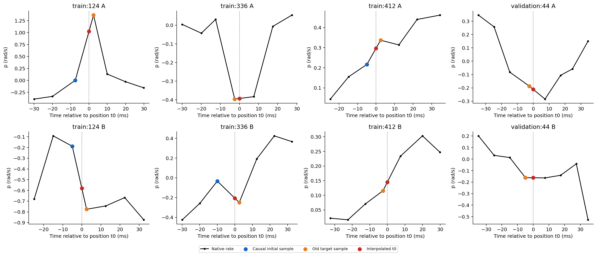
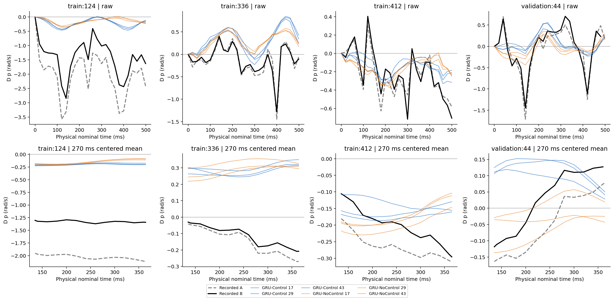
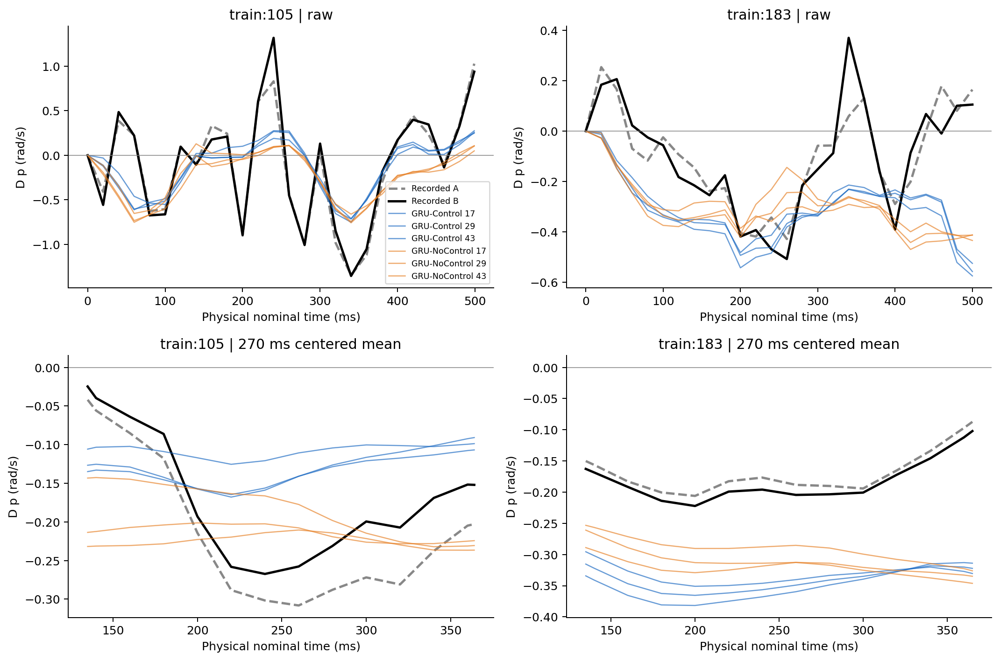
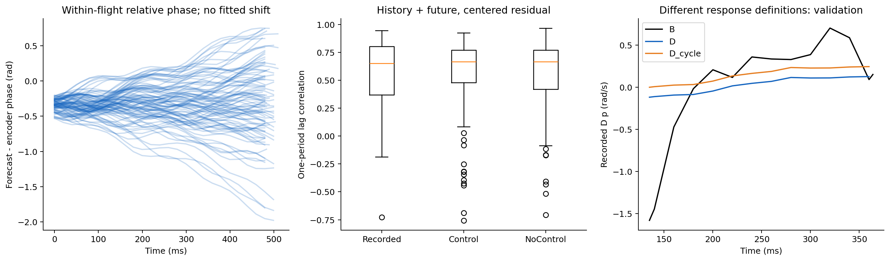
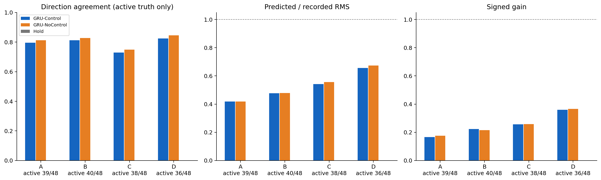
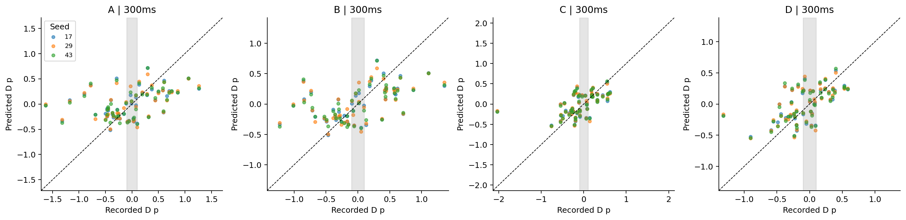
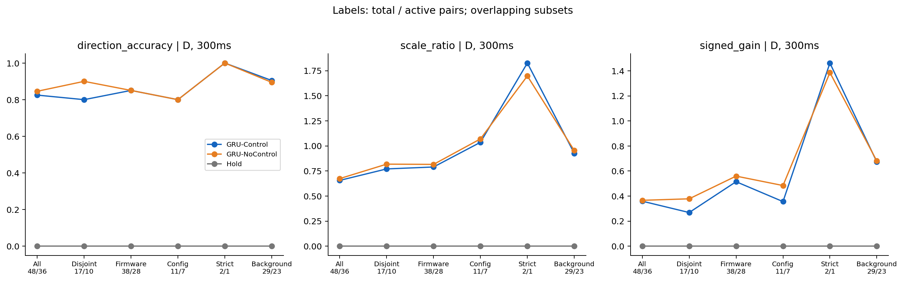

# 局部滚转响应：时间对齐与慢快分离诊断

2026-10-26；基准 `c6580f7a9369db2de721cfd3e31b339c95d317f2`；分支 `exp/local-control-response-timing-slowfast-v1`。

**结论：时间语义与周期振荡确实影响评价，尤其影响部分大幅度反例，但不能据此解释掉主要方向错误。物理对齐与周期尺度平均后，Control 的幅度仍偏小，也未稳定优于 NoControl。应优先澄清状态/相位时间表示，再研究剩余控制敏感性；当前证据不足以直接转向控制损失或网络改造。** 本轮模型完全未变，所有指标变化都属于评价参考、时间支持或响应定义变化，不是模型性能提升。

## 1. 实际范围与基准门禁

复用 AUTO_stable、差动命令 `(right-left)/2`、500 ms 历史和名义未来 500 ms 的冻结索引。训练主对 48、航次互斥 17、同固件 38、同固件同配置 11、严格匹配 2；验证主对 1。冻结背景全部保留：small_pair 29/1、both_future_quiet 30/1，以及原交集与 differential_vs_quiet 队列。合并为 225 个固定窗口、113 个不同对，未增加、删除或重配。

直接复用上一轮的 `native_rollouts.npz` 中 Control/NoControl seeds 17、29、43 和 Hold。没有加载 checkpoint、GPU 推理、训练、控制交换或测试数据。NoControl 仍同时缺少历史和未来控制，不能当成纯未来控制消融。

新分析前，核验旧归档全部 63 个受管文件，并复算 **146,448 行旧逐点结果、3,024 行 p 汇总**；最大数值差约 **5.68e-14**（包括时间列），原方向、RMS 比、有符号增益及误差均复现。原报告与预测数组保持不变。

历史数据集仍为 `velocity_rate_multistep_v1/main_50hz`，manifest SHA256 为 `8afb8623bf7174e4da5b2044f644331b8b251433fed3576f6dcdab470935bcb5`。新增只读提取来自本地已登记的 samples、native_vehicle_angular_velocity、native_encoder_count、native_flap_frequency × train/validation，共 8 份 Parquet，全部核验注册哈希。原因是预测包没有完整原生角速度及编码器时间轴；不需要原始 ULog 或重建数据集。来源与提取结果哈希见 `results/source_receipt.json`。

## 2. 时钟含义与对齐方法

| 对象 | 原定义 / 本轮处理 |
|---|---|
| 位置测量时刻 t0 | 历史最后一条 local-position 的 `state_measurement_us`；原模型原生 dt 的时钟起点 |
| 决策/发布时刻 | 对应 `state_publication_us=decision_us`；历史各字段必须在该时刻可用 |
| 因果 initial.p | 在决策时刻已经发布的最近 angular-velocity 样本；其测量时刻常早于 t0，不是同步测得的 p(t0) |
| truth_initial.p | 原构建器按角速度测量时间寻找离位置 t0 最近的观测；可以在 t0 前，也可以在 t0 后 |
| 原未来标签 | 同样按最近角速度观测配对，但上一轮把其值放在位置时间网格上评价 |
| 模型未来输出 | 每一步完成后的原位置测量时钟时刻；模型步进特征中的相位属于步起点，不能错放到步终点 |
| 新离线参考 | 在已登记原生 `timestamp_sample_us` 上分段线性插值，计算位置 t0 及模型各名义物理时刻的 p/q/r |

同一窗口的因果 initial 和 truth_initial 已逐项追溯到原生角速度记录，值完全一致：大差异来自**不同采样点**，不是 NPZ 搬运或归一化错误。225 个窗口都能在原生观测上建立 t0 双侧插值；所有 initial 角速度发布时刻均不晚于决策时刻。

原生角速度最大采样间隔小于 15 ms；物理插值拒绝跨越 20 ms 以上间隔。原模型/旧目标网格拒绝跨越 40 ms。没有搜索时间平移，也没有按峰值对齐。对真实未来观测的插值只用于离线评价，完全不进入模型。**物理一致性是新评价参考的时钟定义；它并没有修复 GRU 的异步初值或隐藏态。** 分段线性重建也不等于连续运动的独立物理真值。

原完整支持闭区间内，38/225 个窗口在原预测最后时刻缺少原生角速度的右侧插值观测；训练主对原端点的 B 口径只有 34/48 对可用，明确标记缺失而非外推。另定义纯时间戳决定的共同端点 `min(原端点, A原生末时刻, B原生末时刻)`，最多提前 4.990 ms，保留全部 48 对，用于配对一致的 A/B 端点比较。新主四口径比较统一采用 **300 ms，全部 48 对**，因此没有以不等样本集合比较优劣。

`B_sparse` 只把旧目标样本移到其实际测量时间，再作插值，作为稀疏时间重标记诊断；它与使用完整原生观测的 B 分开报告。B 的变化同时包含时钟修正和恢复原网格间丢失的原生观测，不能统称为纯起点修正。逐点保存精确分解：

`B_real − A_real = 未来取样/时钟修正 − 起点修正`。

## 3. 慢快分离及四种口径

只使用训练主队列 96 个窗口的**历史**扑翼频率确定参数：中位数 3.7447 Hz，最小值 2.9792 Hz。一个中位周期四舍五入至 10 ms 为 **270 ms**，作为主窗口；最慢历史频率对应 **340 ms**，作为固定敏感性，不按模型成绩选择。

对真实与预测的分段线性曲线应用同一中心矩形平均算子 `F_W`，积分在各自原生节点及窗口边界上精确计算。只用已经保存的未来范围，要求整窗支持，无镜像、补零或外推。270 ms 的有效中心约为 **135–354/365 ms**，仅约 219–230 ms；340 ms 进一步缩短至约 149–160 ms 的有效长度。中心平均是离线非因果诊断，时间戳放在窗中心，在线实现至少需要等待半窗，即 135/170 ms。

| 口径 | 真实响应 | 预测响应 | 含义 |
|---|---|---|---|
| A | 原位置网格上的旧真实增量差 | 原预测增量差 | 不改变的历史基准 |
| B | 原生物理时间参考，各自减去插值的真实 p(t0) 后作 A−B 差 | 与 A 完全相同 | 新物理时间参考，初值/模型不变 |
| C | `F_W(A_real)` | `F_W(A_pred)` | 原瞬时起点保留的慢变分量 |
| D | `F_W(B_real)` | `F_W(B_pred)` | 物理瞬时起点保留的慢变分量 |

C/D 保留各自的**瞬时起点值**，不意味着起点本身已经周期平均；首个有效中心也不要求响应为零。快速残差定义为 A−C、B−D，满足精确相加关系，但不是正交频带，其能量不能简单相加当作百分比。

为避免把起点的快速振荡常量混入“缓慢变化”，额外保留 `C_cycle/D_cycle`：从 C/D 中减去首个完整周期窗中心 W/2 的值。这是在两个未来周期均值之间比较变化，**不是从原 t0 出发的控制响应**；它排除了早期响应，不能替换主结论或仅因分数更好而选用。

270 ms 矩形平均在约 3.70 Hz 有第一个零点，但频率漂移和非整数周期会残留振荡，较快的真实机动也会被削弱。500 ms 未来仅约 1.5–2.1 个周期，无法可靠识别狭窄频带、稳定相位关系或高阶谐波。本轮不拟合谐波、不强制跨航次绝对相位一致；快速残差还包含非周期扰动、测量变化和取样效应。

## 4. Q1：起点与时间定义解释了多少误差？

训练主窗口的起点差值 RMS：旧 `truth_initial−initial` 为 **0.188 rad/s**；旧目标与物理插值起点之差为 **0.0646**；物理起点与因果 initial 之差仍为 **0.1424**。后二者相加等于前者，但相关，不能用平方比当独立误差来源占比。时间重建并没有让异步输入变成同步状态。

| 训练主对端点口径 | n | Control 同向率 | RMS 比 | 有符号增益 | RMSE，仅作补充 |
|---|---:|---:|---:|---:|---:|
| 原始 A、原端点（旧基准） | 48 | 62.7% | 0.499 | 0.207 | 0.617 |
| A、原生共同支持端点 | 48 | 66.8% | 0.503 | 0.209 | 0.611 |
| B、同一个原生共同端点 | 48 | 64.5% | 0.593 | 0.278 | 0.506 |

同一共同端点上，B 的幅度比例更接近 1，但同向率没有提高；在两口径都非近零的对中，三个种子均没有出现由错变对或由对变错，整体百分比变化来自近零成员改变。NoControl 在 B 的同向率为 **71.5%**、RMS 比 0.526、增益 0.225。

不能把上一轮“改成因果 initial 锚定后 RMSE=0.390”的结果当成时间对齐修正后的成绩。那种口径在 t=0 可能不为零，回答另一问题；本轮 B 使用实际测量时间的物理起点，没有获得相同幅度的下降。

对 `train:124`，旧 A/B 起点差之差为 **1.9516**；其中旧目标相对物理起点的部分为 **0.5369**，物理起点相对因果初值仍有 **1.4148 rad/s**。300 ms 时真实响应由 A 的 −1.631 变为 B 的 −1.013，预测仍约 −0.020，严重低估依然存在。这个例子确有较大对齐影响，但不能据此推广到所有方向错误。

48 对描述性 Spearman 关联中，旧起点差绝对值与 Control 绝对误差约 0.222、方向错误约 0.141、绝对峰值时差约 0.187；目标相对物理起点偏差对应约 0.018/0.084/0.054。数据依赖下不作显著性推断；这些结果不支持“起点标签错位是普遍主因”的强结论。

## 5. Q2：多少方向错误表现为周期振荡或峰值错位？

在同一 300 ms、270 ms 窗口下，从物理原始响应 B 改为慢分量 D，Control 三个种子的变化分类相同：

| 分类 | 对数（总计 48） |
|---|---:|
| 两口径都正确 | 24 |
| 原错误、慢分量正确 | 3：105、363、772 |
| 原正确、慢分量错误 | 3：15、99、336 |
| 两口径都错误 | 1：574 |
| 原有效，慢分量变近零 | 9 |
| 原近零，慢分量变有效 | 5 |
| 两者都近零 | 3 |

因此只能说 **3 对错误与滤除快速变化后的方向不同**，同时有 3 对反向变化、14 对改变有效性，不能说过滤“解释掉大多数错误”。`train:336` 尤其清楚：300 ms 的原始预测与真实均为负，但周期平均后预测约 +0.294、真实约 −0.175，出现慢分量反向。

在约 1 s 的完整历史—未来窗口，按各窗口历史频率固定一个周期的时滞，考察中心平均残差的相关性，没有搜索最优滞后：训练主窗口真实残差相关中位数约 **0.650**（P10/P90 0.122/0.894），Control/NoControl 约 **0.666/0.665**。这支持存在周期性成分，但时间短、重叠且预测侧过去部分来自共同历史，不能把它当成纯未来预测能力或因果贡献比例。

物理原始响应 B 的主峰同号比例为 **72.2%**，峰值时差 P10/P90 约 **−240/+240 ms**；D 为 **82.6%**、约 **−124/+124 ms**。二者时域不同，不能把这个缩小称为相位预测改善：D 的真实/预测峰值约 **33.3%/31.9%** 落在有效区间边界，峰时解释能力很有限。所有主峰在固定 20 ms 诊断网格及有效端点上寻找，不是连续原生信号的精确物理峰值；符号、幅值、时刻及边界标志逐对保存，未反向调整曲线。

模型以最后可用相位和频率保持外推，且不读取真实未来相位。编码器审计显示：按驱动源时间估计，训练主窗口起点相位因观测年龄产生的相位差中位数约 **0.334 rad**；只看未来频率外推的相对相位误差中位数为 +0.019 rad，P10/P90 −1.057/+0.631；把起点相位年龄算入，末端误差中位数约 **−0.399 rad**，P10/P90 −1.279/+0.258。编码器与频率主题没有独立 `timestamp_sample`（字段为 −1），本轮明确标记未知，使用驱动源时间和保守可用性合同，未把 −1 当成测量时刻。以上相位差是该合同下的估计，不是高精度物理相位真值。相位时间语义值得检查，但本轮没有用这些未来观测修正任何预测，不能量化修正后的方向准确率。

## 6. Q3：慢变方向和幅度是否改善、是否优于 NoControl？

以下统一为 **300 ms、训练全部 48 对、航次等权、种子误差/统计汇总**，方向门限 0.1 rad/s。所有百分比的有效对数均明确保留；近零权重与简单计数比例不同。

| 口径 | 有效对数 | Control 同向率 / RMS比 / 增益 | NoControl 同向率 / RMS比 / 增益 | 近零航次权重 |
|---|---:|---:|---:|---:|
| A | 39 | 79.5% / 0.418 / 0.165 | 81.2% / 0.419 / 0.176 | 16.5% |
| B | 40 | 81.2% / 0.477 / 0.224 | 82.8% / 0.479 / 0.215 | 13.2% |
| C | 38 | 73.0% / 0.541 / 0.256 | 74.9% / 0.556 / 0.259 | 25.1% |
| D | 36 | 82.5% / 0.656 / 0.359 | 84.6% / 0.674 / 0.366 | 30.3% |
| D_cycle，另一响应定义 | 31 | 68.8% / 0.438 / 0.179 | 56.4% / 0.378 / 0.097 | 43.0% |

Hold 在所有口径均为零响应，同向率/RMS比/增益为零，方向上的零表示弃判。C/D 滤波降低了响应的快速振荡，却保留瞬时起点，不能等同于周期平均初态的净运动响应。

D 中 Control 的正向响应有符号偏差 **−0.164 rad/s**、负向为 **+0.293**；按绝对幅度计算偏差分别 **−0.164/−0.161**，两侧都偏小，负向还混有反向。NoControl 对应有符号偏差 **−0.146/+0.281**，绝对幅度偏差 **−0.146/−0.150**。总体增益约 0.36，仍远离 1。

| D、270 ms | Control 同向率 / RMS比 / 增益 | NoControl 同向率 / RMS比 / 增益 |
|---|---:|---:|
| seed 17 | 82.5% / 0.644 / 0.355 | 84.6% / 0.677 / 0.372 |
| seed 29 | 82.5% / 0.664 / 0.359 | 84.6% / 0.680 / 0.367 |
| seed 43 | 82.5% / 0.659 / 0.363 | 84.6% / 0.663 / 0.359 |

不选择最优种子。340 ms 固定敏感性下，D 有效 37 对，Control 为 **81.4% / 0.669 / 0.399**，NoControl 为 **81.4% / 0.685 / 0.398**，没有产生稳定 Control 优势。

D 的门限 0.05/0.1/0.2 时，Control 同向率为 **72.3%/82.5%/88.3%**，有效 **42/36/28 对**；NoControl 为 **75.7%/84.6%/91.0%**。高门限去掉了更多小响应，不能只展示较高同向率。`D_cycle` 的 Control 优势值得记录，但它比较 135 ms 之后两个重叠周期均值的变化，有效时间短、幅度比仍只有 0.438，不能选作替代主结论。

辅助 q/r：D 下 Control 同向率约 **95.6%/89.8%**、RMS 比 **0.981/0.834**；NoControl 为 **93.1%/81.1%**、RMS 比 **0.914/0.715**。p 的不足未在所有轴上同样出现；但这些耦合变化不能解释为独立差动效能。

## 7. Q4：残余错误的跨航次和配置一致性

| D，300 ms 队列 | 总数/有效数 | Control 同向率 / RMS比 / 增益 | NoControl 同向率 |
|---|---:|---:|---:|
| 全部主对 | 48/36 | 82.5% / 0.656 / 0.359 | 84.6% |
| 航次互斥 | 17/10 | 80.0% / 0.770 / 0.268 | 90.0% |
| 同固件 | 38/28 | 85.0% / 0.789 / 0.515 | 85.0% |
| 同固件同配置 | 11/7 | 80.0% / 1.036 / 0.356 | 80.0% |
| 严格匹配 | 2/1 | 100% / 1.826 / 1.462 | 100% |
| 小控制差异背景 | 29/23 | 90.5% / 0.926 / 0.673 | 89.5% |
| 双方未来安静背景 | 30/19 | 100% / 1.047 / 0.924 | 92.5% |

严格匹配仅一个有效方向判断，且幅度过大，不能因 100% 就宣称稳健。背景的慢变方向也能较好预测，说明这种表现并非差动控制作用独有；背景仍包含历史、扰动和测量等差异，不是噪声地板。

主队列有 46 航次、11 个共享航次依赖分量，最大分量仍为 25 对。D 的逐对/航次/分量等权同向率为 **86.1%/82.5%/81.0%**，RMS 比 **0.726/0.656/0.771**，增益 **0.423/0.359/0.431**；NoControl 相应同向率 **88.9%/84.6%/81.6%**。不同加权未支持 Control 的稳定优势。

移除任一航次重算 D，Control 同向率范围 **79.5–86.5%**，RMS 比 **0.623–0.794**，增益 **0.309–0.467**。因此总体幅度不足不只是单一航次造成，但具体组的尺度和符号差异明显。D 下固定反向对为 **15、99、336、574、884**，三种子一致；不能把它们视为五次独立干预。逐日期、航次、配置和依赖分量表保留完整结果，子集重叠不相加。

`train:124` 的 D 真值约 −1.323、Control 均值 −0.181；`train:336` 为 −0.175 对 +0.294；`train:412` 为 −0.238 对 −0.161。这些相同时间下的对照分别保留了幅度不足、慢分量反向和部分复现的实例。

唯一验证 `validation:44`：300 ms 的 D 真值为 **+0.1100**，Control 均值约 **+0.1127**，三种子同向；NoControl 仅一颗种子同向。但它恰在 0.1 门限附近，原始 B 真值为 +0.3879，而 `D_cycle` 真值 +0.2283、Control 均值约 −0.0011，仅一颗种子同向。不同响应定义给出不同病例判断，验证单对不能裁决方法、选参或证明泛化。

## 8. Q5：下一步优先机制与本轮限制

**优先级 1：审查状态与相位的共同物理时间和可用性合同。** initial 的角速度滞后、最近目标配对及相位年龄是真实存在且可追溯的问题。应先明确模型是在预测哪个物理时刻的状态、相位应如何按已知历史信息传播；任何修正都需另立冻结对照，不能把本轮后处理指标当成模型已改善。

**优先级 2：在时间语义明确后研究持续的幅度不足与错误符号。** B/D 仍显示 p 幅度不足，`train:336` 等慢分量反向并未消失；Control 也未稳定超过 NoControl。当前不支持直接归咎于控制敏感性不足、立即设计响应 Loss 或改网络。`D_cycle` 中的 Control 优势只是一条有限线索。

本轮无法给出“时间错位/扑翼振荡解释了误差的某个因果百分比”。窗口仅约两个未来周期，中心滤波有效跨度不到一个周期，边界峰值多；C/D 保留瞬时起点，cycle 口径又改变了研究对象。短窗滤波的快速残差不能全称为扑翼周期响应。没有额外空速、扰动或独立控制干预证据，也没有可靠的验证样本规模。

## 9. 复核与交付

`README.md` 给出固定环境、全流程命令和字段说明。`baseline_check.json`、`independent_verification.json`、`extra_verification.json` 与测试日志记录实际检查结果。测试覆盖单调时轴、缺口、无外推、浮点边界、常量与合成周期信号、分量相加/起点定义、训练验证隔离及八项模型输入不变。独立实现使用分段线性函数的解析原函数积分，与主实现的逐窗节点积分分离；另独立核对共同端点与原文件未修改。

实际复核：10 项测试通过；独立重建核对 2,068,269 个有限响应标量，最大差 9.77e-15；66,600 行主要汇总最大差 1.36e-12；另核对 4,746 行共同端点结果，最大差 4.78e-15。旧归档 63 个文件及八项模型输入哈希保持不变。完整快残差汇总另存 `fast_summary.csv`。

所有新增文件只位于本实验目录。旧实验、数据、checkpoint、AGENTS.md 未修改。本轮停止在诊断，不执行控制交换、损失设计、模型修改或 MPC。
