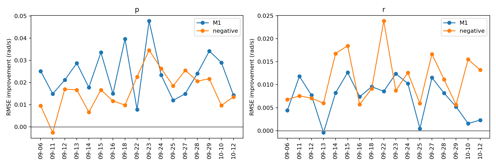
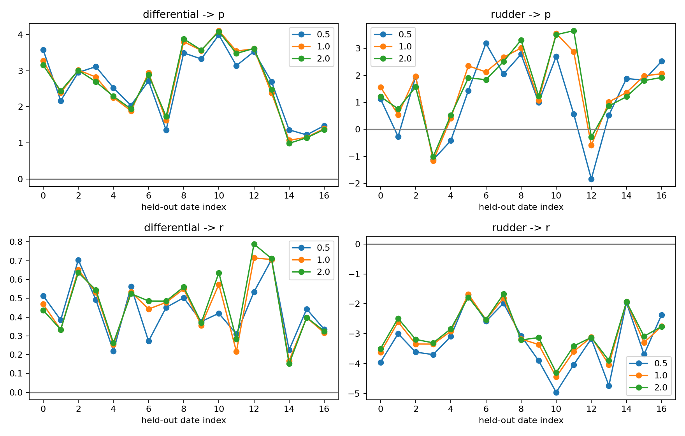
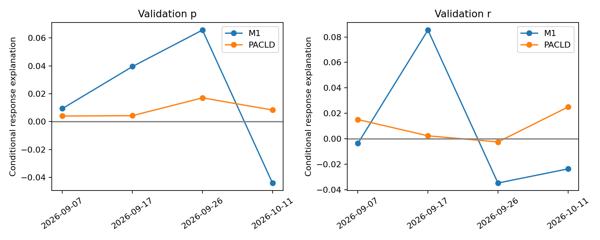
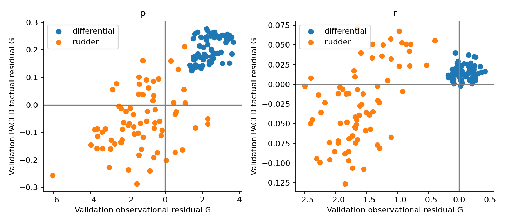

# PACLD A2-v2 控制有效性评价

**核心结论：差动滚转方向一致，但 PACLD 幅值明显不足，不能据此认定控制响应预测已准确。** 主宽度下 validation 局部 G_obs/G_PACLD 中位数为 2.4657/0.2270 rad/s/单位控制；局部相对偏差中位数 -91.6%。独立 validation 条件解释分数 p=0.7914%、r=0.9881%。只有差动滚转进入主评分，其余作为辅助，不构造完整二维总分。

本报告评价**闭环 factual 条件控制响应一致性**。G_PACLD 是模型 factual 输出的条件关联，不是固定 Belief 下单独扰动控制所得的内部导数；本任务未计算该反事实导数。它不是随机动作试验，不建立真实因果控制增益，也不将观察性 G 当作无误差真值。差动滚转为主评价对象；垂尾偏航为反馈混杂明显的辅助诊断。指标分别报告，不合成总分。

## 1. 日期留出与局部 G 独立验证

基线 `73b29d4763830233233461e91710a167700478cc`，独立分支 `research/pacld-control-effectiveness-v2`。复用 A2-v1 的 11,221 个 train 决策、114 航次、17 日期及全部状态/参考特征。每航次决策间隔至少 1 秒；重复时域/采样组已去重。17 次留一日期外层验证，3 折拟合日期内部选择 Ridge alpha∈{1,10,100,1000}。均值/方差只从拟合日期计算；主响应为 FRD Δp、Δr，rad/s，0.2 秒原生角速度观测，不插值。

X 保留机体系速度、角速度、重力方向、频率、Hall sin/cos、决策前控制及 0.5 秒历史、率/姿态参考、控制模式和空速记录及缺失标记。冻结映射为 motor、(right-left)/2、(left+right)/2、rudder；保留四通道作调整变量。读数不是实测舵角或力矩。未来控制属于闭环 factual 记录。

以下 RMSE 按航次先等权、日期再等权；日期 bootstrap 4,000 次、seed=17。区间针对固定交叉拟合预测，未在 bootstrap 内重训。17 日期有限，且模型训练集合相互重叠，区间不能理解为因果检验。gain 为 baseline RMSE 减 model RMSE；删除通道时同时删除 50/100 ms 特征。

|axis|model|baseline|rmse|baseline_rmse|gain|low|high|positive_dates|dates|
|---|---|---|---|---|---|---|---|---|---|
|p|M1|M0|0.477531|0.500736|0.0232053|0.0183534|0.0283116|17|17|
|p|negative|M0|0.485318|0.500736|0.0154177|0.0114578|0.0196422|16|17|
|p|M1|negative|0.477531|0.485318|0.00778768|0.00229026|0.0127195|13|17|
|p|M1|without_differential|0.477531|0.501862|0.0243307|0.019279|0.0299314|17|17|
|p|M1|without_rudder|0.477531|0.477211|-0.000319945|-0.00162489|0.000803042|9|17|
|r|M1|M0|0.173374|0.180717|0.00734323|0.00535719|0.00911404|16|17|
|r|negative|M0|0.169395|0.180717|0.011322|0.00880968|0.0142058|17|17|
|r|M1|negative|0.173374|0.169395|-0.00397879|-0.00680175|-0.00146501|5|17|
|r|M1|without_differential|0.173374|0.176159|0.00278549|0.00197166|0.00367245|17|17|
|r|M1|without_rudder|0.173374|0.177268|0.00389386|0.0025066|0.00516893|15|17|

局部模型修复：在拟合日期内按同模式构造跨航次最多 4 近邻差分；每个评价航次的决策前 X 仅用于选取邻近训练差分中心（每个查询最多 24 个）。ΔY、ΔX、ΔU 均来自训练日期，固定 alpha=10、带宽 0.5/1/2。评价日期的 Y 在拟合函数输入中被置为 NaN，定向毒化测试确认其任意变化不影响 G。随后在留出日期内跨航次差分上比较仅状态校正与状态+控制模型；评价响应不参与拟合。共享近邻和重复配对只在日期聚类汇总中计数，不被当作独立样本。

|width|axis|state_rmse|full_rmse|gain|low|high|positive_dates|dates|
|---|---|---|---|---|---|---|---|---|
|0.5|p|0.632203|0.621116|0.0110873|0.00526177|0.0168665|14|17|
|0.5|r|0.239983|0.237487|0.00249559|-0.000480336|0.00527789|12|17|
|1|p|0.626876|0.616081|0.0107942|0.00468154|0.0165469|13|17|
|1|r|0.23803|0.235742|0.00228828|-0.00116445|0.0050835|14|17|
|2|p|0.627516|0.616741|0.0107754|0.00451432|0.0163816|13|17|
|2|r|0.237977|0.235722|0.00225488|-0.0013488|0.00509146|14|17|

三带宽下差动→p 日期中位 G 全部为正，典型值约 2.70–2.83；差动→r 约 0.44–0.49，亦均为正；垂尾→r 约 -3.13 至 -3.18，各日期均为负。垂尾→p 跨日期翻号，不具备同等级方向依据。带宽未依据评价结果选择，1 为预先固定主宽度，其余为敏感性报告。

|width|axis|channel|median|min|max|positive_dates|dates|
|---|---|---|---|---|---|---|---|
|0.5|p|differential|2.71996|1.2219|3.99286|17|17|
|0.5|p|rudder|1.4394|-1.83596|3.18536|13|17|
|0.5|r|differential|0.442711|0.2196|0.706235|17|17|
|0.5|r|rudder|-3.16904|-4.96053|-1.69703|0|17|
|1|p|differential|2.82555|1.07201|4.11102|17|17|
|1|p|rudder|1.97214|-1.16094|3.55315|15|17|
|1|r|differential|0.468683|0.167811|0.715126|17|17|
|1|r|rudder|-3.17889|-4.44509|-1.68|0|17|
|2|p|differential|2.69502|0.988426|4.08399|17|17|
|2|p|rudder|1.57253|-1.0084|3.6555|15|17|
|2|r|differential|0.485183|0.15168|0.788795|17|17|
|2|r|rudder|-3.12508|-4.30217|-1.67597|0|17|

## 2. 未来控制负对照与反馈混杂

负对照分别用 [250,300] ms、[250,350] ms 的 ZOH 控制均值减决策前值，与正常 [0,50]/[0,100] ms 的特征维数、模型族和样本覆盖一致。全部负对照晚于实际目标测量时刻，维持原有模式/时间支持。228 个决策的原始正常控制复算与上一轮特征最大差 2.22e-16。

滚转正常控制收益 0.023205 rad/s，负对照收益 0.015418，正常控制仍明显更强；偏航正常收益 0.007343，负对照收益 0.011322，后者反而更强。终点之后的控制不能导致已经发生的运动，但可经反馈、控制自相关和共同指令携带其信息。这是明显反馈关联证据，既不能因负对照显著就否定所有观察性预测价值，也不能因正常控制更强就宣称因果识别。

100 ms 正常/负对照同通道相关（电机/差动/对称/垂尾）：[0.7232951798410991, 0.5192329647890199, 0.5379472436612277, 0.5503296361610195]。完整 16×16 相关矩阵见 normal_negative_correlation.csv。

## 3. 可评价通道与有效覆盖

第一阶段结论：差动滚转具备独立日期条件预测与局部校正支持，可进入受限主评价；差动偏航为有支持的交叉项；垂尾偏航虽然方向稳定，但终点后控制的预测力更强，只作为辅助；垂尾滚转方向不确定。电机和对称尾舵保留调整项，不假定零作用。

train 局部拟合记录 678，可辨识记录 678。控制残差矩阵秩不足、数值非有限或拟合对数不超过设计维数时不输出 G。状态支持使用训练跨航次状态距离的最大观测半径诊断，不调节百分比通过率；此边界较宽松，有限样本近邻并不证明高维共同支持。重叠比例中位数 1.0000、最小 0.0238。条件数中位数 2.324、最大 8.364。有效对数和不可评价原因见 local_coverage.csv。

主宽度下不受支持的 train 留出查询主要集中在 2026-09-29（mode 3 为 60 个、mode 15 为 41 个），其余日期多数充分覆盖。support_by_date_mode.csv 按日期/模式给出支持数，state_coverage.csv 给出速度、角速度、频率范围。残差激励按日期及 nav_state 编号 3/15 输出 excitation.csv；不推断这些编号代表的完整任务语义。各日期不同模式的覆盖不均匀；本研究不外推到未覆盖模式、未观测扰动或实际执行器饱和后的真实气动增益。

validation 已实际预测 3,657 个决策；其中 15 个 nav_state=4 窗口在 train 无对应模式，按支持合同标为不可评价（validation_unevaluable_modes.csv）。其余可评价 3642 决策、39 航次、4 日期，局部可评价决策 3641。采用预先固定的 v1 Hall/模式/1 秒间隔及 0.5 秒完整支持要求，因此是 0.2 秒可用窗口的保守共同支持子集，并非穷尽所有仅有 0.2 秒支持的窗口。没有按 PACLD 误差筛选样本。

## 4. 冻结 PACLD 方向、幅值、解释能力及耦合

checkpoint：`/home/zn/flap-system-identification/.worktrees/pacld-gpu-batched-v1/runs/pacld_frozen_eval_seed17/model.pt`；SHA256 `9d82640692c0baec476e276696be4f89fd89a58854361bbcfdf3dbb84cb466c9` 已核实。模型配置与基线一致，train/validation 全 Hall 索引及 manifest 身份与 checkpoint 一致。新入口复用冻结 mixed precision 的只读 GPU inference，无优化器、无权重修改。序列化窗口 B1 与原 B32 预测差最大 1.32e-8 rad/s；执行过程中仅调整 CPU 预取与批大小，不改模型或样本合同。原生读取器提供相同窗口因果 Belief 与原始 ZOH；在真实目标测量时刻查询，不注入未来观测。Y_PACLD 为预测角速度减该 Belief 角速度，Y 为真实目标减最近因果测量角速度，两者各自建立状态条件基准。

根据用户明确补充授权，validation 残差回归允许作为 A/B/D 最终统计。所有条件基准、归一化及超参数仍只在 train 拟合：e(X)、m_obs(X)、m_PACLD(X) 分别拟合，不能用实测 m_obs 替换模型基准。训练残差使用留日期 cross-fit；最终 validation 残差使用全 train 拟合冻结的模型。第二阶段 U 固定为前 100 ms 四通道；M1 同口径使用这四维输入，第一阶段 50/100 ms 联合结果不直接替代。

**矩阵评价口径：**A/B/D 从 validation 实测及 PACLD 残差回归估计，使用同一四通道控制残差、train 残差缩放、固定 alpha=10、以及 train 局部邻域确定的带宽。同模式 validation 样本根据与查询状态的距离赋连续权重，排除 train 支持范围外的样本。该回归是用户允许的最终评价统计，不是新的条件基准；它的系数不进入指标 C。4 个 validation 日期 bootstrap 4,000 次，以固定 nuisance 模型计算矩阵区间；这些局部估计重复使用 validation 数据，不得把局部 G 数量当作独立样本。另保留 train-only 局部 G 参考 CSV，名称 validation_gains.csv 与本节实际评价统计 validation_evaluation_gains.csv 不同。

A：只把第一阶段独立日期方向稳定、且 validation 局部观察性 G 的日期 bootstrap 区间排除零的主通道差动→p 计入方向统计；差动→r 在 validation 多数局部区间跨零，仅少数局部、单个查询日期有方向依据，因此不据此报告总体同向率或相对误差。垂尾两项均不进入主同向率（偏航仅辅助、滚转不确定）。逐日期同向率如下；同日航次不能算独立日期重复试验。

|date|axis|channel|same_direction_rate|eligible_localizations|
|---|---|---|---|---|
|2026-09-07|p|differential|1|15|
|2026-09-17|p|differential|1|16|
|2026-09-26|p|differential|1|18|
|2026-10-11|p|differential|1|22|

B/D：矩阵行 p/r、列差动/垂尾，单位 rad/s 每归一化控制。下表按日期局部中位数再汇总；absolute_error 为绝对差，relative_bias 仅对通过方向证据条件的差动项计算；区间包含零时不报告相对误差。表中区间列是局部区间端点的中位数，不是全局中位增益的置信区间。垂尾不输出相对百分比。三带宽全部保留，不能挑最好结果。

|width|axis|channel|G_obs|G_PACLD|absolute_error|signed_difference|relative_bias|obs_low|obs_high|pacld_low|pacld_high|
|---|---|---|---|---|---|---|---|---|---|---|---|
|0.5|p|differential|1.96874|0.204021|1.81808|-1.81808|-0.941909|0.108032|3.30564|0.0654355|0.250414|
|0.5|p|rudder|-0.737161|-0.113448|2.55222|0.730483|不适用|-5.6755|2.51637|-0.226775|0.0948147|
|0.5|r|differential|0.117115|0.017254|0.260466|-0.0917959|不适用|-0.324464|0.465218|-0.0122485|0.0489321|
|0.5|r|rudder|-1.44787|-0.0141952|1.56485|1.38891|不适用|-2.7251|-0.137571|-0.136051|0.0829465|
|1|p|differential|2.46574|0.227038|2.26261|-2.26261|-0.916366|0.648394|4.11685|0.139808|0.29391|
|1|p|rudder|-1.39605|-0.0743654|1.47136|1.2612|不适用|-5.93848|2.90897|-0.212179|0.180646|
|1|r|differential|0.0270612|0.0155295|0.101621|-0.0151581|不适用|-0.232352|0.344462|-0.0168924|0.0554926|
|1|r|rudder|-1.64782|-0.0271026|1.61473|1.61473|不适用|-3.60074|-0.433998|-0.147191|0.0965756|
|2|p|differential|2.82102|0.246357|2.58321|-2.58321|-0.921832|1.2356|4.51792|0.194744|0.284567|
|2|p|rudder|-1.52437|-0.0837772|1.5079|1.5079|不适用|-5.10987|1.99569|-0.198342|0.267113|
|2|r|differential|0.0238266|0.0172279|0.0718257|-0.00490507|不适用|-0.179273|0.284827|-0.00524131|0.0614215|
|2|r|rudder|-1.44013|-0.0343587|1.45173|1.45173|不适用|-2.54203|-0.728565|-0.0897167|0.0705507|

C：真实残差 R=Y−m_obs(X)，PACLD 残差 R_P=Y_PACLD−m_PACLD(X)，轻量模型响应 R_1=M1(X,U)−m_obs(X)。分数 S=1−E[(R−R_model)²]/E[R²]；零响应基线严格为 0，负分表示比不解释任何条件残差更差。先航次内 MSE、再日期内航次等权、最后日期等权。该 residual score 仍包含未被 X 解释的状态/扰动误差，不能称纯因果控制贡献解释率。

|axis|model|response_score|low|high|dates|zero_baseline_score|raw_rmse|M0_rmse|
|---|---|---|---|---|---|---|---|---|
|p|M1|0.0205119|-0.017421|0.0519886|4|0|0.526951|0.53244|
|p|PACLD|0.00791391|0.00412307|0.0136417|4|0|0.769468|0.53244|
|r|M1|0.0129365|-0.0286543|0.0634532|4|0|0.153735|0.154739|
|r|PACLD|0.00988075|0.000484851|0.0203008|4|0|0.178568|0.154739|

局部状态支持内的独立 validation 分数（排除外推查询；仅训练状态决定）：

|axis|model|score|low|high|dates|supported_samples|
|---|---|---|---|---|---|---|
|p|M1|0.0201901|-0.017421|0.0519886|4|3641|
|p|PACLD|0.00783673|0.00398625|0.0136417|4|3641|
|r|M1|0.0128926|-0.0286543|0.0634532|4|3641|
|r|PACLD|0.00989982|0.000484851|0.0203421|4|3641|

validation 只有 4 日期，bootstrap 区间是有限日期描述性敏感性范围；不能把数千窗口视为数千独立泛化证据。原始响应 RMSE 与条件解释分数不同，不能互相替代。

## 5. 当前数据条件下结论

A2 的局部状态校正在差动滚转上通过了无 anchor 未来响应参与拟合的日期外检验；但未来控制负对照揭示明显反馈关联。因此成立的是受限的闭环条件响应评价框架，不是因果控制有效性评分。PACLD 的差动滚转方向虽一致，幅值仍显著偏弱；其约 1% 的条件解释能力不足以弥补增益差异。原始 Δp RMSE 约 0.7695，差于 M0 的 0.5324 rad/s；原始 Δr 约 0.1786，亦差于 M0 的 0.1547。条件基准移除系统偏差后得到的小正分不能替代原始预测准确性。最终模型数值表现以本报告指标 C 和各日期结果为独立 validation 证据；A/B/D 是授权后的 validation 条件关联统计，受 4 日期、正则化和闭环反馈限制；不能视为真实气动控制增益。没有强制构造完整二维总分。

## 6. 关键阻碍与复现

主要阻碍：偏航反馈混杂较强；实际执行器偏角/延迟与风扰未独立测量；17 个 train 日期和 4 个 validation 日期限制不确定性估计；高维状态共同支持证据有限；validation 残差回归只能描述观察性关联，无法消除未观测反馈混杂。当前任务未建立同合同的冻结 GRU 比较入口，因此不报告 GRU 对照，也未训练 GRU。sealed test 未访问，未执行 MPC 或动力学训练。

已通过定向检查：ZOH 时间积分、原始控制复算、跨航次配对、留出标签毒化不变性、合成 G 恢复、零响应/完美响应分数；GPU 逐窗口检查因果历史、原生目标值与目标时刻，输入数据身份与 checkpoint 核对。









```bash
cd /home/zn/flap-system-identification/.worktrees/pacld-control-effectiveness-v2
export OPENBLAS_NUM_THREADS=1 OMP_NUM_THREADS=1 PYTHONPATH=src
/home/zn/anaconda3/envs/flap-train-gpu/bin/python scripts/diagnose_pacld_a2_v2.py
/home/zn/anaconda3/envs/flap-train-gpu/bin/python scripts/report_pacld_a2_v2.py
# validation 特征提取命令见 reproduce_pacld_a2_v2.sh
/home/zn/anaconda3/envs/flap-train-gpu/bin/python scripts/evaluate_pacld_a2_v2_gpu.py --split train
/home/zn/anaconda3/envs/flap-train-gpu/bin/python scripts/evaluate_pacld_a2_v2_gpu.py --split validation
/home/zn/anaconda3/envs/flap-train-gpu/bin/python scripts/score_pacld_a2_v2.py
/home/zn/anaconda3/envs/flap-train-gpu/bin/python scripts/validation_gain_statistics_a2_v2.py
/home/zn/anaconda3/envs/flap-train-gpu/bin/python scripts/report_pacld_a2_v2_final.py
/home/zn/anaconda3/envs/flap-train-gpu/bin/python scripts/verify_pacld_a2_v2.py
```

所有 CSV/JSON 与关键图随提交发布；features/context/residual NPZ/PKL 为本地可重建中间产物。默认复用 v1 本地特征，可通过 --source 指定复现的同合同 v1 目录。GPU 已存在结果需显式 --resume，按 flight+decision 恢复，禁止静默覆盖。
