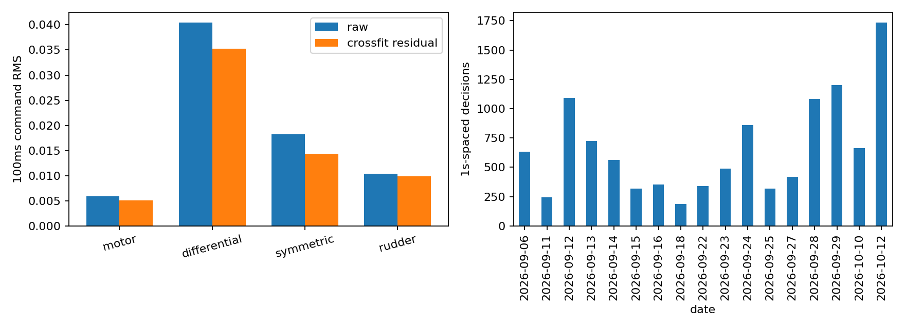
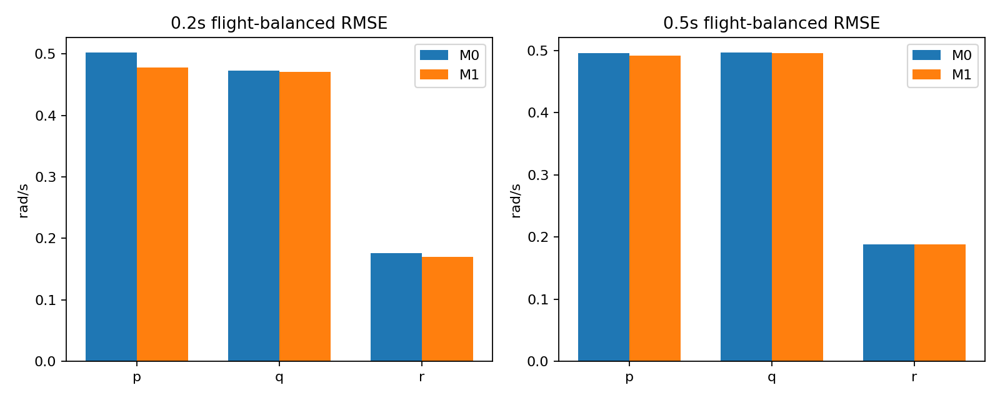
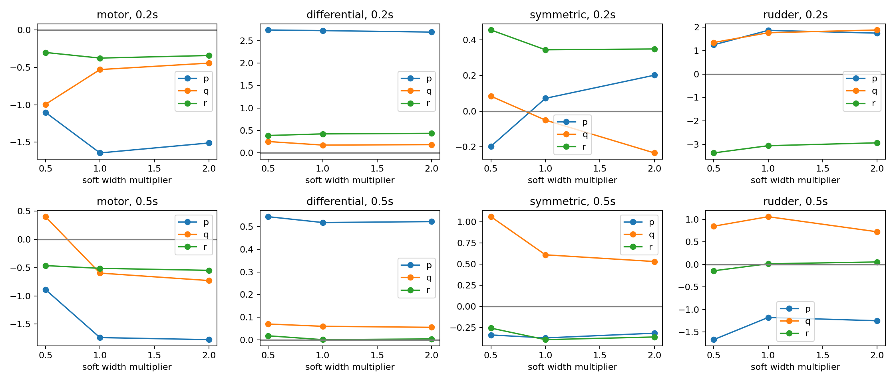

# PACLD 控制有效性 A2 方法可行性诊断

结论：**部分适用，值得针对 0.2 秒差动滚转和垂尾偏航继续发展；目前不能形成全通道控制有效性评分。** 本研究仅为闭环观测条件关联诊断，不建立因果控制增益。

## 数据与合同

基线 `2c088faaed53722911ff0eb897fc253825301685`；分支 `research/pacld-control-identifiability-v1`。只使用冻结 train 114 航次；未访问 validation/test 数据、未加载或训练 PACLD 权重。复用 NativeWindows、冻结映射参数及 shared Hall QC。343,108 条合格多时域/多采样组记录对应 92,682 个唯一决策时刻。采用具备 0.5 秒支持的窗口，按 flight+decision 去重，排除模式转换并施加同航次 1 秒决策间隔，最终 **11,221 个决策、114 航次、17 日期**。该数量是时间稀疏覆盖，不是统计独立样本量。完整历史加预测支持约 1 秒，边界观测容差和同航次相关性仍存在。

X：机体系速度、FRD 角速度 p/q/r、归一化姿态旋转得到的机体系重力方向、频率、Hall 相位 sin/cos、决策前四通道值及前 0.5 秒分为两段的 ZOH 控制均值。姿态/速度按发布时刻因果取最近观测；原生观测年龄按冻结合同约束。相位采用有可用性延迟保护的已发布有效 Hall 观测；不是绝对机翼零位校准。所有缩放均在对应拟合航次计算。

原始 train ULog 额外读取 vehicle_rates_setpoint、vehicle_attitude_setpoint、vehicle_control_mode、airspeed_validated；只提取发布不晚于决策、年龄不超过 0.5 秒的值，并附缺失指示。率参考和姿态参考覆盖全部样本；有效空速 11,102/11,221，控制模式标志 11,089/11,221。空速为记录的 calibrated airspeed，并非独立真值。nav_state 3/15 分别 6,929/4,292 样本，保留数值编号，不推断任务类别。没有把姿态/率参考冒充完整导航任务轨迹。

Y：0.2/0.5 秒原生有效角速度观测减决策前角速度，FRD、rad/s。按测量时刻匹配最近目标，容差遵循采样组 12/30 ms；不插值。冻结窗口继承段/缺口/质量规则。0.2 秒目标偏移范围 -10.939～9.147 ms，0.5 秒为 -5.876～11.022 ms，精确分位数见 summary.json。因主样本要求 0.5 秒支持，0.2 秒结论针对两时域共同支持集。

## 控制定义与边界

冻结 build_config.yaml 定义 motor=actuator_motors.control[0]，left/right/rudder=actuator_servos.control[0/1/2]。114 航次 required_mapping_parameters 全部通过；CA_SV_CS0/1_TRQ_R=-0.55/+0.55、TRQ_P=+1/+1、CS2_TRQ_Y=+1 在所有 train 航次一致。故定义差动=(right-left)/2、对称=(left+right)/2；符号依据冻结分配参数，不依据通道序号猜测。它们是归一化分配命令，不是舵面实测偏角或真实力矩。电机命令与实际扑翼响应之间的物理延迟、舵机滞后未被直接测量；不将 PACLD 假定时间常数当作标定值。

U 为决策后前 50/100 ms 的精确 ZOH 时间加权均值减严格决策前命令；两宽度联合输入 M1。属于实际闭环未来控制记录，不是决策时随机动作，也不是在线可知未来命令。饱和以原始通道 |command|>=0.999 记载，电机下边界另需解释；此统计是控制事件比例，非持续时间比例。电机/左/右/垂尾均值分别为 0.0133%/0.0450%/0.3451%/0%。

## 统计设计

A/B：外层 5 折按航次分组；内层 3 折只在拟合航次选择 Ridge alpha∈{1,10,100,1000}，内层评分按航次等权；模型训练按样本拟合，最终结果按航次等权。M0 与 M1 使用相同标准化/正则化模型族，仅多 8 个控制特征；删除某通道同时删除其两种窗口特征以衡量条件增量。使用 NumPy/SciPy 实现，未修改环境依赖。A 的控制残差来自外层留航次预测。

B 不确定性为 2,000 次航次 bootstrap 的 RMSE 差区间，seed=17；这是固定交叉拟合预测的条件区间，未在每次 bootstrap 重拟合。共享拟合模型、同日相关和多重比较意味着区间不是独立因果显著性证明。逐日期误差表另附：0.2 秒 p/q/r 改善日期数为 17/10/16（共 17 日期），0.5 秒为 14/11/9；这是同一留航次结果的日期汇总，不是留日期验证。

C：每个 anchor 航次在同模式的其他航次中检索最多 24 个状态近邻，不构造全量两两组合。缩放仅用非 anchor 航次；用 ΔX/ΔU/ΔY 拟合带权无截距 Ridge(alpha=10)，宽度为该 anchor 候选距离中位数的 0.5/1/2 倍，权重 exp(-d²/(2h²))。G 使用 100 ms 控制，单位 rad/s 每归一化命令。输出按 anchor 航次汇总，不是每个决策的独立局部增益。anchor 响应参与估计，其他航次会重复作为邻居，因此跨航次 G 分布是敏感性描述，不能当作独立留出验证或置信区间。只比较带宽，未做正则化消融。

## 核心汇总

表中收益为删除该通道相对完整 M1 的 RMSE 差；它衡量该通道额外预测信息，不等于总 M1-M0 收益。

|控制通道|响应时域|独立航次|控制残差激励（100 ms RMS）|M1相对M0收益：通道条件贡献|局部G稳定性|A2适用性|
|---|---|---:|---:|---|---|---|
|电机|0.2s q|114|0.00503|0.000042 [-0.000621, 0.000653]|G中位数 -0.936/-0.601/-0.674；正号航次 45.6%|暂不适用|
|差动水平尾舵|0.2s p|114|0.03527|0.023439 [0.019400, 0.027531]|G中位数 2.881/2.840/2.846；正号航次 92.1%|部分适用（p轴）|
|对称水平尾舵|0.2s q|114|0.01438|0.000885 [-0.000012, 0.001775]|G中位数 0.410/-0.121/-0.244；正号航次 47.4%|暂不适用|
|垂尾|0.2s r|114|0.00990|0.003195 [0.002221, 0.004177]|G中位数 -3.533/-3.263/-3.162；正号航次 0.9%|部分适用（r轴）|
|电机|0.5s q|114|0.00503|-0.000056 [-0.000489, 0.000363]|G中位数 0.775/0.255/0.229；正号航次 51.8%|暂不适用|
|差动水平尾舵|0.5s p|114|0.03527|0.001830 [0.000835, 0.002791]|G中位数 0.595/0.558/0.521；正号航次 70.2%|部分适用（弱滚转信息）|
|对称水平尾舵|0.5s q|114|0.01438|0.000671 [-0.000279, 0.001537]|G中位数 1.364/0.950/0.702；正号航次 69.3%|暂不适用|
|垂尾|0.5s r|114|0.00990|0.000177 [-0.000088, 0.000450]|G中位数 0.158/0.093/0.043；正号航次 52.6%|暂不适用|

所有通道还输出三轴完整结果，见 channel_summary.csv。电机在三个响应轴均无清楚增量；对称通道虽在 0.5 秒滚转有小预测收益，但不能代替稳定俯仰控制证据。没有按任意通过率阈值作判定。

### A：残差激励

```text
 window_ms      channel  raw_rms  residual_rms  effective_rank  condition
        50        motor 0.004296      0.003837        2.015024  48.355431
        50 differential 0.031157      0.026587        2.015024  48.355431
        50    symmetric 0.014318      0.010757        2.015024  48.355431
        50       rudder 0.008032      0.007815        2.015024  48.355431
       100        motor 0.005887      0.005025        1.992520  49.620848
       100 differential 0.040470      0.035273        1.992520  49.620848
       100    symmetric 0.018223      0.014377        1.992520  49.620848
       100       rudder 0.010330      0.009904        1.992520  49.620848
```

100 ms 残差跨通道相关绝对值最大约 0.076；协方差条件数约 49.6、有效秩约 1.99，主要体现差动通道幅值主导，不能仅凭有效秩将其解释为通道完全共线。电机残差量级最小，保留残差并不保证对角速度具有可检测效应。完整协方差/相关矩阵、航次/日期/模式 RMS 见 CSV。残差不等于随机激励，不能排除未观测混杂。

### B：留航次预测

```text
 horizon axis  m0_rmse  m1_rmse     gain    ci_low  ci_high
     0.2    p 0.502089 0.477831 0.024257  0.020179 0.028387
     0.2    q 0.472888 0.471082 0.001805  0.000308 0.003215
     0.2    r 0.176284 0.169698 0.006586  0.005251 0.008005
     0.5    p 0.495127 0.491445 0.003681  0.002162 0.005175
     0.5    q 0.496105 0.495604 0.000501 -0.000470 0.001474
     0.5    r 0.188365 0.188122 0.000242 -0.000104 0.000584
```

单位均为 rad/s；gain=M0 RMSE−M1 RMSE。0.2 秒滚转改善约 4.8%，偏航约 3.7%；0.5 秒仅滚转保留小改善，俯仰/偏航区间包含零。加入参考/空速前，0.2 秒滚转 RMSE 0.503785→0.480770，偏航 0.178502→0.171688；加入后仍有收益，因而不能将全部改善归因于已记录参考。但参考年龄、缺失、线性模型欠拟合、未来反馈仍可混杂。

### C：局部校正

状态校正后标准化控制残差矩阵条件数中位数 2.54，95% 分位 5.18，最大 18.90，没有出现整体严重数值奇异。该结果受 Ridge 和局部选样影响，不保证结构可辨识。差动→p 在三个带宽中位数约 2.88/2.84/2.85，92.1% anchor 航次为正；垂尾→r 约 -3.53/-3.26/-3.16，只有 0.9% 为正。电机分布很宽，对称→q 在 0.2 秒随带宽翻号。0.5 秒差动较弱且跨航次分散，垂尾偏航接近零。

垂尾负关联尤其应理解为闭环条件响应：当偏航率变化时控制器反馈命令也会变化；未观测风扰、实际舵面与延迟也可能参与。不能用这里的负 G 宣称真实操纵方向反转。

## 五个问题的回答

1. 可以有条件放宽匹配：连续状态距离和局部校正在差动滚转、垂尾偏航 0.2 秒场景有数据支持。不能据此任意跨模式/跨缺口配对。
2. 最清楚的是差动水平尾舵→滚转及部分偏航、垂尾→偏航的条件预测信息；电机和对称俯仰不足。
3. 下一阶段应保留机体系速度、p/q/r、重力方向、频率、Hall sin/cos、决策前命令和 0.5 秒控制历史，并保留记录的参考/模式/空速及其缺失信息。本任务未进行逐状态删减，故不能断言每项在统计上都不可替代。
4. 0.2 秒优先；0.5 秒短时控制特征与响应关联衰减，且受到更长时间后续控制和扰动影响，不适合当前全通道评分。
5. 值得进一步发展受限的 A2 诊断，不宜立即升级为 PACLD 最终有效性指标。仍需独立局部验证、执行器实际响应/延迟支持，以及区分未来反馈与输入效应的设计。当前 G 和校正响应均不是无误差真值。

## 产物、复现与检查

图：





coverage.csv 是逐航次覆盖；raw_context_coverage.csv 是原始日志上下文覆盖；flight_errors.csv、date_errors.csv、excitation_coverage.csv、local_g.csv、channel_summary.csv 和 summary.json 为机器可读结果。features.pkl、context.npy、predictions.npz 为本地可重建中间文件，不提交到 Git。

```bash
cd /home/zn/flap-system-identification/.worktrees/pacld-control-identifiability-v1
export OPENBLAS_NUM_THREADS=1 OMP_NUM_THREADS=1 PYTHONPATH=src
/home/zn/anaconda3/envs/flap-train-gpu/bin/python scripts/diagnose_pacld_a2.py
/home/zn/anaconda3/envs/flap-train-gpu/bin/python scripts/report_pacld_a2.py
/home/zn/anaconda3/envs/flap-train-gpu/bin/python scripts/verify_pacld_a2.py
```

已执行：114 航次提取、5×3 航次分组拟合、原始日志上下文读取、局部近邻带宽诊断、2,000 次航次 bootstrap、数值与时间支持检查。未执行模型训练、MPC、sealed 最终评估。
