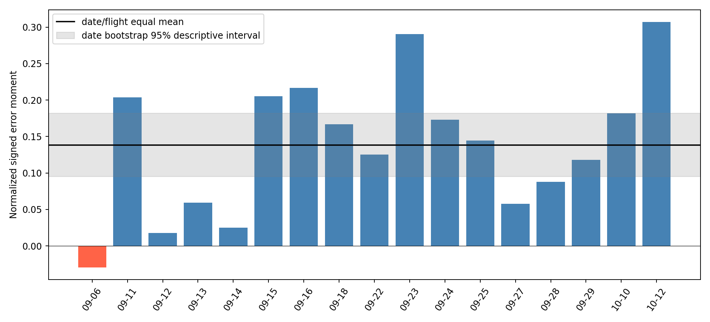
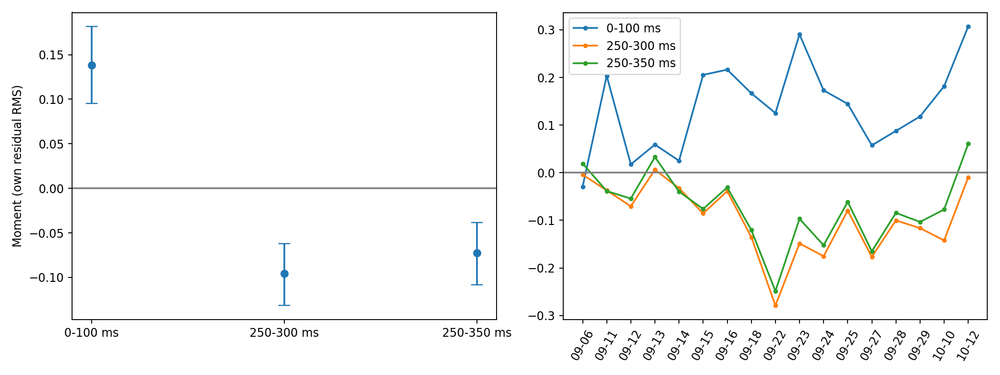
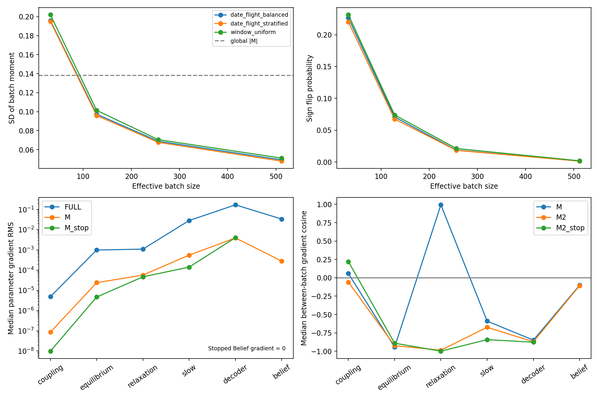

# PACLD-CRM-v1 控制残差矩监督可行性检验

结论：**CONDITIONAL GO，仅可作为观察性预测约束的受限等预算试验候选；不支持把它当作准确控制增益监督。路线A存在显著混杂风险，不建议直接进入正式控制增益训练。** 本轮没有训练、优化器、参数更新、MPC或validation/test数据访问。

## 数据、身份与估计口径

基线 `7746e96d456f25a33e60b074e7f8f47aedb62d26`；冻结checkpoint SHA256 `9d82640692c0baec476e276696be4f89fd89a58854361bbcfdf3dbb84cb466c9`。使用A2-v2全部 11221 个train窗口、114 航次、17 日期，每航次决策间隔至少 1.00042 秒。特征源通过A2既有SHA校验，全部X/U/Y与源特征按 `(flight,t)` 一对一连接后核对；PACLD factual CSV也按该键连接，并验证原生目标时间戳。没有按CSV行序拼接不同来源。A2未来控制数组与已逐行验证X/U/Y的同一归档身份绑定，沿用既有ZOH和质量合同。

原A2无独立身份键的预测NPZ不直接作为误差对照；本轮重算LODO Ridge（17外层日期、其余16日期内部3折，alpha=[1,10,100,1000]），主控制保留原8控制联合选参口径，M0/M1保留原p/r双输出选参。M1仍含A2的四通道、50/100 ms共8个控制特征；这里只评分差动残差×滚转误差，不把M1优势归因于差动单通道。未来控制用同一合同对8个未来控制联合交叉拟合。每行预测都来自不含该日期的模型。详见 `folds.csv`。

U为前100 ms差动 `(right-left)/2` ZOH均值减决策前命令，归一化命令单位；它是闭环未来实际控制记录，**不是随机激励**。p为FRD滚转角速度，rad/s；Y使用观测起点，Y_hat使用因果Belief起点。冻结PACLD沿日志ZOH传播到同一原生目标时刻，没有未来观测更新。Decoder输出整机有效加速度/角加速度，并非孤立翼载荷；本诊断不引入新质量、惯量或力矩参考点标定。

`s_u=0.0360015363`（归一化命令）；`s_p=0.7076565382` rad/s。两者为共同train窗口RMS。m=(U_res/s_u)(E_increment/s_p)无量纲；先窗口均值、再日期内航次等权、最后17日期等权。所有对照同一集合、同一s_p与加权口径；未来控制分别用自己的残差RMS。`E_endpoint=E_increment+E_initial`最大误差 4.44e-16 rad/s。

## A/B：残差与控制误差矩

| metric | M | low | high | positive_dates |
| --- | --- | --- | --- | --- |
| normal | 0.138199 | 0.0953321 | 0.181718 | 16 |
| future50 | -0.0956213 | -0.131563 | -0.0622091 | 1 |
| future100 | -0.0727359 | -0.10801 | -0.0385738 | 3 |
| obs | 0.150142 | 0.106737 | 0.194975 | 16 |
| model | 0.011943 | 0.00788063 | 0.0160976 | 16 |
| initial | 0.0156821 | -0.0504083 | 0.0802793 | 9 |
| endpoint | 0.153881 | 0.112311 | 0.196346 | 16 |
| M0 | 0.168071 | 0.117808 | 0.216171 | 16 |
| M1 | 0.00192404 | -0.0250753 | 0.029741 | 9 |

主矩 **M=0.13819854**，M²=0.01909884。M_obs−M_model=M_error数值恒等成立。PACLD预测仅体现该观察性关联的一小部分：模型矩 0.011943，观测矩 0.150142。不能据此声称真实因果控制增益偏小。M0矩 0.168071，M1矩 0.001924；样本外M1说明控制包含状态Ridge未解释的预测信息。

日期区间来自20,000次日期聚类bootstrap（固定seed=17），只作描述性区间，独立簇仅17个。主矩16/17日期为正，100/114航次为正。逐日期有符号矩如下；完整逐航次见 `flight_moments.csv`。

| date | moment_normal | moment_future50 | moment_future100 | moment_initial |
| --- | --- | --- | --- | --- |
| 2026-09-06 | -0.029533 | -0.0040616 | 0.0192828 | 0.272906 |
| 2026-09-11 | 0.203448 | -0.0371592 | -0.0385032 | 0.0570226 |
| 2026-09-12 | 0.0175154 | -0.0705469 | -0.0544555 | 0.114733 |
| 2026-09-13 | 0.0590086 | 0.0064164 | 0.0329461 | 0.127179 |
| 2026-09-14 | 0.0250904 | -0.0325912 | -0.0396244 | 0.253921 |
| 2026-09-15 | 0.205378 | -0.0855143 | -0.0761757 | -0.084502 |
| 2026-09-16 | 0.216432 | -0.0388272 | -0.0309871 | -0.0681666 |
| 2026-09-18 | 0.166799 | -0.135142 | -0.120243 | 0.133948 |
| 2026-09-22 | 0.12519 | -0.27906 | -0.248664 | 0.0152635 |
| 2026-09-23 | 0.290559 | -0.148541 | -0.0969017 | -0.00441832 |
| 2026-09-24 | 0.172984 | -0.175469 | -0.152388 | -0.0592682 |
| 2026-09-25 | 0.144478 | -0.0795276 | -0.061221 | -0.07741 |
| 2026-09-27 | 0.0574581 | -0.17676 | -0.165076 | 0.0271843 |
| 2026-09-28 | 0.0877142 | -0.100202 | -0.0844178 | -0.0191581 |
| 2026-09-29 | 0.118081 | -0.116404 | -0.103397 | 0.022524 |
| 2026-10-10 | 0.181651 | -0.142256 | -0.077302 | -0.135345 |
| 2026-10-12 | 0.307122 | -0.00991635 | 0.0606181 | -0.309817 |



剔除任一日期后的主矩范围 [0.127641, 0.148682]。仅作影响诊断，删除最高1%/5%绝对残差窗口后主矩分别为 0.119485/0.086724，下降约14%/37%；主要结论并非单个日期造成，但幅度依赖较大控制变化。主结果没有改筛选阈值或归一化。

初始Belief矩总体 0.015682，区间跨零，但各日期可达 [-0.309817, 0.272906]，大于部分日期传播矩。端点误差不能直接当作控制传播误差；采用增量误差消除了起点直接相加项，仍不等于消除初始状态对后续传播的影响。

主U RMS=0.040470，U_res RMS=0.036002。最大日期/航次残差平方能量占比为 23.68%/2.74%。各日期/航次/模式分位数见 `residual_distributions.csv`，总体见 `residual_summary.json`。剩余线性相关绝对值最大的特征：

| feature | correlation |
| --- | --- |
| 43 | 0.0688298 |
| 31 | 0.038048 |
| 21 | 0.0229209 |
| 3 | -0.0194685 |
| 17 | 0.0169055 |
| 24 | 0.0168984 |
| 13 | 0.0147503 |
| 15 | 0.0133929 |
| 11 | -0.0110685 |
| 19 | 0.00999216 |

特征索引：0–2体轴速度，3–5 p/q/r，6–8重力方向，9频率，10–11相位sin/cos，12–23当前/前0.5秒控制历史，24–26率参考，27–30姿态参考，31空速，32–35模式标记，36–47可用性，48起模式one-hot。残差化不保证非线性独立，更不消除未观测反馈。

## C：未来控制负对照

未来250–300 / 250–350 ms矩分别为 -0.095621/-0.072736，绝对值为主矩的 69.2%/52.6%，分别16/17及14/17日期为负。未来控制不可能引起此前结束的响应；其量级与主矩同阶且符号相反，符合响应后反馈纠偏、自相关、持续参考的可能解释，无法在此分离这些机制。主/未来残差相关系数为 0.523182/0.536605。不能用符号相反或未来矩略小消除混杂风险。



## D：批量噪声与梯度

固定随机种子、每种方案/B各10,000次：window_uniform为窗口均匀抽样（估计窗口均值，和目标M略有不同）；date_flight_balanced为按日期/航次层级概率独立抽样；date_flight_stratified为日期数量均衡、日期内航次数量均衡、航次内随机窗口。后两者期望对应目标M。日期/航次组成统计见 `batch_composition.csv` 和各表的mean_unique_flights。

| scheme | B | mean | bias_to_global | sd | sign_flip | M2_mean | mean_unique_flights |
| --- | --- | --- | --- | --- | --- | --- | --- |
| window_uniform | 32 | 0.139092 | 0.000893423 | 0.20202 | 0.2314 | 0.0601585 | 27.551 |
| window_uniform | 128 | 0.140758 | 0.00255906 | 0.101422 | 0.074 | 0.0300992 | 73.729 |
| window_uniform | 256 | 0.139506 | 0.00130736 | 0.0705459 | 0.0213 | 0.0244386 | 97.208 |
| window_uniform | 512 | 0.14013 | 0.00193188 | 0.0511475 | 0.0019 | 0.0222526 | 109.867 |
| date_flight_balanced | 32 | 0.138017 | -0.000181466 | 0.195833 | 0.2265 | 0.0573991 | 27.041 |
| date_flight_balanced | 128 | 0.13847 | 0.000271509 | 0.0973702 | 0.0708 | 0.0286549 | 71.263 |
| date_flight_balanced | 256 | 0.138545 | 0.000346425 | 0.0688944 | 0.0188 | 0.0239411 | 94.5 |
| date_flight_balanced | 512 | 0.138535 | 0.000336936 | 0.0492763 | 0.0015 | 0.0216202 | 108.433 |
| date_flight_stratified | 32 | 0.141989 | 0.00379031 | 0.194986 | 0.2202 | 0.0581805 | 32 |
| date_flight_stratified | 128 | 0.138365 | 0.000166703 | 0.0959165 | 0.0675 | 0.0283449 | 95.1659 |
| date_flight_stratified | 256 | 0.13807 | -0.000128712 | 0.0676738 | 0.0184 | 0.023643 | 111.06 |
| date_flight_stratified | 512 | 0.137148 | -0.00105033 | 0.0479484 | 0.0014 | 0.0211087 | 114 |

层级随机抽样的单窗口方差分解：日期组成 0.008353、日期内航次组成 0.014966、航次内窗口 1.187158；独立抽样时各项除以B。该分解与分层抽样结果共同说明航次组成对估计的影响及无法靠均衡航次消除的窗口噪声。

数值验证 E[M_batch²]=(E[M_batch])²+Var(M_batch)，误差<1e-14；层级采样无偏时才对应M²+Var，窗口均匀方案另有估计目标偏差。B=32噪声方差超过全局M²，平方矩均值约为全局目标的3倍，不能稳定代表系统偏差。B=256已大幅减少符号翻转；B=512是本轮测试中更保守的有效批量候选，仍存在方差项，**没有预注册可靠性门槛，不能声称证明了普适最小批量**。如进入受限试验，应保持日期/航次口径，使用至少512量级有效批量或跨批量估计，并单独验证估计器偏差。本轮未实现训练器。

梯度组在计算前固定，共 136 窗口覆盖日期×四相位×残差符号可用格，随机分入4批。该队列为相位/符号覆盖性诊断样本，不是全train层级概率样本，不能把其M或平均梯度当作全train无偏估计。每批34个窗口；批内采用等窗口权重。每批FULL、M、M²使用相同身份与物理目标；FULL保持原生0.5秒窗口所有物理观测噪声加权目标，Moment使用指定0.2秒增量目标，因此比较的是两个真实目标，不是把FULL改成滚转MSE。Macro机制没有改动，不纳入FULL方向比较。微批量累加得到整批梯度，M²按2M∇M精确计算，并逐微批以autograd验证链式关系。

各诊断批次实际M与FULL值：

| batch | M | FULL | factual_parity_max | autograd_M2_chain_max |
| --- | --- | --- | --- | --- |
| 0 | -0.0432076 | 35.8148 | 1.75931e-08 | 3.52425e-07 |
| 1 | -0.224108 | 32.7809 | 1.17476e-08 | 2.18907e-06 |
| 2 | 0.467156 | 40.5652 | 2.3306e-08 | 8.34543e-07 |
| 3 | 0.479163 | 43.6863 | 1.83822e-08 | 2.32125e-06 |

GPU：NVIDIA GeForce RTX 4090，精度策略 mixed。所有参数逐元素验证未改变。重算factual与冻结CSV最大差 2.33e-08 rad/s；autograd平方矩链式梯度最大差 2.32e-06。零向量余弦记为nan（未定义），不表示梯度非有限。各模块范数中位数如下；全部批次L2、参数RMS、最大绝对值及有限性见 `gradient_statistics.csv`。

| objective | module | l2 | rms | cosine_FULL | max_abs |
| --- | --- | --- | --- | --- | --- |
| FULL | belief | 6.07533 | 0.033676 | 1 | 1.19496 |
| FULL | coupling | 0.000729158 | 4.8839e-06 | 1 | 0.000114127 |
| FULL | decoder | 25.3355 | 0.169743 | 1 | 4.85212 |
| FULL | equilibrium | 0.142179 | 0.000987212 | 1 | 0.0355745 |
| FULL | other | 0.310805 | 0.0897216 | 1 | 0.267377 |
| FULL | relaxation | 0.157975 | 0.00109689 | 1 | 0.0301161 |
| FULL | slow | 4.25301 | 0.0284905 | 1 | 0.683312 |
| M | belief | 0.0503508 | 0.000279098 | 0.301161 | 0.0103788 |
| M | coupling | 1.27786e-05 | 8.55912e-08 | 0.703469 | 2.17703e-06 |
| M | decoder | 0.583758 | 0.00391106 | 0.17323 | 0.132248 |
| M | equilibrium | 0.00345979 | 2.40228e-05 | 0.0566929 | 0.000714369 |
| M | other | 0.00021353 | 6.16408e-05 | -0.0933243 | 0.00014745 |
| M | relaxation | 0.00820327 | 5.69589e-05 | 0.982943 | 0.00169136 |
| M | slow | 0.0825995 | 0.000553326 | 0.310111 | 0.012842 |
| M2 | belief | 0.0294954 | 0.000163495 | -0.362396 | 0.00485094 |
| M2 | coupling | 8.30578e-06 | 5.56321e-08 | -0.406429 | 1.35521e-06 |
| M2 | decoder | 0.383798 | 0.00257137 | -0.248058 | 0.0897485 |
| M2 | equilibrium | 0.0023612 | 1.63949e-05 | -0.200582 | 0.000500062 |
| M2 | other | 0.000158726 | 4.58204e-05 | -0.217106 | 0.000107165 |
| M2 | relaxation | 0.00545299 | 3.78625e-05 | 0.0147895 | 0.00112238 |
| M2 | slow | 0.0582568 | 0.000390257 | -0.401706 | 0.0096796 |
| M2_stop | belief | 0 | 0 | nan | 0 |
| M2_stop | coupling | 1.03035e-06 | 6.9013e-09 | 0.168685 | 1.0633e-07 |
| M2_stop | decoder | 0.396798 | 0.00265847 | -0.258107 | 0.0928744 |
| M2_stop | equilibrium | 0.000475063 | 3.29857e-06 | -0.0863882 | 9.32852e-05 |
| M2_stop | other | 0 | 0 | nan | 0 |
| M2_stop | relaxation | 0.00440992 | 3.062e-05 | 0.0403259 | 0.000911327 |
| M2_stop | slow | 0.0152153 | 0.000101926 | -0.144613 | 0.00273012 |
| M_stop | belief | 0 | 0 | nan | 0 |
| M_stop | coupling | 1.46853e-06 | 9.8362e-09 | 0.265582 | 1.80775e-07 |
| M_stop | decoder | 0.606049 | 0.00406041 | 0.181978 | 0.137755 |
| M_stop | equilibrium | 0.00067307 | 4.67342e-06 | 0.0863882 | 0.000131373 |
| M_stop | other | 0 | 0 | nan | 0 |
| M_stop | relaxation | 0.0067221 | 4.66745e-05 | 0.978587 | 0.00139009 |
| M_stop | slow | 0.021059 | 0.000141072 | 0.104875 | 0.00342873 |

跨批方向余弦（不是有效训练的证明）：

| objective | module | min | median | max |
| --- | --- | --- | --- | --- |
| M | belief | -0.858946 | -0.100313 | 0.940079 |
| M | coupling | -0.786706 | 0.0585624 | 0.932788 |
| M | decoder | -0.976916 | -0.848472 | 0.992792 |
| M | equilibrium | -0.997709 | -0.943257 | 0.965556 |
| M | other | -0.195413 | 0.439028 | 0.87209 |
| M | relaxation | 0.976372 | 0.992952 | 0.998317 |
| M | slow | -0.909338 | -0.58933 | 0.988198 |
| M2 | belief | -0.940079 | -0.106458 | 0.858946 |
| M2 | coupling | -0.932788 | -0.0585624 | 0.679147 |
| M2 | decoder | -0.992792 | -0.870897 | 0.976916 |
| M2 | equilibrium | -0.977684 | -0.923671 | 0.997709 |
| M2 | other | -0.87209 | -0.191095 | 0.825171 |
| M2 | relaxation | -0.998317 | -0.985576 | 0.991123 |
| M2 | slow | -0.988198 | -0.672691 | 0.909338 |
| M2_stop | belief | nan | nan | nan |
| M2_stop | coupling | -0.351917 | 0.220725 | 0.847147 |
| M2_stop | decoder | -0.993141 | -0.876584 | 0.97848 |
| M2_stop | equilibrium | -0.989314 | -0.889888 | 0.929515 |
| M2_stop | other | nan | nan | nan |
| M2_stop | relaxation | -0.99962 | -0.998713 | 0.999384 |
| M2_stop | slow | -0.988832 | -0.841754 | 0.857912 |
| M_stop | belief | nan | nan | nan |
| M_stop | coupling | -0.847147 | 0.105964 | 0.459546 |
| M_stop | decoder | -0.97848 | -0.855042 | 0.993141 |
| M_stop | equilibrium | -0.989314 | -0.907958 | 0.951497 |
| M_stop | other | nan | nan | nan |
| M_stop | relaxation | 0.998241 | 0.999219 | 0.99962 |
| M_stop | slow | -0.857912 | -0.841754 | 0.988832 |

本次实际结果：M梯度的Fast coupling RMS中位数8.56e-8，Decoder为3.91e-3；停止Belief后分别为9.84e-9和4.06e-3。Decoder方向远比Fast coupling更容易被该目标推动，但参数尺度不同，不能把小范数等同于无训练价值。M²与FULL余弦中位数在Fast coupling/Decoder/Slow分别约−0.406/−0.248/−0.402；跨批M²余弦中位数分别约−0.059/−0.871/−0.673，存在方向冲突和批量不稳定。停止Belief后Fast coupling跨批余弦中位数约0.221但最小−0.352，Decoder仍约−0.877；detach没有解决总体方向噪声。四批M为−0.0432、−0.2241、0.4672、0.4792，不能以其中任一批认定训练可行。所有梯度有限；没有预设“极端”阈值，最大绝对分量与范数逐批公开，不据此声称完全没有优化风险。

Fast coupling的梯度可达：命令−执行器状态经coupling驱动Fast包络，后经Decoder映射滚转。equilibrium/relaxation、Slow、Decoder及Belief也可获得梯度。停止Moment初始Belief所有字段梯度后，未来Dynamics/Decoder方向仍可达，Encoder梯度应为零；这只阻止Moment利用初始Belief，不改变原FULL/Macro训练机制。

全train层级加权归一化残差均值为 0.024177，故统一增量偏置对M的导数为 -0.034164 (rad/s)⁻¹；单靠统一偏置消除M需约 4.045 rad/s增量，不能视为廉价的统一偏置解，但状态相关偏置路径仍未排除。

这些模块都依赖状态和潜变量，M目标仅限制一个加权平均残差，未专门限制控制导数。Decoder输出偏置、状态依赖项、Slow/Fast状态修正都可能降低M；仅凭模块范数不能判断改变是否为正确控制传播。优化目标是M²，其梯度为2M∇M；当批量M翻转符号时，M²梯度也会翻转。因此判断与FULL冲突必须看M²而不只看M的余弦。FULL余弦与跨批余弦必须结合上表解释，单批较大梯度或小范数均不能独立认定有效/无效。当前证据是梯度可达与有限样本稳定性诊断，不是参数更新或闭环收益证明。



## 工况依赖

前飞速度按train三分位边界 [6.2470621365817225, 7.536860680811678] m/s分组；相位按Hall机械相位四等分。组内重做航次/日期等权，组间总体矩不等于简单平均（覆盖不同）。

| group | key | M | dates | flights | windows | positive_dates | negative_dates |
| --- | --- | --- | --- | --- | --- | --- | --- |
| mode | 3 | 0.106952 | 17 | 113 | 6929 | 15 | 2 |
| mode | 15 | 0.19537 | 17 | 113 | 4292 | 16 | 1 |
| phase_group | 0 | 0.163805 | 17 | 114 | 2796 | 14 | 3 |
| phase_group | 1 | 0.13131 | 17 | 114 | 2770 | 13 | 4 |
| phase_group | 2 | 0.206661 | 17 | 114 | 3065 | 16 | 1 |
| phase_group | 3 | 0.0371759 | 17 | 114 | 2590 | 9 | 8 |
| speed_group | 0 | 0.121983 | 17 | 114 | 3740 | 14 | 3 |
| speed_group | 1 | 0.168324 | 17 | 114 | 3740 | 15 | 2 |
| speed_group | 2 | 0.121856 | 17 | 114 | 3741 | 13 | 4 |

所有总体模式/速度/相位组的矩为正，没有发现分组总体正负抵消；但相位第3组（从0计数）仅9/17日期为正，M约0.037，远弱于第2组约0.207。尚无证据要求改用多组损失，却不能宣称统一M²解决每个局部工况。应区分总体分组符号与个别日期内的相反方向；逐组日期矩已保存。本轮不添加条件损失版本。若后续采用观察性约束，需保留这些条件诊断，不能把全局M²下降说成所有工况控制响应已解决；相位关联也不能当作相位独立因果作用。

## 四项判断与边界

- **A 信号存在性：VERIFIED。** 在给定Ridge条件特征下，PACLD误差与未解释控制变化存在正矩；不等于所有决策前状态均无法解释。
- **B 统计可靠性：SUPPORTED。** 大多数日期/航次同号，日期bootstrap不跨零；17簇限制推断，尾部窗口影响幅度，局部日期存在异号。
- **C 优化可行性：可达性VERIFIED，稳定训练价值UNRESOLVED。** 梯度可达并检查有限性；较大有效批量明显降低标量矩噪声，但本轮未验证512窗口的参数梯度方向；4×34覆盖性批次显示M²方向不稳，尚未证明优化能改善预测。模块梯度不能防止状态偏置路径绕过目标。
- **D 科学解释边界：强限制。** 未来控制负对照同阶、初始Belief日期污染和闭环反馈，使其不能作为准确控制增益监督。CONDITIONAL GO的条件是保留观察性解释、较大有效批量和FULL对照，不把本轮的梯度可达当作稳定收益承诺；仅可考虑受限等预算对照，本轮不启动。

最值得保留的替代监督方向是因果可用参考与动作、原生滚转增量的多步预测误差，以及具有明确外生来源/设计干预的局部响应证据；在没有外生干预前，M1结果只支持加入动作相关预测信息。

## 输出与复现

所有结果位于独立worktree `.worktrees/pacld-control-residual-moment-v1`。`audit.json`、`residual_summary.json`、`residual_distributions.csv`、`residual_feature_correlations.csv`、`date_moments.csv`、`flight_moments.csv`、`moments.json`、`batch_statistics.csv`、`batch_stratified.csv`、`batch_composition.csv`、`gradient_statistics.csv`、`gradient_stability.csv`、`gradient_checks.json`、`condition_moments.csv`、`conclusion.json`覆盖机器可读交付；`windows.csv`含身份、预测与残差。梯度向量NPZ仅本地保存，由脚本重算，不发布checkpoint或原始数据。

```bash
cd /home/zn/flap-system-identification/.worktrees/pacld-control-residual-moment-v1
export OPENBLAS_NUM_THREADS=1 OMP_NUM_THREADS=1 PYTHONPATH=src:scripts
CRM_PY=/home/zn/anaconda3/envs/flap-train-gpu/bin/python
$CRM_PY scripts/pacld_crm_v1.py
$CRM_PY scripts/pacld_crm_gradients.py --microbatch 4
$CRM_PY scripts/pacld_crm_report.py
$CRM_PY scripts/verify_pacld_crm_v1.py
```

已执行完整train统计、136窗口GPU梯度、独立数值验证（`verification.json`: PASS），并检查三张图的可读性。未运行训练或MPC。

复现依赖上文冻结本地源路径；GPU脚本会复用已完成批次向量，仅适用于本轮同一冻结配置。新诊断应另设输出目录，保留本轮产物。
