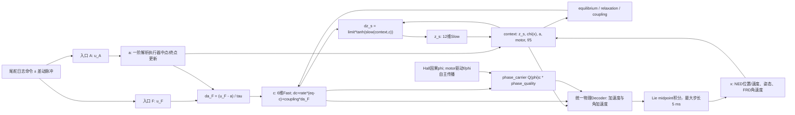
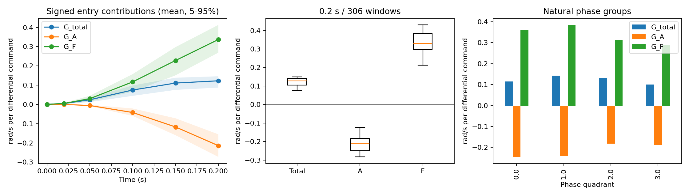
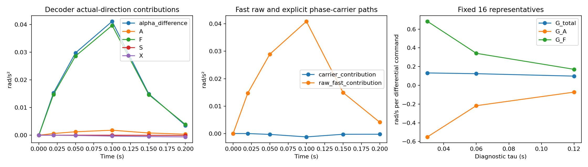
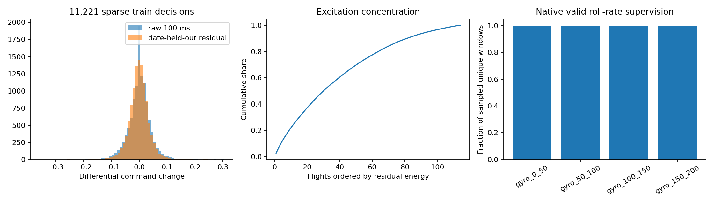

# PACLD-CSAD-v1 控制敏感性机制归因

## 结论

**VERIFIED：同一冻结模型的两条命令入口具有显著相反贡献，且执行器状态到 Decoder 的直接映射较弱。** 306 个窗口的 0.2 s 总增益中位数为 **0.127333**，执行器入口 A 为 **-0.209545**，Fast 直接入口 F 为 **0.329587 rad/s/归一化差动命令**。306/306 均为 A 负、F 正、总响应正。各列中位数不要求相加；逐窗口严格满足加和。

这不是两个独立物理力矩的抵消。入口 A 改变 actuator，继而改变 `da_F=(u_F-actuator)/tau`，也改变全部 context 网络。F 直接入口驱动 Fast；实际完整扰动下 Decoder 的 Fast 状态方向贡献占主导。不能把“入口 A 贡献为负”误称为“执行器到 Decoder 的偏导为负”：后者在所有采样点均为正。

**SUPPORTED：B1 是直接映射层面的主要发现；动态入口之间强烈抵消，但 B2 所说的 Decoder 执行器正贡献被 Slow/Fast 抵消并非本次主要现象。** B3 只能描述最终可达方向响应温和，不能称全部模块不敏感；B4 在 0.2 s 内不是主要瓶颈。更快虚拟执行器并未恢复数量级更大的总响应。

**UNRESOLVED：真实因果增益、正确的目标敏感性，以及数据不足和训练目标不足的相对责任。** 本轮无法据此宣布模型物理增益错误。下一步优先 **D：明确的控制响应监督判别实验**；A 值得作为对照臂，B 暂无充分证据要求立即重构；C 对取得可信实飞控制标签仍是必要前提。

## 1. 冻结协议与真实计算图

- 基线：`research/pacld-controlled-response-v1` / `7962138c6655734def4c490649d39d58eec4233f`。
- checkpoint：`/home/zn/flap-system-identification/.worktrees/pacld-gpu-batched-v1/runs/pacld_frozen_eval_seed17/model.pt`；SHA256 `9d82640692c0baec476e276696be4f89fd89a58854361bbcfdf3dbb84cb466c9`，配置与 train/validation 身份均核验。
- CIR 原样 306 窗口、39 航次、4 日期，复用其缓存因果 Belief；所有字段完整克隆，不重新编码，不使用未来观测。validation 已被历轮使用，本轮是延续性机制分析。
- 主幅值 `0.036001536295864944`（沿用未舍入的 train 残差 RMS）；左右命令分别 ∓a，差动 `(right-left)/2` 变化 ±a，对称量、电机、垂尾不变。命令合法范围及双向可行性沿用 CIR，不裁剪；并非真实舵角。
- 脉冲 `[0,0.1)` s，之后恢复实际 ZOH 命令，各状态独立演化。输出 0/20/50/100/150/200 ms，内部保持原始 ≤5 ms 和原生控制切换边界。
- 原 mixed 精度：物理积分 FP64，网络 FP32。独立 `scripts/pacld_csad_flow.py` 只拆分两个控制入口；正式模型源码和 checkpoint 无改动。τ 诊断仅作用于该诊断实例。




源码对应边如下（均为本分支未修改的冻结源码）：

| 边/计算 | 源码位置 | 含义 |
|---|---|---|
| u→a 中点及终点 | `models/pacld/batch.py:BatchedPACLD.tensor_step`；`flow.py:LieGroupFlow.step` | 一阶解析更新；τ=0.06 s 是假设而非实测 |
| u_tail、a→da→c | `dynamics.py:CoupledDynamics.latent_rates` | `coupling(context) @ ((u_tail-a)/tau)`，加上 equilibrium/relaxation |
| z_s、x、a、motor、f→context | `dynamics.py:CoupledDynamics.context`、`physical_features` | 速度转机体系/10，角速度/3，机体系重力方向；位置不直接进入 |
| context、c→z_s | `dynamics.py:latent_rates` | Slow 有界速率；与 Fast、物理状态动态反馈 |
| context、c、Q(phi)c→alpha | `dynamics.py:decode`、`phase_carrier` | 唯一物理 Decoder；没有原始尾舵命令直连 |
| motor→f、phi | `batch.py:phase`、`flow.py` | 尾舵扰动三分支的 f/phi、相位质量/协方差不变 |
| alpha→omega、姿态→context | `batch.py:tensor_step` | Lie-group midpoint 自主反馈 |
| 历史观测→初始 x/z/c/phi/协方差 | `belief.py:CausalBeliefEncoder`、`batch.py:encode_batch` | 仅决策时已经可用的因果历史；本轮直接复用 CIR 缓存 |

路径存在只是结构事实，不等于学到了充分或物理正确的控制响应。

## 2. 实验一：两入口动态 Shapley 归因

正/负各计算 P00、PA0、P0F、PAF，P00 共用。对每个符号，`R_A=((PA0-P00)+(PAF-P0F))/2`，F 对称定义；`G_A=(R_A_plus-R_A_minus)/(2a)`，F 同口径，总增益 `(PAF_plus-PAF_minus)/(2a)`。不删除模块、不重置状态。

拆开命令后，`da_F` 不再等于执行器自身导数 `da_A`。在 PA0，Fast 直接驱动出现 `-δa/tau`；在 P0F 则出现 `δu_F/tau`，完整变化还包含 coupling 随状态改变的项。两入口相反贡献符合这类导数驱动结构，**不能仅凭抵消认定模型缺陷或浪费控制力**。真正需要外部证据的是这种响应结构及幅值是否符合真实飞机。

下表是时间过程的窗口中位数，单位 rad/s/归一化差动命令：

| time | G_total | G_A | G_F |
|---|---|---|---|
| 0 | 0 | 0 | 0 |
| 0.02 | 0.00440851 | -0.000285994 | 0.0046809 |
| 0.05 | 0.0253318 | -0.00621326 | 0.0318168 |
| 0.1 | 0.080823 | -0.0461179 | 0.127978 |
| 0.15 | 0.113833 | -0.124852 | 0.228964 |
| 0.2 | 0.127333 | -0.209545 | 0.329587 |

0.2 s 分布：

| quantile | G_total | G_A | G_F |
|---|---|---|---|
| 0.05 | 0.0872304 | -0.273042 | 0.269003 |
| 0.5 | 0.127333 | -0.209545 | 0.329587 |
| 0.95 | 0.146087 | -0.155589 | 0.413089 |

有符号绝对贡献为主。辅助抵消量定义 `1-|G_total|/(|G_A|+|G_F|)`，中位数 78.499%；它是计算图贡献抵消度，不是“模型损失了多少真实飞机控制能力”，也不是以接近零的总增益作分母的贡献率。A/F 的强相反贡献可由 actuator 对 Fast 驱动的负项反馈解释；其数值贡献由完整传播确认，不能等同于简单删除 Fast 的消融。

按日期先航次平均后日期平均：

| date | G_total | G_A | G_F |
|---|---|---|---|
| 2026-09-07 | 0.123227 | -0.216343 | 0.339569 |
| 2026-09-17 | 0.12286 | -0.213389 | 0.336249 |
| 2026-09-26 | 0.12184 | -0.215232 | 0.337071 |
| 2026-10-11 | 0.122618 | -0.212388 | 0.335007 |

自然相位组的中位数：

| phase_bin | G_total | G_A | G_F |
|---|---|---|---|
| 0 | 0.116793 | -0.24927 | 0.366084 |
| 1 | 0.142978 | -0.248086 | 0.390474 |
| 2 | 0.132283 | -0.176515 | 0.306619 |
| 3 | 0.0984918 | -0.197342 | 0.29375 |

逐航次与相位分布见 CSV。日期聚类不确定性见 `date_uncertainty.csv`；仅 4 日期，bootstrap 不能建立充分的跨日期外推保证，306 窗口并非 306 个独立实飞干预。相位与工况共同变化，沿用 CIR 自然相位分组，不修改 phi，不能将组间差异全部归因于机械相位。



## 3. 实验二：Decoder 局部 Jacobian 与实际方向贡献

在 factual 状态求 alpha_p 对 31 个局部坐标的导数：a_d；c 的 6 维；z_s 的 12 维；位置 NED m、速度 NED m/s、右乘机体系 SO(3) 旋转 rad、角速度 FRD rad/s 各 3 维。物理速度 Jacobian 使用模型原生 NED 坐标，内部物理特征仍转为机体系；没有将四元数四分量当独立角度。位置导数为零。每个 `J_k` 的单位为 rad/s² 除以对应坐标单位，**不比较异单位原始范数**。

用 `Log(q_factual^-1 q_positive)` 得到姿态差，再计算各 Jacobian 与实际扰动方向的内积，所有贡献统一为 rad/s²。c 导数包含 raw c 和 `phase_carrier(phi,c)` 两条路径；另输出显式 carrier 分量，余量为 raw c 分量。f/phi、质量和电机无分支差异，因此没有遗漏它们的增量项。

下表为窗口均值（可相加），A/F/S/X 在本节分别指 **执行器状态/Fast状态/Slow状态/物理状态的局部贡献**，不同于上一节动态入口 Shapley：

| time | alpha_difference | A | F | S | X | nonlinear_residual | J_0 |
|---|---|---|---|---|---|---|---|
| 0 | 0 | 0 | 0 | 0 | 1.18969e-19 | -1.18969e-19 | 0.0589283 |
| 0.02 | 0.0153433 | 0.000614911 | 0.0147439 | 1.95871e-06 | -1.70349e-05 | -4.71328e-07 | 0.060254 |
| 0.05 | 0.0297551 | 0.00124693 | 0.0285991 | 7.78634e-06 | -9.42761e-05 | -4.39016e-06 | 0.0612582 |
| 0.1 | 0.0411536 | 0.00180879 | 0.0396745 | -1.78634e-06 | -0.000312473 | -1.541e-05 | 0.0619411 |
| 0.15 | 0.0149365 | 0.000805823 | 0.0146627 | -3.68739e-05 | -0.000488401 | -6.79711e-06 | 0.0634956 |
| 0.2 | 0.00354495 | 0.000359294 | 0.00387625 | -8.18987e-05 | -0.000607252 | -1.43694e-06 | 0.0651426 |

执行器差动偏导 J_a 全时间中位数 **0.061696 rad/s²/归一化执行器差动状态**，范围 [0.037848, 0.088730]，均正。100 ms 执行器增量已达 0.029202，但直接 alpha 贡献均值仅约 0.001809；Fast 贡献约 0.039674。这支持“相对于同模型 Fast 通路，直接执行器映射较弱”，不能从缺少真实因果标定的偏导绝对值推断物理误差。

100 ms 的实际扰动大小及投影如下。J 范数按各自坐标单位保留，仅用于描述同一通道，不作跨单位大小排名；投影列统一为 rad/s²：

| group | delta_norm_median | coordinate_unit | J_norm_median | direction_projection_median |
|---|---|---|---|---|
| actuator | 0.0292017 | normalized command | 0.0612201 | 0.00178773 |
| fast | 0.130849 | dimensionless latent | 0.447214 | 0.0378819 |
| slow | 0.00557502 | dimensionless latent | 0.102217 | 5.62778e-06 |
| velocity | 0.00114069 | m/s | 0.0140303 | -6.7869e-06 |
| attitude | 0.000129212 | rad | 0.279543 | -3.12897e-05 |
| rates | 0.00353587 | rad/s | 0.103511 | -0.000318531 |

Fast 状态实际变化并不被截断；其真实方向在 Decoder 上有明确投影。Slow 虽有非零 Jacobian，但实际变化较小且与输出敏感方向的投影较小，不能仅从隐状态范数推断主导性。

全采样点线性剩余 RMS / 完整 alpha 增量 RMS 为 **0.272%**；剩余最大绝对值 0.000322629 rad/s²，逐时域见 `decoder_linearization_error.csv`。剩余保留为非线性/混合精度误差，不强制归入任一模块。响应接近零时不计算逐点百分比。

- **B1 SUPPORTED**：执行器变化充分，而直接 Decoder 执行器方向贡献小。
- **B2 非主要证据**：完整扰动的 Fast 与直接执行器贡献主要同向；Slow 和 X 反馈较小。动态入口 A/F 抵消确实存在，但不能替换为 B2 的 Decoder 状态贡献陈述。
- **B3 部分描述成立、机制归因不充分**：完整可达方向 alpha 响应温和，但 F 入口贡献并不弱；不能宣称所有可达方向都“不敏感”。
- **B4 非主要证据**：0.1 s 后 alpha 衰减，总 G 至 0.2 s 仍增加。沿用 CIR 的非普遍大幅时间抵消结论；本轮不扩展 0.5 s、不推断频域稳定性。



## 4. 实验三：τ 的针对性诊断

预先固定每日期×自然相位组按 flight、t 排序首个窗口，共 16 个，身份见 `tau_representatives.csv`。不依据增益选取。相同 Belief（包括原 τ 下推断的 actuator）出发，仅未来传播使用 0.03/0.06/0.12 s；不重新编码，不视为完整重新标定模型。同时改变 actuator 解析更新时间尺度和 Fast 驱动分母，两个入口均做同样分解。

0.2 s 窗口均值：

| tau | G_total | G_A | G_F |
|---|---|---|---|
| 0.03 | 0.132177 | -0.550779 | 0.682955 |
| 0.06 | 0.124224 | -0.21758 | 0.341804 |
| 0.12 | 0.0983175 | -0.0726751 | 0.170993 |

原 τ 的解析增量 `a*(1-exp(-t/tau))` 在 100 ms 为 0.0292017，即指令变化的 81.112%；脉冲后按 exp 衰减。核验误差 1.21e-16。更快 τ 下 F 正贡献和 A 负贡献都增大、净增益仅小幅改变；更慢 τ 减少净响应。因此 τ 有影响，但当前范围不能解释一个数量级的弱增益，**并非唯一主因**。不能寻找最优 τ 或将该试验当作舵机标定。

## 5. 实验四：train 激励与实际训练监督

### 5.1 激励和真实采样记录

复用 A2-v2 train 留日期残差：11,221 个 ≥1 s 时间稀疏决策、114 航次、17 日期。100 ms 差动原始 RMS **0.040470**，条件残差 RMS **0.036002**。残差来自已观测状态条件模型，不是随机化动作。前五航次占残差能量 **12.42%**；完整航次、日期、模式覆盖见 `excitation_by_*.csv`，50/100 ms 变化逐决策见 `train_excitation.csv`。`train_state_control_correlations.csv` 和 `train_response_correlations.csv` 给出状态及运动增量相关性，不作为因果增益。

原训练日志 `runs/pacld_gpu_b32_seed17_10944windows/training.jsonl` 保存 `global_window_indices`；与冻结 train 索引 SHA 对齐，并用原 BucketSampler(seed=17,batch=32) 完整重演验证全部索引一致。**不是根据 seed 猜测身份，而是日志逐项匹配**。

- 342 个优化步、10,944 次实际采样；10704 个唯一 window_id，10083 个唯一决策时刻；114 航次、17 日期。
- 仅描述性地把 train 稀疏决策 `|100ms差动变化|` 的第75百分位 0.039104 定义为“变化丰富”分层（不是科学通过门槛、不用于模型或 validation 筛选）。实际 2758 次采样、2696 个唯一窗口达到该分层。
- Native 差动命令实际变化时刻、事件数、总变差、真实 ZOH 加权 50/100 ms 变化及每50 ms原生有效滚转角速度目标数均逐窗口读取并保留；没有插值生成目标。首次非零差动变化的5/50/95百分位为 2.096/7.005/96.988 ms；全部 10704 个唯一窗口在该变化之后、200 ms以内有原生有效gyro目标。这里非零仅指命令数值变化（数值容差1e-12），不等于有效独立激励。分时段事件总数见 `training_timeline.json`。
- 以下统计基于 10704 个唯一采样窗口，同决策不同 horizon 仍可能重叠，不能当独立证据。覆盖是优化器看过哪些监督，而非独立样本置信区间。

| native_target_time_bin | windows_with_target | total_targets |
|---|---|---|
| gyro_0_50 | 10704 | 48275 |
| gyro_50_100 | 10704 | 47224 |
| gyro_100_150 | 10704 | 48631 |
| gyro_150_200 | 10704 | 47000 |



### 5.2 FULL / Macro 的实际含义

`models/pacld/batch.py:forward` 是该 checkpoint 的 GPU 训练目标，`training/pacld.py:state_loss/macro_loss/window_objective` 是对应参考实现。

- **FULL**：同一 logged control 的自主状态轨迹与原生观测作 SO(3) 状态残差，按观测噪声方差、质量/掩码加权；gyro 和 EKF 家族等权，家族内事件等权。监督的是 factual 轨迹，**没有同 Belief 不同控制响应差分项**。
- **Macro**：从同一 Belief 传播 BASE 分支（关闭显式相位载波，但保留原始 c 和所有耦合），比较同一窗口两个相邻翼拍目标的状态转移；按 source 和 pair 归一化。它并不是跨飞行独立控制对比。训练固定 lambda_macro=1，原日志 8206 次采样具有有效 Macro 配对；有配对也不意味着控制激励独立。
- 两个分支共用 Encoder 和动力学、没有 detach。控制变化之后的状态误差可经 Lie 积分、Decoder、Slow/Fast 回传；本轮非零 Jacobian 证明局部计算路径存在，原训练后段原生 gyro 目标覆盖也真实存在。**不能把可微或非零局部导数等同于训练期间足够有效的梯度与正确辨识**。
- x、z_s、c 可解释自然状态演化，Encoder 又可从历史推断隐状态，网络可能在弱控制依赖下降低 factual Loss。该可能性与本轮弱直接映射一致，但本轮不能证明优化器具体选择该解的原因。
- 本轮没有新训练、参数更新或额外参数组梯度试验；已有日志总体 grad_norm 不能作为模块贡献证据。FULL/Macro 噪声归一化也不是控制激励强度的归一化，未对控制响应差异施加独立监督。

**判断：数据确实包含分散的差动变化，训练也覆盖了控制后的目标，不能声称“没有控制数据/没有训练信号”。但反馈混杂、跨状态控制对比不足、观测噪声、监督目标不显式区分控制作用与状态演化，仍使准确控制敏感性不充分可辨识。仅此冻结模型无法区分数据激励不足、目标不足、优化不足与结构归纳偏置。A2 的 G_obs 不能直接拿来填补这一缺口。**

## 6. 必须通过的定向检查

| 检查 | 实际结果 |
|---|---|
| train先验数值验证 | 3 个 CIR train 窗口，在 validation 分析前完成 |
| u_A=u_F 时逐步原模型一致 | 全字段最大误差 0；含 factual、双正、双负，所有内部步 |
| 恢复 CIR 逐窗口结果 | 三分支p最大差 1.11e-08 rad/s；train 增益最大差 9.77e-08；validation 2.38e-07，混合精度 batch 尺寸差异 |
| 初始 Belief / 无未来观测 | 七分支全字段 exact clone；复用缓存，无 encode/update 调用 |
| Shapley 加和 | 最大误差 1.11e-16 |
| 解析执行器 / 对称 / 垂尾 | 解析误差 1.21e-16；对称/垂尾误差 1.67e-16 |
| phase/f/质量/协方差不变 | 最大误差 0 |
| Jacobian全部31局部坐标独立差分 | train 最大绝对误差 0.000129；epsilon=0.001，网络FP32 |
| 实际扰动方向独立差分 | validation 最大误差 6.46e-06 rad/s² |
| 原始命令与分母 | 仅 `[0,0.1)` 左右等量反向；actual差动 ±a；原 tape 不修改 |
| 身份与训练日志 | checkpoint/config/train/validation匹配；10,944采样索引逐项重演匹配；未打开sealed test |

解析结果只在所有断言通过后汇总。线性化残差与数值差分误差单独保留，没有用误差修饰归因结果。

## 7. 六个研究问题与后续排序

1. **在哪个动态路径削弱？** 直接 actuator→Decoder 映射贡献较弱；已学习响应主要经 Fast 驱动，A/F 命令入口有明显相反贡献。二者共同解释内部净增益小，不能全部归给执行器滞后。
2. **是否存在 Slow/Fast/物理反馈抵消？** A/F 动态入口抵消明确；从图上 actuator 的 `-a/tau` 驱动反馈是关键候选解释。完整扰动下 Decoder 的 Slow、X 贡献小，Fast 大体同向，并非强 Slow/Fast 输出端相消。Shapley 分配包含所有反馈，不能给出某个单独反馈边的独立物理贡献百分比。
3. **Decoder 是否对执行器差动状态不敏感？** 相对于实际 Fast 状态方向贡献，直接映射明显弱，J_a 小而正；不是严格零导数，也没有真实飞机偏导基准。
4. **一阶动态解释多少？** 100 ms已达81.1%。16窗口 τ减半平均增益仅从0.1242到0.1322；变慢到0.12 s为0.0983。该范围支持次要/部分影响，不能量化真实弱敏感性的物理责任比例。
5. **数据和 Loss 是否足够？** 有实测控制变化及控制后监督，有计算梯度路径；但不足以证明真实控制作用可辨识。FULL/Macro 均无独立控制对比；数据与目标责任目前不能分离。
6. **后续优先哪种研究？** **D 优先**：在一个可获得同初始状态多控制参考的可信受控系统上，固定 PACLD 结构、数据与预算，只比较 factual FULL/Macro 与加入可信控制增量监督的目标，检验相同Belief敏感性及 factual 精度。此实验可区分“结构容纳能力”与“目标约束不足”；仿真参考只证明该系统上的容量，不能替代实飞验证。A 是其中有依据的研究臂；如果结构固定仍无法拟合可信控制对比再考虑 B。对实飞机理结论则优先 C：取得有记录参考/反馈、可区分激励及实测执行器响应；不得直接用 A2 观察性增益作真值。

本轮没有启动上述后续实验。内部计算图归因只解释冻结 PACLD 的行为，不是真实飞机反事实验证。

## 8. 产物与复现

代码：`scripts/pacld_csad_flow.py`、`pacld_csad_v1.py`、`verify_pacld_csad_v1.py`、`audit_pacld_csad_train.py`、`report_pacld_csad_v1.py`。完整 CSV/JSON/图表位于本报告同目录 `control_sensitivity_attribution_v1/`。Jacobian逐坐标、实际增量、贡献与剩余均可机器读取。

```bash
cd /home/zn/flap-system-identification/.worktrees/pacld-control-sensitivity-attribution-v1
export OPENBLAS_NUM_THREADS=1 OMP_NUM_THREADS=1 PYTHONPATH=src
PY=/home/zn/anaconda3/envs/flap-train-gpu/bin/python
$PY scripts/verify_pacld_csad_v1.py
$PY scripts/pacld_csad_v1.py
$PY scripts/audit_pacld_csad_train.py
$PY scripts/report_pacld_csad_v1.py
```

依赖同主机只读 CIR Belief/tape 缓存、A2 train features/residual 和冻结原生 train 数据/训练日志，均不复制或修改。若缓存缺失，应按 CIR 原协议复现，不能用新窗口或重新挑选替代。本轮所有新增结果单独存放；模型源码、checkpoint、原始数据和其他 worktree 保持原样。
