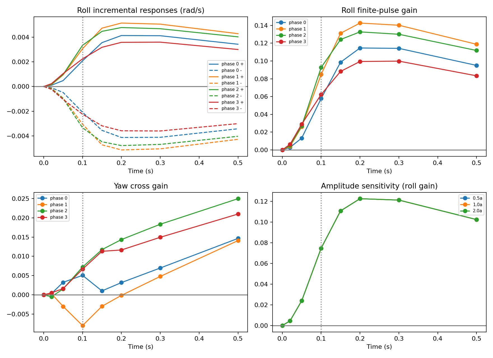
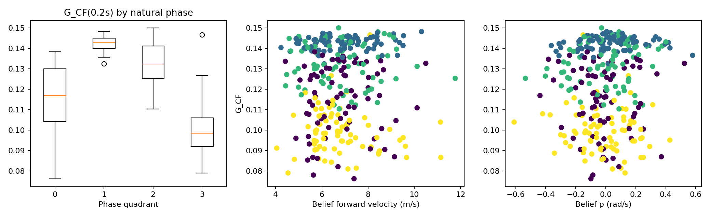
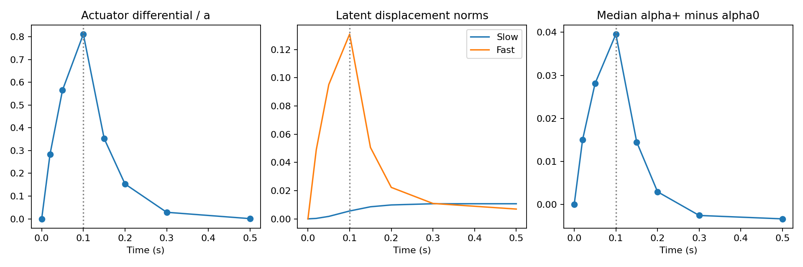

# PACLD-CIR-v1：冻结模型受控增量响应实验

**结论：支持 H1；部分支持 H3；本协议下不支持 H2。** 主幅值 a=0.03600154，同一 Belief 下 G_CF(0.2 s) 中位数 **0.127333 rad/s/单位差动命令**，5–95% 分位 0.087230–0.146087，范围 0.076156–0.150053。306 个窗口均为正。模型内部有限时长敏感性仍小，并未因主动干预而显露出远大于 A2 factual 关联的响应；同时自然相位组之间有明显幅值差异，幅值非线性很小。这不等于证明真实飞机的因果控制增益被低估。

## 1. 冻结对象与协议

基线 `ee1faa2ee42c2a7c2aac85c79cfcfaa205bdc581`；分支 `research/pacld-controlled-response-v1`。checkpoint 为 `/home/zn/flap-system-identification/.worktrees/pacld-gpu-batched-v1/runs/pacld_frozen_eval_seed17/model.pt`，SHA256 `9d82640692c0baec476e276696be4f89fd89a58854361bbcfdf3dbb84cb466c9` 已核实。模型配置、Hall 合同、train/validation manifest 与完整 Hall 索引身份匹配冻结 checkpoint。模型逻辑、参数、执行器时间常数均未修改；未训练、未访问 sealed test、未执行 MPC。

复用 A2-v2 的 3,657 个 validation 决策身份。名义 0.5 秒原生窗口的末目标测量可能略早于 0.5 秒，因此优先寻找同决策、同 start_sample、同 support_start_us、且实际支持至少 0.5 秒的最短冻结窗口（可能为 1/2 秒名义窗口）。不更改历史、不把日志外时间补成 ZOH；同时记录 a2_window_id 和实际支持 window_id。只查询前 0.5 秒。

主幅值来自 A2-v2 train 17 日期交叉拟合的 100 ms 差动控制残差 RMS，11,221 个决策，得到 a=0.03600154；并使用 a/2、2a。这与上一轮留航次估计约 0.0353 有小差异，未根据 validation 选择幅值。前飞速度分界是 train 决策前机体系速度中位数 6.872072 m/s。

冻结映射 `[motor,left,right,rudder]`；差动 `(right-left)/2`。正分支在 [0,0.1) 秒使 left−a/right+a，负分支反向；对称命令、电机、垂尾不变，0.1 秒精确恢复日志命令。17 个归档固件的 ActuatorServos 消息均规定 [-1,1]；对应 153 个 train/validation 航次分配参数一致，电机不可反转，CA_SV0_SLEW/CA_SV1_SLEW=0。没有据此声称舵机物理速率无限；命令合法性不等于实际舵角/舵速已经标定。双向越界即拒绝，不 clip。

每个合格候选只用真实历史编码一次，清除编译器的未来 target/future/pair bookkeeping 后调用 encode_batch，保存因果 Belief。所有 FIELDS（x、z_s、c、f、phi、actuator、variance、phase_quality、phase_covariance）逐值复制到 factual/+/- 三分支；各幅值复用同一缓存 Belief，不重新编码。以后只调用原 propagate_plan，不再做观测更新。三个分支共用相同原生 ZOH 事件及积分分段，显式加入 0/0.1 秒边界，最大积分步仍为 5 ms。0.1 秒后命令相同，传播状态保持独立，不重新同步。

这属于模型内部条件开环干预，不是 PX4 反馈控制器重闭环后的反事实飞行。使用完整 Slow/Fast/执行器/相位/物理状态的自主传播，不以静态 Decoder 偏导代替动态响应。

## 2. 覆盖与选样

先在 3 个 train 窗口完成数值验证，再编码 validation 候选；选样不使用未来运动误差、增益或响应幅值。根据因果 Belief 相位 modulo 2π 划四象限、根据 train 固定速度分界划两档，每航次每个单元取最早合格决策，最多 8 个，缺失单元不补凑。相位继承冻结 Hall 零位工作假设，并非绝对机翼角实测校准；未人为移相。φ=0、2π、负整周都映射到第一组，2π 左邻点属于第四组。

3,657 个候选中合格 3402：215 个缺少同历史且足够长的冻结支持，25 个不满足双向命令范围，15 个模式无 train 支持。最终 306 个窗口、39 航次、4 日期，缺少 6/312 个相位×速度单元。三个幅值均有 306 个双向可行窗口。train 的 3 个窗口只作正确性验证，不宣称代表训练分布。

这是按相位/速度覆盖选取的代表性子集，既不是随机窗口样本，也不是全体飞行时间的无偏频率样本。validation 已被前轮分析使用，本轮明确是冻结模型延续性机制分析，不是新的未触碰测试。窗口不会被当作独立航次；分位数描述所选窗口分布，日期 bootstrap 仅反映 4 日期的有限覆盖。

## 3. 有限时长增益、方向与时间过程

|multiplier|time|windows|flights|dates|G_p_median|G_p_q05|G_p_q95|G_p_min|G_p_max|positive_fraction|G_r_median|G_r_q05|G_r_q95|asymmetry_median|asymmetry_q95|
|---|---|---|---|---|---|---|---|---|---|---|---|---|---|---|---|
|0.5|0.2|306|39|4|0.127337|0.087232|0.146089|0.0761567|0.150056|1|0.010906|-0.00595269|0.0159397|0.00040256|0.00080399|
|0.5|0.5|306|39|4|0.10598|0.073445|0.122851|0.063663|0.127702|1|0.0203416|0.00933842|0.0264183|0.000456688|0.000961781|
|1|0.2|306|39|4|0.127333|0.0872304|0.146087|0.0761561|0.150053|1|0.0109058|-0.00595173|0.0159397|0.00080587|0.00160496|
|1|0.5|306|39|4|0.105978|0.0734439|0.122848|0.0636619|0.127699|1|0.0203415|0.00933911|0.0264181|0.000912327|0.0019329|
|2|0.2|306|39|4|0.127318|0.0872242|0.146075|0.0761553|0.150041|1|0.0109053|-0.00594797|0.0159394|0.00160983|0.00320426|
|2|0.5|306|39|4|0.105969|0.0734385|0.122838|0.063661|0.127688|1|0.0203409|0.00934205|0.0264173|0.00182417|0.00386331|

所有增益单位为 rad/s 每归一化差动命令；相对非对称性为 |R_plus+R_minus|/(|R_plus|+|R_minus|)，低于数值分辨率不定义。主幅值 0.2 秒非对称性中位数约 0.0806%，95% 分位约 0.1605%。因此在本次小幅范围内正负近似反对称。

与主幅值配对的增益差绝对值 95% 分位：a/2 为 4.1e-06，2a 为 1.63e-05。这些差异远小于跨相位/工况分布宽度，未见强幅值非线性。

按日期先对航次等权汇总：

|date|flights|G_p_mean|G_r_mean|min_flight_mean|max_flight_mean|
|---|---|---|---|---|---|
|2026-09-07|10|0.123227|0.00678168|0.118882|0.127421|
|2026-09-17|8|0.12286|0.00759422|0.11842|0.12623|
|2026-09-26|9|0.12184|0.00737739|0.117556|0.125698|
|2026-10-11|12|0.122618|0.00730098|0.111214|0.131814|

日期等权均值 0.122636；4 日期 bootstrap 描述性区间 0.122095–0.123075（4,000 次，seed=17）。不能把该窄区间解释成对新日期/新飞机的可靠普适区间。速度分组描述如下：

|speed_bin|count|mean|median|min|max|
|---|---|---|---|---|---|
|0|155|0.122671|0.12846|0.077939|0.150053|
|1|151|0.122489|0.126936|0.0761561|0.148239|

输出网格固定为 0、0.02、0.05、0.10、0.15、0.20、0.30、0.50 秒，独立于内部 5 ms 及原生控制切换积分网格。主幅值 G_p 中位数约为 0、0.0044、0.0253、0.0808、0.1138、0.1273、0.1248、0.1060。脉冲终止后先继续建立响应，随后温和回落。主幅值 0.2 秒滚转增量量级约 a×G≈0.0046 rad/s。

采样网格上内部最大值出现在 0.2 秒的窗口 215 个、0.3 秒的 90 个。半响应时间只给网格包围区间，不插值声称精确延迟：50–100 ms 共 253 个，100–150 ms 共 52 个。这是有限脉冲响应的采样最大值/半幅区间，不是阶跃稳态超调或真实舵机延迟。

0.2 秒前中央角加速度差采样值变号 30/306；净响应/此前采样最大响应比的中位数 1.000。因此未见普遍“大响应先出现、到 0.2 秒大规模抵消”的现象。0.3–0.5 秒中位角加速度增量为负，解释后期温和回落。稀疏输出可能遗漏节点间的细小峰值/变号，不能据此推断完整周期稳定性或频域特性。

偏航交叉 G_CF(0.2 s) 中位数约 0.01091，5–95% 分位跨零；到 0.5 秒中位数约 0.02034。它是模型内部的交叉响应诊断，不强制纳入主评分。

## 4. 控制差异沿模型如何传播

代码证据：dynamics.context 只读取 u[..., :1] 电机；尾舵命令不直接输入 Decoder。尾舵作用首先通过 actuator 精确一阶滤波，同时 da=(u_tail−actuator)/tau 通过 coupling 进入 Fast 包络；Slow 网络依赖 actuator、c、物理状态等。Decoder 统一输出角加速度。batch.tensor_step 用中点状态、Lie-group 姿态更新、相位/执行器解析演化实现全状态传播。

固定 τ=0.06 s 是模型假设，不是实测伺服标定。100 ms 时差动执行器增量为 a(1−exp(−0.1/0.06))=0.0292017，即命令幅值的 81.1%；200 ms 时仍约 0.0055155。故机制 A（命令改变但执行器几乎无响应）不受支持。

所有分支初始 Decoder 角加速度完全相同，确认没有直接尾舵命令输入通路。随后执行器和 Fast/Slow 都明显改变；100 ms 时 Fast 差范数中位数约 0.13085、Slow 约 0.00558。不同隐状态范数不能当作同单位力矩或因果贡献量，不能仅凭大小断言 Fast 主导。

|time|actuator_plus|slow_plus_norm|fast_plus_norm|alpha_plus_increment|alpha_central_gain|G_p|
|---|---|---|---|---|---|---|
|0|0|0|0|0|0|0|
|0.02|0.0102053|0.000326966|0.0490283|0.0149766|0.416085|0.00440851|
|0.05|0.0203553|0.00174677|0.0951235|0.0280948|0.778301|0.0253319|
|0.1|0.0292017|0.00557502|0.130849|0.0395714|1.09772|0.080823|
|0.15|0.012691|0.00856019|0.0505944|0.0144677|0.401257|0.113833|
|0.2|0.00551549|0.00986362|0.0222887|0.00291084|0.0808047|0.127333|
|0.3|0.00104174|0.0107133|0.010909|-0.00259426|-0.0720817|0.124845|
|0.5|3.71631e-05|0.0107025|0.0069436|-0.0033879|-0.0940728|0.105978|

机制 B 有支持：模型执行器响应正常建立，而本幅值下 Decoder 角加速度增量和最终滚转增量较小。C 在部分窗口/后期可见，但不构成 0.2 秒弱响应的普遍主要抵消解释。D 有自然相位关联的幅值调制证据，没有跨相位正负增益互相抵消的证据（所有主增益均正）。无路径消融或中介实验，不能进一步定量分解执行器、Slow、Fast、物理状态反馈各自的贡献；本轮没有为此修改动态参数。

电机完全相同，因此各分支 f、phi 演化完全相同；这不消除不同自然初始相位对 phase_carrier 的影响。代表窗口的完整 x/z_s/c/f/phi/执行器/质量/协方差及 Decoder α 已输出 representative_internal.csv，代表身份按相位×速度单元最早日期/航次选取，不依据响应挑选。

## 5. 自然机械相位与工况

|phase_bin|n|flights|dates|G_p_median|G_p_min|G_p_max|G_r_median|speed_mean|speed_std|freq_mean|asymmetry_median|
|---|---|---|---|---|---|---|---|---|---|---|---|
|0|74|38|4|0.116793|0.0761561|0.138303|0.00181522|6.88732|1.20264|3.94102|0.000626474|
|1|78|39|4|0.142978|0.132436|0.148239|0.000258166|6.89563|1.26288|3.89546|0.000642472|
|2|77|39|4|0.132283|0.110346|0.150053|0.0145886|6.99786|1.35043|3.84477|0.000821932|
|3|77|39|4|0.0984918|0.0789584|0.146637|0.01168|7.03139|1.29202|3.83694|0.000995872|

因果 Belief 中的分组工况均值：

|phase_bin|v_forward|p|q|r|frequency|
|---|---|---|---|---|---|
|0|6.79809|-0.0125864|-0.0634555|0.0507675|3.94102|
|1|6.88808|0.0272701|0.019503|0.0574745|3.89546|
|2|6.79528|-9.89338e-05|0.0987058|0.00391435|3.84477|
|3|6.80631|-0.0176609|0.0951929|-0.0144333|3.83694|

本批 Belief 扑频中位数约 3.919 Hz，范围 2.127–4.855 Hz；相应原生最近频率观测中位数约 3.904 Hz、范围 1.774–5.001 Hz。因此不能机械套用“所有窗口均为 4–6 Hz”：0.2 秒对中位工况约 0.78 周期。频率观测与 Belief 估计均保留在 frequency_context.csv。

相位组增益中位数约 0.1168/0.1430/0.1323/0.0985；G 与 cos(phi) 的描述性相关约 −0.868、与 sin(phi) 约 0.351。前飞速度组均值较近，速度两档的总体平均增益亦接近；但 q 等角速度随相位有明显组间差异，例如 q 组均值约 −0.063/0.020/0.099/0.095 rad/s，sin(phi) 与 q 的相关约 −0.420。没有人为改 phi 或保持其他隐状态不变进行相位扫频，因此只能称自然相位/耦合工况条件相关，不能独立归因于相位。

## 6. 与 A2 对照及假设判断

|quantity|value|object|
|---|---|---|
|A2 G_obs|2.46574|实飞闭环条件关联；validation残差回归|
|A2 G_PACLD|0.227038|模型factual闭环条件关联；validation残差回归|
|CIR G_CF(0.2s)|0.127333|同Belief下100ms差动脉冲的模型有限时长敏感性|

三者的输入时间结构、统计调整、样本和估计对象不同：A2 使用实际闭环未来控制变化进行条件回归，CIR 则固定同一个 Belief 主动施加 100 ms 有限脉冲。CIR 只用 306 个代表窗口，A2 使用更大的 validation 覆盖。它们不是同一真实物理增益的三个无偏估计，不用三个数字的百分比差宣称物理误差。

- **H1：SUPPORTED。** 模型内部 0.2 秒敏感性确实小且所有窗口均在约 0.076–0.150 的范围，没有显示因 factual 回归而被隐藏的巨大内部响应。这里“小”指本模型和脉冲协议下的数值量级，不是已知真实飞机因果增益的偏差证明。
- **H2：本协议不支持。** G_CF 没有明显大于 G_PACLD；两种统计对象仍不同，不能因此排除 A2 的反馈/条件化偏差。
- **H3：部分 SUPPORTED。** 自然相位/耦合工况对响应幅值有清楚关联；跨日期均值和方向较稳，前飞速度两档差异很小，三扰动幅值下近似线性。未证明单独相位的因果效应。

**下一步判断：**已有足够模型内部证据，把“增强短时控制响应约束的动力学训练目标”列为后续研究候选；不应再仅把弱增益归咎于 factual 回归。但尚不足以决定应强化到多少、或直接拿 A2 的 G_obs 当监督真值。下一步应并行明确可用的观察性响应合同、执行器/扰动证据与状态相位覆盖，再设计训练目标；本轮不启动训练或增加参数消融。

## 7. 数值检查与复现

初始三分支全部字段精确一致；a=0 三分支全字段误差 0.0；B3 对 B64 物理状态最大差 3.46e-08，未实质改变响应。历史控制未改，motor/rudder/对称量不变，三种幅值实际差动变化与分母一致；100 ms 边界不被积分步跨越，之后控制恢复但状态不重置；相位 0/2π 及相邻浮点边界通过；实际结果初始增量为零、执行器解析响应与数值一致、各分支频率/相位差为零。候选编码仅一次，测试重用 train 缓存，不为干预分支重编码历史。







```bash
cd /home/zn/flap-system-identification/.worktrees/pacld-controlled-response-v1
export OPENBLAS_NUM_THREADS=1 OMP_NUM_THREADS=1 PYTHONPATH=src
/home/zn/anaconda3/envs/flap-train-gpu/bin/python scripts/pacld_cir_v1.py preflight
/home/zn/anaconda3/envs/flap-train-gpu/bin/python scripts/pacld_cir_v1.py validation
/home/zn/anaconda3/envs/flap-train-gpu/bin/python scripts/verify_pacld_cir_v1.py
/home/zn/anaconda3/envs/flap-train-gpu/bin/python scripts/report_pacld_cir_v1.py
/home/zn/anaconda3/envs/flap-train-gpu/bin/python scripts/write_pacld_cir_v1_report.py
```

CSV/JSON、冻结协议及关键图随 Git 提交；Belief/control 的 .pt 缓存保留本地，可按原生数据重建。没有修改冻结 checkpoint、模型逻辑、原始数据或其他 worktree。
