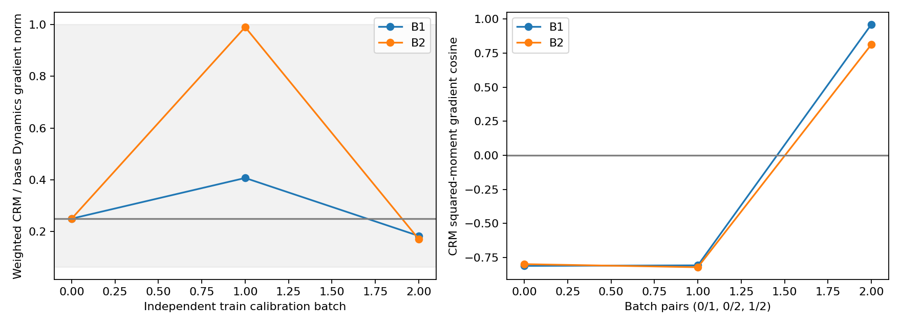

# PACLD-CRM-v2 三组等预算控制相关训练判别实验

当前状态：**blocked_before_formal_training**。实际正式更新：{'B0': 0, 'B1': 0, 'B2': 0}。未完成评价时不填写效果指标。

## 冻结合同

基线 `9c15fffd24bfcacc7c57cd980cc149098cb83f82`；共同checkpoint SHA256 `9d82640692c0baec476e276696be4f89fd89a58854361bbcfdf3dbb84cb466c9`。三组结构相同，原模型源码不修改。优化器策略：Adam restore identical complete frozen optimizer state for all groups；lr=0.0003，lambda_macro=1，梯度裁剪=10.0。生产精度=mixed。

预定三组各64次更新×512窗口=32,768次采样，seed17，共享完全一致的身份及顺序。训练仅CRM-v1的11,221窗口、114航次、17日期，使用原生0.5秒支持及0.2秒附近目标；**不同于原始0.2/0.5/1/2秒混合时域训练分布**。共同序列覆盖9686个唯一窗口、23082次重复抽样；重复是有放回分层抽样的结果，不是新增独立数据。

主控制为前100ms差动尾舵变化，B2为250–350ms未来控制负对照。尺度严格复用CRM-v1完整精度：{'s_u': [0.03600153629586494, 0.096511773175574, 0.10007971131468153], 's_p': 0.7076565381905123, 'scale_reduction': 'window RMS over common train cohort'}。未来控制残差只进入附加Loss。两遍微批量间参数固定，损失梯度为2M_B×mean(∇m_i)，不是mean(m_i²)或微批量矩平方。Moment完整初始Belief detach，FULL/Macro Encoder图保留。原FULL/Macro窗口归一化与无有效Macro时贡献0的规则保留。

预定比较保证**数据和优化更新预算相同**，不是GPU计算量相同。逻辑前向计数定义：每个FULL/Macro分支、每个CRM rollout（连同其必要历史编码）各计一次；B0每微批量FULL/Macro加无梯度Moment诊断共2次，B1/B2无梯度Moment、FULL/Macro、梯度Moment共3次。目标记录发生在optimizer更新后，但Loss/Moment对应该更新的前一步参数，不额外添加一次更新后回放。吞吐和ETA含实际已完成更新的窗口缓存准备及计算时间。

## 校准及定向验证

校准使用独立于正式采样流的三个512窗口批量；它们来自同一train日期/航次总体，可以共享窗口，不是三个独立实飞数据集。第0批固定权重使Dynamics上的CRM梯度为FULL+Macro的25%，另两批只检查稳定性。该25%是固定有限强度诊断，不是最优值。稳定性操作门槛在看结果前写入合同：任一批近零/非有限、lambda>10,000、加权梯度比不在[0.0625,1]，或任意两个批次Dynamics平方矩梯度余弦为负，则停止正式训练。这些是校准停止条件，不是模型效果筛选门槛。

preflight状态：PASS。本次32窗口可丢弃smoke耗时约16.19秒、1.98窗口/秒，allocated显存峰值约108.87 MiB，梯度范数17.57触发原阈值10裁剪；这不是正式训练吞吐。FP64完整图对微批量累积的FULL+Macro/正常M²/未来M²梯度相对L2误差分别约2.16e-15/4.83e-16/7.42e-16。完整图/微批量梯度等价、三组模型与Adam初态、未来残差不影响前向、Belief梯度隔离、Dynamics可达、GPU速度/显存数据见 `preflight.json`。smoke使用可丢弃副本，不计入正式预算；原冻结checkpoint不变。没有使用validation挑选校准权重或训练checkpoint。

## 校准阻碍

**未启动B0/B1/B2正式训练。** 预先冻结的train校准停止规则已触发：

- B1: opposite Dynamics M2 gradients in batches 0/1
- B1: opposite Dynamics M2 gradients in batches 0/2
- B2: opposite Dynamics M2 gradients in batches 0/1
- B2: opposite Dynamics M2 gradients in batches 0/2

| batch | group | M | base_norm | moment_norm | lambda | weighted_ratio | cosine |
| --- | --- | --- | --- | --- | --- | --- | --- |
| 0 | B1 | 0.111545 | 28.085 | 0.0398306 | 176.278 | 0.25 | -0.135126 |
| 0 | B2 | -0.125702 | 28.085 | 0.0248861 | 282.135 | 0.25 | 0.123675 |
| 1 | B1 | 0.123697 | 16.5447 | 0.038208 | 176.278 | 0.407093 | 0.180002 |
| 1 | B2 | -0.105163 | 16.5447 | 0.0580296 | 282.135 | 0.989576 | -0.166672 |
| 2 | B1 | 0.102495 | 23.5976 | 0.0245568 | 176.278 | 0.183443 | -0.275242 |
| 2 | B2 | -0.0639747 | 23.5976 | 0.0143178 | 282.135 | 0.171185 | 0.264865 |

跨批Dynamics平方矩梯度方向：

| group | batch_a | batch_b | cosine |
| --- | --- | --- | --- |
| B1 | 0 | 1 | -0.810852 |
| B1 | 0 | 2 | -0.806805 |
| B1 | 1 | 2 | 0.960777 |
| B2 | 0 | 1 | -0.798048 |
| B2 | 0 | 2 | -0.820556 |
| B2 | 1 | 2 | 0.813376 |

完整模块范数、余弦、加权比例及拟裁剪状态见 `loss_calibration.json`。停止依据是train校准，不是validation结果。未改变lambda、批量或采样来追求通过，也没有运行替代训练。H1/H2/H3仍未经过本轮训练检验。




## 七项问题

1. **B1是否比同预算B0更好？** UNTESTED：校准停止，三组正式更新均为0；不作优劣、泛化或CIR变化判断。

2. **B1是否比未来控制负对照B2更好？** UNTESTED：校准停止，三组正式更新均为0；不作优劣、泛化或CIR变化判断。

3. **正常Moment是否改善且跨日期稳定？** UNTESTED：校准停止，三组正式更新均为0；不作优劣、泛化或CIR变化判断。

4. **内部CIR增益是否变化？** UNTESTED：校准停止，三组正式更新均为0；不作优劣、泛化或CIR变化判断。

5. **普通状态预测精度是否受影响？** UNTESTED：校准停止，三组正式更新均为0；不作优劣、泛化或CIR变化判断。

6. **是否支持继续研究CRM？** 当前校准未支持直接启动该固定CRM训练比较。需要先解释梯度校准不稳定，不能靠validation调权。

7. **下一步保留CRM还是改用其他范式？** 本轮停止，不自动加大CRM权重或切换范式。现有证据不足以选择保留CRM或替代方法。

## 冻结评价与解释限制

只有B0/B1/B2全部完成64更新后，才打开validation。评价复用原PACLD156个窗口、A2固定身份和原状态校正/局部回归、CIR306窗口及正负差动pulse。CIR重新编码各模型但固定原选择、相位组与扰动协议，不按模型表现重筛。Validation条件模型只在train拟合；CIR是内部模型干预，G_obs是闭环观察性关联。验证日期少、单seed，日期bootstrap仅描述性；未预设非劣界，不能把数值接近称为证明状态性能不恶化。

正式训练、恢复和自动评价入口已实现并通过语法检查；若校准停止，这些后续路径没有获得端到端执行验证。若校准停止，所有后续评价维持未执行，不能制作虚构三组对比或把初始模型重复三次当成训练结果。

## 一键复现、恢复与发布

```bash
cd /home/zn/flap-system-identification/.worktrees/pacld-crm-training-comparison-v2
bash scripts/run_pacld_crm_v2.sh
# 仅在已启动任务中断后，严格恢复：
bash scripts/run_pacld_crm_v2.sh --resume
```

脚本串行执行B0/B1/B2，只使用CUDA_VISIBLE_DEVICES指定的一张GPU；结束后自动评价、生成报告、按公开allowlist提交推送并核对远端SHA。校准BLOCKED会拒绝启动，不能用resume绕过。已存在冻结校准结果时直接复用；BLOCKED状态不能靠重跑一键脚本覆盖。被排除的采样身份文件可由seed确定性重建并校验合同散列。逐窗口采样身份、控制/状态中间文件、checkpoint、RNG、优化器及梯度向量在`crm_training_comparison_v2/local/`或被.gitignore排除的采样文件中，仅本地保存。公开仅包含代码、合同、汇总统计与图表。
