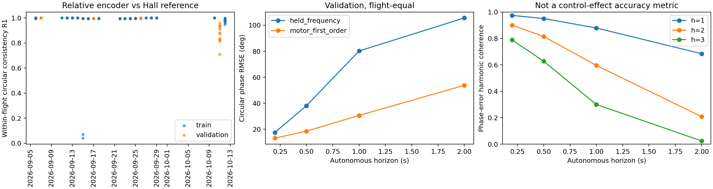

# 面向MPC的相位耦合动力学：资料继承、机械相位与自主相位预测诊断

日期：2026-10-28。本次实际执行结果，不是正式动力学训练完成报告。

**结论：核心假设仍为 UNRESOLVED。** 本轮完成独立分支和资料继承、正文文献研究、161个train/validation航次的相位核查、四份原始ULog交叉验证，以及候选控制驱动的自主相位预测实验。发现了可量化的新信息，但尚未建立跨日期物理机械零点与9–10月硬件参数合同。依照任务允许的停止条件，没有启动不可信的正式A/B/C动力学训练，也没有用短训替代正式实验。

**这不是“相位控制效能无效”的负结果，更不是“全部日志不可用”的结论。** 有相当多航次的编码器/Hall关系稳定，具备进一步使用的价值。阻断的是当前要求的跨航次、具有物理含义的统一机械相位控制效能结论；一个依赖未验证零点/质量参数的代理模型可以拟合数据，却不能回答同一个科学问题。

## 1. 源分支、研究分支及资料继承

- 实际源分支为 `reference-dynamics-data-v1`，源HEAD为 `84a9d1b0c9b889a16504e8fe18d6c0ecd7db6358`，并非预期的 `feat/ullt-state-space-wing-aero`。用户随后明确授权从论文和当前规范所在工作区新建分支。
- 新分支 `research/phase-coupled-mpc-v1`，工作区 `/home/zn/flap-system-identification/.worktrees/phase-coupled-mpc-v1`，从上述本地HEAD建立，完整保留其提交历史。
- 检查时源工作区有2个修改项、42个删除项、4444个未跟踪项。没有提交、stash、覆盖或清理这些内容；无关配置与历史计划删除没有搬入研究分支。
- 根 `AGENTS.md` 与源HEAD一致，SHA256为 `34de330f41d68bb18015c5b759dcca7ebc989a21162b2009a97cc92e50639330`。当前根规范与相关data/models/training/evaluation等子目录规范按实际文件复制，未修改规则。
- 10篇本地PDF全部按原相对路径、文件名与内容复制，逐文件大小和SHA256一致，见 `inheritance.json`。原有 `docs/papers/` 忽略规则保留。全文提取文件也位于忽略目录，不提交PDF或论文全文。
- 本研究没有将缺失于当前分支的历史GRU代码误称为已继承源码。历史代码、注册表及报告从对应worktree只读查阅，数据来源显式登记在 `config.json`，不切换旧实验分支作为基线。

## 2. 实际文献依据与研究空白

正文阅读重点包括方法公式、数据处理、训练及结果，以下不把作者摘要中的表述当成已验证的本项目结论。

| 本地文献 | 正文方法与结果范围 | 可继承部分及本项目限制 |
|---|---|---|
| Qian等，TIE 73(5), 2026，*Learning Periodic Patterns…* | 式(1)–(8)使用去均值周期观测、有限傅里叶核GP；Remark 1明确学习相位是抽象周期坐标，非直接翼运动相位。后续使用频率估计/相关性修正并恢复振荡运动。 | 可继承周期表示及慢变/周期分配意识；不能将基于IMU重新对齐的相位当作候选控制下可得的机械相位，也不能把观测分离当作控制动力学识别。[DOI](https://doi.org/10.1109/TIE.2025.3634403) |
| Zhao等，JBE 22:1126–1142, 2025，*Hybrid Phase-functioned Neural Network* | 式(3)–(7)为等效六维力矩与Newton–Euler；PFNN采用周期Catmull–Rom权重插值，40/40/6网络。正文训练至少200 epoch，主要数据随机70/15/15划分；另用同日另一航次验证增量，展示0.5秒递推，滚转力矩/侧力较弱。 | 统一刚体积分与周期参数化已是现有方法。标签使用加速度计及陀螺差分，需质量/惯量与杆臂修正；本项目不能照搬其标签和随机样本划分。其相位提取还使用翼角传感器和俯仰角速度，不等于本项目因果相位合同。正文称六组插值参数，但展示公式保留mod4记法，不能机械抄式实现。[DOI](https://doi.org/10.1007/s42235-025-00692-x) |
| Jin等，2026，*System Analysis and Control Design…* | 正文平台1.5m、0.85kg，MPMS寻找周期候选轨道、Floquet分析；辨识用非线性仿真的升降舵3-2-1-1激励。特别注意式(33)是常数A、B加时间周期外力，并未显式识别相位相关控制增益B(φ)。一阶模型平均拟合指标约61.32%。 | 支持对比“周期强迫”和“周期控制效能”，不是后者已经被论文验证。仿真主动激励与本项目自然闭环记录不同；近单位Floquet乘子也不能直接证明本机稳定。[DOI](https://doi.org/10.1007/s12555-026-00173-9) |
| Wang等，TMECH 30(1), 2025，*Stabilization Controller Design…* | 正文比较周期模型与平均模型的稳定性及控制器，使用Poincaré截面设计；对象强调翼尾相互作用和纵向周期动力学。 | 支持保留周期内演化和截面转移，不能外推成1.6m平台的全六自由度实飞控制结论。[DOI](https://doi.org/10.1109/TMECH.2024.3393483) |
| Amini等，2020，*A Simplified Model…Large-scale Ornithopter* | 正文讨论较大翼质量占比时多体惯性对等效载荷的影响。 | 提醒本研究W应表述为指定机身参考下的整机等效广义载荷，不能声称已分离纯翼气动力。[DOI](https://doi.org/10.1007/s42235-020-0086-4) |
| Beintema等，ICLR 2023，连续时间深子空间编码 | 利用历史编码器初始化潜在状态及连续时间预测误差学习。 | 可借鉴执行器/未测慢变状态的历史初始化；编码隐状态本身不建立物理可辨识性。 |

其余本地Rao、Sharvit、Cai、PI-WAN文献完成身份及相关性筛查，不声称全部逐页精读或复现实验。

沿Introduction追溯了两个直接范式来源：Zhao引用的[Holden等2017 PFNN原文](https://theorangeduck.com/media/uploads/other_stuff/phasefunction.pdf)说明周期权重插值本身不是新发明；Wang所讨论的[Taha等2015高阶平均研究](https://pubmed.ncbi.nlm.nih.gov/25561166/)说明忽略周期项可能影响稳定性判断，但不保证增加谐波一定提升数据预测。

额外核查了[作者提供的periodic-LPV闭环辨识实现](https://www.dcsc.tudelft.nl/~jwvanwingerden/pbsid/examples/html/ex23_plpv_wts.html)：示例有显式随机外部激励、已知周期调度和独立验证输入；本项目不能把自然闭环舵面变化等同于这种激励设计。没有复制或运行这些外部实现。

**HYPOTHESIS：**值得验证的增量是，在同一因果输入和统一积分器下，显式相位相关控制增益能否比“平均控制增益+周期强迫”提供跨航次、控制相关的增益，而不是周期网络或刚体积分器本身是否可用。

## 3. 数据、硬件与观测合同

使用 `velocity_rate_multistep_v1`，注册清单SHA256为 `8afb8623bf7174e4da5b2044f644331b8b251433fed3576f6dcdab470935bcb5`，本轮实测一致。保留原整日志/物理飞行/日期划分，只读取122个train、39个validation航次的原生表；没有打开test Parquet或计算其哈希。已有报告的历史test摘要并不构成本轮测试评价。

NED位置/速度、FRD角速度、Hamilton wxyz的FRD→NED姿态；motor与三路servo为分配器归一化命令，不是实测舵角、推力或舵机状态。读到的156个航次同一飞控UUID、4个另一UUID、1个未知；UUID不能证明翼、尾翼、电池或Hall安装未变化。

**UNRESOLVED：**目前查阅的注册表、原始参数和研究配置中没有将9–10月每一平台与质量/惯量/安装标定绑定的证据。现有 `configs/data/multibody_wrench_label_v1.yaml` 明确绑定四月canonical ratio8数据及一份实测工作簿，不能直接沿用为9–10月事实。历史GPTR的零杆臂/110ms假设也不是新的安装标定。

质量/惯量缺失主要阻断物理W的尺度和力矩参考解释，并非所有运动代理模型训练在数学上都不可能：同时缩放m与F，或J与相应力矩，运动方程可不变。可以改做质量归一化加速度模型，但应明确它改变了当前物理解释，不把单位质量假设写成硬件测量。

原生角速度、EKF姿态/速度与IMU比力不当作同一无误差观测。已读取指定02.2、02.3B、02.4、02.5、02.6及STATUS：三阶周期观测可重复性已知，慢变/周期自由补偿和缺测加速度误差也已知。本轮未重新拟合GPTR，未产生加速度/角加速度监督标签。现有48对滚转匹配仍只有11个共享依赖分量，不能按48个独立试验计算证据强度。

## 4. 新的机械相位诊断

脚本：`audit_phase.py`。逐航次结果：`phase_per_flight.csv`；按日期结果：`phase_by_date.csv`；参考变化事件：`phase_resets.csv.gz`。

| 本轮读取的集合 | 航次数 | 有有效wing_phase的航次 | 有独立Hall事件的航次 |
|---|---:|---:|---:|
| train | 122 | 117 | 66 |
| validation | 39 | 39 | 23 |

**VERIFIED：**编码器按原日志 `FLAP_RATIO=7.9090909958` 转换；独立Hall间编码器增量推算的“逐航次中位传动比”的集合中位数为train 7.909038、validation 7.909008。总体支持配置比，而不支持把四月ratio8直接替换进来。个别10月航次偏离，不据此宣称已测得新的齿比。

令 `s=4096*ratio/(2π)`，Hall软件参考计数 `c0(t)=c(t)-s*phase_unwrapped(t)`；研究相对编码器相位与Hall相位之差的圆周集中度 `R=|mean(exp(i*delta))|`。R只衡量同航次内两种参考能否接近固定相移，不证明绝对零点准确。

- train/validation的R中位数分别0.99726/0.99569，多数航次稳定。
- 9月15日两份train日志R仅0.04070、0.07080，无法用一个固定相移使两种参考在整段内一致；二者没有独立Hall事件记录。
- 10月11日validation的R日期中位数约0.87887；具体日志低至0.71059。故不能仅凭phase_valid=true混用全部日期。
- 从参考计数变化推断出的86,534次软件参考更新中，圆周修正超过10°有12,346次，超过30°有4,003次。它们是参考变化，不是已认证的真实翼拍事件；也不是物理相位误差真值。

`verify_raw.py`对9月7日、9月15日、10月11日上午及下午的四份明确非test ULog重新提取，编码器计数、wing_phase关键字段和存在的Hall脉冲计数与数据表逐项一致，最大绝对差为0。异常来源不在这次Parquet读取。

### 因果可用性与可修复部分

**VERIFIED：**`WingPhase.cpp`将消息timestamp写为最近编码器时刻；Hall的 `RPMCapture.cpp` 则将事件timestamp写为中断时刻，发布在后续工作队列Run。采样时间不能充当发布时间。三份相关固件版本的Hall驱动源码完全一致，来源保存在 `reference/sources.json`。

还发现原始日志有多个 `rpm` 实例：AS5600和Hall捕获器均可发布RPM，实例编号可能不同，不能默认rpm:0就是Hall。诊断按编码器时间戳一致性排除AS5600实例，剩余实例只标记为候选Hall来源；未经唯一发布源确认不升级为部署合同。

提出并在有Hall的三个原始日志上计算了保守候选上界：取Hall事件后的第二条同一Hall-RPM源记录时间，与包围该Hall事件的右侧编码器样本之下一条编码器时间的最大值。利用串行Run次序可避免把同一Run内、Hall发布之前写入的rpm.timestamp误当上界。结果在 `raw_verification.json`；它仍依赖发布源核实，不是实测延迟。

**SUPPORTED：**有独立Hall、来源可确认且编码器连续的子集，有希望建立因果的传感器索引相位。其余只有wing_phase的航次不能默认套用同一上界。**UNRESOLVED：**传感器索引是否跨日期指向同一翼机构位置；当前没有安装/重装记录或翼角标定证明。不能通过未来IMU相关性对齐来补齐这个事实。

## 5. 已完成的候选电机控制驱动相位预测实验

这是一项前置执行器/相位诊断，不是A/B/C六自由度正式训练。模型为

\[
\dot f=b_0+b_u u_m+b_f f,\qquad \dot\phi=2\pi f.
\]

使用train原生频率相邻记录拟合，每航次等权的线性最小二乘，固定微小ridge=1e-6；不按validation选参数，不扫阶数或时常数。拟合要求相邻频率记录间隔≤30ms，实际使用93个训练航次、1,315,984个转移，并非全部122航次均进入拟合；较低频记录未被插值增密，逐航次拟合行数保存在frequency_fit.json。该限定是本诊断的覆盖限制，不表示较低频数据不适合更一般的执行器辨识。拟合结果 `(b0,bu,bf)=(3.6354512,23.3935701,-5.1267254)`。f来自已滤波频率通道，不能将 `-1/bf≈0.195s` 直接宣布为真实电机机械时间常数。

初始编码器和f仅取其保守availability≤决策时刻的记录。未来只使用事实归一化motor命令的ZOH事件带，f和phi按同一解析解自主递推；没有读取未来真实频率或相位作为输入。比较基线仅固定起点f，不固定未来真实f。编码器连续增量作为离线相位参考，不解决跨日志绝对机械零点问题。

每2.5秒尝试一个起点，要求完整2秒编码器支持、间隙≤30ms、初始f>1Hz、频率可用时间年龄≤30ms；不含未知固件航次。未来电机无效会终止该窗口，其覆盖逐时域报告。训练侧121航次，验证侧39航次。采用端点圆周误差，先航次内均方、再航次等权开方；不是重叠窗口独立置信区间。所有逐窗口误差保存在压缩CSV。

| 验证时域 | 预测窗口数 | 固定起点频率：相位RMSE | 电机一阶模型：相位RMSE |
|---|---:|---:|---:|
| 200ms | 2277 | 17.514° | 13.145° |
| 500ms | 2276 | 38.120° | 18.552° |
| 1s | 2275 | 80.148° | 30.632° |
| 2s | 2265 | 105.550° | 53.770° |

2秒未缠绕相位RMSE分别192.376°、53.838°，因此保留圆周指标时也展示周数漂移。四个验证日期的电机模型2秒误差为44.65°、55.94°、63.44°、51.29°，均低于固定f的103.81°–107.87°。这是同一固定模型的分组描述，不是四次独立主动控制实验。

**VERIFIED：**当前数据支持电机命令对自主相位预测有实质帮助。**SUPPORTED：**未来相位预测应成为动力学系统状态的一部分。**UNRESOLVED：**这不是更强执行器模型的误差下界，也没有证明候选电机反事实响应正确。

按航次等权的相位误差谐波相干量 `|E exp(i*h*error)|`，电机模型2秒的h=1/2/3分别为0.684/0.208/0.0248；200ms为0.974/0.900/0.788。高阶周期项对相位误差非常敏感，但这些量不是控制增益误差、不可辨识性的充分证明或真实周期运动预测结果。



## 6. 主模型的数学约定与当前未执行部分

以下是基于文献与诊断保留的模型定义，**没有伪装为已经训练的网络**：

\[
x=(p_N,v_N,R_{NB},\omega_B,a,f,\phi),\quad
\dot p_N=v_N,\quad \dot v_N=g_N+R_{NB}F_B/m,
\]
\[
\dot R_{NB}=R_{NB}[\omega_B]_\times,\quad
\dot\omega_B=J^{-1}(\tau_B-\omega_B\times J\omega_B).
\]

`a`必须有明确的执行器代理含义及因果历史初始化；扑频由候选motor驱动。W针对所选参考刚体的有效载荷，包含未显式建模的翼质量/气动效应，不能称为孤立翼载荷。质量、惯量与参考点确定后才能赋予N/Nm解释。

慢变状态可采用因果翼拍尺度状态滤波/动力学状态，作为系数的调度变量z；必须从同一全状态系统演化，不再生成独立慢变位置/姿态轨迹。固定z、a、f时，周期项在相位测度dφ上严格零均值，使W_mean为这一条件下的相位平均；不声称等于非恒定频率、状态变化下的时间平均。周期项经全状态反馈改变下一周期z，因此即便基函数零均值，周期净作用也可不为零。

A显式含G_h、D_h，B仅有G0及状态相关周期强迫；相同输入支持、积分精度、划分与训练预算。可用SO(3)指数更新与同一Newton–Euler积分器，必须检查步长收敛；不能将两个独立网络的位置和姿态拼成“统一系统”。C应复用当前GRU-Control并按相同可信子集重评，而不是拿旧全数据RMSE直接排名。

**本轮A/B/C训练次数为0，GPU动力学训练更新为0。** 位置/速度/姿态/角速度200ms至2s误差、翼拍振幅、截面净漂移、B/D控制响应、真实控制敏感性和模型不确定性均没有本轮新模型结果，不能填入旧实验数字。Zhao式PFNN对照也未运行。GPU宿主检查可见两卡但已有高负载；本轮没有干扰其他进程，GPU资源不是科学停止原因。

## 7. 可辨识性、MPC边界及Poincaré方向

相位零点不确定会旋转每阶sin/cos系数。单个公共常数零点只是坐标约定；问题在于每日志各自未知偏移及时间变化，不能据此解释共享G_h/D_h的机械意义。`test_diagnostics.py`独立验证了系数旋转后相同预测的规范自由度。

同样，若闭环输入局部为 `a=π(z,φ)`，则 `G→G+ΔG`、`c→c−ΔGπ` 在所观测轨迹上可给出相同W，却改变模型内部的控制导数。脚本中的精确反例说明为何低轨迹RMSE不能证明控制效能；**它不是对161航次数据设计矩阵做过秩检验的结论**。已有匹配对存在相位混杂和共享航次依赖，不能通过模型内部交换未来控制制造真实反事实标签。

当前只有：真实电机命令条件下的相位预测、传感器参考一致性、有限来源核验。没有新增对其他控制通道的物理效能证明，没有MPC闭环证明。未来控制候选应限制在训练共同支持范围，并传播相位/执行器/状态不确定性；单独四路min/max不能作为联合支持域。

**SUPPORTED：**如果物理参考可固定，但瞬时控制交互仍缺乏支持，应优先评估翼拍尺度Poincaré状态转移：从固定机械截面到下一同一截面，预测持续时间、净速度/角动量/姿态增量，并保留候选控制的周期内序列或明确的周期控制参数化。它可以减少对高阶瞬时相位误差的敏感性。

**UNRESOLVED：**Poincaré映射不能自动绕过截面参考问题；任意每日志相对零点并非同一物理截面。周期平均状态可以作为更弱的替代研究对象，但需明确平均/初始化合同，不能将其命名为已经识别的同截面映射。本轮没有另行训练Poincaré模型，也未用它替代未完成的核心比较。

## 8. 复现、验证与恢复研究的条件

在研究worktree运行，环境不变：

```bash
P=/home/zn/anaconda3/envs/flap-train-gpu/bin/python
OPENBLAS_NUM_THREADS=1 "$P" experiments/phase_coupled_mpc_v1/audit_phase.py
OPENBLAS_NUM_THREADS=1 "$P" experiments/phase_coupled_mpc_v1/verify_raw.py
OPENBLAS_NUM_THREADS=1 "$P" experiments/phase_coupled_mpc_v1/phase_forecast.py
MPLCONFIGDIR=/tmp/flap-phase-mpl OPENBLAS_NUM_THREADS=1 "$P" experiments/phase_coupled_mpc_v1/summarize.py
"$P" experiments/phase_coupled_mpc_v1/test_diagnostics.py
```

**实际验证：**五项数值检查通过：相位积分与独立高精度ODE求解一致、ZOH分段组合一致、零bf解析极限、相位规范等价、闭环增益非唯一性反例。四份原始日志交叉检查完成。没有训练种子，因为前置频率模型为确定性求解；没有宣称多种子稳定性或未运行的神经网络测试。诊断修正了空有效相位航次处理、无效availability尾记录和多RPM实例选择，最终表来自修正后的完整运行。

恢复正式研究需要的不是再加几个网络层，而是确认已有资料中的两项事实：

1. 9–10月各日期/平台的Hall磁铁、编码器和传动机构是否保持同一安装参考；可接受哪一段已知稳定的机械索引作为共享相位。仅缺共同绝对角度但安装一致，可以定义Hall=0，不必强求上/下止点=0。当前尚未取得这项确认。
2. 9–10月质量、惯量、参考点和传感器/执行器安装的适用记录；若无法补齐，明确改为归一化运动代理及观察性控制研究，降低物理载荷与MPC因果结论范围。

无需增加实飞也可能通过现有装配/标定记录解决。之后可在可信子集固定合同，以本次自主相位结果为起点实施充分预算A/B/C训练。当前结论保持为：**已发现真实的相位参考非均匀性和候选电机驱动预测收益，但尚无证据回答“显式周期控制效能是否优于周期强迫与GRU”。**
