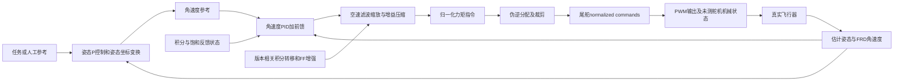

# B：已知控制器下的闭环联合辨识

结论：**控制器分层重建 SUPPORTED；固定控制干预 plant 辨识当前 NO-GO**。不是宣称闭环辨识理论上不可能，而是现有训练数据尚未支持可将预测误差唯一归给 plant 的创新/噪声假设。本轮不拟合大型 PACLD，也不把控制器复现误差当成 plant 误差。

## 范围和来源

基线 `9c15fffd24bfcacc7c57cd980cc149098cb83f82`；执行主 Agent 的 `px4-identifiability-contract-v1/experiments/px4_identifiability_v1/shared_contract.md`。只读 114 个 train ULog（17 日期，15 个已逐日志验证的固件 SHA）。共同队列为 11221 个既有合格窗口。原生控制器检查仅取这些决策之后 `[t,t+0.2s]` 内记录；不重新扩大飞行片段，不读取 validation/test。端点信息诊断直接复用共同特征的原生目标，不插值。

本地 PX4 origin 为 jiashunjiang2022/PX4-Autopilot，以 `git show <logged SHA>:<path>` 取源码，没有使用当前 HEAD 替代固件。`source_evidence.json` 保存 15 SHA × 8 文件的内容身份和行号摘录。主机仓库和 ULog 均只读，未修改正式模型或 checkpoint。

## 控制链及实际固件差异



基本 roll 姿态环是 `(roll_sp-roll)/tc - sin(pitch)*yaw_euler_rate_sp` 后限幅，并非独立外生 roll rate 参考。源码 `c9af571575af33d5403fbb479256848797c801e2:src/modules/fw_att_control/fw_roll_controller.cpp:50–74`。姿态环完整复现不在本轮已完成数值覆盖内。

基本角速度环为 `P*(p_sp-p)+I-D*p_dot+FF*p_sp`。积分含约 400 deg/s 尺度的误差衰减、饱和反积分和积分限幅；源码同 SHA `src/lib/rate_control/rate_control.cpp:75–137`。D 的导数来自发布的滤波角加速度而非本研究差分。控制器由 angular_velocity 回调触发，另有超过20ms的调度条件；实际 dt 从 timestamp_sample 算并夹在 2–40ms，而不是把日志频率当运行周期（`FixedwingRateControl.cpp:218–245`）。

基本版本用 1s 时间常数空速低通，再做 trim speed / constrained speed 缩放；PID 输出乘该缩放平方与 gain_compression。压缩器包含高通、平方低通、泄漏和上下限状态（`src/lib/rate_control/gain_compression.cpp:62–126`）。日志不能保证每一次内部更新都可见。

**不能把所有15固件当同一控制器。** `fw_rate_control` 有14种内容，RateControl库有6种内容；后期有 BumplessRollITransfer、anti-windup读取消耗修复以及 FastFFPlus。例 `926693950a4b2fe448d4b18d859c54bf9aa8a260:FixedwingRateControl.cpp:430–479` 的积分转移上下文与约508行的 FastFFPlus。`controller_configurations.csv` 保留每个训练日志实际参数；其中 FLAP_SLOW_EN 在 68 日志有定义，59 日志启用，所有114日志 FW_GC_EN=1、FW_RR_D=0、CA_METHOD=2；本轮没有复现全部这些内部状态，因此近似链误差不能全部解释为空速滤波误差。

控制面分配矩阵直接由各日志 `CA_SV_CS{i}_TRQ_{R,P,Y}` 构造，伪逆、trim、逐通道裁剪，再计算 `(right-left)/2`；没有从数据拟合分配系数。固定翼默认不归一化 RPY，AUTO选择伪逆。源码 `src/lib/control_allocation/control_allocation/ControlAllocationPseudoInverse.cpp` 与 `src/modules/control_allocator/VehicleActuatorEffectiveness/ActuatorEffectivenessControlSurfaces.cpp`。这里的 torque 是归一化控制器请求，**不是 N·m**；servo 是命令，不是测量舵角。

## 实际重建结果

| 检查 | 样本 / 日志 / 日期 | RMSE | R² | 含义 |
|---|---:|---:|---:|---|
| 参考及角速度→P项 | 88025 / 90 / 15 | 0.0025011 | 0.991196 | 对PID P项的独立参数公式重建 |
| 记录导数→D项 | 88025 / 90 / 15 | 0 | 未定义 | 此覆盖内D项为零，不能作为高频动态复现证据 |
| 记录P/I/D/FF求和→记录PID输出 | 88025 / 90 / 15 | 1.80e-8 | 约1 | 代数记录一致性，不是递推控制器验证 |
| 记录PID输出、GC、即时空速→torque | 86740 / 89 / 15 | 0.067725 | 0.950107 | 含oracle中间项的近似链检查 |
| 记录torque→差动servo | 92766 / 114 / 17 | 0.0014144 | 0.999975 | 对真实尾舵命令的分配层重建 |

逐日期分配 RMSE 为 0.000157–0.003229，最差日 R² 0.999816；P项逐日 RMSE 0.000935–0.004308，最差日 R² 0.972951；近似 PID→torque 逐日 RMSE 0.05109–0.08707，最差日 R² 0.905782。跨日期并非独立验证集；这些是 train 描述性误差。

`rate_ctrl_terms` 只在90/114日志存在，缺少的24日志不能默认补出各项。其余核心话题在114日志存在。窗口内典型日志间隔：angular_velocity约9.98ms、servo和rate setpoint约19.96ms、airspeed约100ms、GC约102ms、allocator status约196ms；这是记录间隔，**不是控制器固定周期**。完整覆盖和每日期结果见 CSV。

时序：P项使用同 timestamp_sample 最近过去角速度，以及 PID项发布时间前的参考；此参考仍可能已经比真实控制器读取的参考更新，因而不能称精确scheduler replay。PID→torque检查允许记录PID发布时间后2ms的匹配，只是离线oracle诊断；不用于因果输入、不进入plant估计。空速使用即时记录值替代内部1s滤波，GC使用最近过去记录；这两个近似和版本差异都保留在误差中，没有调参消除。分配只使用servo发布前最近40ms内的torque，异步日志缺失导致剩余误差。本轮 provenance 中参数变化记录为0，实际初始控制参数逐日志保存。

## 可观测与仍未知

可见：姿态/角速度估计、角速度导数、rate reference、normalized torque、servo和PWM输出、参数、稀疏积分/增益压缩/分配饱和状态；部分版本PID各项可见。

不能从这些可见记录直接得到：每次uORB消费和运行顺序、完整空速滤波状态、每次GC内部更新、积分转移完整状态及其精确初始化、真实舵机角度/载荷/死区/延迟、真实角速度测量误差、扑翼载荷及风扰创新。传感器滤波器参数可见不代表其全速内部输入及状态可见。没有把PWM等同实际舵面位置。不存在已验证的独立真实角速度标签来分离估计器噪声与plant扰动。

## 0.2秒局部模型与信息证据

明确模型类：`Δp_i = θ0 + θp p_i + θq q_i + θr r_i + b_m Δmotor_i + b_d Δd_i + b_s Δs_i + b_r Δrudder_i + e_i`。差动控制是共同合同的前0.1秒ZOH均值减baseline；端点是原生接近0.2秒测量。它目前定义一个观察性端点回归，不把自然闭环后半程控制等同固定干预波形。

11221窗口中八列设计满秩（8），列尺度化 Gram 条件数2.6175；观测OLS RMSE0.50791 rad/s。这说明此低维条件回归并未简单退化成线性列共线问题，**不证明因果信息充分**。

如果每个未验证创新 `e_i` 自由，则联合雅可比是 `[X,I]`，profile信息为 `Xᵀ(I-I)X=0`。对任意 δ，将 `θ'=θ+δ`，`e'=e-Xδ`，观测拟合完全相同；实数计算改变差动系数±1、±10（尺度化系数）后，补偿后预测最大差异1.42e-14。即使控制器完全已知，其条件似然约束也不会区分这两种plant加扰动分解，因为它看到相同状态和控制历史。

这不是“无外生激励一定不可辨识”的定理。限制为独立白噪声/指定创新滤波器、固定结构且足够激励、正确状态测量模型，可能恢复闭环预测误差辨识；但这些约束是额外假设，不能由设计矩阵满秩或高控制器R²自动推出。自由创新反例用于指出所缺信息，不作为所有合理物理模型的不可辨识证明。

## 联合辨识前提与路线判断

1. 已知反馈结构：SUPPORTED，15固件源码齐全，但递推复现仅部分验证。
2. 精确采样/执行器接口：部分SUPPORTED，记录时间与控制运行周期不同；真实舵机动态未测。
3. 正确噪声/创新结构：UNRESOLVED，没有经独立信息支持的扰动与反馈/测量误差分离。残差白化即使通过也仅是必要诊断。
4. 动态持续激励与固定干预可识别：UNRESOLVED，低维端点设计满秩仅说明该条件设计可估。
5. 状态与输入误差可忽略：UNRESOLVED，不能将滤波FRD角速度当真值。

因此本轮 **NO-GO：不能用重建控制器直接生成PACLD的反事实滚转增益监督**。可继续的限定方向是“版本感知的控制器状态/创新建模”，在已有train日志中先补齐观测模型、验证完整递推残差及其条件结构；只有假设独立支持后，才值得做小型局部闭环PEM，不应立即重训PACLD。可结合C把未识别扰动作为显式敏感性维度；若A找到可信外部参考，也仍需明确定义其闭环总响应估计对象。

后续数据需求（本轮不新增实飞）：优先检查已有日志是否保留全速滤波输入、完整GC/积分转移状态、FF增强开关和执行器反馈；不存在的真实舵角和独立测量噪声证据应标缺失，不能从代码补造。未来模型可显式区分物理状态、控制器状态、测量创新及执行器状态，训练目标可先是条件预测似然与记录控制一致性，而不是假定因果增益的CRM约束。此建议尚未验证改善MPC。

## 复现与验证

```bash
cd /home/zn/flap-system-identification/.worktrees/px4-identifiability-b-v1
OPENBLAS_NUM_THREADS=1 /home/zn/anaconda3/envs/flap-train-gpu/bin/python scripts/px4_b_v1.py
OPENBLAS_NUM_THREADS=1 /home/zn/anaconda3/envs/flap-train-gpu/bin/python scripts/px4_b_information.py
```

已实际执行上述两脚本；独立检查聚合SSE、样本数和信息补偿误差，执行Python语法检查和 git diff --check。仅本地提交脚本、聚合结果、报告；没有推送，没有逐窗口派生输出，没有模拟plant、神经训练或holdout评估。
