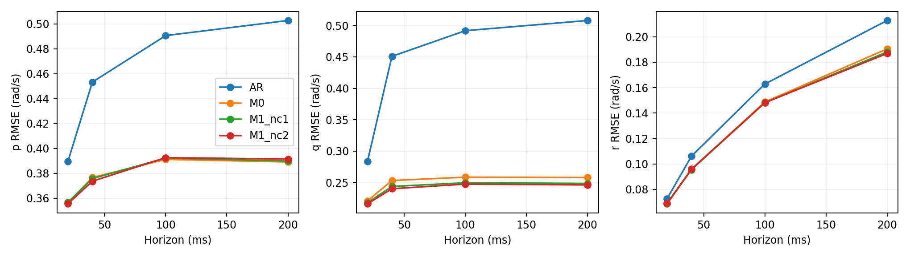
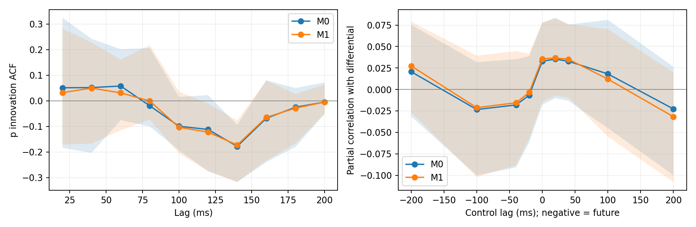
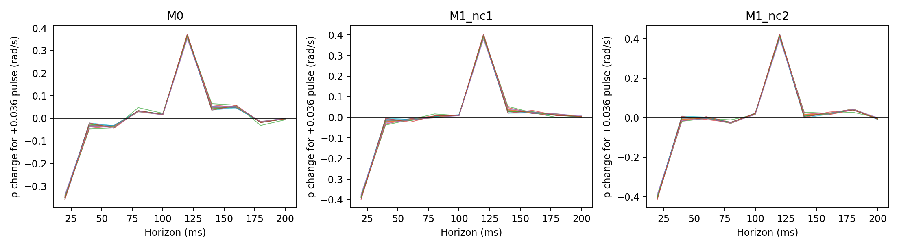
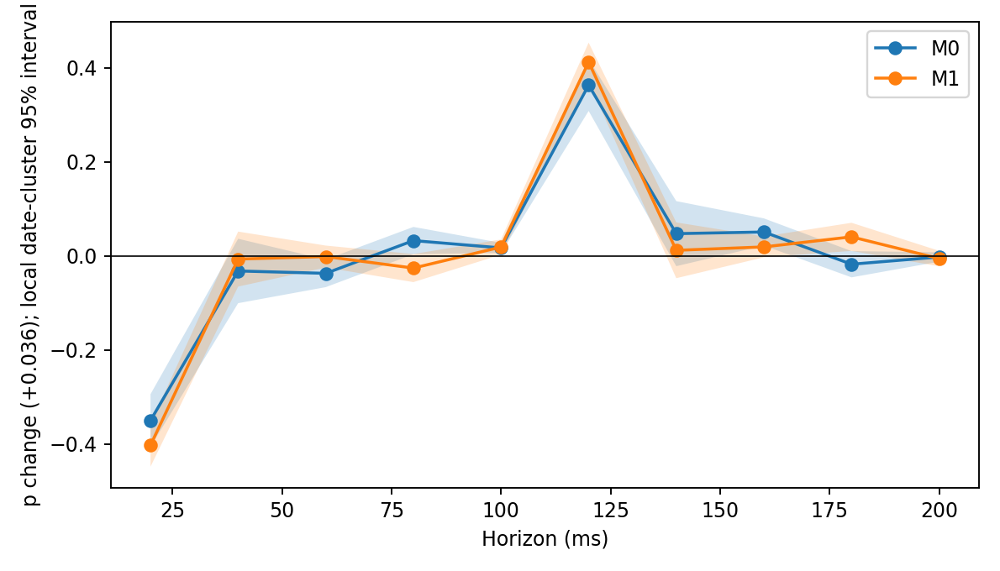
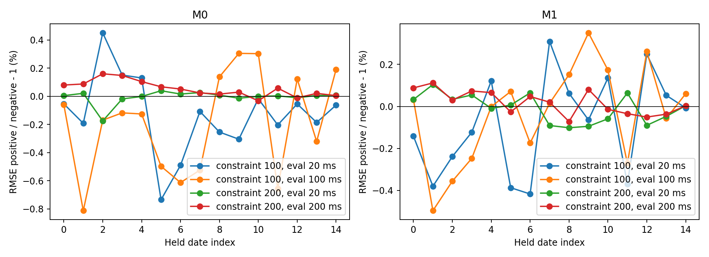

# PX4-CLID-v2：真实闭环动态辨识与有限维创新模型

## 结论与适用范围

**SUPPORTED：数据提供了有用的条件闭环动态预测信息；UNRESOLVED：尚不足以稳定确定固定差动干预的真实 plant 响应。整体接近情况 B，但显式创新模型的增益较小，不能称全面、显著改进。**

主实验滚转 pooled RMSE：20 ms时ARX 0.356115、M1 0.355426 rad/s；200 ms时无控制AR 0.502741、ARX 0.389050、M1 0.391376 rad/s。M1短时略好、长时略差；其20 ms滚转创新ACF日期均值由0.0509降至0.0320，但仍有明显日期异质性。100 ms正负约束的同一时域RMSE日期平均差为ARX −0.189%、M1 −0.0325%，正方向分别仅在10/15、7/15日期胜出。

本次确实拟合了有限参数 ARX/ARMAX，并在完全留出的 train 日期评价；没有使用逐样本自由误差补偿。正负响应模型均重新拟合动态参数，发现相反的 **100/200 ms** 响应可以取得接近的留日期预测误差。这是所选模型类下的实际弱辨识证据，不是“所有 ULog 不可能辨识”的结论，也不把预测近似等同统计等价或真实因果证明。

1. **现有日志能否提供稳定响应信息？** 能提供条件预测信息及给定参数化下的响应估计；固定干预增益的稳定辨识尚不成立。下面分别给出最优解的跨日期一致性和反向可替代解，二者不能混为一谈。
2. **创新模型带来什么？** 有限维因果噪声滤波改变一步残差和多步初态预测，对预测有有限改善；未消除控制符号歧义或全部残差结构。
3. **什么稳定？** 15 个高频日期的内部选择均采用相同短 ARX 结构；各模型未约束解在20 ms均为负响应、100 ms均为正响应；但200 ms增益在一阶与二阶创新结构间反号。响应数值范围列于下表。它们只是拟合解的重复性，不是唯一辨识或执行器物理时延证据。
4. **什么仍未辨识？** 真实飞机的反事实差动增益、真实舵机时延与测量/扰动分解；动态输入相关、有限噪声结构与模型失配、记录时间偏移和粗采样共同限制判断。
5. **是否进入 PACLD？** 不建议将本轮响应当作因果增益监督或直接启动控制动力学训练。条件预测建模值得保留为后续候选，但本轮不足以支持直接迁移控制响应约束；未运行任何 PACLD 训练。

## 数据、原生覆盖与时间合同

起点 `c7683865f053ac7aa165a13e7e68641a7198a814`；独立分支 `research/px4-closed-loop-dynamic-id-v2`。使用 velocity_rate_multistep_v1 train provenance，逐个实际读取 **114 个不同 ULog**，核对 `ver_sw` 与全部 **15 个固件 SHA**。没有读取 validation/sealed test 样本、ULog、checkpoint 或计算其哈希；其他两个仓库只读。

20 ms 合同保留 **580,401 行 / 2,610 段 / 90 日志 / 15 日期 / 13 固件**。并非把旧 11,221 窗口复制加密。原生提取包括 angular velocity、servo、motor、status、wing phase；既有 train 样本仅用于复用质量掩码和 reviewed/segment/mode 合同，不使用未来角速度作特征。

- `y=[p,q,r]`：FRD rad/s。`u=[motor,(right-left)/2,(right+left)/2,rudder]`：PX4 normalized command。不是实际舵角、不是 N·m，也不是单独机翼气动力。本模型不涉及质量或力矩参考点转换。
- `t_k` 为规则网格。`y_k` 取 `timestamp <= t_k` 的最近已发布角速度，同时要求 `timestamp_sample <= t_k` 且偏移在 `[-12,0] ms`；不做状态插值。实际匹配偏移 min/p1/median/p99/max 为 **−12/−11.168/−5.493/−0.240/−0.078 ms**。
- `u_k` 是原始命令按 **publication timestamp** 在 `[t_k−20 ms,t_k)` 的精确 ZOH 积分均值。`timestamp_sample` 不作为执行命令发布时间。精确的是**记录命令的保持积分**，不能确认日志遗漏期间的真实每次执行更新。
- 因而 `d=0` 表示同一个末端区间的命令均值，不是证明真实执行器零时延。尤其目标原生采样比网格早约 5.5 ms，`u_k` 的末端部分可能晚于该原生样本；这属于已声明的离散化/同时反馈限制，不能将其系数解释成纯前向物理效应。
- 复用 `valid_core`，排除 excluded/review、gap/reset/mode-change 边界；网格两侧样本必须同 segment、同模式且间隔 ≤40 ms；检查 raw status 的 armed/failsafe/模式；原生 rate 间隔和 command 间隔均受 40 ms 约束。任何不合格点切断序列，至少保留 40 点连续段。没有跨缺口或模式拼接，保留模式 3/15。
- 第一次累计 ZOH 时定位并修复了飞行前 NaN 污染整段积分的问题：只在积分计算中以零占位，同时显式拒绝与非法命令相交的区间；没有把非法命令作为有效数据填充。

`coverage.csv` 给出日期×固件候选/有效/保留行数；`native_timing.csv` 给出各日志原生时间统计的聚合，`match_offsets.csv` 保留偏移直方图，`time_contract.json` 固定合同。逐样本时间和 flight identity 仅保存在 `local/`。

**两个稀疏日期的必要替代合同：** 2026-10-10/12 的角速度约20 ms、servo/motor约100 ms。不能伪造其20 ms控制历史。单独用100 ms网格、过去原生输出容差30 ms、gap160 ms，得到全部114日志/17日期/15固件的157,800行、515段。只对这两个日期做留日期100/200 ms评价，其余16日期拟合。固定 `(na,nb,d,λ)=(3,5,1,10^-4)`，比较 AR/M0/M1(1阶、2阶)，不扫描额外阶数；一格就是100 ms，因此历史物理长度与主实验不同。其命令仍只是记录保持近似，不能恢复漏记执行命令，也没有该两日20/40 ms结果。**不得把两套采样合同合并为17日期统一50 Hz验证。**

| date | model | horizon_ms | axis | n | rmse | bias |
| --- | --- | --- | --- | --- | --- | --- |
| 2026-10-10 | AR | 100 | p | 3531 | 0.477893 | -0.004000 |
| 2026-10-10 | AR | 100 | q | 3531 | 0.444772 | 0.000779 |
| 2026-10-10 | AR | 100 | r | 3531 | 0.164227 | -0.001765 |
| 2026-10-10 | AR | 200 | p | 3531 | 0.503747 | -0.006286 |
| 2026-10-10 | AR | 200 | q | 3531 | 0.452179 | 0.003047 |
| 2026-10-10 | AR | 200 | r | 3531 | 0.168177 | -0.004356 |
| 2026-10-10 | M0 | 100 | p | 3531 | 0.458643 | -0.041189 |
| 2026-10-10 | M0 | 100 | q | 3531 | 0.427129 | -0.053108 |
| 2026-10-10 | M0 | 100 | r | 3531 | 0.155311 | -0.015196 |
| 2026-10-10 | M0 | 200 | p | 3531 | 0.500435 | -0.027454 |
| 2026-10-10 | M0 | 200 | q | 3531 | 0.434474 | -0.050295 |
| 2026-10-10 | M0 | 200 | r | 3531 | 0.160282 | -0.021663 |
| 2026-10-10 | M1_nc1 | 100 | p | 3531 | 0.452017 | -0.039262 |
| 2026-10-10 | M1_nc1 | 100 | q | 3531 | 0.434024 | -0.049696 |
| 2026-10-10 | M1_nc1 | 100 | r | 3531 | 0.149347 | -0.016750 |
| 2026-10-10 | M1_nc1 | 200 | p | 3531 | 0.490381 | -0.028279 |
| 2026-10-10 | M1_nc1 | 200 | q | 3531 | 0.440006 | -0.050698 |
| 2026-10-10 | M1_nc1 | 200 | r | 3531 | 0.156181 | -0.025302 |
| 2026-10-10 | M1_nc2 | 100 | p | 3531 | 0.452065 | -0.039159 |
| 2026-10-10 | M1_nc2 | 100 | q | 3531 | 0.433524 | -0.049825 |
| 2026-10-10 | M1_nc2 | 100 | r | 3531 | 0.149670 | -0.016330 |
| 2026-10-10 | M1_nc2 | 200 | p | 3531 | 0.490576 | -0.028345 |
| 2026-10-10 | M1_nc2 | 200 | q | 3531 | 0.439576 | -0.050737 |
| 2026-10-10 | M1_nc2 | 200 | r | 3531 | 0.156200 | -0.024711 |
| 2026-10-12 | AR | 100 | p | 12304 | 0.595207 | -0.014489 |
| 2026-10-12 | AR | 100 | q | 12304 | 0.515103 | -0.054734 |
| 2026-10-12 | AR | 100 | r | 12304 | 0.182348 | -0.006537 |
| 2026-10-12 | AR | 200 | p | 12304 | 0.605400 | -0.008805 |
| 2026-10-12 | AR | 200 | q | 12304 | 0.504764 | -0.044497 |
| 2026-10-12 | AR | 200 | r | 12304 | 0.219815 | -0.008891 |
| 2026-10-12 | M0 | 100 | p | 12304 | 0.598598 | -0.114642 |
| 2026-10-12 | M0 | 100 | q | 12304 | 0.514438 | 0.002539 |
| 2026-10-12 | M0 | 100 | r | 12304 | 0.175990 | -0.013075 |
| 2026-10-12 | M0 | 200 | p | 12304 | 0.619066 | -0.101112 |
| 2026-10-12 | M0 | 200 | q | 12304 | 0.511286 | -0.003650 |
| 2026-10-12 | M0 | 200 | r | 12304 | 0.208702 | -0.011891 |
| 2026-10-12 | M1_nc1 | 100 | p | 12304 | 0.596417 | -0.111348 |
| 2026-10-12 | M1_nc1 | 100 | q | 12304 | 0.515792 | 0.006960 |
| 2026-10-12 | M1_nc1 | 100 | r | 12304 | 0.175854 | -0.017609 |
| 2026-10-12 | M1_nc1 | 200 | p | 12304 | 0.615313 | -0.101593 |
| 2026-10-12 | M1_nc1 | 200 | q | 12304 | 0.515904 | -0.001542 |
| 2026-10-12 | M1_nc1 | 200 | r | 12304 | 0.211507 | -0.020527 |
| 2026-10-12 | M1_nc2 | 100 | p | 12304 | 0.596065 | -0.111138 |
| 2026-10-12 | M1_nc2 | 100 | q | 12304 | 0.515996 | 0.006458 |
| 2026-10-12 | M1_nc2 | 100 | r | 12304 | 0.176072 | -0.017004 |
| 2026-10-12 | M1_nc2 | 200 | p | 12304 | 0.614985 | -0.101427 |
| 2026-10-12 | M1_nc2 | 200 | q | 12304 | 0.516461 | -0.001761 |
| 2026-10-12 | M1_nc2 | 200 | r | 12304 | 0.211127 | -0.019599 |

## 有限参数模型和拟合

M0：`y_k=b+Σ A_j y_(k-j)+Σ B_j u_(k-j)+e_k`，保留四个输入及完整3×3状态耦合，加入固定截距允许条件均值。正则项为 `λ Σ diag(X'X)_i ||θ_i||²`，截距不惩罚。系数 `theta` 的行序：截距；j=1..na 的 p/q/r；j=d..d+nb−1 的 motor/differential/symmetric/rudder；列序 p/q/r。完整参数见 `models.json` 与 `final_models.json`。

M1：`A(L)y=b+B(L)u+C(L)ε`，采用共享标量 monic MA 滤波器 `C(L)I_3`，1或2阶；不是 Box-Jenkins，plant 和噪声共用 A 分母。递推 `ε_k=y_k−预测确定项−Σ c_j ε_(k−j)`，每个片段以零创新初始化。只拟合有限个 c，不给各样本自由创新变量；ε 是参数给定后由记录因果递推得到的残差。假设工作创新为零均值、同方差白过程；实际跨轴协方差和白化是否成立必须由诊断判断。

对每个候选 C，以 `1/C` 分段滤波 X、Y 并精确求解 ridge θ；最小化创新平方和加同一 ridge 正则，使用按初始目标值归一化的 L-BFGS-B 收敛判据。完成的有限差分求导解保留，并独立检查其目标梯度；针对线搜索数值失败，改用因果滤波解析梯度和直接残差范数避免正规方程大数相减，必要时以同一目标的有界Powell优化完成。没有改变模型、正则或数据合同。Schur反射参数在[-0.95,0.95]保证逆滤波稳定；AR伴随矩阵谱半径限制 <0.9999，必要时以约束优化求稳定解。优化器量级导致的提前停止曾被合成恢复测试发现并修复，所有发布结果来自修复后的重新拟合。没有更改测试恢复精度。

主候选只有六个：`(3,5,0,1e-4),(3,5,1,1e-4),(5,10,1,1e-4),(5,10,2,1e-4),(3,5,1,1e-2),(5,10,1,1e-2)`。外层逐日期留出；其余日期按排序后模3划成三个内部日期组，按内部一步三轴合计误差选结构/正则，再在相同结构下选1/2阶C。外层日期完全不更新参数。所有主fold均选 `(3,5,0,1e-4)`，选择细节、分数和C阶数见 `selection.json`。不把这是“真实物理阶数”的证明。最终全train模型使用内部选择的众数，只用于参数/信息展示，不计入留日期成绩。

最终全train M0谱半径=0.964412；M1谱半径=0.965145，C=[1.0, 0.38968565732498905, 0.30626096743718806]。模型参数数量 M0=90、M1=92，而非每样本一个噪声参数。AR是去掉全部控制输入的同阶输出动态基线。

## 留日期预测

评价起点从每段历史及创新warmup后每10点取一次，所有模型使用相同起点；20/40/100/200 ms分别自主传播1/2/5/10步。初态只来自起点已经发布的历史状态，后续真实角速度只用于计分；未来创新取零，已有创新记忆按C传播。未来控制使用已发生的记录序列，所以全部都是 **factual conditional replay**，不是现实提前获知未来反馈命令的在线预测，也不是反事实验证。

以下是聚合SSE得到的RMSE（rad/s）：

| model | horizon_ms | p | q | r |
| --- | --- | --- | --- | --- |
| AR | 20 | 0.389375 | 0.283552 | 0.072654 |
| AR | 40 | 0.453220 | 0.450831 | 0.106142 |
| AR | 100 | 0.490606 | 0.491684 | 0.162832 |
| AR | 200 | 0.502741 | 0.507908 | 0.212776 |
| M0 | 20 | 0.356115 | 0.220634 | 0.068692 |
| M0 | 40 | 0.376539 | 0.253085 | 0.095800 |
| M0 | 100 | 0.391114 | 0.258472 | 0.148730 |
| M0 | 200 | 0.389050 | 0.257921 | 0.190446 |
| M1 | 20 | 0.355426 | 0.216096 | 0.069071 |
| M1 | 40 | 0.373569 | 0.240045 | 0.095937 |
| M1 | 100 | 0.392496 | 0.247410 | 0.148210 |
| M1 | 200 | 0.391376 | 0.246098 | 0.186848 |

日期等权平均RMSE（避免密集样本被误当独立重复）：

| model | horizon_ms | p | q | r |
| --- | --- | --- | --- | --- |
| AR | 20 | 0.395052 | 0.283554 | 0.074272 |
| AR | 40 | 0.458408 | 0.454919 | 0.108010 |
| AR | 100 | 0.499035 | 0.498712 | 0.165440 |
| AR | 200 | 0.510796 | 0.514819 | 0.215767 |
| M0 | 20 | 0.362196 | 0.221573 | 0.070330 |
| M0 | 40 | 0.381241 | 0.255817 | 0.097388 |
| M0 | 100 | 0.397705 | 0.261503 | 0.150545 |
| M0 | 200 | 0.394360 | 0.260841 | 0.192807 |
| M1 | 20 | 0.361506 | 0.217449 | 0.070719 |
| M1 | 40 | 0.378297 | 0.242662 | 0.097554 |
| M1 | 100 | 0.399670 | 0.250503 | 0.150001 |
| M1 | 200 | 0.397312 | 0.249092 | 0.189041 |

滚转相对于无控制AR的日期等权改善、改善日期数，以及M1相对M0变化：

| model | horizon_ms | mean_date_gain_vs_AR_pct | improved_dates | M1_vs_M0_mean_pct |
| --- | --- | --- | --- | --- |
| M0 | 20 | 8.524383 | 15 | 0.146728 |
| M0 | 40 | 17.308073 | 15 | 0.782863 |
| M0 | 100 | 20.640062 | 15 | -0.468057 |
| M0 | 200 | 23.014443 | 15 | -0.755162 |
| M1 | 20 | 8.660057 | 15 | 0.146728 |
| M1 | 40 | 17.950468 | 15 | 0.782863 |
| M1 | 100 | 20.269556 | 15 | -0.468057 |
| M1 | 200 | 22.456742 | 15 | -0.755162 |

每日期、每轴的样本数、RMSE、偏差及充分统计见 `date_metrics.csv`，完整 pooled bias 见 `aggregate_metrics.csv`。未以重叠窗口数计算独立显著性。



## 创新诊断及相位边界

一步创新在留出日期按片段因果重建。`innovation_correlations.csv` 提供20–200 ms ACF、与控制/状态历史的相关、以及未来控制描述性相关；正 lag 为过去，负 lag 为未来。partial differential相关控制前一格p/q/r及其他三输入，仅是描述性条件相关，不是工具变量或外生性检验。零lag控制可能依赖同一测量，不要求其机械为零。创新分布按日期、模式、相对encoder相位8箱列于 `innovation_distribution.csv`。

20 ms 创新ACF的日期均值和范围：

| model | channel | mean | min | max |
| --- | --- | --- | --- | --- |
| M0 | p | 0.050933 | -0.183486 | 0.324804 |
| M0 | q | 0.048602 | -0.039263 | 0.147499 |
| M0 | r | 0.012445 | -0.252427 | 0.212089 |
| M1 | p | 0.031988 | -0.171055 | 0.282283 |
| M1 | q | 0.017083 | -0.055361 | 0.152753 |
| M1 | r | 0.002400 | -0.272867 | 0.171423 |



未建立因果Hall机械相位的跨日志统一合同。现有relative encoder phase仅用于描述，不能把不同日志相位箱当统一绝对相位；`wing_phase`的原发布可用合同也不足以自动升级为Hall因果输入。因此 **M2 NO-GO**，未加入相位调制参数或扫描谐波。创新近似白化即使改善，也不证明plant结构正确或因果可辨识。

## 动态激励与有限参数信息

对实际动态滞后设计计算差动各滞后列，在截距、过去p/q/r和其他三通道全部滞后列上残差化，以Schur补保留条件Gram；报告条件RMS、特征值、最强/最弱时延组合和列尺度化设计奇异值。M1使用实际 `1/C` 滤波后的设计。按日期、固件和全train输出 `dynamic_information.json`；不是沿用旧八列静态满秩结论。

全train M0差动条件RMS：[0.24334590923199667, 0.24197062119021442, 0.2399538124117837, 0.23782131277659424, 0.23614543046820932]；M1：[0.14555615780188655, 0.14495638249268503, 0.143727014750691, 0.14246963514042724, 0.14166428160746744]。滞后为[0, 20, 40, 60, 80] ms。

列尺度化条件数 M0=4144.735，M1=1970.757。M1最弱差动滞后方向=[-0.27288616582684233, 0.6291774696532016, -0.5953168905068976, 0.3899960810904563, -0.15221599387845114]，最强方向=[0.4525821297336324, 0.4516100479751979, 0.4479330997052375, 0.44365297085411626, 0.4401656052605468]（向量整体符号任意）。低特征值方向表示这些延迟组合难区分；满秩和有限条件数不等于真实干预增益已可靠确定。

另外从实际因果PEM残差对全部θ及C反射参数的导数构造联合Gauss–Newton信息；`response_uncertainty.json` 给出其谱、条件数和按**日期聚类**的sandwich局部响应标准误。信息不包括每样本自由参数，不把ridge先验当数据信息。这是局部线性近似，只有14/15个日期簇，且结构失配未计入，不能作为真实飞机的置信区间或全局唯一性证明。

## 固定差动脉冲与反向假设

同一个初始历史、同一创新历史、同一其他输入序列下，分别加±0.036差动，持续100 ms，随后恢复；其他输入可固定motor=0.6、symmetric=rudder=0。线性叠加使与共同baseline的响应差不依赖所选共同初态/截距；代码直接计算这一差值，严格只改d通道。正负曲线相反，正减负=0.072×单位增益。未调用真实飞机或模拟plant作为真值。

单位输入100/200 ms有限时长p增益（rad/s per normalized command）的跨日期分布：

| model | horizon_ms | mean | min | max |
| --- | --- | --- | --- | --- |
| M0 | 100 | 0.476724 | 0.420233 | 0.606514 |
| M0 | 200 | -0.060951 | -0.181862 | 0.009979 |
| M1_nc1 | 100 | 0.282594 | 0.216546 | 0.350297 |
| M1_nc1 | 200 | 0.103979 | 0.032950 | 0.189427 |
| M1_nc2 | 100 | 0.523991 | 0.412099 | 0.646988 |
| M1_nc2 | 200 | -0.150844 | -0.275302 | -0.011071 |



全train局部日期聚类不确定性：

| model | horizon_ms | gain | date_cluster_se | lower_local95 | upper_local95 |
| --- | --- | --- | --- | --- | --- |
| M0 | 100 | 0.475680 | 0.151379 | 0.178977 | 0.772382 |
| M0 | 200 | -0.061067 | 0.140886 | -0.337203 | 0.215070 |
| M1 | 100 | 0.525053 | 0.228865 | 0.076478 | 0.973629 |
| M1 | 200 | -0.153782 | 0.232683 | -0.609840 | 0.302276 |



关键符号比较：每个fold、每个M0/M1，分别将100 ms或200 ms脉冲增益约束为 `+abs(g_fit)` 或 `-abs(g_fit)`，重新优化**全部A、B和截距**并保持稳定。C固定为该fold训练所得值，因此这是明确的**固定噪声结构条件剖面**，不是全局搜索C后的轮廓似然。不是把B乘−1，也没有自由残差补偿。两个独立剖面分别约束100或200 ms单点，整条曲线不强制逐点反号。其存在已经说明同一合理噪声滤波器下可找到不同控制响应的模型，但不声称找到全局最优或证明统计等价。

正响应模型相对负响应模型的留日期p RMSE百分比差：

| model | target_horizon_ms | horizon_ms | mean | min | max |
| --- | --- | --- | --- | --- | --- |
| M0 | 100 | 20 | -0.128629 | -0.734230 | 0.450119 |
| M0 | 100 | 100 | -0.188936 | -0.811945 | 0.304646 |
| M0 | 200 | 20 | -0.005937 | -0.175298 | 0.039367 |
| M0 | 200 | 200 | 0.053776 | -0.032076 | 0.159823 |
| M1 | 100 | 20 | -0.079864 | -0.416866 | 0.309335 |
| M1 | 100 | 100 | -0.032465 | -0.496222 | 0.350229 |
| M1 | 200 | 20 | -0.008520 | -0.101370 | 0.104140 |
| M1 | 200 | 200 | 0.019144 | -0.071981 | 0.111946 |

`sign_profile.csv` 保留每日期偏好；近似持平、小幅双向变化应理解为实际判别力有限，而不是预设固定百分比阈值的等价检验。即使未约束解跨日期方向一致，也不能掩盖这些反向替代解。



## 限制、复现与交付

控制与测量闭环相关、同区间命令含反馈、日志可能漏记命令、时间匹配偏移、线性时不变模型和共享标量C的局限，都可能影响控制增益。跨固件并未人为挑选一致版本；覆盖及信息按版本保留，但本轮没有另拟合版本条件化模型。因此不能声称单一结构已解释全部固件。归一化命令到测得角速度本来就含未观测执行器、传感器和扰动动态，不能从这些结果拆出真实舵面或物理力矩增益。

可复现命令（工作目录为本worktree；Python固定指定环境，CPU单线程BLAS）：

```bash
export OPENBLAS_NUM_THREADS=1 OMP_NUM_THREADS=1
PY=/home/zn/anaconda3/envs/flap-train-gpu/bin/python
$PY scripts/px4_clid_extract.py
$PY scripts/px4_clid_extract.py --coarse100
$PY scripts/test_px4_clid.py
$PY scripts/px4_clid_run.py
$PY scripts/px4_clid_coarse.py
$PY scripts/px4_clid_diagnostics.py
$PY scripts/px4_clid_report.py
$PY scripts/px4_clid_verify.py
$PY scripts/px4_clid_write_report.py
```

`CLID_SHARD=0/1/2`可在三个CPU进程分别运行主拟合，分片各写独立fold文件，随后无该变量再运行一次合并缓存；不是额外模型或随机种子。纯确定性拟合，无研究随机种子；合成测试种子固定于代码。

9项定向测试实际通过：精确ZOH、非法值/缺口、输入延迟及符号、未来状态隔离、确定性、创新递推、可逆性、合成ARMAX恢复、完整动态符号约束重拟合。独立产物检查见 `verification.json`，主实验检查195个模型，100ms补充检查8个模型。所有检查实际执行后才报告；没有修改PACLD/checkpoint、原始ULog或PX4源码。

发布范围仅脚本、定向测试、模型参数、日期/固件聚合统计、图表和本文。`local/`以及`coarse100/local/`中的逐样本序列、日志身份清单、fold缓存、优化中间版本与日志保留服务器，不提交。使用既有 provenance 和质量合同，不额外生成新数据集或训练PACLD。后续若要将响应信息用于训练，需要先解决实际控制输入覆盖和对更合理噪声/测量模型的响应稳定性；本轮到此结束。
