# 结构化控制效能模型：正式三折跨航次留出比较

基准 `f1324dfaaa807297d83b1d246cf21e362d5140bf`；新分支 `exp/structured-control-effectiveness-group-holdout-v1`。

**结论：完成27/27次从头训练及全部留出评价，未发现 M1/M2 在局部滚转响应方向和幅度上稳定优于 M0。** M1/M2 更强地使用未来控制，且改善部分普通轨迹误差；但300ms原始物理时间参考 B 的 p 方向同向率下降，慢变参考 D 的微小方向变化全部发生在 Fold 0 的单个大依赖分量内。慢变幅度低估没有整体改善，部分反向预测被放大。因此不将 M1/M2 晋升为“控制可用”模型，不继续无依据增加相位分支复杂度。M1 可保留为显式控制通路的研究对照，下一步优先研究闭环数据可辨识性、目标与控制响应之间的关系以及有依据的弱物理约束。本轮未开展这些后续实验。

## 1. 实际执行、隔离与训练公平性

启动时核对指定远端基准、HEAD、工作区及适用 AGENTS，使用独立 worktree，原工作区修改未混入。所有新增交付位于本目录，旧模型、数据、报告和 AGENTS 未修改。

明确复用 `velocity_rate_multistep_v1/main_50hz`，manifest SHA256：
`8afb8623bf7174e4da5b2044f644331b8b251433fed3576f6dcdab470935bcb5`。
原 train/validation 缓存哈希与 H1000 数据审计一致，107920/36332窗口、94/27航次；没有重新打包、读取 test 或切换 canonical dataset。模型直接导入上轮冻结实现，V0时间合同、六维离散速度／角速度更新、13维积分状态、原物理积分器和 `exact_zoh_merge_us_v1` 均不变。完整结构见上轮 [model_design_zh.md](../structured_control_effectiveness_v1/model_design_zh.md)。

| Fold | 拟合窗口 / 航次 | 留出窗口 / 航次 | 主对 / 分量 | B / D方向有效对 |
|---|---:|---:|---:|---:|
| 0 | 87239 / 76 | 20681 / 18 | 25 / 1 | 20 / 19 |
| 1 | 95627 / 83 | 12293 / 11 | 12 / 4 | 9 / 10 |
| 2 | 87750 / 77 | 20170 / 17 | 11 / 6 | 11 / 7 |

三折成员、窗口索引与上轮文件逐字节一致；按 flight 及源 ULog/boot 隔离。每折先切出拟合窗口，才调用原 `fit_normalization` 计算 input mean/scale、六维 output_scale 和四项 loss_scales。M1/M2控制坐标尺度也从该折尺度派生，绝不使用原全训练 normalization。每折三模型共享完全相同的尺度；独立 float64 NumPy/SciPy 复算最大差异低于 `4.1e-7`。留出航次不进入梯度、尺度或 checkpoint 选择。

| 模型 | 参数量 | 实际训练 | 更新数合计 | epoch耗时合计，含验证 |
|---|---:|---:|---:|---:|
| M0：原 GRU-Control | 37590 | 9 × 24轮 | 19152 | 2165.76 s |
| M1：显式状态相关控制效能 | 36534 | 9 × 24轮 | 19152 | 2224.25 s |
| M2：M1加显式相位调制 | 42774 | 9 × 24轮 | 19152 | 2298.39 s |

合计648个epoch、57456次优化更新，0次中断恢复、0次失败重训、无早停。每个 fold/seed 下三模型的实际全局窗口 batch 顺序哈希逐轮相同；每次更新数分别为2064、2256、2064。500ms历史、自主1000ms训练、batch1024、AdamW(.001,.0001)、clip5、cosine T_max24、原四项损失全部冻结。只用原27航次 validation 的等航次损失、继承的最小改善1e-4规则保存 best；每次也保存 last。不同折归一化 loss 不用于跨折绝对数值排名。

使用现有 `flap-train-gpu` 和两张 RTX4090，共享GPU且未终止其他进程。训练任务墙钟跨度3544.19s（59.07分钟），各epoch计时之和6688.40s；后者包含验证和CPU开销，不是独占GPU内核计时。单进程峰值 PyTorch 分配显存不超过1.817GB。训练TF32开启、评价关闭，与原合同一致。旧6轮和历史24轮 checkpoint 均未混入本轮推理。

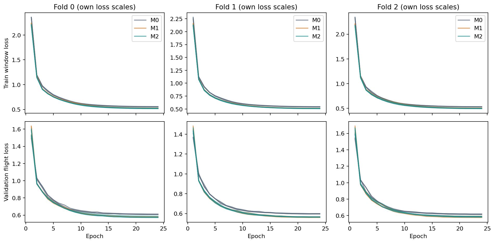

## 2. 评价对象、覆盖与统计单位

48主对每个 model/seed 只使用其所属留出折 best，得到432条主300ms p记录／口径，无重复折评分、删失败对或补配。额外队列按冻结名单保留，只有两端均在本折留出航次中的对才评分。

冻结完整资产实际为110个训练对及3个验证对：105个训练对可评价，其中48主对、57个其他冻结对；5个训练跨折对不可评价，见 `unevaluable_background_pairs.csv`。另外2个非主验证背景对不属于训练航次留出协议，单列 `excluded_validation_background.csv`。validation:44 对每折三模型三种子单独展示，已暴露于 checkpoint 选择，不进入主排名。这里各质量／背景队列可能重叠，不能相加。

- A：原始标签／起点的事实响应差，完整保留为参照。
- B：冻结的原生角速度、同物理时间插值参考；模型输入仍为V0。
- D：对B及预测采用同一270ms中心平均，保留瞬时起点；属于离线诊断，不是在线滤波，也不是新模型。
- 主方向门限为真实响应绝对值大于0.1 rad/s；预测绝对值须大于1e-8才判同向。B有40/48对有效、8对近零；D有36/48对有效、12对近零。航次等权近零权重为13.15%／30.25%，与不加权对数比例不同。
- 主300ms A/B/D均支持48对。A/B的100/200/400ms支持48对；精确500ms均为缺失。D仅在完整270ms窗口内评分，100/400/500ms不支持。原共同末端 A支持48对、B支持37对，缺失继续保留；各对滤波有效末端D支持48对。没有外推或静默修复。

正文默认航次等权、三种子等权汇总基础计分行，先保留每种子指标，不先平均曲线再判断方向。另提供逐对、依赖分量等权和逐航次／日期／配置结果。三种子不是三倍独立物理样本。11个分量中，B/D分别只有10/8个包含方向有效对；无有效方向的分量记NA，幅度统计仍保留。

## 3. Q1、Q2：留出方向及幅度是否改善？

**B方向下降，D没有稳定而广泛的改善；B幅度增加与方向退化同时出现，D幅度低估仍在。** 下表所有模型采用相同真值、时间支持、门限和样本。

| 参考 | 模型 | 方向同向率 | 预测/真实RMS比 | 有符号增益 | RMSE | MAE |
|---|---|---:|---:|---:|---:|---:|
| B | M0 | 81.93% | 0.469 | 0.213 | 0.522 | 0.412 |
| B | M1 | 74.95% | 0.580 | 0.235 | 0.545 | 0.384 |
| B | M2 | 73.95% | 0.591 | 0.249 | 0.540 | 0.386 |
| D | M0 | 82.49% | 0.663 | 0.369 | 0.351 | 0.279 |
| D | M1 | 82.80% | 0.648 | 0.343 | 0.359 | 0.260 |
| D | M2 | 83.27% | 0.660 | 0.348 | 0.360 | 0.258 |

RMSE/MAE单位rad/s。有符号增益为加权 `Σ(real×pred)/Σ(real²)`，不是气动力或物理控制增益。M1/M2降低了部分MAE，但较大反向误差使RMSE略升；不能仅报告MAE改善。A的同向率为80.34%/74.17%/73.13%，RMS比0.410/0.508/0.517，完整参照不改变上述判断。A/B/D定义不同，不能把跨口径指标变化当成模型改善。

| 模型 | B同向率，seed17 / 29 / 43 | D同向率，seed17 / 29 / 43 |
|---|---|---|
| M0 | 81.16 / 77.41 / 87.21% | 82.49 / 82.49 / 82.49% |
| M1 | 73.01 / 76.76 / 75.09% | 82.62 / 84.57 / 81.19% |
| M2 | 75.43 / 75.09 / 71.34% | 82.62 / 84.57 / 82.62% |

B正向19对、负向21对：正向有符号偏差由−0.332变为−0.258/−0.254，但负向偏差由+0.423增至+0.481/+0.475。D正向14对、负向22对：正向偏差−0.158→−0.165/−0.164，负向+0.292→+0.313/+0.315。D正／负真实响应的绝对幅度偏差也未整体改善，分别为M0 −0.158/−0.163，M1 −0.163/−0.173，M2 −0.160/−0.167 rad/s。

门限敏感性不改变主判断：0.05门限下B有44对，方向78.03/75.87/74.94%；D有42对，74.02/74.27/74.66%。0.2门限下B有35对，81.78/75.26/77.48%；D有28对，88.28/88.67/89.28%。没有以排除近零样本后的同向率上升掩盖有效数量变化。

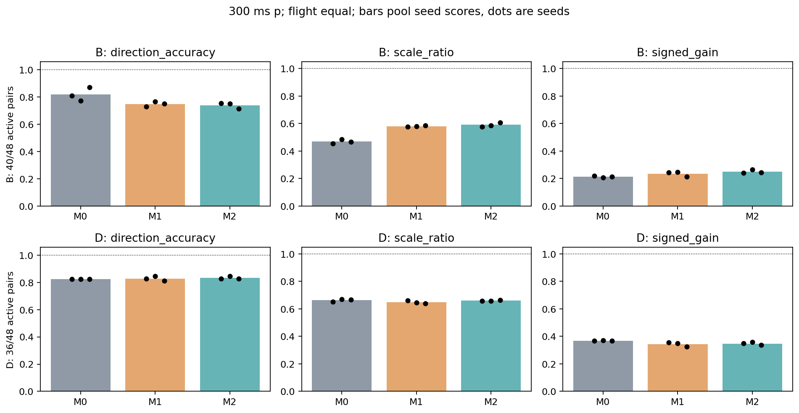
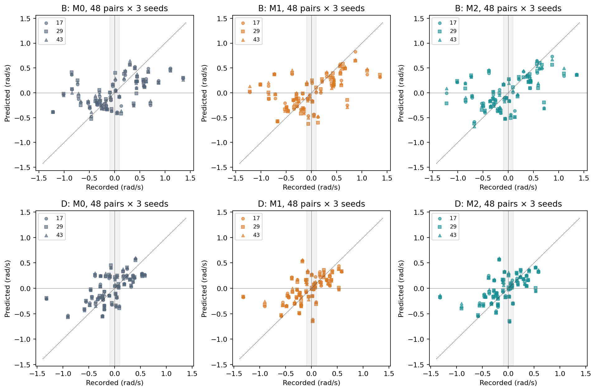

## 4. Q3：是否跨折、跨分量及匹配质量一致？

| 范围 | 对数；B/D有效 | B方向 M0 / M1 / M2 | D方向 M0 / M1 / M2 |
|---|---|---|---|
| Fold 0，C03单个分量 | 25；20/19 | 84.05 / 74.60 / 71.89% | 87.20 / 87.87 / 88.91% |
| Fold 1，4分量 | 12；9/10 | 62.93 / 66.33 / 66.33% | 89.29 / 89.29 / 89.29% |
| Fold 2，6分量 | 11；11/7 | 89.22 / 79.41 / 79.41% | 71.43 / 71.43 / 71.43% |
| 排除Fold 0 | 23；20/17 | 80.68 / 75.17 / 75.17% | 78.57 / 78.57 / 78.57% |

逐对等权的B同向率为83.33/80.83/79.17%，分量等权为77.67/74.83/74.55%；D逐对等权86.11/86.11/87.04%，分量等权80.97/80.97/81.19%。D的航次等权小增幅不是跨分量普遍改善。

在包含有效B方向的10个分量中，M1有2个改善、4个退化，M2有2个改善、3个退化；没有一个分量在三个种子中都取得B方向净改善。D的8个有效分量中，M1逐对平均没有净改善分量，M2仅C03有极小净改善，其他分量不变。全部11分量仍保留，C03的25对不能解释成25次独立验证。

逐对配对得失（每项为该种子“错→对 / 对→错”的对数）：

| 比较 | B seed17 / 29 / 43 | D seed17 / 29 / 43 |
|---|---|---|
| M1−M0 | 3/4，4/3，1/4 | 1/1，1/0，1/2 |
| M2−M0 | 3/4，4/4，1/5 | 1/1，1/0，1/1 |

D所有得失都位于C03：train:99在三种子都改善；train:203在seed17/43退化；M1另在seed43使train:788退化。不得把三种子重复计分行当作独立干预。

匹配质量敏感性也不支持统一优势：17对航次互斥子集中D有效10对，同向率80%→90%/90%，但只增加train:99这一对；同固件38对为85.05/84.45/85.05%；同固件同配置11对（有效7）均80%，RMS比却由1.034升至1.254/1.283，RMSE由0.311升至0.358/0.366。严格匹配2对只有1对D有效，均100%同向；M1/M2误差下降是局部正例，数量不足以支持稳健泛化。

小控制差异背景有效保留27对，D真实响应RMS为0.195 rad/s；两端未来安静队列27对为0.261，主对为0.419。背景并非零，也不是纯传感器噪声或控制因果误差下界。小差异背景D方向为89.86/89.86/89.02%；安静队列为100/94.20/91.30%。背景组和质量组成员有重叠，完整有效对数见CSV。

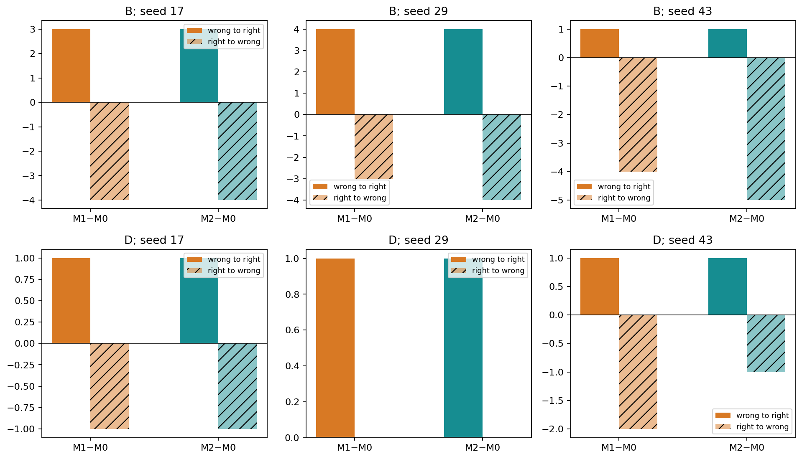
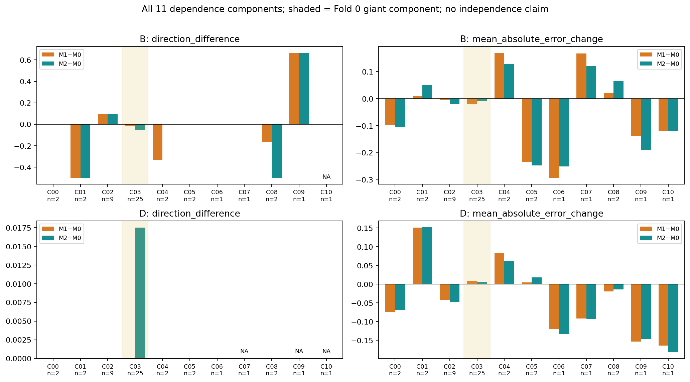

## 5. 失败、正例及时间变化

以下300ms D数值仅为便于阅读展示三种子预测均值；所有正式计分均逐种子完成。单位rad/s。

| 病例 | 真实D | M0 | M1 | M2 | 观察 |
|---|---:|---:|---:|---:|---|
| train:99，fold0 | −0.280 | +0.052 | −0.027 | −0.048 | 三种子都纠正方向，但响应幅度仍很小 |
| train:203，fold0 | +0.531 | +0.262 | −0.012 | −0.032 | 新模型出现反向，seed17/43明确由对变错 |
| train:124，fold0 | −1.323 | −0.199 | −0.166 | −0.162 | 严重低估仍在，且略加重 |
| train:336，fold2 | −0.175 | +0.257 | +0.545 | +0.573 | 原反向预测被显著放大 |
| train:412，fold1 | −0.238 | −0.149 | −0.131 | −0.139 | 三模型均可重现部分慢变方向，新结构未更好 |

train:124 的B真实−1.013，而M0/M1/M2为−0.034/+0.170/+0.224；train:336 的B真实−0.386，预测−0.109/+0.408/+0.433。这不是单纯幅度不足，结构化输出可能将正确或接近零的方向推向反向。

按全主队列D平均绝对误差变化选出的最大改善例是train:746：真实D仅+0.038（近零，方向弃判），预测由−0.176变为−0.013/+0.005。它说明减少历史趋势偏差有价值，但不能作为有效方向改善证据。该选择规则和所有固定／追加病例均记录在 `illustration_selection.json`，不影响评分集合。

原始B峰值绝对时间偏移的逐对／种子平均为125.7/109.8/115.2ms，D为69.0/60.8/61.4ms；B峰值绝对幅度误差0.524/0.413/0.403，D约0.198/0.200/0.200 rad/s。部分瞬时峰值拟合改善不能抵消300ms方向退化。D真实峰值约41.7%位于有效区间边界，短窗口峰值时刻解释有限；没有做oracle时间平移或峰值对齐。

validation:44真实B=+0.388、D=+0.110。各折三种子均值中，B预测范围为M0 0.039–0.057、M1 0.093–0.136、M2 0.118–0.152；D分别为0.113–0.146、0.099–0.117、0.082–0.115。该已暴露病例存在幅度改善，但单例不能决定排名。三个fold分别保存完整病例图，没有混成独立验证样本。

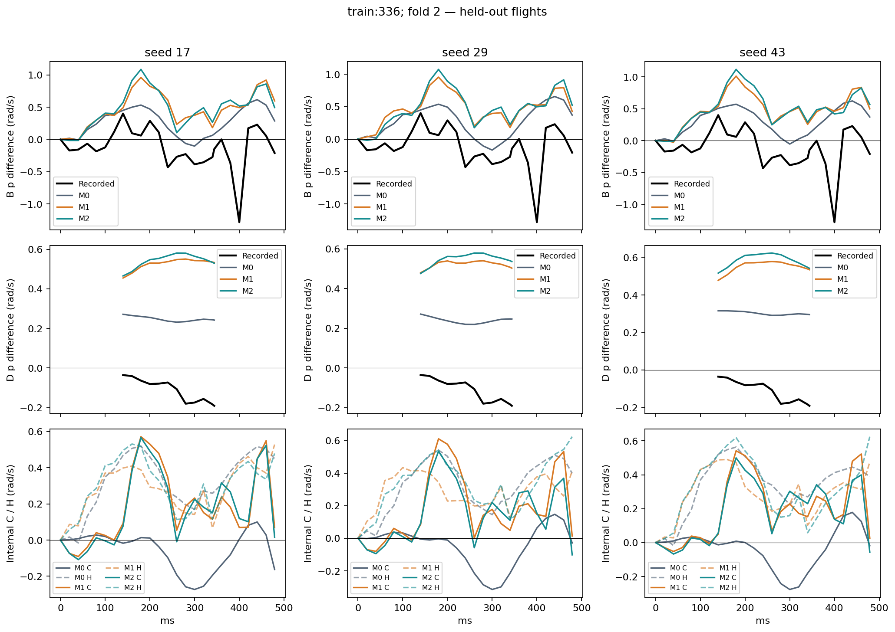
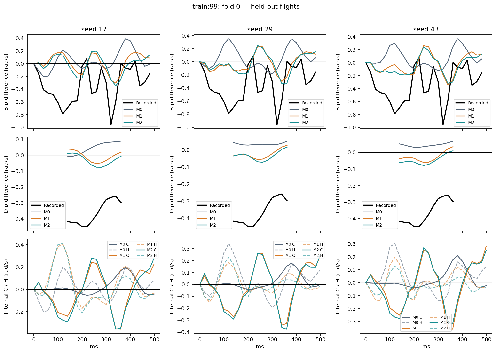
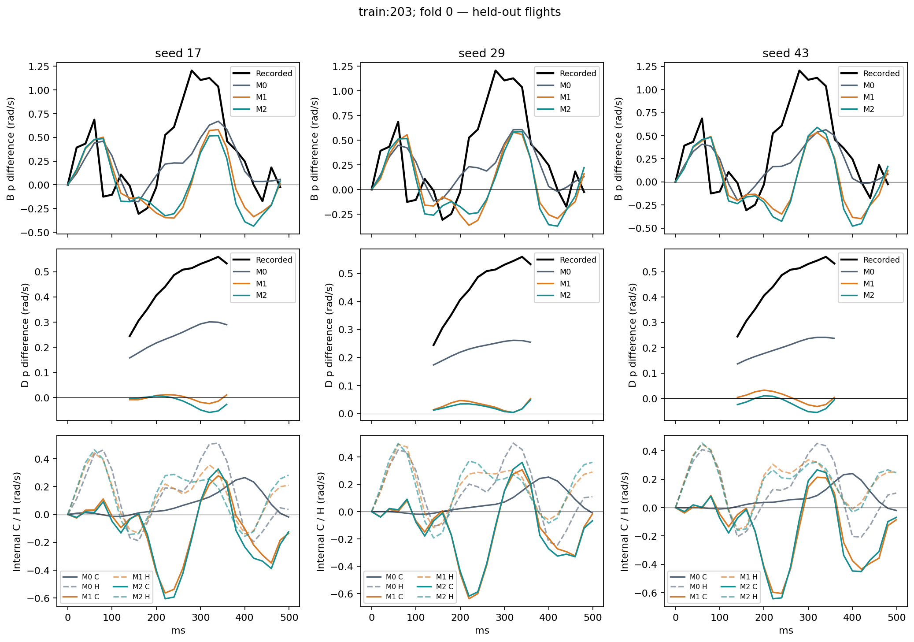

## 6. 模型内部敏感性：控制通路确实改变，但不是准确率证明

每个留出对使用同一receiver历史下的AA/AB/BA/BB。除未来四路事件外，初值、历史、dt和由历史外推的相位均相同；donor相对时间平移、原生ZOH及支持边界复用冻结输入。下面是**原始300ms模型内部**分解，不是D滤波后的物理控制效应。

| 模型 | CA RMS | CB RMS | C RMS | H RMS | C/H | CA/CB同向率 | 弃判权重 |
|---|---:|---:|---:|---:|---:|---:|---:|
| M0 | 0.097 | 0.105 | 0.098 | 0.254 | 0.387 | 100.0% | 81.50% |
| M1 | 0.226 | 0.261 | 0.237 | 0.278 | 0.853 | 98.14% | 41.53% |
| M2 | 0.225 | 0.279 | 0.243 | 0.280 | 0.869 | 96.25% | 41.97% |

CA/CB只在两者绝对值均大于0.1时判方向；有效计分行为26/72/73（48对×3种子中），涉及12/27/28个不同对。不能将接近100%的条件同向率推广至全部48对。

M1的C RMS在11/11分量大于M0，M2在10/11分量大于M0，表明确实改变了未来控制的使用，不只是一个航次造成。三个种子均满足|C|≤0.1的主对由32减少到20/20；C跨种子混合符号的对数为12/6/10。H仍存在且略增加，C与H反号权重由40.99%升至50.47%/49.23%，抵消指标由0.167升至0.286/0.273。

以时间平均差动差为分母、|分母|≥0.02的内部有符号经验增益为0.233/0.054/0.007（46对有有效分母）。四路控制完整联合变化，差动并非独立激励；这些正负增益既不是物理真值，也不能直接判作物理符号对错。C增大约2.4倍没有带来更好的留出p方向，这是本轮的重要负结果。

432个实际使用的四组合输入条目均未超出各自拟合折的控制坐标和初始v/ω边际范围，未出现命令物理范围违规；但边际范围不能证明联合历史—控制支持。旧全训练条件支持记录另存、明确标记，未冒充折内支持。没有根据支持标志或预测结果删除任何主对。

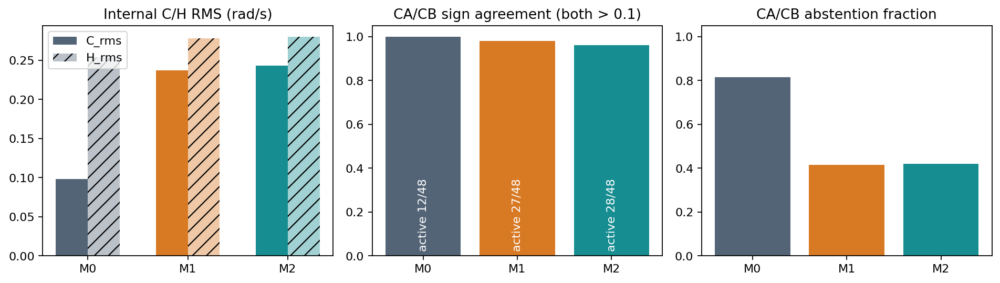

## 7. Q4：其他运动轴与事实轨迹是否退化？

53,144个留出窗口、46航次的自主1s事实评价，先计算每窗口有效步RMS，再按航次等权并汇总种子，得到下列相对M0变化。这些时间窗口存在重叠，不是53144个独立试验：

| 误差项 | M1 | M2 |
|---|---:|---:|
| 位置向量 | −1.78% | −1.70% |
| 速度向量 | −2.42% | −2.34% |
| 姿态测地角 | −10.45% | −10.54% |
| 角速度向量 | −4.05% | −4.04% |
| p / q / r各轴 | −6.23 / +0.56 / −6.35% | −6.20 / +0.63 / −6.43% |
| 垂直速度vz | +0.90% | +1.16% |

没有发现整体事实轨迹严重退化；相反，姿态和p/r拟合有改善。q和vz有小幅退化，逐航次记录完整保留。局部B的q方向85.23%→90.32/89.44%，r为89.82%→95.26/93.74%；D的q方向95.60%→94.62/94.62%，r为86.53%→89.29/89.74%。B的r响应差RMSE略升（0.157→0.162/0.162），不能只报告同向率改善。普通轨迹精度改善与局部p方向退化并存，说明它们不是同一个目标。

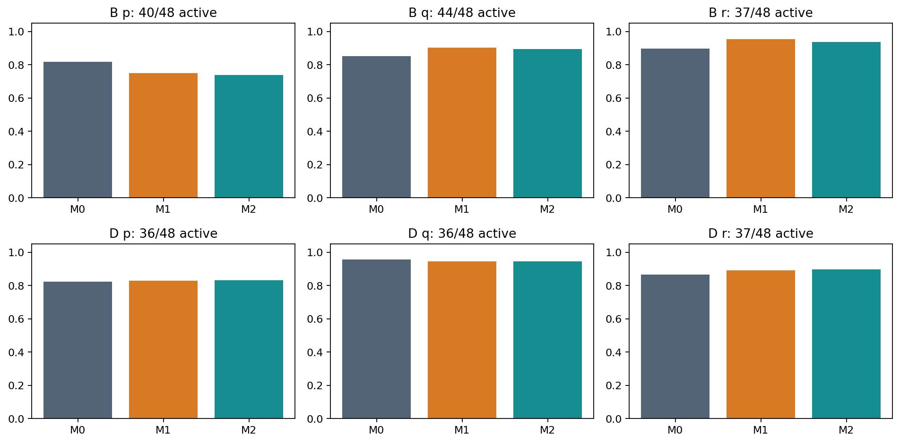
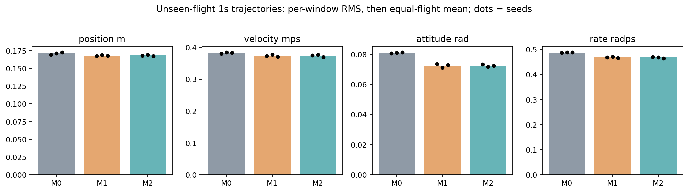

## 8. 验证、异常记录与复现

最终14项自动测试通过。训练前7项门禁通过；所有正式batch的显式控制梯度非零且有限，无NaN或协议性训练失败。27次best/last均核验哈希、24轮、更新数、学习率、窗口顺序、折内normalization及控制尺度。27个已训练模型全部通过冗余ZOH分段、批量／逐样本及未来真值／相位排除检查，最大批量差异9.54e-7。

独立实现复核11664条300ms事实轴记录、6048个事实汇总和3024个内部汇总；响应插值／平均最大误差4.24e-16，汇总最大误差1.56e-15，C/H闭合误差4.45e-16。按预先均匀索引抽取每次模型64个留出窗口，共1728个，用SciPy旋转及float64向量运算核对轨迹和六轴误差，最大差异1.58e-7。所有模型A/B/D真值及支持掩码与上游逐行相同。

一次验收断言失败已明确保留：最初将未进入本次评价的7个非主对都误写成训练跨折背景；实际是5个训练跨折对和2个非主验证背景。修正数量断言为从冻结train成员关系推导，并纠正文档后14项通过。未改变折、pair、预测、模型或统计数值；原失败日志 `tests_final_initial_failure.log` 和流水线失败状态仍保留，最终恢复记录另存。此前数量口误不是删样本或放宽筛选。

复现命令和数据路径见 [README.md](README.md)，自动生成的全部数表见 [result_tables.md](result_tables.md)。主要入口：

- `folds/fold*/normalization*.json`、27组 `training/*/seed*/{best,last}.pt`、日志、`effective_run_config.json`；
- `results/factual_*`、`internal_*`、`paired_*`、`per_group_300.csv`、`seed_consistency.csv`、`peak_metrics.csv.gz`；
- `results/heldout_trajectory.csv.gz`、逐航次轨迹、原生四组合NPZ和逐窗口索引；
- `results/training_completion.json`、`independent_verification.json`、`inference_checks.json`、环境及来源receipt；
- `archive_manifest.json` 保存本目录全部关键文件SHA256，54个best/last权重均独立归档。

## 9. Q5：下一步判断与结论边界

**不支持把M1或M2作为已改善局部控制响应的优胜结构继续堆叠复杂度。** M1以更少参数改善一般轨迹拟合、并使未来控制通路可直接诊断，值得作为研究对照保留；M2的额外相位调制没有提供稳定的局部p方向优势。优先调查控制响应符号、状态依赖和闭环可辨识性，而不是把C/H放大或validation loss下降作为成功标准。可进一步比较训练目标或有依据的弱物理先验，但本轮不实施新Loss、额外模型训练或MPC。

这些结果不能证明数据是唯一瓶颈，也不能证明结构化模型普遍无效。原匹配规则及架构已在原训练数据上探索形成；本轮严格隔离的是当前拟合、归一化和选择过程，不是完全前瞻盲测。只有11个依赖分量、D方向有效分量仅8个，且一个分量含25对，不提供缺乏依据的显著性或置信区间。

事实响应差仍混合状态差、反馈、联合控制、扰动和测量误差；B/D是冻结的离线评价定义，不是独立物理控制真值。V0状态／相位时序不确定性以及跨航次log-local相位零点限制仍保留。模型使用记录未来dt和控制，不代表在线规划接口已验证。CA/CB/C没有真实swapped轨迹，不能计算真实反事实准确率，也不能推导MPC可靠性。封存test始终未读取。本轮在完整正式比较、报告和归档后停止。
