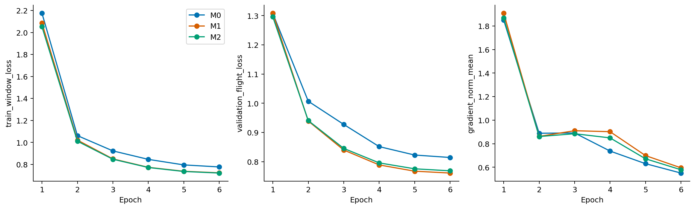
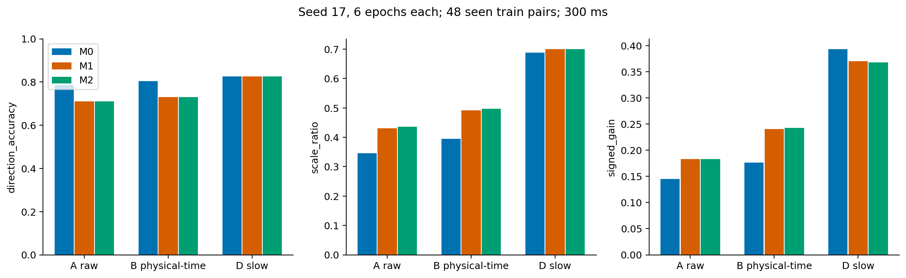
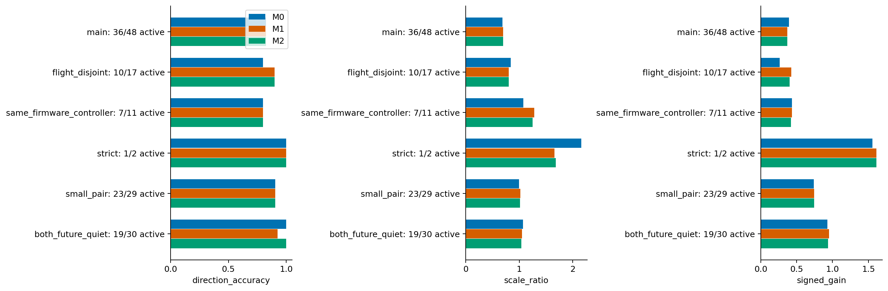
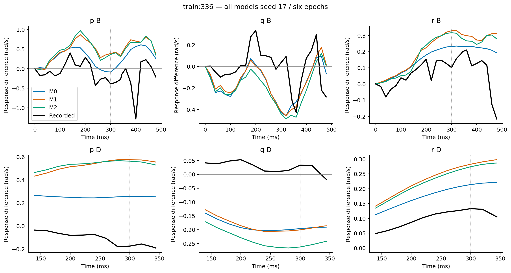
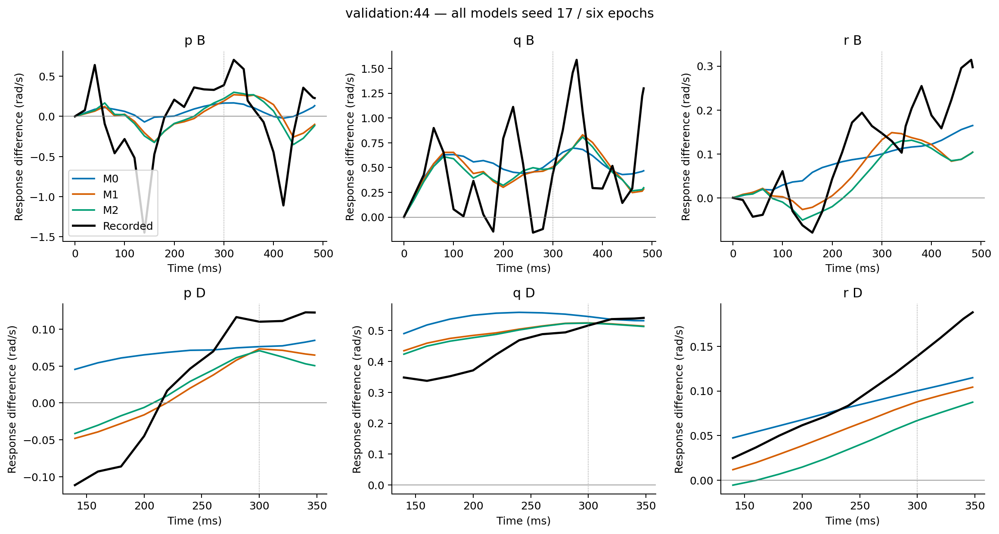
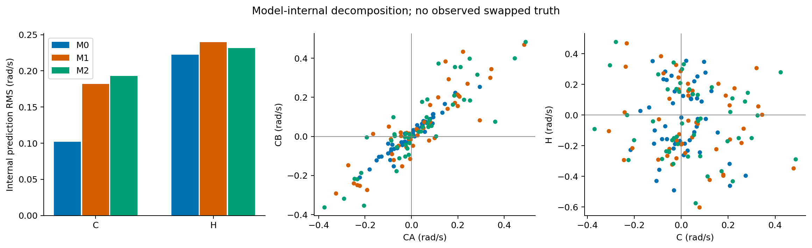
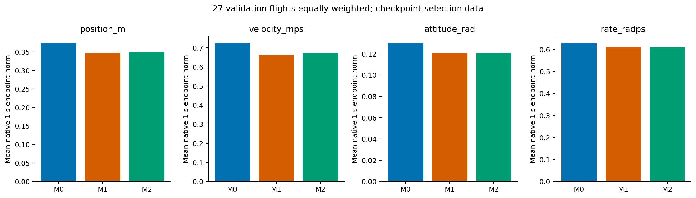
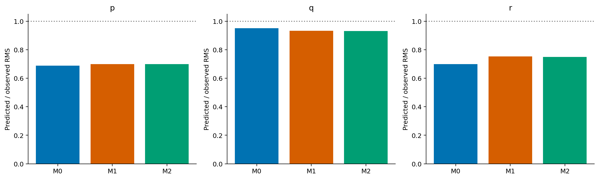

# 结构化控制效能模型：设计与单种子六轮试训练

基准 `2c99a7fcf8495cfb1d21535e928716537aa7eb73`；分支 `exp/structured-control-effectiveness-v1`。

**结论：M1/M2 可以正确训练，并改变了模型利用未来控制的方式；总体事实轨迹损失下降，但局部响应方向没有稳定改善。幅度增加与部分反向误差放大同时出现。值得进行预先固定的跨航次留出比较，尚不能选择新结构作为“控制可用”模型。M2 没有显示明确优于更简单 M1 的证据。** 本轮只完成第一阶段；未训练留出折、多种子、新 Loss 或 MPC。

## 1. 实际范围、资产与公平性

使用指定历史 `velocity_rate_multistep_v1/main_50hz`，manifest SHA256 `8afb8623bf7174e4da5b2044f644331b8b251433fed3576f6dcdab470935bcb5`。原 H1000 缓存在旧 velocity-rate-dataset worktree 找到，train/validation 缓存与旧 data_audit 中 SHA256 完全一致；107920/36332 窗口、94/27 航次的 flight/origin/start/end/history/future_count 与登记窗口逐项一致，没有重新打包。

原历史 500 ms、训练未来 1000 ms、V0 时间合同、原归一化／loss_scales、全有效步位置/速度/姿态测地角/角速度损失不变。所有目标仅参与损失或离线误差，不进入预测输入。保留原 `exact_zoh_merge_us_v1`、原生 dt 与积分器。没有读 test Parquet、测试日志、改原数据、旧模型或旧报告。

原六个 H1000 checkpoint 保留，只作为历史参照；本轮 M0 从头训练，与 M1/M2 使用完全相同预算。历史 24 epoch 的结果单独保存于 `results/historical_24epoch_reference.csv`，不能与六轮模型作最终胜负比较。复用之前全部固定 113 对、225 窗口、452 个 receiver/donor 组合，包含训练主对 48、航次互斥 17、验证主对 1 和全部背景／质量子集。

## 2. Q1：结构正确且能够训练吗？

可以。原模型输出六维下一步速度／角速度残差，不是七维加速度。新模型保持 13 维状态与原积分器。公式、归一化、mask、输入隔离和限制见 [model_design_zh.md](model_design_zh.md)。

| 模型 | 结构 | 参数量 | 相对 M0 |
|---|---|---:|---:|
| M0 | 原 GRU64 + 事件 GRU16，当前控制进入递推隐藏态 | 37590 | — |
| M1 | 无当前控制的基础递推 + 状态相关 6×8 控制矩阵 × 四路偏离时间矩 | 36534 | -2.81% |
| M2 | M1 加显式 sin/cos 一阶相位调制的控制矩阵 | 42774 | +13.79% |

参考命令固定为 receiver 历史末端命令。事件的零阶及一阶时间矩分别保留命令偏离总量和早晚变化；当命令始终等于参考时显式项严格为零。两个矩会压缩复杂波形，不能说其表达能力等同原 GRU16。M1 已通过隐藏态隐含相位，M2 增加显式调制；log-local 零点限制仍存在，矩阵不是已辨识物理气动力。

先通过 9 项实现测试，再用每模型 3 次 H1000 优化更新完成 smoke，丢弃 smoke 权重。正式训练后额外检查已训练模型的 ZOH 不变性与控制敏感性，共 **12 项测试通过**。控制分支梯度每个正式 batch 都非零且有限。无 NaN、梯度失效或中途重启。首轮裁剪前最大梯度约 19，按固定阈值 5 裁剪；之后下降，没有因此调整超参数。

## 3. 实际预算与收敛

seed=17；每模型完整 107920 窗口 × 6 epoch，batch1024，106 更新/epoch，**636 更新/模型，共 1908 更新**。另有丢弃权重的 smoke 共 9 更新。AdamW，初始 lr=.001、weight_decay=.0001、clip=5。余弦 T_max 从历史 24 统一改为 6，无提前停止；六轮 lr 为 .001/.0009330/.0007500/.0005000/.0002500/.0000670。每轮全验证、以原航次等权多步损失和最小改善 1e-4 选 best；同时保存 last。

| 模型 | epoch / 更新 | best epoch | best 验证损失 | 训练阶段秒 | 峰值分配显存 GB |
|---|---:|---:|---:|---:|---:|
| M0 | 6 / 636 | 6 | 0.814466 | 69.67 | 1.942 |
| M1 | 6 / 636 | 6 | 0.761149 | 69.95 | 1.757 |
| M2 | 6 / 636 | 6 | 0.768801 | 72.06 | 1.757 |

总 epoch 计时 211.67 秒，约 3.53 分钟，包含每轮验证，不包含实现／测试／报告。GPU cuda:1、RTX4090、Torch2.7.0+cu128；训练 matmul TF32 开启，与原脚本一致，评价关闭 TF32。GPU 同时有其他工作，计时不是独占性能基准。六轮 batch 顺序 SHA256 在三模型间完全一致；模型结构和初始化参数抽样顺序本身不同。

## 4. Q2：方向和幅度有没有积极迹象？

有部分幅度改善，但方向证据混合。下表为训练 48 主对，300 ms，seed17，航次等权。A/B/D 真值、支持、门限逐行一致：A 原标签起点，B 原生角速度物理时间插值参考，D 为 B 的固定 270 ms 中心平均并保留瞬时起点。D 只作离线诊断。

| 模型／口径 | 方向同向率 | 预测/真实 RMS 比 | 有符号增益 | RMSE rad/s |
|---|---:|---:|---:|---:|
| M0 A | 78.68% | 0.3452 | 0.1448 | 0.6092 |
| M1 A | 71.06% | 0.4304 | 0.1831 | 0.6053 |
| M2 A | 71.06% | 0.4355 | 0.1832 | 0.6069 |
| M0 B | 80.33% | 0.3943 | 0.1763 | 0.5246 |
| M1 B | 73.01% | 0.4917 | 0.2405 | 0.5107 |
| M2 B | 73.01% | 0.4975 | 0.2424 | 0.5113 |
| M0 D | 82.49% | 0.6881 | 0.3933 | 0.3472 |
| M1 D | 82.62% | 0.6992 | 0.3703 | 0.3624 |
| M2 D | 82.62% | 0.7000 | 0.3677 | 0.3639 |

A/B/D 有效方向对数为 39/40/36，总数均 48；航次等权近零比例 16.49%/13.15%/30.25%。主门限 |真实差|>.1 rad/s，.05/.2 敏感性完整保存，不因模型变化改变有效集合。

相对 M0，M1/M2 在 A/B 各有 3 对方向由错变对、4 对由对变错；D 各 1 对变好、1 对变差。D 的 0.13 个百分点变化来自航次权重，不是正确对数增加。B 的幅度绝对误差分别在 30/31 对减小；D 两者均在 30 对减小，但大反例使整体 RMSE 上升、有符号增益下降。

正向／负向真实响应的幅度偏差 `|pred|−|real|`（rad/s）：B 的 M0 -0.3400/-0.3747，M1 -0.2515/-0.3301，M2 -0.2578/-0.3154；D 的 M0 -0.1687/-0.1460，M1 -0.1414/-0.1488，M2 -0.1465/-0.1454。低估仍存在。

时间依赖也明显：B 的 200 ms 同向率 M0/M1/M2 为 59.31/66.45/66.76%，到 400 ms 则为 69.76/60.34/60.34%。不能只选有利时刻。100/200/300/400 ms 和共同支持端点均保存；精确 500 ms 沿用原交换支持缺失，不外推。D 在 100/400 ms 不具备完整滤波支持，另标记 filter_endpoint，不能混称原始端点。

### 匹配质量、航次互斥与背景

D/300 ms：主队列方向 82.49→82.62→82.62%；航次互斥 17 对中仅 10 对方向有效，方向 80→90→90%，增益 .2614→.4240→.4039，是值得留出验证的局部迹象。它仍是训练已见数据，不能称泛化。

同固件 38 对（28 有效）方向均 85.05%；同固件同配置 11 对（7 有效）均 80%，RMS 比 1.0755→1.2803→1.2475，增益 .4363→.4352→.4216，幅度变大并未改善增益。严格 2 对仅 1 对方向有效，均 100%，不具统计说服力。

small_pair 背景 29 对（23 有效）方向均 90.47%；both_future_quiet 30 对（19 有效）为 100→92.46→100%。背景不是纯噪声或控制因果误差下界。逐对、航次等权、共享航次依赖分量等权与日期／配置分组均保存。各子集重叠，不相加。

### 固定正反例与唯一验证病例

D/300 ms 的 p 响应差，rad/s：

| 病例 | 真实 | M0 | M1 | M2 |
|---|---:|---:|---:|---:|
| train:124 | -1.32277 | -0.21217 | -0.17457 | -0.18299 |
| train:336 | -0.17473 | +0.25724 | +0.57539 | +0.56275 |
| train:412 | -0.23793 | -0.19247 | -0.16035 | -0.17461 |
| validation:44 | +0.11002 | +0.07628 | +0.07327 | +0.07083 |

124 的严重低估没有解决；336 的反向预测被明显放大；412 保留部分正确响应但幅度略退化；验证病例方向相同，幅度也没有改善。唯一验证对所在数据还参与 checkpoint 选择，既不是独立测试，也不足以证明泛化。没有删除失败样本。

## 5. Q3：是否改变了未来控制使用方式？

改变了。相同 receiver 的 AA/AB 或 BA/BB 只换未来四路 ZOH；其他历史、initial、相位、频率、dt 完全相同。沿用原 C/H 对称分解与起点增量，恒等闭合误差 <4e-16。

| p / 300 ms，航次等权 | M0 | M1 | M2 |
|---|---:|---:|---:|
| CA RMS | .10459 | .17766 | .18573 |
| CB RMS | .10025 | .19466 | .20936 |
| C RMS | .10173 | .18171 | .19268 |
| H RMS | .22253 | .23950 | .23167 |
| CA/CB 双有效对数 / 48 | 10 | 19 | 17 |
| 双有效条件同向率 | 100% | 100% | 100% |
| 双近零比例 | 69.58% | 36.05% | 39.31% |
| 内部 C 与差动均值的有符号汇总增益 | +.7250 | -.1379 | -.1083 |

|C|≤.1 的对数从 34 降至 27/27。但不设幅度门限时，CA/CB 数值反号的对数从 2 增至 9/5；双有效同向不能外推到全体。H 仍较大，控制响应仍依赖历史；C/H 不是独立方差解释率。

内部经验增益使用原 |差动均值|≥.02 的保护；增益改符号说明内部映射发生变化，**不证明哪个符号是物理正确的**。四路命令联合变化，没有真实 swapped 轨迹。C 变大与部分事实方向变差同时出现，禁止据 C 增大或 C/H 比值选择模型。

## 6. Q4：事实轨迹或其他运动轴是否退化？

在全部 36332 个原验证窗口、27 航次等权的原生约 1 s 端点，整体轨迹没有严重退化：

| 模型 | 位置 m | 速度 m/s | 姿态 rad | 角速度 rad/s |
|---|---:|---:|---:|---:|
| M0 | .37423 | .72540 | .13022 | .62944 |
| M1 | .34725 | .66232 | .12044 | .61044 |
| M2 | .34891 | .67218 | .12109 | .61191 |

这里是先逐航次平均窗口误差模长，再平均航次；不是六轴单分量 RMSE。全路径 RMS 和每个窗口／航次均保存。这也是 checkpoint 选择数据，不构成独立测试。

局部耦合方向存在退化：D/300 ms 的 q 同向率 94.53→91.33→91.33%，r 为 84.23→83.58→79.96%。q 的 RMS 比 .9519→.9342→.9318；r 的 .6991→.7535→.7506。r 的幅度及 RMSE 改善与方向下降并存，M2 不能只看 p。六维速度／角速度逐点结果全部保留。

## 7. Q5：下一轮固定留出方案

建议保留三个结构进行一次预先固定的 3 折 × 3 种子 × 3 模型比较，而不是立即加响应 Loss 或搜索增幅。方案与窗口索引已保存，本轮**没有执行**。

对冻结训练主对建共享航次图，同时合并同 ULog/boot 的不同段；按依赖分量对数降序、稳定 ID 破同序，逐个分配到当前对数最少折。仅使用图和规模，不用模型效果或真实响应挑折。划分后才描述覆盖：

| 折 | 主对 | 留出航次 | 分量 | 拟合窗口 | 留出窗口 | D 有效方向 / 正 / 负 | D 真实 RMS |
|---|---:|---:|---:|---:|---:|---:|---:|
| 0 | 25 | 18 | 1 | 87239 | 20681 | 19 / 7 / 12 | .3866 |
| 1 | 12 | 11 | 4 | 95627 | 12293 | 10 / 5 / 5 | .2772 |
| 2 | 11 | 17 | 6 | 87750 | 20170 | 7 / 2 / 5 | .4320 |

每折完全排除对应航次／同源 ULog 的全部窗口。其他原训练航次可用于拟合；原 validation 27 航次只作统一 checkpoint 选择。**各折必须仅在该折拟合航次重新计算输入/输出归一化及 loss_scales**，不能沿用包含留出航次的全训练统计。模型、seed17/29/43、24 固定 epoch、优化器、调度、验证频率和选择规则一致，无提前停止；共 27 次正式训练。

每个主对只在其所属留出折评价，全部 48 对覆盖一次；背景对仅当两端航次均留出时评价，跨折背景缺失不补配。全固定训练对 112 中有 105 对可按此规则评价，7 对跨折不具双端留出支持。各折原差动 RMS 范围约 .101–.377，持续 .122–.459 s；日期／配置和 A/B/D 正负数见 holdout_coverage.csv。最大 25 对分量不能人为拆开；第二、三折 D 有效量也有限，不构造独立窗口置信区间。

按本轮硬件与 epoch 时间外推，27 次训练约 **1.77–2.12 GPU 小时**，不含重算统计、评价和资源竞争开销，非承诺时长。原匹配规则是在原训练数据上探索的，即使未来预测训练严格留出，匹配选择仍不是前瞻独立实验；需要保留这一限制。

## 8. 验证、边界与交付

- 原训练缓存、注册窗口身份、分区、原归一化和上游数组 SHA256 均已核验；没有新数据打包或 test 访问。
- 12 项测试覆盖六维残差／13维状态、原位置和四元数积分、零偏离、非零有限控制梯度、基础分支隔离、相位 mask、因果前缀、未来标签污染隔离、ZOH 拆分、批量／逐样本、训练后敏感性。
- 独立复算 4068 条 300 ms 事实预测，最大差 2.78e-16；四组合内部差最大 2.70e-15；1620 条事实汇总最大差 6.0e-15，810 条内部汇总最大差 1.12e-16。独立 SciPy 对每模型 128 个覆盖全验证序列的窗口复算姿态／欧氏误差，最大差 2.65e-7。
- 三模型评价真值和有效支持逐行完全一致。所有正式训练次数、学习率、梯度、顺序哈希、best/last 和耗时保存，无参数搜索、额外种子或失败试验被隐藏。

完整代码／复现说明见 [README.md](README.md)。本轮的积极迹象是“可训练、控制通路可测量、总体事实误差下降”；主要反证是“局部方向退化、慢变增益下降、反向病例被放大”。因此批准的是研究价值判断，不是控制可用性认证。下一阶段须另行执行，本轮到此停止。
