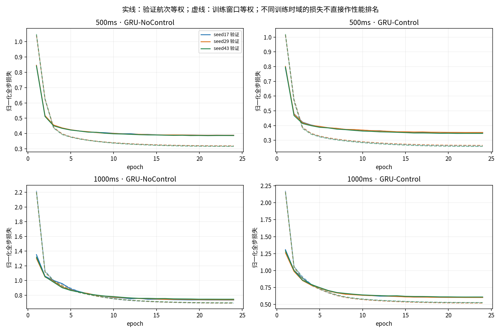
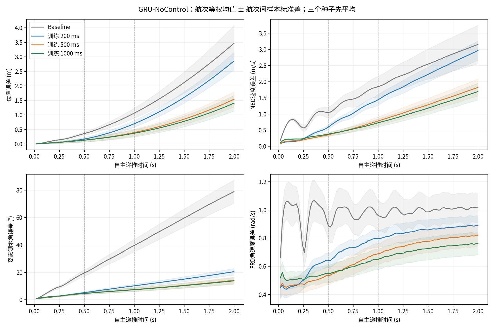
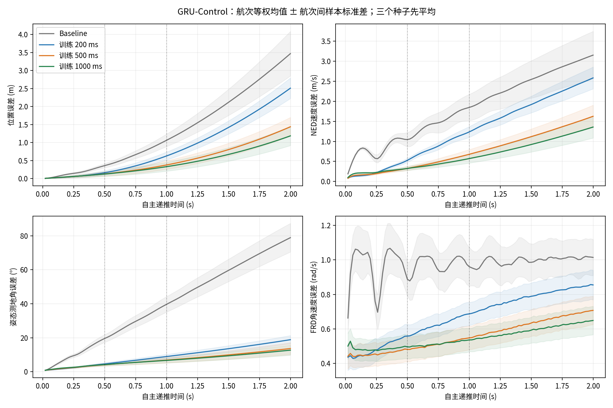
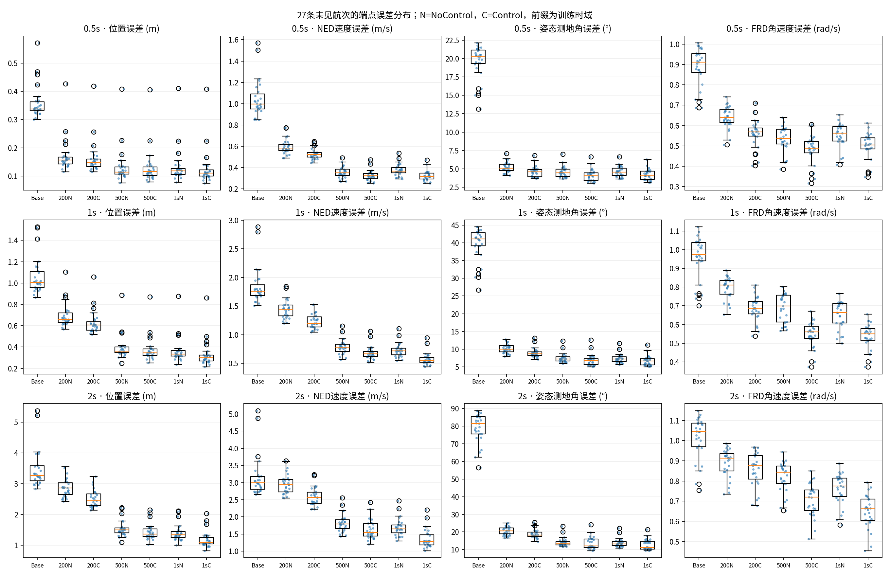
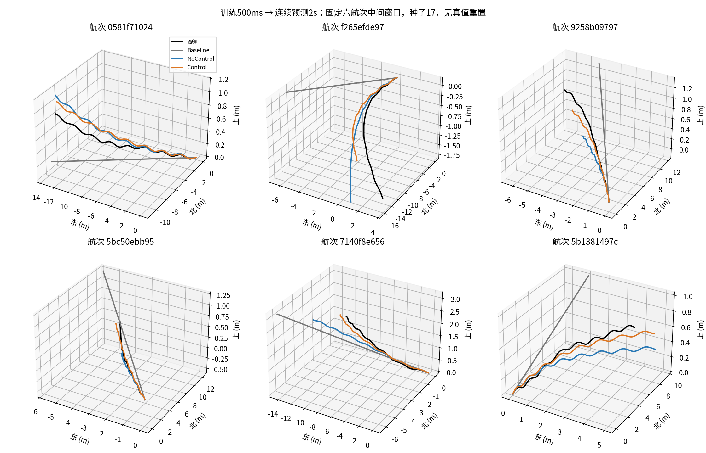
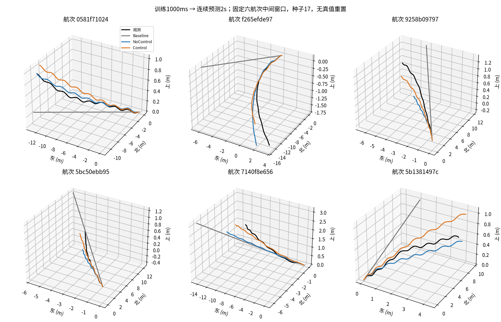
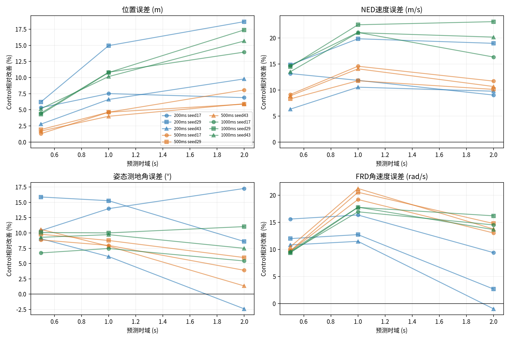

# GRU64：500ms与1s多步损失训练，验证至2s

## 分析结论

**1s多步训练更适合作为下一轮1～2s轨迹预测的主候选；500ms训练仍有短时姿态、角速度精度优势。** 两组均实际完成Control/NoControl × 三个种子的全部训练，每次24轮、2,544次更新，没有缺失种子或提前截断。两组训练进程累计耗时分别791.6s、1,377.7s，分两张GPU并行；相同更新预算下，1s的实际训练耗时约为500ms的1.74倍。峰值已分配显存分别1.16GiB、1.81GiB，不包含其他用户进程。所有结论限于封存测试集之外的验证飞行。

1. **新模型明显优于恒定速度/角速度基线。** 1s训练Control在2s处的航次等权位置、速度、姿态、角速度误差为1.185m、1.357m/s、12.711°、0.649rad/s；相对基线分别降低65.8%、56.9%、83.9%、36.0%。两个新训练时域的NoControl也优于基线，说明改善并非完全依赖已知未来命令。

2. **延长训练确实改善较长预测，但有时域取舍。** 直接比较共享训练起点、损失尺度和优化协议的两个新Control模型：1s训练相对500ms训练，在1s评价处的位置/速度误差降低12.5%/15.7%，在2s处降低17.5%/16.5%；这两项在27/27条飞行都改善。2s姿态与角速度误差进一步降低6.9%/8.3%，分别有26/27和27/27条飞行改善，航次配对区间未跨零。500ms处，1s训练的姿态误差从4.133°略增至4.217°，角速度从0.481升至0.496rad/s，约差2.0%和3.1%；速度差异很小，配对区间跨零。因此不能说更长训练在每个时域、每个指标都占优。旧200ms训练Control的2s位置误差为2.509m，新1s模型为1.185m；但历史训练窗口数和损失尺度也不同，这不是严格的单变量时域效应估计。

3. **加入控制的总体预测增益在三个种子中稳定，但不是所有航次/工况都更好。** 对两个新训练时域，各自三个种子、三个验证时域、四项航次等权平均误差中，Control均低于同种子NoControl。1s训练在2s处加入控制的位置、速度、姿态、角速度平均改善分别为15.7%、19.9%、8.0%、14.8%，对应更好航次27/27、25/27、19/27、26/27。四项航次配对95%区间均为负。500ms训练在2s处的姿态改善只有3.8%，配对区间[-1.420°, 0.340°]跨零。1s训练在低控制变化组的2s姿态反而是Control 10.703°、NoControl 10.331°；REVIEW组姿态也没有改善。这里控制输入同时包括历史命令和闭环日志中的未来命令，结论是条件预测信息有用，不能据此证明反事实控制响应。

4. **较短评价时域更稳定，2s仍有明显累积误差和长尾。** 1s训练Control的位置误差从500ms的0.126m增至1s的0.330m、2s的1.185m，姿态从4.217°增至6.678°、12.711°。2s的三个种子平均后逐窗口误差P95为位置2.528m、速度2.983m/s、姿态28.298°、角速度1.326rad/s，不能只看总体均值。高动态组的2s位置误差约1.398m，普通组1.111m；高控制变化组1.377m，低变化组1.035m。REVIEW仅覆盖6条飞行、1,091个窗口，其位置误差约2.972m，不能用这些窗口数当独立飞行样本量。最差位置航次为2026-09-07的log_30（b9b276…），航次均值2.026m；2026-09-26的log_2（7140f8…）与log_3（7ac747…）的姿态均值分别21.349°与17.957°。因此表现依赖具体飞行与工况。

5. **误差来源要区分常规长时域与观测不一致片段。** 同一起点真实未来v/ω积分的总体位置/姿态残差，在500ms约0.094m/1.196°，1s约0.180m/1.525°，2s约0.341m/2.049°。1s训练Control在2s与该观测积分轨迹仍相差1.072m、12.901°，远大于总体观测积分残差的量级，说明改善速度/角速度预测及其长期递推仍有空间。但REVIEW组的2s观测积分位置残差已达2.270m，普通组为0.273m，必须单独审查这类观测链条不一致。误差模长不能相加或相减作贡献比例；这些诊断既不能唯一定位根因，也不是模型误差的严格下界。0.5s的位置误差与观测积分残差已在相近量级，也不能由此宣称达到可实现精度极限。

后续值得保留1s训练Control和匹配NoControl，开展小规模联合/解耦消融与控制响应验证；500ms模型保留为短时对照。应先继续定位REVIEW/高动态长尾，并审查频率保持、相位线性外推在长时域的局限。2s目前仍是训练时域之外的自主外推，未来控制又是已记录的闭环反馈命令，当前证据不足以进入MPC或宣称控制可用。本轮没有开展这些后续实验，测试集没有解封。

## 实际完成的实验

分别训练500ms、1s两组模型；每组包含GRU-NoControl与GRU-Control，固定种子17、29、43，共12次正式GPU训练。每次从相同随机初始化规则开始，并非从200ms checkpoint微调。测试集持续封存；没有MPC、PX4修改或控制可用性认证。

训练从过去500ms历史编码出隐藏状态，之后连续自主递推。500ms组在约25步、1s组在约50步的**全部有效未来步**计算损失；原生dt和偶发26/51步保留。没有teacher forcing、分段真值重置或未来相位/频率输入。2s仅用于验证分析，不用于checkpoint选择。

## 数据、输入与公平性

数据按configs/data/velocity_rate_dataset_registry.yaml解析velocity_rate_multistep_v1/main_50hz，manifest及授权train/validation样本、窗口、执行器事件哈希已验证。见data_audit.json和run_manifest.json。

- 两个新训练时域共享107,920个窗口、94条训练飞行。验证选择共享36,332个窗口、27条飞行。它们是1s注册起点与500ms注册起点的交集，保留100ms起点步长。
- 共享缓存和train/validation_windows.parquet保留1s注册窗口元数据；count_500ms和count_1000ms记录两个实际裁剪端点。500ms训练在送入GPU前按count_500ms裁剪目标、dt与事件序列并设置mask，不读取后半段控制作为输入。
- 最终各模型使用冻结长时域评估中的35,946个共同起点、27条验证飞行，统一评估500ms/1s/2s。旧200ms模型和基线沿用已校验的同起点结果。
- 两模型都使用历史速度、角速度、姿态、有效扑翼观测、mask及实际dt；姿态采用旋转矩阵特征，无四元数符号二义性。位置仅作为积分初值。
- Control额外使用历史四路命令和未来原生控制事件序列，保留区间内命令变化。NoControl不读历史或未来控制。
- 未来频率保持起点有效值，相位按它因果外推；无效观测掩码保留。未来真实运动状态只用于训练目标或验证误差。
- 新500ms和1s组的输入/输出归一化均沿用原训练集统计；共用重新从1s训练窗口计算的损失尺度。旧200ms训练使用110,863窗口及原损失尺度，因此旧模型只是历史参照，不是严格单变量时域消融。

## 损失与训练预算

每步L = (||Δp||/s_p)^2 + (||Δv||/s_v)^2 + (SO(3)测地角/s_R)^2 + (||Δω||/s_ω)^2。先对窗口内有效步等权平均，再对batch窗口平均；位置为相对起点位移。四项权重均1。

共同尺度依次为[0.628177, 1.430341, 0.430563, 1.057853]，单位为m、m/s、rad、rad/s；由共同1s训练集的恒定运动学基线残差RMS设定，未用验证集。精确值见normalization.json。

| 训练时域ms | L_p | L_v | L_R | L_omega |
|---|---|---|---|---|
| 500 | 0.131313 | 0.413272 | 0.250597 | 0.974229 |
| 1000 | 1.0 | 1.0 | 1.0 | 1.0 |

上表是两时域训练基线的各项平均无量纲平方损失，便于审查实际相对权重。500ms与1s使用同一尺度，但不同跨度的分量大小仍会不同；早期步并未因损失尺度而获得单独加权。

GRU64/事件编码GRU16，两种模型均分配37,590参数。训练日志按“梯度非None的参数张量”计数，NoControl为36,486、Control为37,590；此计数仍包括NoControl中连接恒零控制输入的权重。NoControl排除不执行的事件GRU（1,104参数）、历史控制输入列（768）和递推事件输入列（3,072）后，功能上参与预测的参数为32,646。两者GRU主体和宽度相同，但有效容量并非严格相等。相同seed、相同起点随机顺序、AdamW(lr=0.001, weight_decay=0.0001)、batch1024、梯度裁剪5、24epoch上限、patience5、最小改善1e-4及余弦学习率。按各自训练时域的验证航次等权多步损失选最佳checkpoint。

每个epoch的新数据窗口数相同；1s组每次更新的递推与反传长度约为500ms组两倍，所以更新次数预算一致不等于计算量一致。Control与NoControl的事件编码开销亦不同。完整预算如下。

| training_horizon_ms | model | seed | epochs | updates | best_epoch | seconds | peak_allocated_bytes | stop_reason |
|---|---|---|---|---|---|---|---|---|
| 200 | GRU-NoControl | 17 | 24 | 2616 | 22 | 59.04 | 960047104 | fixed_epoch_budget |
| 200 | GRU-NoControl | 29 | 24 | 2616 | 23 | 60.09 | 960047104 | fixed_epoch_budget |
| 200 | GRU-NoControl | 43 | 24 | 2616 | 24 | 58.68 | 960047104 | fixed_epoch_budget |
| 200 | GRU-Control | 17 | 24 | 2616 | 22 | 62.37 | 959925760 | fixed_epoch_budget |
| 200 | GRU-Control | 29 | 24 | 2616 | 23 | 63.45 | 959925760 | fixed_epoch_budget |
| 200 | GRU-Control | 43 | 24 | 2616 | 24 | 62.44 | 959925760 | fixed_epoch_budget |
| 500 | GRU-NoControl | 17 | 24 | 2544 | 21 | 156.34 | 1247118848 | fixed_epoch_budget |
| 500 | GRU-NoControl | 29 | 24 | 2544 | 21 | 121.89 | 1247118848 | fixed_epoch_budget |
| 500 | GRU-NoControl | 43 | 24 | 2544 | 21 | 124.63 | 1247118848 | fixed_epoch_budget |
| 500 | GRU-Control | 17 | 24 | 2544 | 23 | 129.43 | 1247166464 | fixed_epoch_budget |
| 500 | GRU-Control | 29 | 24 | 2544 | 22 | 129.4 | 1247166464 | fixed_epoch_budget |
| 500 | GRU-Control | 43 | 24 | 2544 | 21 | 129.94 | 1247166464 | fixed_epoch_budget |
| 1000 | GRU-NoControl | 17 | 24 | 2544 | 23 | 248.73 | 1756895744 | fixed_epoch_budget |
| 1000 | GRU-NoControl | 29 | 24 | 2544 | 23 | 223.87 | 1756895744 | fixed_epoch_budget |
| 1000 | GRU-NoControl | 43 | 24 | 2544 | 23 | 215.46 | 1756895744 | fixed_epoch_budget |
| 1000 | GRU-Control | 17 | 24 | 2544 | 23 | 232.39 | 1941391360 | fixed_epoch_budget |
| 1000 | GRU-Control | 29 | 24 | 2544 | 22 | 230.67 | 1941391360 | fixed_epoch_budget |
| 1000 | GRU-Control | 43 | 24 | 2544 | 22 | 226.58 | 1941391360 | fixed_epoch_budget |

## 端点误差

**均值 ± 航次间样本标准差**：先在每条飞行内平均窗口，再平均种子，最后27条飞行等权。不是逐轴RMSE。重叠窗口不作为独立飞行；窗口等权均值、标准差、P95/P99及种子间标准差见summary.csv。

| 验证时域s | 条件 | 位置误差 (m) | NED速度误差 (m/s) | 姿态测地角误差 (°) | FRD角速度误差 (rad/s) |
|---|---|---|---|---|---|
| 0.5 | Kinematic Baseline | 0.3591 ± 0.0587 | 1.0450 ± 0.1762 | 19.5812 ± 2.2592 | 0.8875 ± 0.0968 |
| 0.5 | H200-GRU-NoControl | 0.1703 ± 0.0594 | 0.5960 ± 0.0715 | 5.2175 ± 0.7002 | 0.6409 ± 0.0542 |
| 0.5 | H200-GRU-Control | 0.1622 ± 0.0591 | 0.5280 ± 0.0509 | 4.5957 ± 0.7384 | 0.5586 ± 0.0678 |
| 0.5 | H500-GRU-NoControl | 0.1321 ± 0.0623 | 0.3569 ± 0.0534 | 4.5787 ± 0.7501 | 0.5346 ± 0.0633 |
| 0.5 | H500-GRU-Control | 0.1299 ± 0.0625 | 0.3257 ± 0.0507 | 4.1328 ± 0.8300 | 0.4813 ± 0.0711 |
| 0.5 | H1000-GRU-NoControl | 0.1318 ± 0.0626 | 0.3777 ± 0.0572 | 4.6199 ± 0.7190 | 0.5483 ± 0.0629 |
| 0.5 | H1000-GRU-Control | 0.1257 ± 0.0635 | 0.3240 ± 0.0485 | 4.2175 ± 0.7494 | 0.4962 ± 0.0680 |
| 1.0 | Kinematic Baseline | 1.0621 ± 0.1732 | 1.8472 ± 0.3266 | 39.6890 ± 4.5751 | 0.9602 ± 0.1124 |
| 1.0 | H200-GRU-NoControl | 0.6957 ± 0.1142 | 1.4422 ± 0.1646 | 10.1743 ± 1.2551 | 0.7950 ± 0.0592 |
| 1.0 | H200-GRU-Control | 0.6272 ± 0.1103 | 1.2361 ± 0.1339 | 8.9551 ± 1.2891 | 0.6871 ± 0.0667 |
| 1.0 | H500-GRU-NoControl | 0.3946 ± 0.1191 | 0.7841 ± 0.1303 | 7.4779 ± 1.3500 | 0.6884 ± 0.0749 |
| 1.0 | H500-GRU-Control | 0.3772 ± 0.1182 | 0.6785 ± 0.1180 | 6.8653 ± 1.6689 | 0.5483 ± 0.0679 |
| 1.0 | H1000-GRU-NoControl | 0.3690 ± 0.1227 | 0.7286 ± 0.1231 | 7.3433 ± 1.2771 | 0.6501 ± 0.0727 |
| 1.0 | H1000-GRU-Control | 0.3300 ± 0.1239 | 0.5717 ± 0.1116 | 6.6775 ± 1.4347 | 0.5363 ± 0.0675 |
| 2.0 | Kinematic Baseline | 3.4674 ± 0.6186 | 3.1513 ± 0.5932 | 78.9200 ± 8.4287 | 1.0142 ± 0.1049 |
| 2.0 | H200-GRU-NoControl | 2.8576 ± 0.3009 | 2.9647 ± 0.2984 | 20.5196 ± 2.4134 | 0.8890 ± 0.0699 |
| 2.0 | H200-GRU-Control | 2.5085 ± 0.2860 | 2.5832 ± 0.2725 | 18.8633 ± 2.4654 | 0.8548 ± 0.0858 |
| 2.0 | H500-GRU-NoControl | 1.5388 ± 0.2646 | 1.8226 ± 0.2637 | 14.1912 ± 2.5045 | 0.8212 ± 0.0752 |
| 2.0 | H500-GRU-Control | 1.4370 ± 0.2610 | 1.6253 ± 0.2787 | 13.6562 ± 3.4973 | 0.7072 ± 0.0823 |
| 2.0 | H1000-GRU-NoControl | 1.4052 ± 0.2688 | 1.6947 ± 0.2599 | 13.8152 ± 2.4595 | 0.7616 ± 0.0769 |
| 2.0 | H1000-GRU-Control | 1.1849 ± 0.2686 | 1.3574 ± 0.2730 | 12.7108 ± 2.9983 | 0.6488 ± 0.0824 |

## 配对比较

先在每条飞行内平均三个种子，再按飞行进行配对bootstrap（5000次）的95%区间；同日期飞行仍可能相关。负差值表示候选模型误差更小。没有按窗口数量夸大独立样本量。

| horizon_ms | reference | candidate | metric | improvement_pct | better_flights | 区间 |
|---|---|---|---|---|---|---|
| 500 | H500-GRU-NoControl | H500-GRU-Control | position_m | 1.637 | 19 | [-0.0038, -0.0004] |
| 500 | H500-GRU-NoControl | H500-GRU-Control | velocity_m_s | 8.758 | 27 | [-0.0367, -0.0258] |
| 500 | H500-GRU-NoControl | H500-GRU-Control | attitude_deg | 9.739 | 26 | [-0.5302, -0.3567] |
| 500 | H500-GRU-NoControl | H500-GRU-Control | rate_rad_s | 9.961 | 27 | [-0.0636, -0.0437] |
| 500 | H1000-GRU-NoControl | H1000-GRU-Control | position_m | 4.644 | 23 | [-0.0081, -0.0043] |
| 500 | H1000-GRU-NoControl | H1000-GRU-Control | velocity_m_s | 14.212 | 27 | [-0.0603, -0.0471] |
| 500 | H1000-GRU-NoControl | H1000-GRU-Control | attitude_deg | 8.71 | 26 | [-0.4833, -0.3194] |
| 500 | H1000-GRU-NoControl | H1000-GRU-Control | rate_rad_s | 9.508 | 27 | [-0.0621, -0.0442] |
| 500 | H500-GRU-Control | H1000-GRU-Control | position_m | 3.22 | 22 | [-0.0060, -0.0025] |
| 500 | H500-GRU-Control | H1000-GRU-Control | velocity_m_s | 0.5 | 15 | [-0.0047, 0.0012] |
| 500 | H500-GRU-Control | H1000-GRU-Control | attitude_deg | -2.049 | 7 | [0.0163, 0.1450] |
| 500 | H500-GRU-Control | H1000-GRU-Control | rate_rad_s | -3.087 | 2 | [0.0108, 0.0190] |
| 1000 | H500-GRU-NoControl | H500-GRU-Control | position_m | 4.408 | 21 | [-0.0240, -0.0105] |
| 1000 | H500-GRU-NoControl | H500-GRU-Control | velocity_m_s | 13.467 | 27 | [-0.1232, -0.0872] |
| 1000 | H500-GRU-NoControl | H500-GRU-Control | attitude_deg | 8.192 | 23 | [-0.8625, -0.3631] |
| 1000 | H500-GRU-NoControl | H500-GRU-Control | rate_rad_s | 20.355 | 27 | [-0.1576, -0.1226] |
| 1000 | H1000-GRU-NoControl | H1000-GRU-Control | position_m | 10.583 | 27 | [-0.0474, -0.0310] |
| 1000 | H1000-GRU-NoControl | H1000-GRU-Control | velocity_m_s | 21.546 | 27 | [-0.1760, -0.1374] |
| 1000 | H1000-GRU-NoControl | H1000-GRU-Control | attitude_deg | 9.067 | 24 | [-0.8912, -0.4370] |
| 1000 | H1000-GRU-NoControl | H1000-GRU-Control | rate_rad_s | 17.512 | 27 | [-0.1269, -0.0998] |
| 1000 | H500-GRU-Control | H1000-GRU-Control | position_m | 12.527 | 27 | [-0.0527, -0.0415] |
| 1000 | H500-GRU-Control | H1000-GRU-Control | velocity_m_s | 15.749 | 27 | [-0.1166, -0.0977] |
| 1000 | H500-GRU-Control | H1000-GRU-Control | attitude_deg | 2.735 | 21 | [-0.3100, -0.0931] |
| 1000 | H500-GRU-Control | H1000-GRU-Control | rate_rad_s | 2.191 | 26 | [-0.0159, -0.0086] |
| 2000 | H500-GRU-NoControl | H500-GRU-Control | position_m | 6.617 | 23 | [-0.1349, -0.0698] |
| 2000 | H500-GRU-NoControl | H500-GRU-Control | velocity_m_s | 10.825 | 24 | [-0.2558, -0.1361] |
| 2000 | H500-GRU-NoControl | H500-GRU-Control | attitude_deg | 3.77 | 18 | [-1.4196, 0.3403] |
| 2000 | H500-GRU-NoControl | H500-GRU-Control | rate_rad_s | 13.874 | 27 | [-0.1281, -0.0983] |
| 2000 | H1000-GRU-NoControl | H1000-GRU-Control | position_m | 15.674 | 27 | [-0.2569, -0.1822] |
| 2000 | H1000-GRU-NoControl | H1000-GRU-Control | velocity_m_s | 19.904 | 25 | [-0.3928, -0.2804] |
| 2000 | H1000-GRU-NoControl | H1000-GRU-Control | attitude_deg | 7.994 | 19 | [-1.8192, -0.3796] |
| 2000 | H1000-GRU-NoControl | H1000-GRU-Control | rate_rad_s | 14.808 | 26 | [-0.1301, -0.0943] |
| 2000 | H500-GRU-Control | H1000-GRU-Control | position_m | 17.542 | 27 | [-0.2733, -0.2316] |
| 2000 | H500-GRU-Control | H1000-GRU-Control | velocity_m_s | 16.487 | 27 | [-0.2926, -0.2453] |
| 2000 | H500-GRU-Control | H1000-GRU-Control | attitude_deg | 6.923 | 26 | [-1.1947, -0.7168] |
| 2000 | H500-GRU-Control | H1000-GRU-Control | rate_rad_s | 8.255 | 27 | [-0.0639, -0.0529] |

## 航次、工况和误差来源

group_metrics.csv给出REVIEW、高动态、模式变化和控制变化幅度分组的航次等权结果。控制变化幅度使用历史+2s命令范围向量的L2范数，按共同验证窗口三分位进行描述性分组；阈值见group_definition.json，从不进入训练或checkpoint选择。高动态/REVIEW沿用冻结2s窗口元数据。

观测积分参照沿用同一批起点：将真实未来v/ω送入相同梯形位置及SO(3)积分，再与EKF观测比较。它只用于事后诊断，不送入模型；不是严格预测误差下界，也不能用两个误差模长的差直接做贡献分解。模型相对该积分轨迹的差见dynamics_integral_500ms.csv及dynamics_integral_1000ms.csv。

以下为1s训练Control在2s处的分组结果：均值 ± 组内航次间样本标准差。不同组的飞行构成和窗口不同，不是受控工况因果实验。

| 分组 | 组 | 航次 | 窗口 | 位置m | 姿态° | 观测积分位置残差m |
|---|---|---|---|---|---|---|
| control_change_group | high | 27 | 11982 | 1.377 ± 0.338 | 14.648 ± 3.291 | 0.396 ± 0.334 |
| control_change_group | low | 27 | 11983 | 1.035 ± 0.292 | 10.703 ± 2.772 | 0.317 ± 0.224 |
| control_change_group | medium | 27 | 11981 | 1.141 ± 0.294 | 12.475 ± 3.164 | 0.338 ± 0.261 |
| high_dynamics | False | 27 | 24097 | 1.111 ± 0.297 | 12.346 ± 3.039 | 0.310 ± 0.223 |
| high_dynamics | True | 27 | 11849 | 1.398 ± 0.382 | 13.686 ± 3.719 | 0.403 ± 0.281 |
| review | False | 27 | 34855 | 1.116 ± 0.215 | 12.653 ± 3.032 | 0.273 ± 0.093 |
| review | True | 6 | 1091 | 2.972 ± 1.025 | 13.431 ± 5.096 | 2.270 ± 0.934 |

| 时域ms | 观测积分位置残差m | 观测积分姿态残差° |
|---|---|---|
| 500 | 0.0936 ± 0.0645 | 1.1955 ± 0.1929 |
| 1000 | 0.1797 ± 0.1270 | 1.5250 ± 0.2694 |
| 2000 | 0.3414 ± 0.2432 | 2.0490 ± 0.3921 |

未来控制是闭环日志中的已记录命令，可能包含控制器对未来观测的反馈信息。Control对NoControl检验的是历史与未来命令的总体条件预测信息，不能单独证明控制反事实响应、独立干预有效性或闭环稳定性。

## 图表

轨迹例子固定为与旧评估相同的六条航次中间窗口、种子17，不按预测好坏挑选。逐步曲线覆盖约20ms至2s，按原生步的实际平均时间绘制；支持量保存在native_steps_per_flight.csv，末步少量99步窗口不会补真值。

## 复现与归档

使用/home/zn/anaconda3/envs/flap-train-gpu/bin/python。顺序为：train_velocity_rate_horizons.py prepare → normalize → train --horizon {500,1000}（自动先smoke，也可单独运行smoke阶段）；evaluate_velocity_rate_horizon_training.py evaluate --horizon {500,1000} → summarize → verify；运行本报告脚本，提交实现代码后执行evaluate_velocity_rate_horizon_training.py archive，再提交实验归档。所有实验根目录只创建一次，历史结果不覆盖。

训练配置、源码SHA256、数据哈希、checkpoint SHA256、日志与峰值显存分别记录在run_manifest.json、data_audit.json、各训练目录training_provenance.json、summary.json及training.jsonl。逐窗口端点在metrics/；逐航次、种子、配对和工况统计均以CSV保存。大体积原生步逐窗口误差及训练缓存保留在忽略目录artifacts/velocity_rate_gru64_horizon_training_v1，归档清单记录哈希。

测试包括长递推因果前缀、NoControl隔离、可变步数裁剪、全步损失与padding、1s梯度传播；GPU smoke验证有限梯度/四元数/输入隔离。新checkpoint在128个分布于全验证集的窗口上用SciPy独立复算全部原生步指标；逐窗口聚合另行复算，并核验历史实验归档不变。详见verification.json、evaluation_*.json和testing.json。
