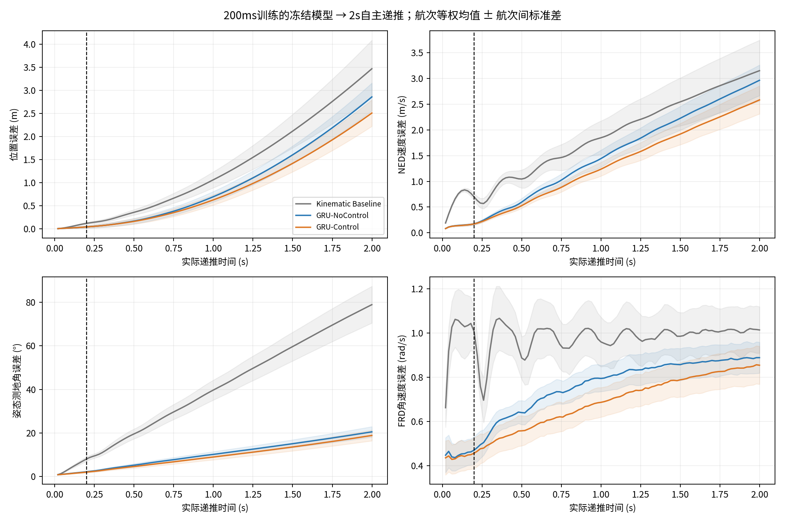
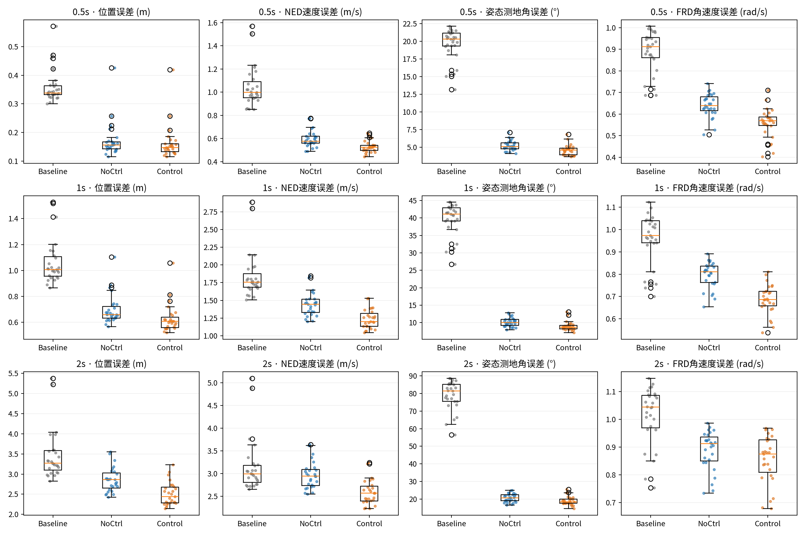
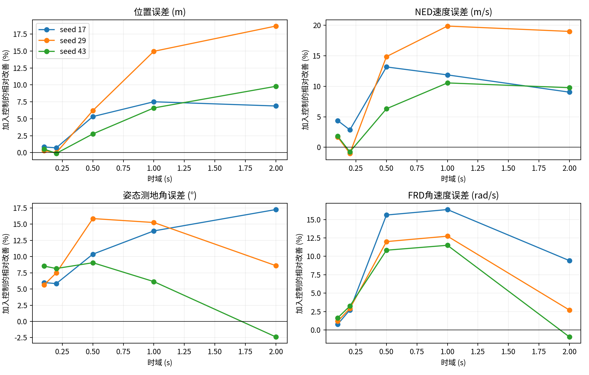
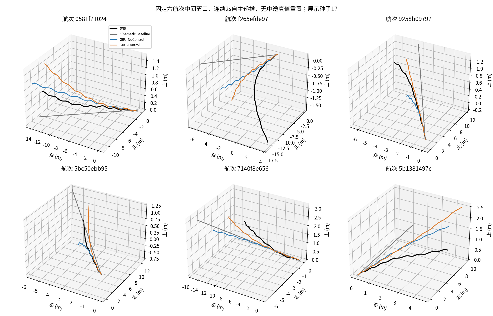

# GRU64冻结模型：500ms、1s、2s验证

**本轮没有重新训练。** 使用第一轮200ms训练并选好的6个checkpoint，保持500ms历史，连续递推至2s。测试集封存。

## 结果判断

- **可以连续预测到2s，且全体窗口输出有限，但准确度随时域明显下降。** Control的500ms/1s/2s位置误差分别为0.1622/0.6272/2.5085m，速度误差0.5280/1.2361/2.5832m/s，姿态4.5957°/8.9551°/18.8633°，角速度0.5586/0.6871/0.8548rad/s。这里“有限”只说明本次数值递推完成，不证明系统稳定性或控制可用性。

- **Control在这三个时域的四项航次等权均值仍优于恒定运动学基线。** 三种子平均后，27个验证航次的四项指标都改善；但平动收益随时域收窄：位置相对基线改善54.8%→41.0%→27.7%，速度49.5%→33.1%→18.0%。姿态优势仍明显，不能由此忽略其2s绝对误差已接近19°。

- **控制输入的总体预测信息在500ms/1s更清楚。** 相对NoControl，500ms四项改善4.76%、11.41%、11.92%、12.84%；1s改善9.86%、14.29%、11.98%、13.57%，三个种子的方向均一致。2s三种子平均仍改善12.22%、12.87%、8.07%、3.84%，但姿态只有17/27航次改善，种子43的姿态和角速度分别退化2.39%和0.95%。2s的REVIEW组姿态也退化约10.69%，说明收益不是无条件稳定的。闭环未来命令是条件回放信息，不能等同于独立干预证据。

- **长时域误差已主要超出观测积分残差的量级。** 真实未来v/ω积分的500ms/1s/2s位置残差为0.0936/0.1797/0.3414m、姿态残差1.1955°/1.5250°/2.0490°；Control预测与该积分轨迹的距离则为0.1019/0.5177/2.3285m和4.6625°/9.0297°/18.9505°。2s误差不能主要用EKF观测不一致来解释，自主速度/角速度预测的累积偏差更加突出。这些模长不构成独立方差分解，也不能证明唯一根因。

- **保持起点频率的相位外推成为明显局限。** 500ms/1s/2s相位圆周MAE约29.9°/62.1°/88.9°。这是事后用未来观测计算的诊断，没有将未来真实相位/频率反馈给模型；尚未通过消融证明它造成了多少预测误差。

- **下一步应区分“延长推理”与“长时域训练”。** 本轮模型只用200ms多步损失训练，不能据此判定500ms/1s训练的上限。当前500ms结果支持下一轮先做相同预算的500ms训练对照，再考虑1s及因果相位/频率预测改进。暂不建议将当前2s结果视为可用的长时域动力学仿真器；本轮不进行这些额外训练，不解封测试集。

## 验证时到底给了什么

| 输入 | GRU-NoControl | GRU-Control |
|---|---|---|
| 过去500ms NED速度、FRD角速度、姿态 | 有 | 有 |
| 有效历史相位/频率、mask、历史与未来实际dt | 有 | 有 |
| 初始位置 | 仅积分初值，网络不使用绝对位置 | 同左 |
| 历史四路执行器命令 | 无 | 有 |
| 已记录未来控制事件及持续时间 | 无 | 有 |
| 未来真实速度、角速度、姿态或位置 | 仅评价目标，不进模型 | 同左 |
| 未来真实相位/频率 | 无；保持起点频率、线性推进相位 | 同左 |

Control并非只用“当前运动状态＋未来控制”；还用历史控制与历史扑翼观测。两模型都只在起点初始化一次，之后状态和隐藏状态完全自主递推。未来实际dt是共同的离线时间条件。未来命令来自闭环日志，可能包含控制器对未来观测的反馈信息；更长时域下这种条件回放的预测优势仍不是反事实控制能力。

## 数据与共同起点

数据为注册的velocity_rate_multistep_v1/main_50hz。所有时域和模型使用共同的 **35,946窗口、27航次**；先求100/200/500/1000/2000ms注册窗口起点的交集，再从2s序列中取各注册端点。没有按模型误差筛选窗口。

| horizon_ms | windows | flights |
|---|---|---|
| 100 | 37011 | 27 |
| 200 | 36970 | 27 |
| 500 | 36852 | 27 |
| 1000 | 36332 | 27 |
| 2000 | 36268 | 27 |

因此本报告100/200ms数值是共同长窗口起点的重算，不应与第一轮36,970窗口数值直接混同。原生dt、99/100步有效mask和全部控制事件保留；端点距名义时域不超过12ms。原生逐步曲线按实际时间绘制，每步支持量保存在native_steps_per_flight.csv。

## 端点结果

数值为向量模长/姿态测地角的 **均值 ± 航次间样本标准差**：先在航次内平均窗口、再平均三个种子、最后27航次等权。不是逐轴RMSE；重叠窗口不是独立飞行。窗口等权、P95/P99、种子间标准差另见summary.csv。

| 时域s | 模型 | 位置误差 (m) | NED速度误差 (m/s) | 姿态测地角误差 (°) | FRD角速度误差 (rad/s) |
|---|---|---|---|---|---|
| 0.1 | Kinematic Baseline | 0.0481 ± 0.0109 | 0.7572 ± 0.0272 | 3.9351 ± 0.4901 | 1.0572 ± 0.1410 |
| 0.1 | GRU-NoControl | 0.0205 ± 0.0132 | 0.1423 ± 0.0150 | 1.4449 ± 0.1392 | 0.4472 ± 0.0621 |
| 0.1 | GRU-Control | 0.0204 ± 0.0132 | 0.1385 ± 0.0153 | 1.3477 ± 0.1690 | 0.4418 ± 0.0696 |
| 0.2 | Kinematic Baseline | 0.1193 ± 0.0207 | 0.6978 ± 0.0685 | 8.0515 ± 0.9831 | 1.0068 ± 0.1016 |
| 0.2 | GRU-NoControl | 0.0425 ± 0.0258 | 0.1725 ± 0.0203 | 2.1955 ± 0.2854 | 0.4712 ± 0.0611 |
| 0.2 | GRU-Control | 0.0424 ± 0.0258 | 0.1718 ± 0.0211 | 2.0381 ± 0.3040 | 0.4573 ± 0.0691 |
| 0.5 | Kinematic Baseline | 0.3591 ± 0.0587 | 1.0450 ± 0.1762 | 19.5812 ± 2.2592 | 0.8875 ± 0.0968 |
| 0.5 | GRU-NoControl | 0.1703 ± 0.0594 | 0.5960 ± 0.0715 | 5.2175 ± 0.7002 | 0.6409 ± 0.0542 |
| 0.5 | GRU-Control | 0.1622 ± 0.0591 | 0.5280 ± 0.0509 | 4.5957 ± 0.7384 | 0.5586 ± 0.0678 |
| 1.0 | Kinematic Baseline | 1.0621 ± 0.1732 | 1.8472 ± 0.3266 | 39.6890 ± 4.5751 | 0.9602 ± 0.1124 |
| 1.0 | GRU-NoControl | 0.6957 ± 0.1142 | 1.4422 ± 0.1646 | 10.1743 ± 1.2551 | 0.7950 ± 0.0592 |
| 1.0 | GRU-Control | 0.6272 ± 0.1103 | 1.2361 ± 0.1339 | 8.9551 ± 1.2891 | 0.6871 ± 0.0667 |
| 2.0 | Kinematic Baseline | 3.4674 ± 0.6186 | 3.1513 ± 0.5932 | 78.9200 ± 8.4287 | 1.0142 ± 0.1049 |
| 2.0 | GRU-NoControl | 2.8576 ± 0.3009 | 2.9647 ± 0.2984 | 20.5196 ± 2.4134 | 0.8890 ± 0.0699 |
| 2.0 | GRU-Control | 2.5085 ± 0.2860 | 2.5832 ± 0.2725 | 18.8633 ± 2.4654 | 0.8548 ± 0.0858 |

## Control相对NoControl

区间为航次配对bootstrap 95%区间（5000次，种子先平均）；同日期航次可能相关，不能将窗口数量当作独立样本量。

| horizon_ms | metric | 改善% | 更好航次 | 误差差值区间 |
|---|---|---|---|---|
| 500 | position_m | 4.76 | 25/27 | [-0.01108, -0.00525] |
| 500 | velocity_m_s | 11.41 | 27/27 | [-0.07961, -0.05747] |
| 500 | attitude_deg | 11.92 | 27/27 | [-0.76333, -0.48006] |
| 500 | rate_rad_s | 12.84 | 27/27 | [-0.09417, -0.07053] |
| 1000 | position_m | 9.86 | 27/27 | [-0.08120, -0.05625] |
| 1000 | velocity_m_s | 14.29 | 27/27 | [-0.22919, -0.18337] |
| 1000 | attitude_deg | 11.98 | 24/27 | [-1.66351, -0.77261] |
| 1000 | rate_rad_s | 13.57 | 27/27 | [-0.11588, -0.09914] |
| 2000 | position_m | 12.22 | 27/27 | [-0.39864, -0.30271] |
| 2000 | velocity_m_s | 12.87 | 27/27 | [-0.43419, -0.32562] |
| 2000 | attitude_deg | 8.07 | 17/27 | [-2.77298, -0.56510] |
| 2000 | rate_rad_s | 3.84 | 24/27 | [-0.04584, -0.02208] |

## 积分与相位外推参照

真实未来v/ω仅用于以下独立诊断：从相同初态进行同一积分，观察它与EKF目标的不一致。它不是严格误差下界，不能将误差模长相加作方差归因。

| 时域ms | 观测积分位置残差m | 观测积分姿态残差° |
|---|---|---|
| 100 | 0.0207 ± 0.0132 | 0.7693 ± 0.0851 |
| 200 | 0.0395 ± 0.0260 | 0.8986 ± 0.1174 |
| 500 | 0.0936 ± 0.0645 | 1.1955 ± 0.1929 |
| 1000 | 0.1797 ± 0.1270 | 1.5250 ± 0.2694 |
| 2000 | 0.3414 ± 0.2432 | 2.0490 ± 0.3921 |

另用真实未来相位/频率作事后诊断，不送入网络。因果外推采用起点频率保持、相位线性推进，其相位圆周MAE及频率保持MAE如下。此诊断不能单独证明模型误差的根因；相位为日志相对坐标，并非跨日志绝对机械零位。

| horizon_ms | phase_circular_mae_deg_mean | phase_circular_mae_deg_std | frequency_hold_mae_hz_mean | frequency_hold_mae_hz_std |
|---|---|---|---|---|
| 100 | 14.3639 | 0.2655 | 0.2014 | 0.016 |
| 200 | 16.7385 | 0.7679 | 0.2087 | 0.0198 |
| 500 | 29.9005 | 2.6323 | 0.199 | 0.0419 |
| 1000 | 62.0617 | 7.9239 | 0.2564 | 0.0524 |
| 2000 | 88.9198 | 1.8884 | 0.2845 | 0.0611 |

## 图表

轨迹窗口在评价前按航次顺序等间隔选取六航次的中间起点，不挑选最好结果；所有种子同窗预测已保存。

## 验证与边界

- checkpoint、原训练归一化及第一轮全部归档文件哈希已核对，未修改；无模型选择、调参或重新训练。
- 100步前向的前缀不变性、未来真值隔离、NoControl控制隔离通过定向测试。GPU全体窗口输出有限；独立SciPy重算与数据loader对照见numerical_verification.json及verification.json。
- 归一化来自第一轮训练，未用长时域验证统计重新拟合。固定评估batch=2048、TF32设置沿用第一轮。
- 训练只覆盖200ms，500ms/1s/2s分别是2.5/5/10倍训练时域外推；这不等价于用这些时域的损失正式训练后的结果。
- 27航次未参加训练，但曾用于第一轮200ms checkpoint选择；本轮是验证诊断，不是新的独立测试结论。
- 高动态、REVIEW和模式变化分组采用整个2s窗口标记，属于事后分组，不进入模型。
- 逐窗口五时域端点指标归档在metrics/；完整逐原生步误差NPZ及打包缓存保存在artifacts/velocity_rate_gru64_long_horizon_v1，并由归档清单记录哈希。
- 不开展MPC/PX4修改，不解封测试集，不宣称控制可用。
