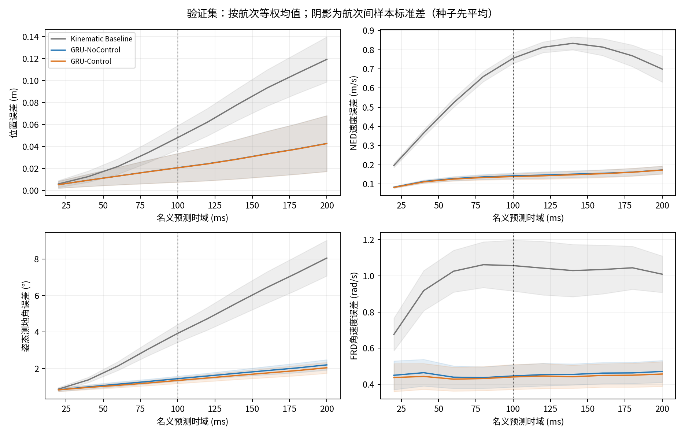
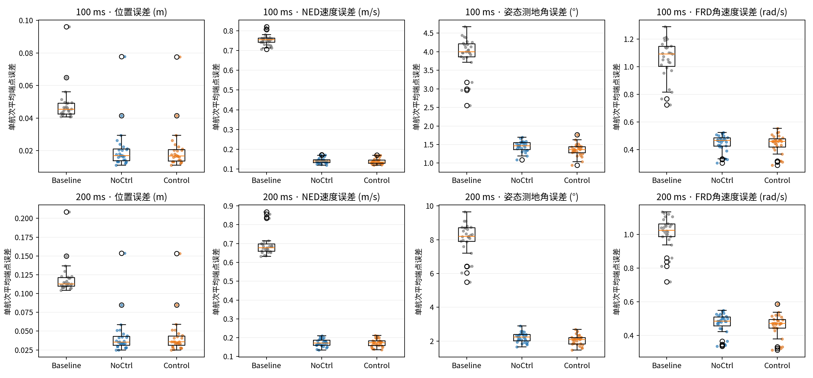
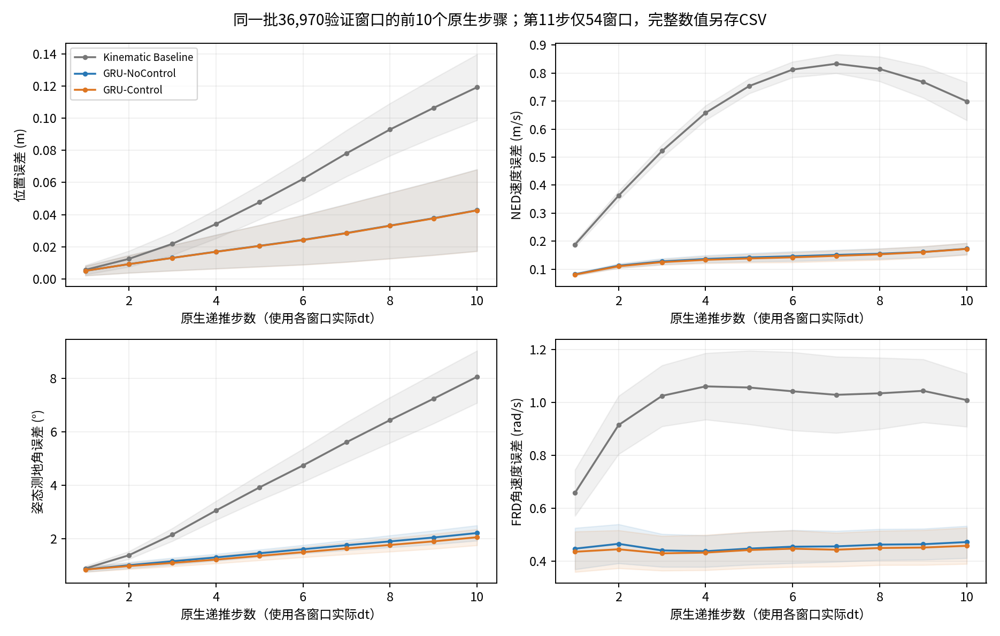
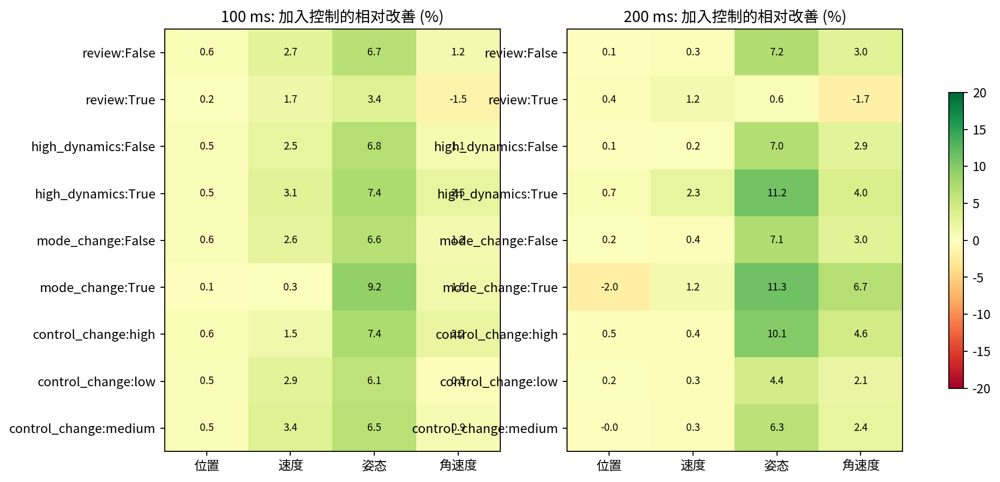
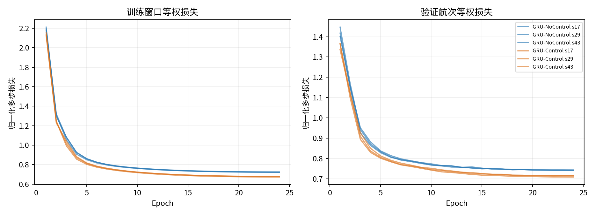
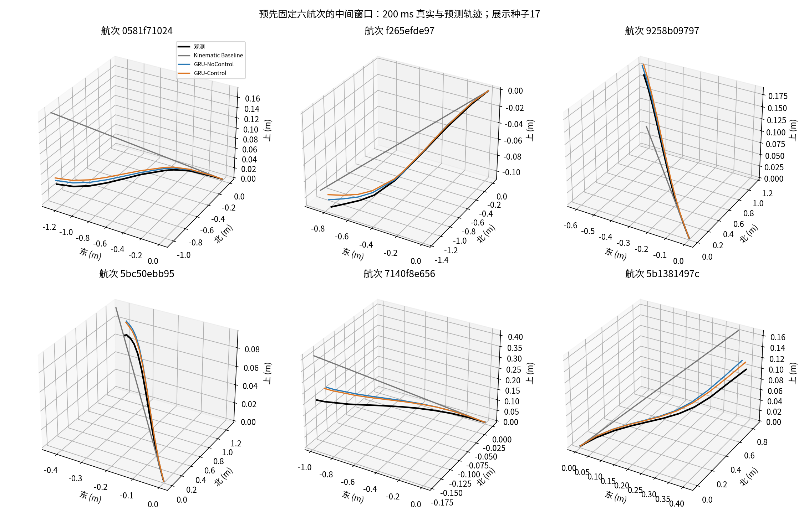
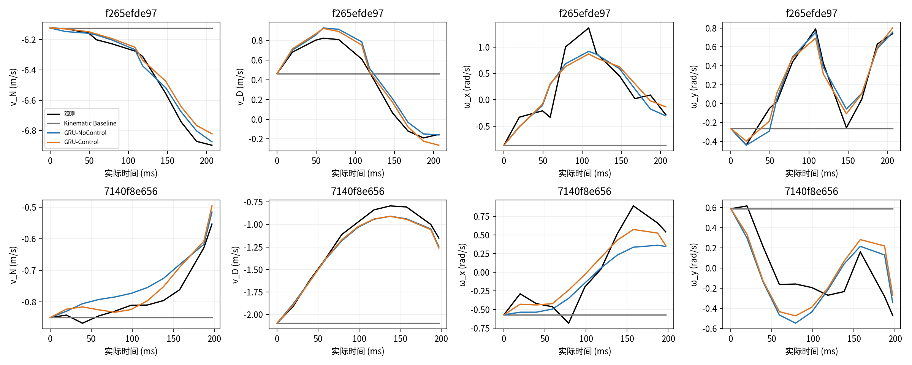

# 第一轮 Velocity & Angular-Rate Multi-Step Dynamics Learning

本报告只涉及 train/validation；测试 Parquet 未加载、未哈希、未评价。所有预测都是自主递推。

## 五个问题的回答

1. **直接预测速度、角速度明显优于恒定运动学基线。** 两种GRU在100/200ms的四项指标均大幅降低；按三种子平均后，27个验证航次全部优于基线。GRU-Control相对基线的100ms改善依次为位置57.3%、速度81.6%、姿态65.6%、角速度58.2%；200ms为64.3%、75.3%、74.6%、54.6%。这些是对日志观测的条件预测收益，并非物理真实性证明。

2. **加入控制有稳定但有限、分指标的收益。** 100ms的四项均值在三个种子中都改善，但角速度仅17/27航次改善。姿态是最一致的收益：100ms下降6.66%（26/27航次），200ms下降7.17%（27/27航次）；200ms角速度下降3.03%（23/27航次），三个种子方向一致。200ms位置仅改善0.21%、速度仅0.40%，航次bootstrap区间跨零；种子29/43这两项均略退化，不能声称控制全面稳定改善平动预测。总体归一化验证损失由NoControl的0.74268降至Control的0.71252，约4.1%。

3. **误差来源依状态分量而异。** Control的100/200ms位置误差为0.02054/0.04263m，真实未来v积分的观测残差为0.02076/0.03966m；模型轨迹与该观测积分轨迹的距离为0.00946/0.02087m。位置误差已受到观测一致性的显著影响，不能仅归责于速度预测。姿态的相应误差为1.3525°/2.0466°，观测积分残差0.7709°/0.8989°，预测姿态与观测积分姿态距离1.3433°/2.1344°，仍有明显的角速度递推改进空间。不同项存在方向抵消，不能从这些模长算独立误差占比；100ms预测位置误差还略低于观测积分残差，直接说明该残差不是严格下界。

4. **100ms在本实验中误差更小，200ms的平动控制收益更不稳定。** Control从100ms到200ms，位置约增加108%、速度24%、姿态51%、角速度3.6%；角速度及基线速度曲线存在非单调变化，不能假定所有误差都随时域单调增长。模型在不同航次上并非同等准确：200ms最大航次平均位置误差0.15344m，来自2026-09-07的log_30，其观测积分残差已达0.14973m；第二大航次log_28为0.08494m，对应残差0.08040m。控制收益在高动态/大控制变化组的姿态上更强（200ms分别约11.18%/10.12%），REVIEW组角速度反而退化约1.75%。REVIEW只有6航次、972窗口，需要保留这一边界。这是有限时域预测表现，不是渐近稳定性或闭环稳定性结论。

5. **值得进入下一轮小规模联合/解耦架构消融和专门控制响应验证，但不能宣称控制可用。** 当前结果支持继续研究GRU速度/角速度预测；下一轮应保持本轮数据划分、三个种子和评价协议，并把位置观测一致性、旋转预测、REVIEW敏感性分开检查。控制对照同时增加历史命令和未来命令，且存在少量有效容量差异，不能把增益唯一归因于未来控制或因果控制响应。后续可另设历史控制/未来命令信息消融，再在数据支持范围内检查响应方向、延迟和扰动鲁棒性。本轮不开展这些新实验，不解封测试集，不开展MPC或PX4修改，`control_ready=false`。

本轮训练预算为每模型每种子24轮，六次均跑满预算，未触发早停；最佳checkpoint在22～24轮。学习曲线趋缓，但未证明更大预算也不再改进。全部结论限于当前27个验证航次、500ms历史及100/200ms时域。

## 主要结果

下表为验证集 **端点向量误差模长 / SO(3)测地角的均值 ± 航次间样本标准差**。先在每航次内平均窗口、再平均三个种子，最后对 27 航次等权；不是逐轴RMSE，也不是将重叠窗口当独立飞行。

| 时域ms | 模型 | 位置误差 (m) | NED速度误差 (m/s) | 姿态测地角误差 (°) | FRD角速度误差 (rad/s) |
|---|---|---|---|---|---|
| 100 | Kinematic Baseline | 0.0481 ± 0.0109 | 0.7554 ± 0.0269 | 3.9318 ± 0.4874 | 1.0563 ± 0.1403 |
| 100 | GRU-NoControl | 0.0207 ± 0.0131 | 0.1423 ± 0.0149 | 1.4491 ± 0.1381 | 0.4470 ± 0.0614 |
| 100 | GRU-Control | 0.0205 ± 0.0131 | 0.1386 ± 0.0151 | 1.3525 ± 0.1673 | 0.4416 ± 0.0688 |
| 200 | Kinematic Baseline | 0.1194 ± 0.0205 | 0.6988 ± 0.0677 | 8.0518 ± 0.9769 | 1.0089 ± 0.1007 |
| 200 | GRU-NoControl | 0.0427 ± 0.0255 | 0.1732 ± 0.0203 | 2.2048 ± 0.2851 | 0.4719 ± 0.0608 |
| 200 | GRU-Control | 0.0426 ± 0.0255 | 0.1725 ± 0.0210 | 2.0466 ± 0.3012 | 0.4576 ± 0.0684 |

窗口等权与随机种子间波动分别见 `summary.csv` 的 `window_mean/window_std` 和 `seed_mean/seed_std`；原始逐航次见 `per_flight.csv`。Baseline不训练，因此只有一份结果。

### 配对比较

负的误差差值表示候选更好。区间为按航次配对bootstrap 95%区间（5000次）；同日期航次仍可能相关，不能把它当严格独立飞行试验的显著性结论。

| horizon_ms | reference | metric | 改善% | 更好航次 | 差值95%区间 |
|---|---|---|---|---|---|
| 100 | Kinematic Baseline | position_m | 57.29 | 27/27 | [-0.02840, -0.02655] |
| 100 | Kinematic Baseline | velocity_m_s | 81.65 | 27/27 | [-0.62432, -0.60911] |
| 100 | Kinematic Baseline | attitude_deg | 65.60 | 27/27 | [-2.71512, -2.41921] |
| 100 | Kinematic Baseline | rate_rad_s | 58.19 | 27/27 | [-0.65502, -0.57241] |
| 100 | GRU-NoControl | position_m | 0.55 | 22/27 | [-0.00017, -0.00006] |
| 100 | GRU-NoControl | velocity_m_s | 2.61 | 21/27 | [-0.00538, -0.00217] |
| 100 | GRU-NoControl | attitude_deg | 6.66 | 26/27 | [-0.11265, -0.07877] |
| 100 | GRU-NoControl | rate_rad_s | 1.21 | 17/27 | [-0.01001, -0.00038] |
| 200 | Kinematic Baseline | position_m | 64.28 | 27/27 | [-0.07893, -0.07421] |
| 200 | Kinematic Baseline | velocity_m_s | 75.32 | 27/27 | [-0.55036, -0.50497] |
| 200 | Kinematic Baseline | attitude_deg | 74.58 | 27/27 | [-6.27249, -5.69622] |
| 200 | Kinematic Baseline | rate_rad_s | 54.64 | 27/27 | [-0.57380, -0.52823] |
| 200 | GRU-NoControl | position_m | 0.21 | 16/27 | [-0.00028, 0.00011] |
| 200 | GRU-NoControl | velocity_m_s | 0.40 | 13/27 | [-0.00296, 0.00135] |
| 200 | GRU-NoControl | attitude_deg | 7.17 | 27/27 | [-0.18630, -0.12862] |
| 200 | GRU-NoControl | rate_rad_s | 3.03 | 23/27 | [-0.02087, -0.00749] |

## 数据、因果边界和模型

- 数据版本 `velocity_rate_multistep_v1`，组 `main_50hz`；manifest SHA256 `8afb8623bf7174e4da5b2044f644331b8b251433fed3576f6dcdab470935bcb5`。注册条目和全部 train/validation 文件哈希见 `data_audit.json`。
- 94训练航次110,863窗口，27验证航次36,970窗口；500ms历史、200ms训练预测、100ms起点步长。保留全部原生步长，历史26/27点，未来10/11步；未重采样或丢弃11步窗口。
- 100/200ms评估选最近原生目标，偏差最多12ms，不插值观测。辅助曲线点容差15ms（160ms处112个窗口超过12ms，最大12.170ms）；没有因此筛掉窗口。所有模型与时域用同一批200ms窗口；逐步原生时间和误差均已保存。
- 输入使用历史NED速度、FRD角速度、FRD到NED旋转矩阵前两列、有效相位sin/cos、频率、显式mask和实际dt。绝对NED位置不进入网络；四元数符号不进入姿态特征。
- 历史相位保持该日志原点下的有效相对相位，不声称跨日志绝对零位已标定。未来频率取起点有效历史频率并保持；相位按该频率线性推进。起点频率或相位无效时屏蔽未来相位。无效频率置零并带mask。
- 训练有效历史相位/频率覆盖率98.93%，有1,181个窗口起点无效；验证覆盖率100%，所以本轮未实证验证缺相位情况下的泛化性能。mask代码有合成变异测试，覆盖率详见mask_coverage.json。
- GRU64历史编码器 + GRUCell64递推器 + 6维线性头，采用当前v/ω的identity skip预测下一步v/ω，不训练加速度标签。位置梯形积分，姿态右乘机体系平均角速度的SO(3)指数，Hamilton wxyz每步归一化。
- 控制模型历史额外读取四路命令；每个未来状态区间内的完整ZOH事件段按顺序送入GRU16（4路命令+持续时间），并在原生状态边界预测。边界事件属于右侧区间。没有把整个区间命令均值冒充起点因果输入。事件编码是条件序列特征，并不声称区间内部状态动力学已被解析积分。
- NoControl完全不访问历史四路命令、事件内容、事件数量或控制变化标记；相同非控制输入、相同主干和相同参数初始化。为严密配对，保留相同张量形状与不活动的控制参数，其梯度不更新。
- 未来真实状态、真实相位/频率只属于监督/诊断，forward接口不接收它们；无teacher forcing。未来实际dt作为共同采样时刻条件，并非已验证在线时钟预测。
- 闭环日志中的未来控制是已记录命令；控制器可能响应未来扰动/状态，因此该对照检验控制历史与未来命令的总体预测信息，不能单独证明反事实响应、独立因果作用或控制可用性。

## 损失与训练预算

四项权重均为1；每步用平方向量模长/平方测地角除以训练集RMS尺度平方，再对每窗口有效原生步等权平均、对训练窗口等权平均。位置用相对初始位置的位移。尺度依次为 [0.08418446034193039, 0.7219823002815247, 0.09167816489934921, 1.0561769008636475]（m, m/s, rad, rad/s），来自训练窗口恒定运动学残差；输入和输出尺度也仅由训练集估计。没有强制修改EKF观测以满足积分。

AdamW，初始学习率0.001，weight decay=0.0001，24轮余弦调度，batch=1024，梯度裁剪5；每轮遍历全部训练窗口。两模型同一种子同一轮使用完全一致的随机置换。验证按航次等权的归一化多步损失选checkpoint，patience=5、min_delta=1e-4。

| model | seed | parameters | gradient_parameters | epochs | updates | best_epoch | best_validation_flight_loss | seconds | stop_reason |
|---|---|---|---|---|---|---|---|---|---|
| GRU-NoControl | 17 | 37590 | 36486 | 24 | 2616 | 22 | 0.74231 | 59.04358 | fixed_epoch_budget |
| GRU-NoControl | 29 | 37590 | 36486 | 24 | 2616 | 23 | 0.74201 | 60.09377 | fixed_epoch_budget |
| GRU-NoControl | 43 | 37590 | 36486 | 24 | 2616 | 24 | 0.74372 | 58.6752 | fixed_epoch_budget |
| GRU-Control | 17 | 37590 | 37590 | 24 | 2616 | 22 | 0.71424 | 62.37188 | fixed_epoch_budget |
| GRU-Control | 29 | 37590 | 37590 | 24 | 2616 | 23 | 0.71457 | 63.45437 | fixed_epoch_budget |
| GRU-Control | 43 | 37590 | 37590 | 24 | 2616 | 24 | 0.70874 | 62.44484 | fixed_epoch_budget |

两者均分配37,590参数。NoControl的事件GRU（1,104参数）不执行；历史控制输入列768参数及递推事件输入列3,072参数对输出无作用，因此功能上参与预测的是32,646参数，Control为37,590。`gradient_parameters`只是拥有梯度张量的参数数（仍包括零输入列），不是精确有效容量。主干宽度与预算保持一致，但不能声称有效容量完全相等。三种子全部完成，不挑选最好种子作主结果。各模型各种子的best.pt、训练日志和哈希均已保存。

训练代码提交 `f24f6d40ce6eb5f0f1feff747d499af8bf4bd51c`，起点 `10f963f8b7115e63e536fae3b3a562f768eaf277`。GPU与显存信息见 `runtime.json`、各训练summary。GPU smoke含有限梯度、自主递推、平移不变性和NoControl控制隔离；测试覆盖坐标、四元数符号、零误差梯度、mask、边界事件以及数据打包与官方loader一致性。

## 观测积分残差与归因

以下诊断从与模型完全相同的可用初态出发，使用未来真实v/ω做同一运动学积分。它包含EKF更新、异步姿态/角速度观测与离散积分误差，属于观测链一致性参照，不是传感器精度、严格预测误差下界或唯一根因。

| 时域ms | 指标 | 观测积分→观测 | Kinematic Baseline→观测积分 | GRU-NoControl→观测积分 | GRU-Control→观测积分 |
|---|---|---|---|---|---|
| 100 | position_m | 0.02076 ± 0.01305 | 0.04084 ± 0.00178 | 0.00966 ± 0.00079 | 0.00946 ± 0.00076 |
| 100 | attitude_deg | 0.77090 ± 0.08448 | 4.13599 ± 0.50215 | 1.43016 ± 0.15828 | 1.34330 ± 0.17848 |
| 200 | position_m | 0.03966 ± 0.02565 | 0.10588 ± 0.00498 | 0.02129 ± 0.00246 | 0.02087 ± 0.00257 |
| 200 | attitude_deg | 0.89885 ± 0.11661 | 8.43416 ± 1.03948 | 2.27718 ± 0.28260 | 2.13440 ± 0.30721 |

位置向量上有精确分解：预测−观测 = (预测−观测积分) + (观测积分−观测)，但两部分可抵消，模长不能直接相加或当作独立方差占比。姿态只能比较旋转距离并用三角不等式解释；没有将两类误差当作独立噪声。v/ω端点误差本身来自对日志目标的预测；积分额外影响p/R。

## 航次与工况差异

所有分组均为事后诊断，不作为模型输入或调参依据。控制变化强度是历史+未来事件四通道峰峰值的L2范数，低/中/高阈值只由训练窗口三分位数确定。高动态和REVIEW采用数据集既有全窗口标记。组内先按航次等权；各组样本数与航次数见 `group_metrics.csv`，少航次组不可过度解读。

## 图表

轨迹展示固定选六个按数据顺序均匀分布航次的中间窗口，未按模型误差挑选；展示种子17，其余种子的同窗预测也保存在trajectory_examples.npz。

## 复现与归档

独立复算见 `verification.json`：全部验证窗口基线使用NumPy/SciPy闭式积分核对；六个checkpoint各复跑182窗口（含全部54个11步窗口）；逐窗口→逐航次汇总独立复核。固定batch=2048时checkpoint指标最大差异约4.3e-6；航次汇总差异在1e-15量级。25项定向测试通过，2项原有全数据QA未启用，未触及测试Parquet。

数值复现必须保持评估batch=2048及本轮TF32设置。改变batch形状时，GPU内核的数值路径不同；所查窗口的四项指标最大变化依次约为6.96e-5m、9.09e-4m/s、0.00623°、0.00118rad/s，已记录于verification.json。所有主比较使用相同固定batch协议；不能混用不同数值设置解释极小的平动增益。

使用 `/home/zn/anaconda3/envs/flap-train-gpu/bin/python`，依次执行 `scripts/prepare_velocity_rate_learning.py`、`scripts/train_velocity_rate_learning.py --smoke-only`、`scripts/train_velocity_rate_learning.py`、`scripts/evaluate_velocity_rate_learning.py`、`scripts/report_velocity_rate_learning.py`。正式训练目录非空时拒绝覆盖；复现实验应在新的输出目录/独立checkout进行。

缓存NPZ位于被git忽略的artifacts目录，可以由注册数据重建；其哈希已归档。逐窗口端点与逐原生步误差以Parquet保存；逐航次、种子、分组、配对比较为CSV；checkpoint均随本地实验提交。原数据、历史实验和主工作区未改动。未推送。
