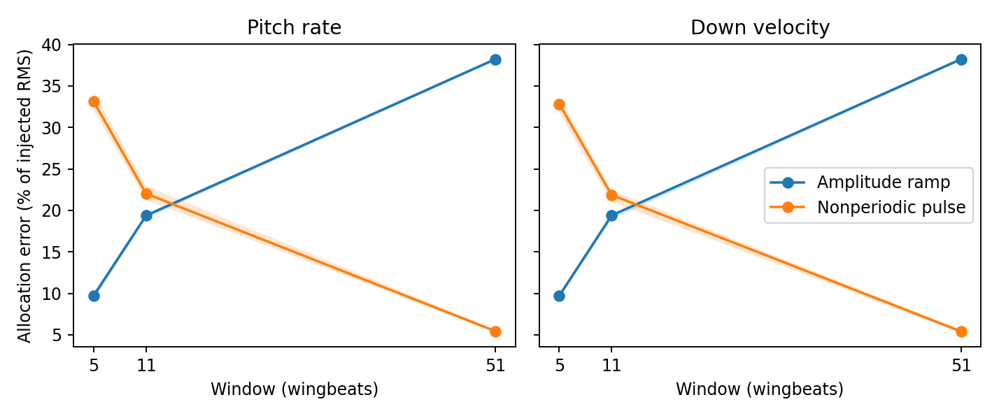

# 在实飞测量时刻注入已知波形

沿用 9832d31 已冻结的 19 个开发架次、每架一个共同物理中心及其 vD/q 原生连续段。在中心前后各 2 s 计分。被评估的离线分离器对运动是线性的，因此直接计算分离器对注入量的响应，等于对原始与叠加后信号分离再作差。每拍以原时刻的中点单元时间加权，截取计分窗后按秒归一化，各架次等权。标签约定令同步注入每拍离散均值为零。窗口覆盖目标拍两侧，结果仅描述观测分配。

三阶固定波形包含 H1、0.35 的 H2 和 0.2 的 H3；变幅探针在 0.5 s 内将幅值从 0.5 线性升到 1.5。独立非周期瞬态为 0.2 s 的紧支撑正弦平方脉冲。变频探针在实际逐拍转速变化上再调制拍内瞬时转速，保留拍边界，并将相同的已知相位提供给分离器。stride=2 在每拍保留交替原生时刻，重算观测权重与离散中心；这是采样敏感性，不能替代另一套传感器的实测。

|q 注入类型|51 拍固定系数|11 拍固定系数|5 拍固定系数|5 拍局部线性系数|
|---|---:|---:|---:|---:|
|恒幅|0.15%|0.18%|0.22%|0.24%|
|变幅|38.24%|19.38%|9.73%|9.53%|
|已知变相速|1.35%|0.84%|0.47%|0.53%|
|快速非周期脉冲|5.43%|22.02%|33.10%|33.15%|
|变幅与脉冲同时出现|37.71%|19.47%|11.37%|11.26%|

表为错误分配 RMS 除以两种注入分量 RMS 的平方和开根号。单一成分时可唯一解释泄漏方向，混合注入时两条路径可抵消。q 的 5 拍固定系数与 51 拍相比，变幅误差在 19/19 架下降，非周期脉冲泄漏在 19/19 架上升。对变幅，波形投影增益从 0.867 升至 0.979；对非周期脉冲，保留投影从 0.990 降到 0.897。稀疏一半使 5 拍局部线性法的 q 恒幅误分配从 0.24% 升到 1.09%。在本探针中，改变邻域宽度的影响远大于同窗改用线性变系数。实飞残留证据具有通道差异，不能把注入误差解释为真实标签的错误率。

与 9832d31 的 51 拍实验区别在于此处使用更短的计分窗、线性幅值爬升和单位幅度，因而 38.24% 与旧实验全窗的 21.68% 不可互换。原分支同时提供同趋势 Fourier/LSF 留出、真实工况残留随机化及长窗注入，见 [历史汇总](../history_zh.md)。所有配置与输入字段见 [run.py](run.py)，19 架的全部设置见 [per_flight.csv](per_flight.csv)；[summary.csv](summary.csv) 同时提供脉冲和波形投影增益。按 run.py、plot.py 顺序以 flap-train-gpu 解释器运行，需原历史分支 9832d31 可在相邻 worktree 读取。
