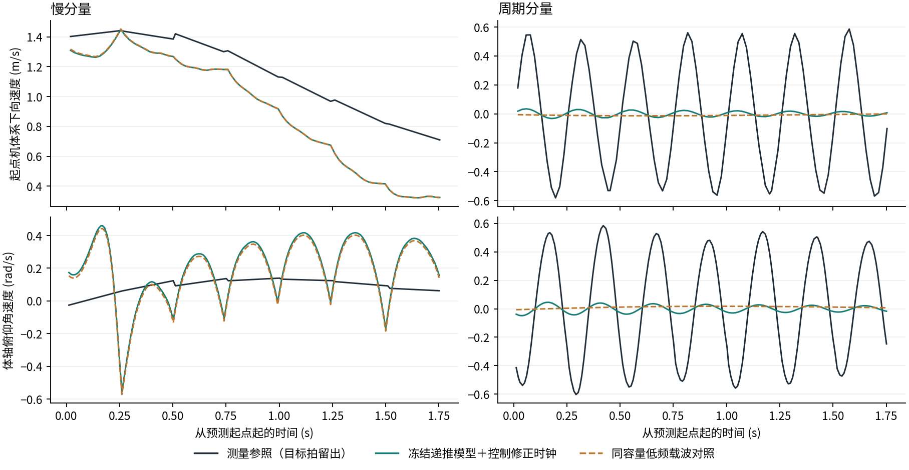
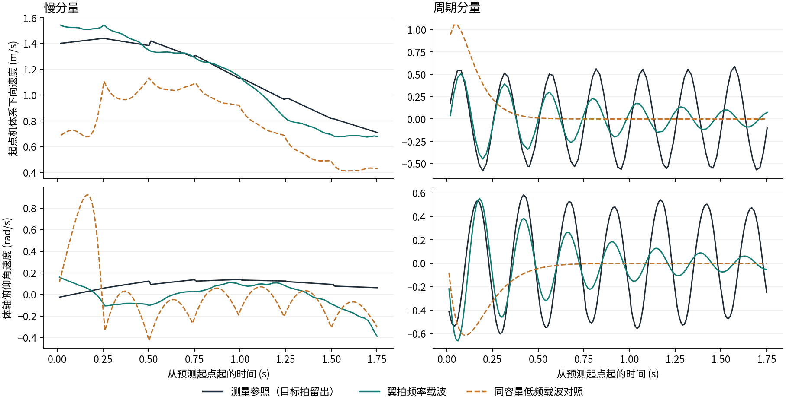

# 飞行数据中的周期与慢变分量

## 参照能识别什么

在当前 39 个完整开发架次上，每架次先按时间取最多 8 个预测起点。在未来两秒中，仅使用有足够真实观测、Hall 同步有效、同一连续状态段内的完整拍。按拍用相邻的前两拍和后两拍拟合局部线性变化及一阶正余弦，其振幅允许线性改变；整段目标拍的运动观测完全留出。然后独立检验这个模型能否重构目标拍的真实测量。未来 Hall 相位只参与离线参照与诊断。相对相位的参考零未独立标定为真实翼角。[采样与评价协议](protocol.md) · [逐架次覆盖和来源](coverage.json)

| 测量 | 验证架次 | 有效起点 | 完整拍与起点组合 | 原生观测 | 相邻拍只拟合趋势 RMSE | 相邻拍加一阶振荡 RMSE |
|---|---:|---:|---:|---:|---:|---:|
| 起点 FRD 系速度（m/s） | 27 | 172 | 919 | 12,378 | 0.4960 | 0.2725 |
| 机体 FRD 角速度（rad/s） | 38 | 199 | 997 | 25,898 | 0.7449 | 0.6255 |

速度参照的留拍重构收益为 0.2235 m/s，配对 95% 区间 [0.2067, 0.2398]，27/27 架改善。角速度参照的收益为 0.1194 rad/s，区间 [0.0948, 0.1452]，36/38 架改善。50 Hz 主采样组的原生速度约 51 Hz、角速度约 101 Hz；稀疏组的原生速度约 10 Hz，全部未达到拍内采样门槛，原生角速度约 50 Hz，仍有可分辨的周期观测。相邻和重叠窗口可能重复使用同一拍，区间按架次重新采样。[留拍测量误差](reference_scores.json)

将已知混合注入 371 组相同真实时钟、采样和测量相位。线性趋势与线性变幅正弦的两个分量均恢复至约 10⁻¹⁵ 的 RMSE。对持续 0.5 秒的平滑阶跃，参照将注入量 RMS 的 **10.9%** 分给周期项；对振幅在约 3.5 拍内变化一圈的单谐波，参照将 **8.7%** 分给慢项，周期波形仍有 **27.0%** 的相对误差。这些是参照在指定注入条件下的误差，不能用来给每条真实飞行轨迹附上同样大小的置信带。[参照源码](prepare_reference.py)

## 拍频可以外推多久

仅对起点拍频、编码器和 Hall 有效，且期间未发生相位断点或状态复位的样本，把模型实际使用的起点拍频外推量 2πf₀t 与测得的 Hall 相对起点相位变化比较。相位差取主值。下表的余弦一致度 1 表示吻合，0 对应无整体同相倾向。区间和点数随时域变化。

| 样本来自 | 0–0.5 秒一致度 / 圆周 RMS | 0.5–1 秒 | 1–2 秒 |
|---|---:|---:|---:|
| 速度观测时刻 | 0.911 / 24.8° | 0.608 / 57.2° | 0.192 / 92.3° |
| 角速度观测时刻 | 0.891 / 27.6° | 0.518 / 64.8° | 0.096 / 98.5° |

长时域的角速度样本上，平均余弦的一致度区间 [−0.069, 0.255] 包含零。由实际起点频率推演得到的时钟，对前半秒最可靠。[相位诊断与各组架次区间](phase_clock.json)

## 工程候选的分量证据

候选在仅用既有八个正式目标训练的强递推模型上冻结主干，拟合带控制修正时钟的周期读出。三组种子为 17、29、43；此处先计算各自的架次等权 RMSE 差，再对三种子取平均，共用整架次的 10,000 次重采样。慢分量检验使用同一窗口首个有效完整拍为基准，考察之后的拍均值变化；这是运动趋势诊断，持续值对照知道本窗首个有效拍的参照。周期分量与未来项干预使用窗口内全部合格完整拍。

| 工程模型的分量检验 | 速度收益 m/s，配对 95% 区间 | 角速度收益 rad/s，配对 95% 区间 |
|---|---:|---:|
| 预测独立周期参照，相对零周期 | +0.01091 [0.00688, 0.01484] | +0.04389 [0.03687, 0.05077] |
| 各拍去均值后，相对用慢支路充当周期预测 | +0.03921 [0.02927, 0.05069] | +0.06761 [0.05445, 0.08174] |
| 预测相邻拍估计的慢趋势变化，相对保持首拍值 | +1.00579 [0.73807, 1.27313] | **−0.40672 [−0.45003, −0.36240]** |
| 预测真实观测，保留未来周期项相对删除该项（起点修正相同） | +0.00578 [0.00381, 0.00783] | +0.01959 [0.01560, 0.02397] |
| 预测真实观测，原相位相对未来项翻转半周期（起点修正相同） | +0.01512 [0.01104, 0.01929] | +0.04711 [0.03849, 0.05651] |

表中每一方向在三个种子均一致。真实速度目标的周期参照 RMS 是 0.42193 m/s，模型误差仍有 0.41102 m/s，实际可解释的周期幅度有限。对于角速度，预测周期误差由 0.45380 降到 0.40990 rad/s，但慢趋势误差由持续值的 0.18062 升到 0.58734 rad/s。同一窗口首拍归零后，周期支路也优于慢支路来估计角速度缓慢变化，因为前者接近维持首拍。附加敏感性检验直接用真实测量的拍内时间平均作为慢参照，速度仍有 1.13705 m/s 收益，角速度仍退化 0.21282 rad/s。这项替代参照是在看到单种子慢角速率结果后增加的。相位修正对未来实测运动的贡献可与起点偏置分开；这不能证明真实飞机只有一个慢项和一个物理振荡源。[三种子完整结果](original_three_seed_scores.json)

示例为预选窗口 609 的机系下向速度及俯仰角速度，所有模型都使用这个窗口，统计覆盖见上表。[示例身份](original_component_example.json)

幅值也限制了解释。三个种子的工程候选周期输出 RMS 只有独立周期参照的 **13.1%–13.5%（速度）**、**15.6%–20.5%（角速度）**。它能归属一部分可预测的同步运动，但会明显低估振幅。示例中强基线的慢角速度还带有起伏，整个角速度分量并未得到良好分离。

## 从头联合训练的分量证据

三种子均在相同的 49,152 步主比较点评价。固定时域的六项飞行预测指标见整轮报告；此处所有数值来自上文的独立原生翼拍诊断。

| 独立评价，正数为收益 | 速度 m/s，配对 95% 区间 | 角速度 rad/s，配对 95% 区间 |
|---|---:|---:|
| 预测独立周期参照，相对零周期 | +0.06982 [0.05974, 0.07959] | +0.05606 [0.04397, 0.06793] |
| 预测邻拍慢趋势变化，相对停在首拍值 | +1.11488 [0.84090, 1.38517] | **−0.19680 [−0.23013, −0.16515]** |
| 预测真实观测，保留未来周期项相对删除该项 | +0.03339 [0.02822, 0.03923] | +0.02861 [0.02104, 0.03672] |
| 预测真实观测，原相位相对未来项反号 | +0.10675 [0.09306, 0.12186] | +0.09745 [0.07921, 0.11762] |

两种运动通道的周期支路都优于零周期，也优于将慢支路拿来预测去均值后的周期参照。联合训练的三种子周期分支 RMS 达到参照的 23.6%–55.2%（速度）与 28.7%–46.8%（角速度）。与工程方案相比，这个网络恢复的周期幅度较大，但预测总体误差是否改善，要用整轮报告中相同训练预算和匹配对照的正式指标判断。角速度慢趋势未通过预定检验，改用目标拍真实观测的均值做敏感性检验，收益为 −0.02839 rad/s，区间 [−0.07271, 0.01831] 跨零。单一示例不能代替跨架次结果。[三种子分量结果与完整消融](three_seed_scores.json)

另外，对冻结增强历史递推骨干并按错开时刻与原八目标混合监督拟合的校正读出，也执行了完全相同的三种子分量检验。周期参照收益分别为 +0.0379 m/s、+0.0597 rad/s。慢趋势收益为 +1.0559 m/s 与 −0.3472 rad/s，与其他两种训练方式的分项方向一致。[冻结增强骨干的分量检验](linear_vs_matched_scores.json)

评分脚本将每个原生时刻作为一条额外终点，先沿该观测流原来的四分之一秒结点递推。它在 24 个窗口、八个原时刻、两条观测流上还原正式入口。网络未来的命令来自已知实录前缀；相位、邻拍观测与目标拍状态不会回流给网络。[分量及反事实评分入口](evaluate.py) · [三种子配对](summarize_seeds.py)
