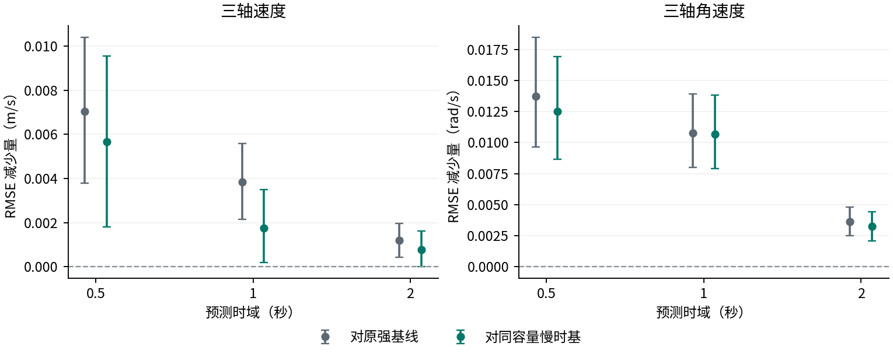
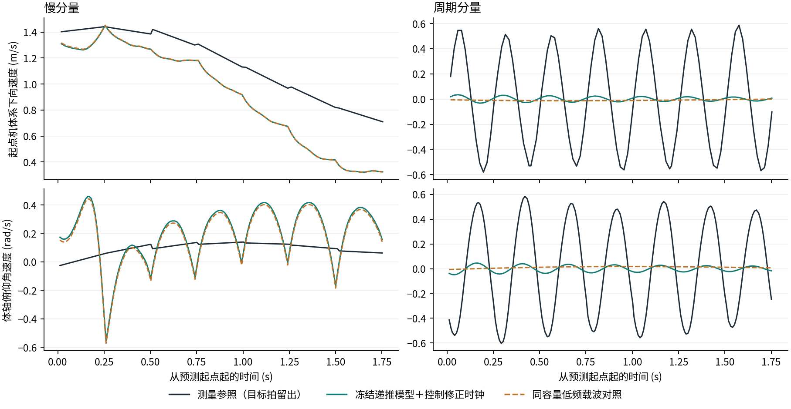

# 在扑翼预测网络中区分周期运动与慢变运动

本轮检验两个问题。显式使用扑翼周期能否改善给定实录控制的速度和角速度预测？网络给出的两个分量，能否分别对上真实飞行中可重复的拍内振荡和跨拍慢变？前者靠同容量消融归因，后者靠留出完整翼拍的独立观测检验。两种结论分别判读。

## 文献依据与实飞口径

本轮接续上一轮保留的低阶命令递推模型。OpenAlex 补检快照有 49 篇，入围四篇均取得全文。选中 NeuralProphet 的可加趋势与周期结构及其对独立分量的评价思路，按作者 MIT 实现复现核心算子。在有已知真值的五条合成序列上，只用总信号拟合，分别评价未参与拟合的 1,200 天，最差中心化趋势、季节 RMSE 分别为 0.000734 和 0.000777（归一化单位）。论文的大规模业务预测没有在此复跑。论文使用日历周期，迁移到实飞必须解决起点相位、拍频漂移、非等间隔观测及条件控制问题。检索按路线截断，覆盖记为部分。[论文原文](https://arxiv.org/abs/2111.15397) · [检索与复现记录](literature/report_zh.md) · [复现验收](../../reproductions/rep-bc7ae8dfcdef4cb6/reproduction_report.md)

三组主实验均使用相同的 121 个训练架次、39 个开发架次、半秒决策历史和随时间可得的实录命令。训练种子 17、29、43 按组配对。端点评价覆盖同一批 44,524 个开发窗；速度误差在起点机体 FRD 坐标表示，角速度为三轴机体系角速率。每架次先平均各有效窗的误差平方范数，架次等权后开方。文中的总体指标先按种子计算上述 RMSE 再对三个种子等权。95% 区间用同一组架次索引配对重采样 10,000 次。开发数据用于停止及方案研究，种子只有三个，封存集保持关闭。[研究协议](program.md)

## 网络、消融与后续修订

1. **从头联合训练。** 共同强基线保留递推慢状态和低阶命令。两个双分支模型在这个主干上，加一个从起点历史估计正余弦系数、按轴学习衰减的输出头。总增量等于慢分支增量加预测时刻的振荡减起点振荡。完整模型按起点拍频推进，匹配模型改用 0.25 Hz，所有参数、两组正交基、网络初始化、抽样、监督和停止规则相同。三组都能看到相同的过去运动谐波摘要。标准训练步数比较取 49,152 步，另外训练至最低学习率下持续平台，并独立评价各自终点。[研究配置与三组运行](studies.json)
2. **隔离时钟与优化的影响。** 起点拍频在长时域失去相干。只用训练架次的编码器转数标签拟合五个时钟系数，用起点及历史拍频、油门和截至查询时刻的油门前缀修正累计相位。39 个开发架次 1–2 秒区间的相位差余弦均值从 **0.085 升至 0.753**。评估时没有输入未来实测拍频、编码器转数或运动。[时钟估计及配对结果](clock/clock_fit.json)
3. **冻结动力学主干。** 对相同主干拟合增量读出，在每个输出轴读取相同的 47 个起点特征。三项系数分别对应慢偏移、周期余弦和周期正弦。三个消融都有 846 个可训练权重，分别使用 0.25 Hz 慢时基、保持起点拍频、随命令修正的拍频。头部使用完全相同的线性岭回归；双精度求解完整训练集的凸二次目标，不依赖早停。额外时钟的五个系数来自训练架次。在这个对照中，改变时钟不会改变主干权重、训练时长或可学习读出容量。训练中恒定的有效位居中后是零列，求解时将不可识别系数置零，三个模型使用同一处理。[读出协议](readout/protocol.md) · [权重拟合实现](readout/fit.py)
4. **分开核查监督时刻。** 原八个查询间隔为 0.25 秒，主干的数值积分依赖过去的查询节点。对 4,073 个训练窗，只改变中间积分节点、保持最终实际查询时刻不变，旧主干输出已相差 RMS **0.138 m/s、0.254 rad/s**。因此额外比较了沿原节点推进再查询拍内时刻，以及仅用原八个标签拟合读出。后一项保留原有强基线的训练和评价时间口径。原生分离诊断始终沿已经过去的原积分节点推进，核对在原八个端点能复现正式输出。[路径核查](readout/path_check.json) · [监督消融协议](readout/path_protocol.md)

## 分量参照能测到什么

目标拍的观测不参与拟合。用同一有效段内前后相邻的四个完整翼拍，按原生时间和 Hall 相位估计慢趋势、基频正余弦及变化的幅值，再预测被留出的实际目标拍。相对同样邻拍拟合的局部趋势，加入周期项使未见目标拍的重构 RMSE 在速度上减少 **0.2235 m/s**（27/27 架），角速度上减少 **0.1194 rad/s**（36/38 架）。采样支持共计速度 27 架、角速度 38 架。稀疏组的速度未达到拍内测量门槛，稀疏组较高频的角速度可单独纳入。相邻窗可能涵盖同一拍，区间按架次计算。

此参照识别传感器相位同步的一阶重复成分和局部低频趋势。用 371 组真实时钟注入已知分量，线性趋势和线性变幅谐波可恢复至数值精度；平滑瞬态约 **10.9%** 的 RMS 进入周期项，非线性变幅谐波约 **8.7%** 的 RMS 进入慢项。慢变和周期的物理来源仍有多种解释，不能从训练损失、数学可加性或单例图证明完整物理分离。[独立分量预注册](diagnostics/protocol.md) · [原生证据和泄漏量](diagnostics/report_zh.md)

## 预测精度与增益归因

工程上保留**冻结上轮低阶命令主干、仅按原八个目标拟合、用命令修正周期相位**的版本。下表是共同 49,152 步的主干和各自完整拟合的读出；三种子等权。速度为 m/s，角速度为 rad/s。

| 模型 | 0.5 秒速度 | 1 秒速度 | 2 秒速度 | 0.5 秒角速度 | 1 秒角速度 | 2 秒角速度 |
|---|---:|---:|---:|---:|---:|---:|
| 原强基线 | 0.30863 | 0.49998 | 0.99765 | 0.51592 | 0.52458 | 0.55032 |
| 同容量、0.25 Hz 慢时基 | 0.30725 | 0.49789 | 0.99723 | 0.51466 | 0.52448 | 0.54993 |
| 同容量、保持起点拍频 | 0.30208 | 0.49824 | 0.99756 | 0.50833 | 0.52240 | 0.55056 |
| **同容量、随命令修正相位** | **0.30160** | **0.49615** | **0.99645** | **0.50216** | **0.51378** | **0.54666** |

- 主指标 2 秒角速度相对强基线减少 **0.00365 rad/s**，即 **0.66%**，95% 架次配对区间 [0.00251, 0.00481]。0.5 秒减少 **2.67%**，1 秒减少 **2.06%**。2 秒速度减少 0.00120 m/s，区间 [0.00042, 0.00195]，幅度较小。
- 相对同容量慢时基，2 秒角速度减少 **0.00327 rad/s**，95% 区间 **[0.00209, 0.00445]**，32/39 个架次改善。三个种子的收益依次为 0.00195、0.00418、0.00367 rad/s。相对只保持起点拍频，减少 **0.00390 rad/s**，区间 [0.00281, 0.00503]。同样增加读出参数或单纯加入恒频正弦，都没有取得修正时钟相同的收益。
- 以各自充分平台为主干终点（49,152、49,152、50,688 步）重新评价，2 秒角速度相对强基线减少 0.00362 rad/s，区间 [0.00252, 0.00478]，相对匹配慢时基减少 0.00334 rad/s，区间 [0.00215, 0.00453]。对实际保留的 seed17 单独比较，角速度 **0.53783 → 0.53559 rad/s**，速度 **0.98749 → 0.98489 m/s**。[配对结果](readout/results.json) · [模型代码](readout/model.py) · [seed17 完整权重](readout/original_runs/incumbent17/corrected.pt)

**哪些方案失败了。** 从头联合训练时，49,152 步的 2 秒角速度 RMSE 为强基线 0.57667、实际拍频模型 0.65099、慢时基 0.56322 rad/s；训练至各自平台后分别为 0.57053、0.62653、0.56175。九个拟合均达到预定平台，终点分布在 49,152–112,128 步。固定联合训练网络的所有权重，仅替换相位时钟，平均可挽回 0.00542 rad/s，仍远落后于共同强基线。其结果说明端到端双分支参与了拟合，但不足以带来要求的预测收益。[初始九次训练与终点评价](accuracy.json)

**为何保留原八个目标。** 在新训练的三份增广主干上，同种训练网格拟合冻结读出后，修正模型比慢时基好 0.00397 rad/s；将额外原生查询的积分路径改回原节点后，两者差异几乎为零，区间 [−0.00294, 0.00284]。对上轮 seed17 在用主干，混合错开标签后的修正时钟读出为 0.54629 rad/s，改为沿原节点查询后为 0.54676，均比原来的 0.53783 差。仅按原八个目标拟合才得到上表的净收益。本轮观察到训练标签日程和主干表示相互影响，积分路径差异不足以单独解释退化。开发集反复参与设计，三种子重复验证描述了这一协议下的稳定性。[不同主干、监督与积分路径的全部消融](readout/results.json)

## 网络能分离哪些运动

工程候选在同一批完整目标拍上的结果如下。周期列比较零周期和网络预测，慢趋势列比较保持首拍均值和网络预测跨拍变化。参照、窗、数据质量门槛及对照都在看模型结果前登记。

| 运动量 | 周期参照 RMSE，零项 → 周期分支 | 慢趋势 RMSE，持续值 → 慢分支 | 判断 |
|---|---:|---:|---|
| 速度，27 架 | 0.42193 → **0.41102 m/s** | 1.65358 → **0.64779 m/s** | 两项及分支互换检查均通过，支持分离一部分拍内周期速度和跨拍慢变速度 |
| 角速度，38 架 | 0.45380 → **0.40990 rad/s** | 0.18062 → **0.58734 rad/s** | 周期角速度可预测，慢角速度明显劣于保持首拍均值，该通道的双分量解释未通过 |

在保持慢分支和起点周期偏移完全相同时，只删除未来周期项，真实采样点上的速度 RMSE 增加 **0.00578 m/s** [0.00381, 0.00783]，角速度增加 **0.01959 rad/s** [0.01560, 0.02397]。这排除了全部收益只来自起点去偏的解释。另一方面，工程模型实际输出的周期 RMS 只达到独立参照的约 **13%（速度）和 16%–21%（角速度）**。可辨认同步成分的方向和时序，不代表恢复了全部振幅。用测量拍均值替代慢趋势参照，慢角速率依然失败。[工程模型分量与干预结果](diagnostics/original_three_seed_scores.json) · [固定案例图](diagnostics/original_component_example.png)

另外对最初的从头网络做了历史输入干预。在相同窗输入已知等 RMS 的相位正弦或慢斜坡，保持起点、命令不变，重算全部历史摘要。相对同容量慢时基，真实载波使下向速度和俯仰角速度的周期输出对正弦的相对选择性分别额外提高 36.2 和 44.1 个百分点，但慢支路也更响应正弦，未表现出对慢斜坡的专属性。这个干预针对从头训练的模型；工程候选的判断来自上表列出的独立翼拍测量和未来周期项干预。[历史干预报告](interventions/report_zh.md)

## 工作流与交接

文献终排时，N-BEATS 作者仓库的非商业许可不符合本轮开放许可门槛，但 CLI 缺少“代码可见且有明确限制许可”的独立状态；已在证据中写出实际许可。两个 PDF 的题名因拆词未能自动绑定，四份原文均已人工核实。实验方面，单看九个端到端 study 的保留状态会漏掉后续冻结读出。跨轮记录因此直接引用完整配对结果、权重、独立翼拍检验及适应性选择的边界。

后续检索留下两个问题：怎样在相位不确定时估计可预测的振荡幅值，以及怎样预测跨拍角速度变化并超过保持当前拍均值的简单方法。本轮到此结案。[跨轮交接](../../memory/cycles/cycle-712cdd2529039272.json)
