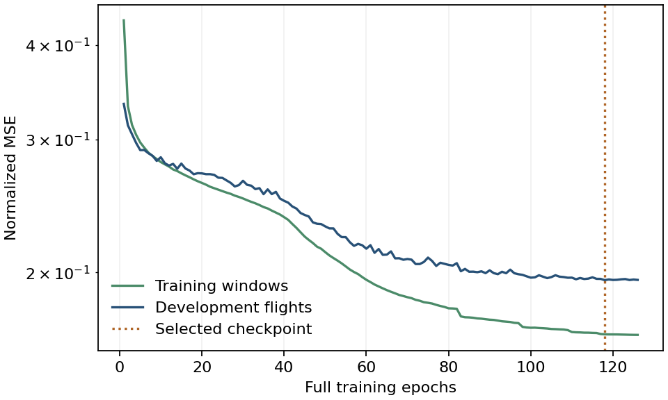

# 受控连续潜状态基线与高阶相位模块移植

在原 121 个训练架次、39 个开发架次和八个原生评价时刻上，从零训练了一种受控 Neural ODE。给这套独立的连续动力学模型加上从原递推网络训练出的高阶输运模块，冻结双方全部权重，0.5 秒和 1 秒角速度在 39 个架次全部改善。两秒端点的配对区间跨零。

| 增量预测 RMSE | 0.5 秒速度 | 1 秒速度 | 2 秒速度 | 0.5 秒角速率 | 1 秒角速率 | 2 秒角速率 |
|---|---:|---:|---:|---:|---:|---:|
| 受控连续潜状态基线 | 0.344063 | 0.539893 | 1.091499 | 0.542322 | 0.575744 | 0.631130 |
| 同权重 + 已训练的二三阶条件相位输运 | 0.343698 | 0.539836 | 1.091496 | 0.511465 | 0.563282 | 0.630983 |

速度单位 m/s，角速度单位 rad/s。按架次等权后开方。0.5 秒角速度的改善为 0.030856 rad/s，39 架次配对描述性 95% 区间 [0.027204, 0.034579]，相对改善 5.69%。1 秒改善 0.012462 [0.010750, 0.014218]，相对改善 2.16%。固定移植头参数，改用打乱条件标签拟合的圆矩，分别损失 0.005307 [0.004359, 0.006327] 和 0.001888 [0.001283, 0.002499] rad/s。两秒角速度改善 0.000147 [−0.000084, 0.000375]。角速度短时正收益能从原递推预测器转到这里使用的连续动力学。原递推模型自身的绝对误差更低；本项证据覆盖这一种独立的结构化基线与 seed 17。[统一移植评价](../transfer/ode_result.json)

## 建模及数值积分

历史编码器读入决策时刻可得的半秒运动历史、命令、编码器及有效位等 180 维信息，以及此前已用的 14 维拍内运动摘要，生成两个各 24 维的初始潜态和命令编码的条件参数。记这两个状态为 z、y，历史条件为 h，记录的四通道命令为 u(t)。模型学习的向量场具有如下结构。

```text
dz/dt = −Λz z + Fz(h,u)
dy/dt = −Λy y + Fy(h,u,z)
output(t) = R(z(t), y(t)) − R(z(0), y(0))
```

Fz 包含对历史条件调制的命令投影和 tanh，Fy 还包括对当前 z 与命令特征的联合非线性变换。Λz、Λy 为训练学习的全局正对角速率（0.08–3 s⁻¹），推理时固定；z 可以影响 y，y 不反馈给 z。R 包含线性与非线性读出。这个本地实现属于有结构约束的 Neural ODE，架构和成绩不能代表任意向量场或 Chen 等原文基准。

每窗展平实录控制段，合并相邻且命令完全相同的片段，将实际控制跳变和原八个时刻的速度/角速度查询取并集。真实时间按输入微秒时基对齐。每段的第一组状态可解析推进，使用它在区间中点的精确状态计算第二组神经场的驱动，再用含对角恢复项的指数中点更新。零阶保持控制只在其实际生效区间内积分。每窗中位数 113 段，开发集最大 118 段。速度增量为起点机体 FRD，角速度增量为机体系。模型没有读取未来运动状态或实测未来拍频。

## 训练与复核

在 GPU0、指定训练环境上用 seed 17 从头训练，40,584 个参数。每个 epoch 包含全部 126,237 个训练窗，最后不足一批的补位不计入损失。126 个 epoch 共 31,122 次 AdamW 更新。第 118 轮开发标准化 MSE 最小，为 0.195415；学习率降到 0.0000625 后达到预登记平台才停止。参数相对初始化的 L2 变化为 34.485。三个目标时域使用同一 checkpoint 的完整八个查询导出。39 个开发架次共 44,524 个窗口，训练与验证飞行无交集。[训练方案](protocol.md) · [完整训练曲线](curve.json) · [拟合统计及逐时域指标](results.json)



从每个开发架次取四个窗，共 156 窗。相同批构型下，重载选中权重后的预测与存档逐项完全相同。人为修改第四个输出时刻之后的命令，前四个输出变化为零。每个实际区间再等分两次，在全 FP32 下比较数值解，两者的速度差三维 RMSE 为 0.000759 m/s、角速率差为 0.000943 rad/s。训练和原导出使用 PyTorch 的 high 单精度矩阵乘模式；从成批预测改成 156 窗小批时，实测个别输出绝对差最大为 0.001993，复查精确值时可直接读取固定导出。[数值与因果性复核](verification.json)

[模型](model.py) · [训练和导出入口](train.py) · [裸模型逐架次结果](flight_mse.csv) · [最优权重](best.pt) · [终点权重](terminal.pt) · [八时刻逐窗预测](predictions.npz)
