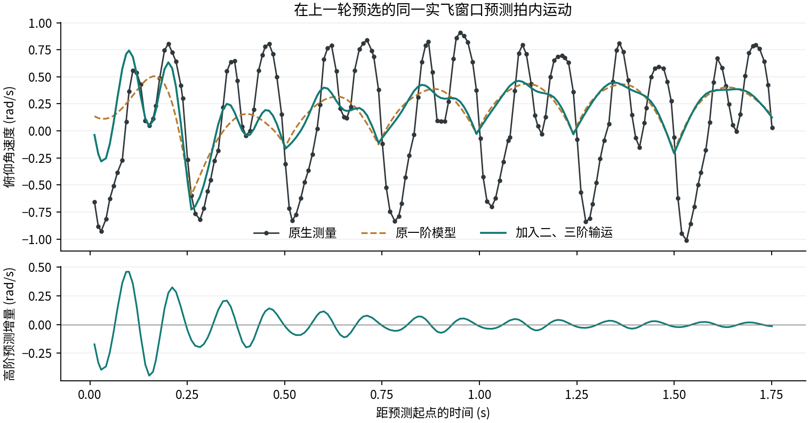

# 相位和拍频在哪个模块里最有用

值得保留的功能是**用预测相位推进过去半秒里实际观测到的二、三阶拍形**。扑翼在一个周期内可以有多次起伏。一阶模型追踪基频，仍会错过拍内第二、第三个起伏。此次在相同飞行和训练预算下，对每一阶分别错置相位并重训；恢复任一阶都能改善短时三轴角速度。到 2 秒，这个高阶信号的净贡献消失。相位对预测的价值取决于它用在哪里、预报多远。[两轮高阶输运](waveform/coherence/report_zh.md) · [独立分阶消融](waveform/order_ablation/report_zh.md)

## 模块做了什么

1. 决策时，用同一段 0.5 秒历史的 26 个时刻，按相对编码器角拟合线性慢趋势及前三阶正余弦，留下二、三阶的系数。速度历史只在采样足够密的架次使用。原主干继续负责较慢动力学，一阶周期支路继续负责基频；高阶支路输出可以独立清零或错相。
2. 未来角度由起点拍频、近期拍频和截至查询时刻的实录命令预测。在训练架次上，分别拟合二、三阶相位误差复向量的条件均值。它的方向校正相位偏差，长度反映相似工况下该阶还剩多少相干性。模型前向不读取未来编码器。用一个复矩同时校正角度和幅度，对这两个作用的进一步拆分仍然开放。
3. 以预测的二倍角、三倍角去查询历史波形，分别用于机体三轴速度和角速度的增量预测。短时采样能否解释实际运动，以真实翼拍观测评估。高阶头有 72 个运动读出系数，另外有训练集估计的时钟参数。模型可加载已拟合权重，加到接受同一时刻、坐标系和命令条件的预测器上。[推理接口与调用方式](waveform/coherence/report_zh.md) · [源码](waveform/coherence/inference.py)

## 对当前强递推模型的增益

使用 velocity_rate_multistep_v1，同批 121 个训练架次、39 个开发架次（44,524 个开发窗），种子 17、29、43。每架次先对有效窗的三轴平方误差求均值，各架次等权后开方，最后对三个主干的 RMSE 等权。下表比较相同旧主干上的两个不同读出功能和它们直接相加的实际预测。单项与组合在各查询时间使用同一组权重。指标为角速度 RMSE，单位 rad/s。[固定组合协议](combined/protocol.md) · [全六项分数、三种子及配对区间](combined/results.json)

| 模型 | 0.5 秒 | 1 秒 | 2 秒 |
|---|---:|---:|---:|
| 上轮保留模型，已有一阶命令修正时钟 | 0.502163 | 0.513783 | 0.546665 |
| 只增加一阶工况偏角校准 | 0.502126 | 0.512808 | 0.546169 |
| 只增加二、三阶波形输运 | 0.481826 | 0.504281 | 0.546667 |
| 两个功能组合 | **0.481671** | **0.503321** | **0.546168** |
| 组合相对上轮改善 | **4.08%** | **2.04%** | **0.09%** |

组合在三处的整架次配对改善量分别为 0.020492 [0.015840, 0.025252]、0.010462 [0.008623, 0.012458] 和 0.000497 [0.000237, 0.000757] rad/s，分别为 38、39、28 个架次同向。保持一阶校准后，高阶分支对 0.5 秒和 1 秒的边际贡献为 0.020454 和 0.009486 rad/s；2 秒的边际贡献为 0.000001，区间跨零。保持高阶项后，两秒的一阶校准贡献为 0.000499 [0.000306, 0.000707] rad/s。短时改善主要来自波形，长时的小幅改善来自更准确的一阶钟。速度在 0.5 秒由 0.301600 降至 0.300178 m/s；1 秒 0.496145→0.496160，2 秒 0.996454→0.996548 m/s，后两项区间都跨零。[逐架次四臂测量](combined/flight_mse.csv) · [组合预测实现](combined/predictor.py)

## 能把改善归给哪一项

- **过去的起点，还是未来的波形。** 第一轮只对起点做校正，或用保持相同容量的 3.8 Hz 时钟，0.5 秒角速度分别为 0.502986 和 0.503410 rad/s。按预测相位推进降至 0.486522。保留该组权重，仅把未来高阶关闭或错相，误差分别回到 0.503334 和 0.522343。第一轮在 2 秒退化到 0.547599，由此开启了第二轮的相干性校准和移除长期起点偏移。[第一轮与冻结权重干预](waveform/report_zh.md)
- **每一阶是否独立有用。** 第二轮固定全部历史、72 个读出参数和正确的工况圆矩，只分别改变二、三阶推进相位。四臂各自完整重训。0.5 秒的结果是两阶均错相 0.502177，只对齐二阶 0.495733，只对齐三阶 0.488306，两阶均对齐 0.481826 rad/s。另一阶已对齐时，二阶与三阶各自带来 0.006480 [0.003785, 0.009435] 和 0.013907 [0.010319, 0.018077] rad/s 的额外改善。三种子在两项比较上均同向。[逐阶重训及反例](waveform/order_ablation/report_zh.md)
- **真实拍内运动能否看到同一效应。** 0–0.5 秒内的 193 个预选完整拍窗覆盖 35 个架次。相对原一阶模型，高阶头使原生角速度测量误差从 0.84437 降至 0.77577 rad/s（8.12%），去掉局部慢趋势和一阶后，误差在二三阶频带的投影从 0.38014 降至 0.24468 rad/s（35.63%）。后者只描述该频带，飞机全部角速度的改善取前者。恢复二阶或三阶分别改善整拍角速度 0.05647 和 0.01607 rad/s，均 35/35 架同向。入选测量与训练分开，诊断使用的目标拍相位只参与评价。这支持特定同步运动的预测，不足以确立独立气动成因或证明慢角速率支路已完成物理分离。[原生翼拍统计](waveform/coherence/results.json)
- **工况校准是否只是多加了权重。** 以相同 72 系数重训后的仅时长、工况错配、正确工况三臂，在 0.5 秒分别为 0.485501、0.486098、0.481826 rad/s。保持正确工况头的权重再换错配圆矩，得到 0.486365。开发编码器对同一短时域的二阶和三阶时钟误差也同时变小。[独立编码器误差](waveform/coherence/clock_summary.json) · [配对曲线](waveform/coherence/paired_angular_rate.png)

图中飞行与窗口沿用上轮预先选定的案例，seed 17，显示机体俯仰角速度在原生观测时刻的预测。高阶修正随时域衰减，长时真实转动仍有明显未预测的起伏。表中的定量结论取全部合格架次。

## 换到两种动力学主干

将相同的 seed17 高阶头直接用于两个独立训练的动力学模型，全部权重冻结。TCN 的 0.5 秒角速度由 0.53038 降至 0.51024 rad/s（3.80%），1 秒改善 1.53%。本地实现的受控 Neural ODE 由 0.54232 降至 0.51147 rad/s（5.69%），1 秒改善 2.16%。两种主干在 0.5 和 1 秒的架次配对区间均排除零，2 秒均跨零。TCN 已续训到第 108 个 epoch 的平台，ODE 从零训练至第 126 个 epoch 的平台。同种子完整工程模型在三个角速率端点也都优于两个裸基线；整套模型间的差值包含原主干性能，只在各自模型内加头前后的差可以归到这里的高阶读出。[跨主干实测、训练预算与限制](transfer/report_zh.md) · [同一高阶头的跨主干效果图](transfer/backbone_gain.png)

## 哪些思路没有过机制检验

- 显式估计起点慢状态可轻微改善两秒角速度，但实测相位比同容量 3.8 Hz 锚只好 0.000007 rad/s，区间跨零。独立跨拍慢角速率变化仍明显输给诊断用首拍均值持续值。此结果支持通用慢锚，未给出实测相位特有的贡献。[起点锚消融](onset/report_zh.md)
- 将过去四个延迟点从固定时间改为按实测角寻址，2 秒角速度 0.546773→0.546713 rad/s，对应区间跨零，同时略逊于按起点频率近似的 0.546663。一组普通的逐时域非线性残差读出也能改进速度（两秒 0.996454→0.988006 m/s），实际相位寻址没有额外改善它。独立直接非线性输入输出模型在两秒为 1.52553 m/s、0.74917 rad/s。不同模型家族的排名和同容量消融承担不同的证据作用。[三种时钟及 NARX 逐种子结果](delay/results.json)
- 一阶时钟的平均偏角有独立匹配消融支持；只令一阶圆矩模长随工况改变的两秒收益区间跨零。高阶头对工况圆矩的支持不应追溯为一阶幅值门控证据。[一阶偏角与模长的四臂实验](coherence/report_zh.md)

## 研究记录

文献从既有交接 cycle-712cdd2529039272 出发。OpenAlex 本轮返回日额度限制，经 DataCite 定向取回 3 篇，终排核对了其中 2 篇公开全文和作者代码。广义 Lomb–Scargle 的加权最小二乘结果与作者实现一致，圆周矩核心协议得到 VERIFIED_CORE。它们提供可复用的数学构件；本轮实飞模块的证据来自上述飞行对照。[检索与复现](literature/report_zh.md) · [Lomb–Scargle 原文](https://arxiv.org/abs/0901.2573) · [圆周滤波原文](https://arxiv.org/abs/1501.05151)

Research Autopilot 已在 study-8f661e351889 登记延迟负结果，study-2f284331bd9c / exp-ef5033f8f5a9 登记并从头重拟合高阶“正确工况 vs 同容量错配”的关键对照，逐架次 MSE 与独立原程序相差小于 2.1×10⁻⁹。两个工程问题会影响日后续跑。首先，CLI 的 start 接受 research/ 下的可编辑文件，到 plan 才报告整个目录受保护，为此保留首次基线、迁移一个实现文件后重建了相同协议。其次，一份已取得的 PDF 因题名拆词未能自动绑定，经原文及作者页人工核实。两者均已在本轮处理。

## 论文主张的边界

这批实飞支持这样的叙述：过去一个到两个翼拍中的非正弦运动，含有约半秒至一秒仍可预测的分量；按各阶相位推进、并按该阶转角误差校准，能让不同主干更准确地预测机体角速度。证据包括独立编码器标签、同容量错相重训、原生翼拍的频带误差和冻结跨主干移植。主要收益发生在角速度。开发集已用于设计、停止与选型，所给的 95% 区间是在这 39 个架次上的描述性配对区间，多个开发对照未经独立测试确认。当前不能据此推断气动力来源、跨机型泛化、闭环改善或发表档次。

本轮入口为 `research-autopilot cycle context --id cycle-c319daa12af65c99`。实验源代码在本地独立分支 `research/phase-module-evidence-20261125`；主项目 research/rounds 下有同轮材料供后续检索。[组合模型的输入与复跑方式](combined/README.md)
