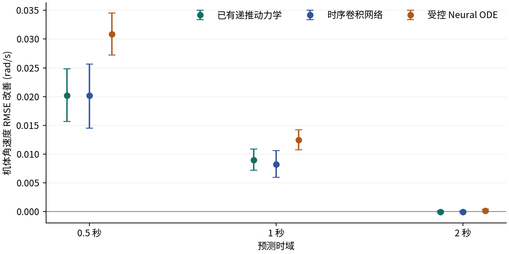

# 换一个动力学主干，高阶读出还能工作吗

把原有递推模型 seed 17 上已经学好的历史波形读出直接接到两个其他模型。训练不再更新时钟、高阶系数或目标主干。所有评价先核对窗口 ID、flight_id 和八个原生观测时刻，再在相同 39 个开发架次、44,524 窗上计算三轴性能。融入目标模型的信息仅是起点前的历史、起点拍频及截至查询的实录命令。两个目标模型在普通输入中也能看到过去的相位或频率。[预先登记的比较](protocol.md) · [六项指标、逐架次配对区间](backbone_comparison.json)

| 主干（seed 17） | 0.5 秒角速度，原 → 加头 | 改善 | 1 秒角速度，原 → 加头 | 改善 | 2 秒角速度，原 → 加头 |
|---|---:|---:|---:|---:|---:|
| 训练高阶头所用的原一阶递推模型 | 0.49494 → 0.47474 | 4.08% | 0.50414 → 0.49517 | 1.78% | 0.53559 → 0.53564 |
| 通用 TCN，时序卷积 | 0.53038 → 0.51024 | 3.80% | 0.53385 → 0.52566 | 1.53% | 0.56061 → 0.56066 |
| 受控 Neural ODE，本地结构化实现 | 0.54232 → 0.51147 | 5.69% | 0.57574 → 0.56328 | 2.16% | 0.63113 → 0.63098 |

单位均为 rad/s。对 TCN，0.5 秒的整架次配对改善为 0.02015 [0.01449, 0.02562] rad/s，33/39 架改善；1 秒为 0.00819 [0.00592, 0.01060]，37/39 架。对 Neural ODE，这两处为 0.03086 [0.02720, 0.03458] 和 0.01246 [0.01075, 0.01422]，均 39/39 架。固定第二轮波形系数只错置圆矩校准的训练对应关系，0.5 秒 TCN 与 Neural ODE 分别多损失 0.00490 和 0.00531 rad/s。早期收益在充分训练的模型上保持，2 秒的两个目标主干中均无区间排除零的高阶增益。速度各时域增益较小，0.5 秒分别约 0.20%、0.11%。[TCN 错相与冻结头干预](tcn_result.json) · [Neural ODE 错相与冻结头干预](ode_result.json)

TCN 从同数据、多任务训练的旧 seed17 权重继续以原八目标训练 108 个全 epoch（13,392 次额外更新），按事前规则在最低学习率进入平台，主比较用开发损失最低的第 100 个 epoch。旧 TCN 在 2 秒角速度为 0.69242，完成同协议续训后达到 0.56061；拿旧权重做唯一比较会大幅高估优势。Neural ODE 从零训练 126 个全 epoch、31,122 次更新，第 118 个 epoch 开发损失最低。初始编码与受控连续潜状态的两层三角耦合、真实控制跳变分段、解析衰减与二阶中点积分的数值方法详见协议。研究覆盖这两个充分训练的具体实现，两者训练过程、时间表示和容量均有差别。归因应取同一主干加头前后的配对差。[TCN 训练协议](../external_baselines/protocol.md) · [TCN 停止记录](../external_baselines/stop.json) · [Neural ODE 结构与训练](../ode_baseline/protocol.md) · [Neural ODE 数值核查和停止记录](../ode_baseline/results.json)

本试验固定了与 H4 训练对应的主干种子，跨架构复验只有 seed 17，使用的仍是同一批开发飞行。它检验读出的跨架构可用性；跨架次来源、跨机型、闭环控制和封存测试的泛化仍待独立数据判断。
