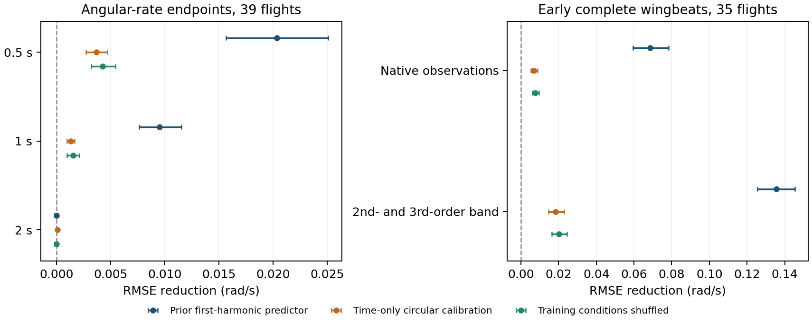

# 高阶波形的条件相位校准

第一轮在相同开发集看到了高阶波形的短时收益与两秒退化。第二轮保留原预测的一阶相位、慢状态和主干，去掉新增高阶头持续的起点偏移，分别按训练集编码器误差直接估计二、三阶残差的复均值。它们同时修正传播方向与幅值。已用三份主干全量拟合新读出并与同结构各控制比较。

| 39 个开发架次、三种子平均 | 0.5 秒角速率 | 1 秒角速率 | 2 秒角速率 | 2 秒速度 |
|---|---:|---:|---:|---:|
| 上轮一阶动力学 | 0.502163 | 0.513783 | 0.546665 | 0.996454 |
| 第一轮，高阶按修正时钟推进 | 0.486522 | 0.506202 | 0.547599 | 0.996386 |
| 第一轮，1.125–1.8 秒间平滑回到一阶 | 0.486522 | 0.506202 | 0.546665 | 0.996454 |
| 第二轮，无圆矩校准 | 0.485768 | 0.505534 | 0.546989 | 0.996477 |
| 第二轮，时长圆矩 | 0.485501 | 0.505586 | 0.546742 | 0.996459 |
| 第二轮，同容量错配条件圆矩 | 0.486098 | 0.505816 | 0.546668 | 0.996451 |
| 第二轮，真实条件圆矩 | **0.481826** | **0.504281** | 0.546667 | 0.996452 |
| 同上一行权重，推理时改用错配圆矩 | 0.486365 | 0.505780 | 0.546695 | 0.996450 |

角速率为 rad/s，速度为 m/s。真实条件圆矩在 0.5 秒和 1 秒相对原一阶预测分别改善 **4.05% 和 1.85%**，39 架次配对描述区间分别为 [0.015670, 0.025095] 和 [0.007646, 0.011522] rad/s。前者改善 37/39 架，后者为 39/39 架。真实条件比只用时长额外改善 0.003675 [0.002723, 0.004718] 和 0.001305 [0.000973, 0.001655]；比等容量错配条件额外改善 0.004272 [0.003225, 0.005435] 和 0.001535 [0.000979, 0.002122] rad/s。固定新头权重只替换条件也使两个时域恶化。两种新圆矩均用原训练架次经过连续性检查的编码器标签估计，预测只读因果工况。

正好两秒，第二轮追回第一轮角速率损失 0.000932 [0.000535, 0.001267] rad/s；相对原一阶模型的改善为 −0.000002 [−0.000186, 0.000186] rad/s，19/39 架改善。未达到相对原模型无净退化的严格数值门槛，区间也不能建立统计等效。若任务要求两秒端点严格保持已部署预测，经本轮推理验证，表中第一轮的平滑回退模式在全部八个查询中保留前段，在两秒的全部窗精确回到旧模型。该模式的时域由观察过开发结果后选定。

速度的效应比角速率小。在 0.5、1、2 秒，真实条件与旧一阶模型的 RMSE 分别为 0.301282 对 0.301600、0.496019 对 0.496145、0.996452 对 0.996454 m/s。0.5 秒改善区间 [0.000164, 0.000483]，1 秒 [0.000061, 0.000197]，2 秒 [−0.000008, 0.000013] m/s。



## 哪部分运动能证实

选择与上一轮相同的原生完整目标拍，在每拍投影实际测量误差，先剔除线性时间趋势和一阶谐波，再计算其二、三阶子空间内的均方根。该评价目标使用真实采样时刻与目标拍，未来编码器相位只用于评分。0–0.5 秒原生角速度在 35 架次从 0.84437 降至 **0.77577 rad/s**，平均改善 8.12%，区间 [0.05942, 0.07827] rad/s；该高阶频带的角速度误差从 0.38014 降至 **0.24468 rad/s**，改善 35.63%，区间 [0.12542, 0.14531] rad/s，全部 35 架同向。同期速度在 27 架由 0.58944 降至 0.58830 m/s，高阶误差由 0.06078 降至 0.04146 m/s。1–2 秒原生整拍的角速率从 0.83132 降至 0.82467 rad/s，37 架中 34 架改善。该时段的均值含较早时刻，其支持不同于精确两秒端点。

在 121 个训练架次上用 505,616 个合格编码器时刻拟合圆矩，每个谐波次数各用自己的训练目标。开发集 0–0.5 秒，条件二阶/三阶的复平面均方误差分别为 0.1233/0.2642，只用时间为 0.1990/0.3882，均优于时长和错配工况。1–2 秒，条件二、三阶预测圆矩的模长均值分别降为 0.392 和 0.193。二阶相对时间控制的误差改善为 0.0268 [0.0159, 0.0366]，三阶相应为 0.0088 [−0.0035, 0.0203]。短时两种阶数各自的时钟校准可单独评价。这一步联合训练了二、三阶。后续在同一架次和相同参数量下分别错置二阶或三阶的相位，测得两者各有独立的短时收益。条件圆矩同时改变模长和方向，本轮保留这两者的联合解释。[分阶消融](../order_ablation/report_zh.md)

## 可移植接口

独立接口 HarmonicTransport 接收历史系数、每个输出流的实际查询时间、原预测主干外部提供的因果拍频时钟和四个因果工况特征，直接返回应加到基础预测上的速度与角速度增量。它不依赖基础预测网络的隐状态。系数的最后两维为谐波次数（2、3）与正余弦系数；速度为分量 0、角速率为分量 1。历史波形按上一轮 experiment.py 的 extract(history26, main_mask) 计算。低采样率速度及其他不合格历史的相应系数置零。θ 是相对决策原点的未来一阶预测角（弧度），不能直接把真实未来编码器位置当作输入。四个条件为起点频率减 3.8 Hz、起点油门减 0.5、起点与近半秒均值的频率差，以及截至查询时刻的指数加权油门与起点之差。

```python
from inference import HarmonicTransport, causal_conditions

head = HarmonicTransport.from_files(seed=17, device="cuda:0")
conditions = causal_conditions(history194, pooled_commands, origin_command, query_seconds)
delta = head(history_coefficients, query_seconds, predicted_phase_radians, conditions)
prediction = base_prediction + delta
```

三个种子各取 128 个真实开发窗、2,048 个分流查询，将以上接口的预测与完整离线程序逐项比较，最大差 2.39×10⁻⁷。零时刻或不可用历史的增量均严格为零；只查前四个时刻，或修改后四个时刻的命令与相位，前四个增量差均严格为零。移植到不同主干时，使用哪个种子的权重及该主干的基线须一并报告。全部实飞结果仍属于被反复用于设计的开发架次。

[事前协议](protocol.md) · [完整实飞结果](results.json) · [高阶编码器评价](clock_summary.json) · [可独立调用的增量头](inference.py) · [推理一致性与前缀检查](inference_checks.json) · [训练及评估代码](run.py) · [第一轮对照与失败边界](../report_zh.md)
